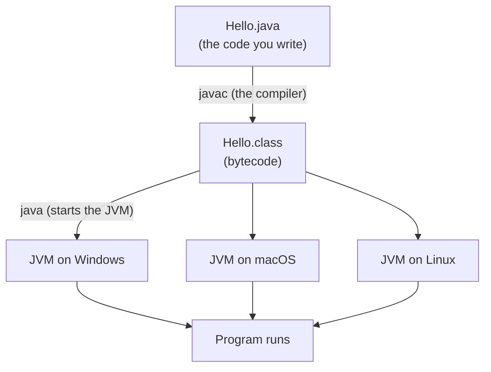

# Day 1 — Welcome to Java: Set Up and Run Your First Program

> **How to use these notes:** each section matches one item on today's checklist. Read it, **type the code yourself** (don't copy-paste, typing is how the syntax sticks), then tick **Done**. The "Check yourself" questions at the end of a section turn into flashcards on the Revise page.

**Today's goal:** by tonight you will have Java installed, know what the JDK and the JVM are, and have run your first program both from your editor and from the terminal.

<!-- topic: b1_t1 -->
## ☕ Java — Getting Started

<!-- subtopic: b1_t1_s1 -->
### What programming is

A computer is very fast and very obedient, but it has no common sense. It does **exactly** what it is told, one step at a time, and nothing else. A **program** is that list of steps, written in a language the computer can be made to understand.

Think of a recipe:

| Recipe | Program |
|---|---|
| Ingredients | **Data**: numbers, text, true/false values |
| Steps, in order | **Instructions**, run top to bottom |
| "If the dough is sticky, add flour" | **Decisions** (`if`) |
| "Stir 20 times" | **Repetition** (loops) |
| "Make the sauce (see page 12)" | **Reusable pieces** (methods) |

Every program you will ever write is built from those same few ideas. Over the next twelve days you learn each of them in Java.

**Why so strict?** People understand "add a bit of salt". A computer can't guess what "a bit" means. That's why programming languages have precise rules (grammar called **syntax**): a missing semicolon is like a recipe with a missing word, and the computer refuses to continue rather than guess.

> 💡 You will make lots of mistakes. Everyone does, including people with 20 years of experience. An error message is not a failure. It's the computer telling you exactly what it didn't understand.

<details>
<summary>What is a program, in one sentence?</summary>

A precise list of instructions that a computer follows step by step, working on some data.
</details>

<!-- subtopic: b1_t1_s2 -->
### What Java is and why it's a good first language

**Java** is a programming language created at Sun Microsystems in 1995 (now looked after by Oracle and a big open-source community). Thirty years later it is still one of the most used languages in the world.

Where you meet Java every day without noticing:

- **Backend servers** of banks, shops, booking sites and payment apps. When you pay with UPI or book a ticket, there's a good chance Java code runs on the server. This is what the Spring Boot part of this course is about.
- **Android apps** (Android was built around Java; Kotlin, its cousin, runs on the same machinery).
- **Big data and streaming** tools like Kafka, Hadoop and Elasticsearch are written in Java.
- **Enterprise software** inside large companies: insurance, logistics, telecom.

Why it's a good **first** language:

1. **Clear rules.** Java makes you say what type every value is. That feels strict at first, but it means the computer catches many mistakes before the program even runs.
2. **Write once, run anywhere.** The same Java program runs on Windows, macOS and Linux without changes (you'll see why in the next section).
3. **Jobs.** Java backend developers are in demand everywhere, from startups to the biggest tech companies.
4. **Huge community.** Any error message you get, someone has already asked about it online.

<details>
<summary>Name three places where Java is used.</summary>

Backend servers (banks, shopping, payments), Android apps, and big-data tools like Kafka. Large company software is another big one.
</details>

<!-- subtopic: b1_t1_s3 -->
### JDK, JRE and JVM in simple words

Computers don't understand Java directly. Their processors only understand **machine code** (long lists of 0s and 1s), and every kind of processor has its own. Java solves this in two steps:



1. **Compile.** The **compiler** (`javac`) checks your code for mistakes and translates it into **bytecode**, saved in a `.class` file. Bytecode is not tied to any one processor.
2. **Run.** The **JVM (Java Virtual Machine)** reads the bytecode and runs it on your actual computer. There's a JVM for every operating system, so the same `.class` file runs everywhere.

The three names you'll hear:

| Name | What it is | Do you need it? |
|---|---|---|
| **JVM** — Java Virtual Machine | The program that runs bytecode | Yes, it's inside the JDK |
| **JRE** — Java Runtime Environment | JVM + the standard library (ready-made code for text, maths, files…) | Comes inside the JDK |
| **JDK** — Java Development Kit | JRE + developer tools: the compiler `javac`, the debugger and more | **Yes, install this one** |

An easy way to remember: **JDK ⊃ JRE ⊃ JVM**. The JDK contains everything. As a developer you always install the JDK.

<details>
<summary>What does javac do, and what does the JVM do?</summary>

`javac` (the compiler) checks your `.java` code and turns it into bytecode (`.class`). The JVM runs that bytecode on your computer.
</details>

<details>
<summary>Why can the same Java program run on Windows and on a Mac?</summary>

Because Java compiles to bytecode, not to one processor's machine code. Each operating system has its own JVM that knows how to run that bytecode.
</details>

<!-- subtopic: b1_t1_s4 -->
### Install JDK 21 and an editor

**Step 1: install the JDK (version 21).** Version 21 is an LTS (long-term support) release, which is what companies use.

- **Windows / macOS:** download the installer for **JDK 21** from [adoptium.net](https://adoptium.net) (Eclipse Temurin, free) and run it. On Windows, tick the option that sets `JAVA_HOME` and adds Java to `PATH` if the installer offers it.
- **macOS with Homebrew:** `brew install --cask temurin@21`
- **Ubuntu / Debian Linux:** `sudo apt install openjdk-21-jdk`

**Step 2: check it worked.** Open a terminal (Windows: search for "Terminal" or "Command Prompt"; macOS: "Terminal") and type:

```bash
java -version
javac -version
```

You should see something like `openjdk version "21.0.5"` and `javac 21.0.5`. If you see "command not found" or "not recognized", the JDK isn't on your `PATH` yet: close and reopen the terminal, and if it still fails, reinstall and tick the PATH option.

**Step 3: install an editor (IDE).** An IDE (Integrated Development Environment) is a code editor that understands Java: it colours your code, points out mistakes as you type and runs programs with one click.

- **IntelliJ IDEA Community Edition** (free, from jetbrains.com/idea). This is what most Java developers use. Recommended.
- **VS Code** with the "Extension Pack for Java" is a lighter alternative.

**Step 4: create your first project in IntelliJ.**

1. *New Project* → choose **Java**, pick JDK 21 in the **JDK** box, build system **IntelliJ** (we'll learn Maven later), untick "Add sample code".
2. Name it `java-practice` and click **Create**.
3. Right-click the `src` folder → *New* → *Java Class* → name it `Hello`.

You'll use this one project for all the small programs in the first phase.

<details>
<summary>Which command shows the Java version you have installed?</summary>

`java -version` (and `javac -version` for the compiler).
</details>

<!-- subtopic: b1_t1_s5 -->
### Hello World, line by line

Type this into `Hello.java`:

```java
public class Hello {
    public static void main(String[] args) {
        System.out.println("Hello, World!");
    }
}
```

Click the green ▶ next to `main` in IntelliJ. The output panel shows `Hello, World!`. You just wrote and ran a program. 🎉

Now what each part means. You don't need to understand every word today; some of them (`public`, `static`) get their own day later.

| Code | Meaning |
|---|---|
| `public class Hello` | Declares a **class** called `Hello`. All Java code lives inside a class. The file **must** be called `Hello.java`, matching the class name exactly (capital H too). |
| `{ … }` | **Curly braces** mark where something starts and ends. Every `{` needs a matching `}`. |
| `public static void main(String[] args)` | The **main method**: the exact spot where your program starts. The JVM looks for this line, word for word. |
| `System.out.println(…)` | Prints whatever is in the brackets to the screen, then moves to a new line (`println` = print line). |
| `"Hello, World!"` | A piece of **text** (called a String). Text always goes in double quotes. |
| `;` | Ends a statement, like a full stop ends a sentence. |

Rules that trip up beginners:

- Java is **case-sensitive**: `System` works, `system` doesn't. `Main` and `main` are different things.
- Every statement ends with `;`. Lines that open a block (`{`) don't.
- Indentation (the spaces at the start of lines) doesn't change what the program does, but it makes it readable. IntelliJ fixes it for you: **Ctrl+Alt+L** (Windows/Linux) or **Cmd+Alt+L** (macOS).

`print` vs `println`:

```java
System.out.print("Hello ");
System.out.print("there");
System.out.println("!");
System.out.println("Next line");
```

prints

```text
Hello there!
Next line
```

`print` stays on the same line; `println` moves to a new line after printing.

<details>
<summary>What must the file name be for a class called Hello?</summary>

`Hello.java`, exactly the same as the class name, including capital letters.
</details>

<details>
<summary>What is the difference between print and println?</summary>

`println` moves to a new line after printing; `print` keeps the cursor on the same line.
</details>

<!-- subtopic: b1_t1_s6 -->
### Run it from the terminal

The ▶ button is convenient, but it hides what really happens. Run the same program by hand once so you understand it.

Open a terminal **in the folder that contains `Hello.java`** (in IntelliJ: right-click the file → *Open In* → *Terminal*). Then:

```bash
javac Hello.java      # compile: creates Hello.class next to it
java Hello            # run: start the JVM with the class Hello (no .java, no .class)
```

You'll see `Hello, World!`. Look in the folder: there is now a `Hello.class` file. That's the bytecode from the earlier section.

**Shortcut (Java 11+):** for a program that fits in one file, you can compile and run in one step:

```bash
java Hello.java
```

This compiles in memory and runs immediately, without leaving a `.class` file behind. You'll use this a lot for practice programs.

| Command | What it does |
|---|---|
| `javac Hello.java` | Compile. Prints errors if there are any; prints nothing if all is well. |
| `java Hello` | Run the compiled class. |
| `java Hello.java` | Compile and run a single-file program in one go. |

If `javac` says `error: class Main is public, should be declared in a file named Main.java`, the class name and file name don't match.

<details>
<summary>What two commands compile and then run Hello.java?</summary>

`javac Hello.java` then `java Hello`. Or, for one file, simply `java Hello.java`.
</details>

<!-- topic: b1_t2 -->
## 🧮 Practice — Your First Programs

<!-- subtopic: b1_t2_s1 -->
### Print your name, age and city

Make a new class `AboutMe` and print three lines about yourself:

```text
Name: Asha
Age: 21
City: Pune
```

Use three `System.out.println` statements. Then try it with **one** `println` and the special characters `\n` (new line) inside the text: `"Name: Asha\nAge: 21\nCity: Pune"`. Both give the same output.

👉 The **Code Practice** tab has this as exercise 1, with hints and a solution.

<!-- subtopic: b1_t2_s2 -->
### Print a box of stars

Print this 5 × 5 box using only `println`:

```text
* * * * *
* * * * *
* * * * *
* * * * *
* * * * *
```

Five `println` lines is fine for today. On Day 5 you'll print the same box with a loop in three lines of code, and pyramids and triangles too.

**Bonus:** print a hollow box (stars only on the border). Exercise 2 in **Code Practice**.

<!-- subtopic: b1_t2_s3 -->
### Break the program on purpose

Reading errors is a skill, and the best way to learn it is to cause errors deliberately. Make each change below to `Hello.java`, run it, read the message, then undo the change.

| Change | What the compiler says (roughly) |
|---|---|
| Delete the `;` after `println(...)` | `error: ';' expected` and the line number |
| Change `main` to `mian` | Compiles fine, but running gives `error: Main method not found in class Hello` |
| Change `System` to `system` | `error: package system does not exist` |
| Delete the last `}` | `error: reached end of file while parsing` |
| Remove the closing `"` | `error: unclosed string literal` |
| Rename the class to `Hi` but keep the file name | `class Hi is public, should be declared in a file named Hi.java` |

Notice that every message tells you **the file and line number**, then **what it expected**. Always read the first error first: one mistake can cause several messages after it.

<details>
<summary>A program has 5 compile errors. Which one should you fix first?</summary>

The first one. A single mistake (like a missing brace) often causes the errors after it, and they disappear once it's fixed.
</details>

## 📝 Day 1 Recap

1. What turns your .java file into bytecode? → **the compiler, javac**
2. What runs bytecode on your computer? → **the JVM (Java Virtual Machine)**
3. Which one do developers install: JDK, JRE or JVM? → **the JDK (it contains the other two)**
4. What file extension does compiled bytecode have? → **.class**
5. Where does every Java program start running? → **the main method: public static void main(String[] args)**
6. What ends a statement in Java? → **a semicolon ;**
7. Is Java case-sensitive? → **yes: System and system are different**
8. Run a single-file program in one command? → **java Hello.java**
9. println vs print? → **println adds a new line at the end; print doesn't**
10. File name for public class Greeting? → **Greeting.java**
