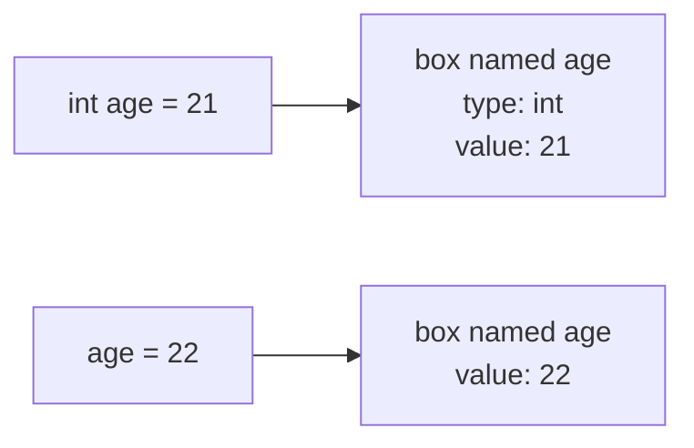

# Day 2 — Variables and Data Types

> Type every example yourself and run it. Change a value, run again, and see what happens. That's the fastest way to learn.

**Today's goal:** store values in variables, pick the right type for each one, print them nicely, and write code that other people (and future you) can read.

<!-- topic: b2_t1 -->
## ☕ Java — Variables & Data Types

<!-- subtopic: b2_t1_s1 -->
### Variables: a named box for a value

A **variable** is a named box that holds one value. You give it a name, and you say what **type** of value it can hold.

```java
int age;          // declare: make a box called age that can hold a whole number
age = 21;         // assign: put 21 in the box
int marks = 87;   // declare and assign in one line (most common)

age = 22;         // change it: the old value 21 is replaced
System.out.println(age);   // prints 22
```



Three things to notice:

1. **`=` means "store"**, not "is equal to". `age = age + 1` is perfectly fine: take the value in `age`, add 1, store the result back in `age`.
2. A variable must be **declared before it's used**, and it must have a value before you read it. `int x; System.out.println(x);` doesn't compile ("variable x might not have been initialized").
3. A variable's **type never changes**. Once `age` is an `int`, you can't put text in it.

```java
int a = 5;
int b = a;    // b gets a COPY of the value 5
a = 10;
System.out.println(b);   // still 5: changing a later doesn't touch b
```

<details>
<summary>What does age = age + 1 do?</summary>

It reads the current value of `age`, adds 1, and stores the result back into `age`. `=` means "store", not "equals".
</details>

<!-- subtopic: b2_t1_s2 -->
### The 8 primitive types

Java has eight built-in **primitive** types for simple values. You'll use four of them almost all the time.

| Type | Holds | Example | Range / size |
|---|---|---|---|
| **`int`** | whole numbers | `int count = 42;` | about −2.1 billion to +2.1 billion |
| **`long`** | big whole numbers | `long population = 8_000_000_000L;` | about ±9.2 × 10¹⁸ (note the `L`) |
| **`double`** | decimals | `double price = 99.99;` | ~15 significant digits |
| **`boolean`** | true or false | `boolean isPassed = true;` | only `true` or `false` |
| `char` | one character | `char grade = 'A';` | single quotes, exactly one character |
| `float` | decimals, less precise | `float temp = 36.6f;` | ~7 digits (note the `f`) |
| `byte` | tiny whole numbers | `byte level = 3;` | −128 to 127 |
| `short` | small whole numbers | `short year = 2026;` | −32,768 to 32,767 |

How to choose:

- Counting things, ages, marks, indexes → **`int`**
- Phone numbers? **Not a number type at all**: you never do maths on them and they can start with 0 or `+`. Use text (`String`).
- Money in real apps → special classes (later); for practice, `double` is fine.
- Something yes/no (is logged in, has paid) → **`boolean`**
- Very large counts (milliseconds, world population, bank balances in paise) → **`long`**

Underscores in numbers are allowed for readability: `1_000_000` is one million.

**Watch out: numbers have limits.**

```java
int big = 2_147_483_647;   // the largest int
big = big + 1;
System.out.println(big);   // -2147483648  (it wrapped around! This is called overflow)
```

Java doesn't warn you about overflow. If a value might exceed about 2 billion, use `long`.

**Watch out: decimals aren't exact.**

```java
System.out.println(0.1 + 0.2);   // 0.30000000000000004
```

Computers store decimals in binary, so some values can't be stored exactly. It's not a Java bug; every language does this.

<details>
<summary>Which type would you use for a student's marks, a price, and whether they passed?</summary>

`int` for marks (whole number), `double` for price (decimal), `boolean` for passed (true/false).
</details>

<details>
<summary>Why shouldn't a phone number be an int?</summary>

You never do maths on it, it can start with 0 or +, and a 10-digit number doesn't even fit in an `int`. Store it as text (a `String`).
</details>

<!-- subtopic: b2_t1_s3 -->
### String: text, joining and printing

Text is stored in a **`String`** (capital S: it's not a primitive, it's a class, but you use it just as easily).

```java
String name = "Asha";
String city = "Pune";
String empty = "";               // a String with no characters
```

**Joining text with `+`** (called concatenation):

```java
String greeting = "Hello, " + name + "!";
System.out.println(greeting);                    // Hello, Asha!
System.out.println(name + " lives in " + city);  // Asha lives in Pune
```

When one side of `+` is a String, the other side is turned into text too:

```java
int age = 21;
System.out.println("Age: " + age);        // Age: 21
System.out.println("Sum: " + 2 + 3);      // Sum: 23   ← text + 2 = "Sum: 2", then + 3 = "Sum: 23"
System.out.println("Sum: " + (2 + 3));    // Sum: 5    ← brackets do the maths first
System.out.println(2 + 3 + " apples");    // 5 apples  ← left to right: 2 + 3 = 5 first
```

`+` works **left to right**. Use brackets whenever you want maths to happen before joining.

**Special characters** inside text start with a backslash (`\`), called escape sequences:

| Write | Means |
|---|---|
| `\n` | new line |
| `\t` | tab (lines things up) |
| `\"` | a double quote inside the text |
| `\\` | a single backslash |

```java
System.out.println("She said \"hi\"\nand left.");
```
```text
She said "hi"
and left.
```

**Formatted printing** with `printf` is handy for decimals:

```java
double price = 49.5;
System.out.printf("Price: %.2f%n", price);   // Price: 49.50
```

`%.2f` means "a decimal with 2 digits after the point", `%d` is a whole number, `%s` is text, and `%n` is a new line.

<details>
<summary>What does System.out.println("Total: " + 4 + 5) print, and how do you get 9?</summary>

It prints `Total: 45` (text + 4 gives text, then + 5 joins again). Write `"Total: " + (4 + 5)` to get `Total: 9`.
</details>

<!-- subtopic: b2_t1_s4 -->
### Naming rules and conventions; constants with final

**Rules** (break them and the code won't compile):

- Letters, digits, `_` and `$` only. No spaces, no hyphens.
- Can't **start** with a digit: `2ndPlace` ✗, `secondPlace` ✓
- Can't be a Java keyword: `int class = 5;` ✗
- Case-sensitive: `total` and `Total` are two different variables.

**Conventions** (the code compiles anyway, but every Java developer follows them):

| What | Style | Example |
|---|---|---|
| Variables and methods | **camelCase**: start lowercase, each new word capitalised | `studentName`, `totalMarks`, `isLoggedIn` |
| Classes | **PascalCase**: every word capitalised | `BankAccount`, `Hello` |
| Constants | **UPPER_SNAKE_CASE** | `MAX_MARKS`, `PI` |

**Good names explain themselves.** Compare:

```java
int d = 7;                 // d of what?
int daysInWeek = 7;        // clear without a comment
```

Booleans read best as questions: `isEmpty`, `hasPaid`, `canVote`.

**Constants with `final`:** a `final` variable can be assigned only once. Use it for values that should never change.

```java
final int MAX_MARKS = 100;
final double GST_RATE = 0.18;

MAX_MARKS = 120;   // ✗ compile error: cannot assign a value to final variable MAX_MARKS
```

Using a named constant instead of typing `100` everywhere means that if the value ever changes, you change it in one place, and readers know what the number means.

<details>
<summary>How do you name a variable for "number of students", and a constant for the maximum score?</summary>

Variable: `numberOfStudents` (camelCase). Constant: `final int MAX_SCORE = 100;` (UPPER_SNAKE_CASE with `final`).
</details>

<!-- subtopic: b2_t1_s5 -->
### Comments: notes for humans

Comments are ignored by the compiler. They're for people reading the code.

```java
// A single-line comment: everything after // on this line is ignored

/*
   A multi-line comment.
   Useful for longer explanations or for temporarily disabling code.
*/

/**
 * A Javadoc comment: describes a class or method.
 * Tools turn these into documentation pages, and IntelliJ shows them on hover.
 */
public class Hello { }
```

**Good comments explain *why*, not *what*.** The code already says what it does.

```java
count = count + 1;   // add 1 to count            ✗ says nothing new

total = total * 0.9;  // loyal customers get 10% off  ✓ explains the reason
```

A useful habit: if you need a comment to explain *what* a line does, try giving the variable a better name first.

**Comment out code** while experimenting: select lines and press **Ctrl+/** (Windows/Linux) or **Cmd+/** (macOS) in IntelliJ to toggle `//` on all of them.

<details>
<summary>What should a good comment explain: what the code does or why?</summary>

Why. The code already shows what it does; a comment adds the reason or the context that the code can't.
</details>

<!-- subtopic: b2_t1_s6 -->
### var: let the compiler work out the type

Since Java 10, for variables inside a method you can write `var` and let the compiler figure out the type from the value:

```java
var count = 10;          // compiler decides: int
var price = 99.5;        // double
var name = "Asha";       // String
```

Important: **this is not "any type"**. The type is decided once, at compile time, and can't change:

```java
var count = 10;
count = "ten";     // ✗ compile error: count is an int
```

Rules:

- `var` needs a value right away: `var x;` ✗
- Only for local variables (inside methods), not for fields or method parameters.

When to use it: when the type is obvious from the right-hand side. When you're learning, writing the type out (`int`, `double`) is clearer, so this course mostly spells types out.

<details>
<summary>After var x = 5; can you write x = "five";?</summary>

No. `var` made `x` an `int` at compile time, and a variable's type never changes.
</details>

<!-- topic: b2_t2 -->
## 🧮 Practice — Variables

<!-- subtopic: b2_t2_s1 -->
### Report card with variables

Store a student's details in variables of the right types and print a small report:

```text
===== REPORT CARD =====
Name    : Asha Verma
Roll no : 17
Marks   : 87.5 / 100
Passed  : true
=======================
```

Pick types carefully: name → `String`, roll number → `int`, marks → `double`, passed → `boolean`. Make the maximum marks a `final` constant, and use `\t` or spaces to line the colons up.

👉 Exercise 1 in **Code Practice**.

<!-- subtopic: b2_t2_s3 -->
### Swap two numbers without a third variable

The usual way to swap uses a temporary variable:

```java
int a = 5, b = 9;
int temp = a;   // temp = 5
a = b;          // a = 9
b = temp;       // b = 5
```

Puzzle: swap them **without** `temp`, using only `+` and `-`.

Hint: after `a = a + b`, `a` holds the sum. From the sum and one number, you can recover the other one.

<details>
<summary>How do you swap a and b using only + and -?</summary>

`a = a + b; b = a - b; a = a - b;` With a=5, b=9: a becomes 14, b becomes 14−9=5, a becomes 14−5=9.
</details>

The temp-variable version is what you'd write in real code (it's clearer and can't overflow), but the puzzle is good practice at tracing values step by step. 👉 Exercise 2 in **Code Practice**.

## 📝 Day 2 Recap

1. What does = mean in Java? → **store the value on the right into the variable on the left**
2. Type for whole numbers? → **int (long for very large ones)**
3. Type for decimals? → **double**
4. Type for true/false? → **boolean**
5. Quotes for a char vs a String? → **single quotes 'A' for char, double quotes "A" for String**
6. What is overflow? → **a number going past its type's limit and wrapping around, e.g. int max + 1 becomes negative**
7. "Age: " + 2 + 1 prints? → **Age: 21 (joined left to right as text)**
8. Naming style for variables? → **camelCase, e.g. totalMarks**
9. What does final do to a variable? → **it can only be assigned once (a constant)**
10. Can a var variable change its type later? → **no, its type is fixed at compile time**
