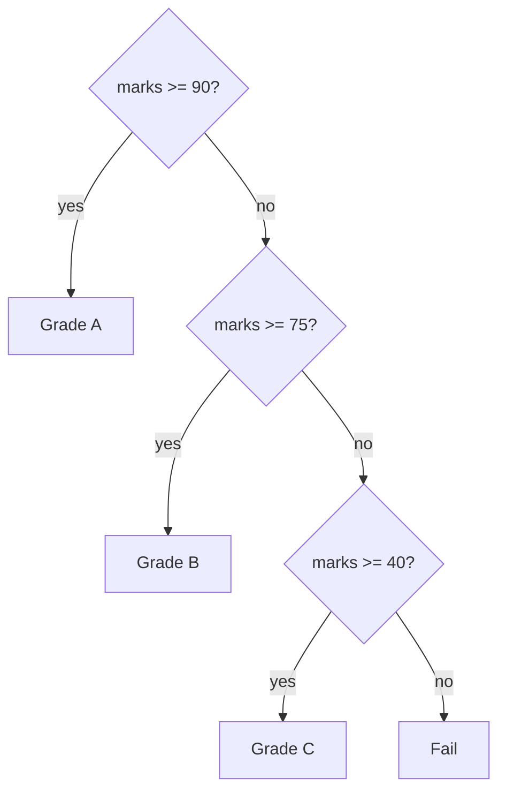

# Day 4 — Making Decisions: if, else and switch

> Until now every line ran, top to bottom. Today your programs start choosing.

**Today's goal:** make a program take different paths depending on values, combine conditions, and pick between `if` and `switch`.

<!-- topic: b4_t1 -->
## ☕ Java — Conditions

<!-- subtopic: b4_t1_s1 -->
### if, else if, else

`if` runs a block of code only when a condition is `true`:

```java
int marks = 72;

if (marks >= 40) {
    System.out.println("Passed");
}
```

`else` gives the other path:

```java
if (marks >= 40) {
    System.out.println("Passed");
} else {
    System.out.println("Failed");
}
```

`else if` chains several checks. Java tests them **top to bottom and runs only the first one that's true**:

```java
if (marks >= 90) {
    System.out.println("Grade A");
} else if (marks >= 75) {
    System.out.println("Grade B");
} else if (marks >= 40) {
    System.out.println("Grade C");
} else {
    System.out.println("Fail");
}
```



With 72, the first check is false, the second is false, the third is true: "Grade C", and the rest is skipped. Because only the first match runs, **order matters**. Put `marks >= 40` first and everyone above 40 would get grade C.

**Common mistakes:**

```java
if (marks >= 40);              // ✗ the ; ends the if! The block below always runs
{
    System.out.println("Passed");
}

if (marks = 40) { }            // ✗ = stores, == compares (this one doesn't even compile for ints)

if (marks >= 40)
    System.out.println("Passed");
    System.out.println("Well done");   // ✗ NOT part of the if: runs always. Use braces!
```

Always use curly braces `{ }`, even for one line. It prevents the third bug completely.

<details>
<summary>In an if / else if chain, how many blocks can run?</summary>

At most one: the first block whose condition is true (or the `else` block if none are true).
</details>

<!-- subtopic: b4_t1_s2 -->
### Nested conditions and combining checks

You can put an `if` inside another `if`:

```java
if (age >= 18) {
    if (hasLicence) {
        System.out.println("You can drive");
    } else {
        System.out.println("Get a licence first");
    }
} else {
    System.out.println("Too young to drive");
}
```

When both conditions simply have to be true together, `&&` is flatter and easier to read:

```java
if (age >= 18 && hasLicence) {
    System.out.println("You can drive");
}
```

Use nesting when each level needs its own `else` message (like above); use `&&` / `||` when you only care about the combined result.

A tidy pattern is to **handle the bad cases first** and keep the main path un-nested:

```java
if (amount <= 0) {
    System.out.println("Amount must be positive");
} else if (amount > balance) {
    System.out.println("Not enough balance");
} else {
    balance -= amount;
    System.out.println("Withdrawn " + amount);
}
```

Compare `boolean`s directly. `if (isMember)` reads better than `if (isMember == true)`, and `if (!isMember)` better than `if (isMember == false)`.

<details>
<summary>Rewrite if (a) { if (b) { go(); } } without nesting.</summary>

`if (a && b) { go(); }`
</details>

<!-- subtopic: b4_t1_s3 -->
### The ternary operator

For a simple "pick one of two values", there's a one-line form:

```java
// condition ? valueIfTrue : valueIfFalse
String result = marks >= 40 ? "Pass" : "Fail";
int bigger = a > b ? a : b;
System.out.println("You have " + count + (count == 1 ? " item" : " items"));
```

It's an **expression**: it produces a value, so you can store it or print it. Use it for short choices between two values. For anything longer, or with more than two outcomes, a normal `if` is clearer. Nested ternaries (`a ? b : c ? d : e`) are legal but hard to read; avoid them.

<details>
<summary>Write the larger of a and b using the ternary operator.</summary>

`int max = a > b ? a : b;`
</details>

<!-- subtopic: b4_t1_s4 -->
### switch statements

When you compare **one value** against many fixed options, `switch` can be tidier than a long `else if` chain:

```java
int day = 3;

switch (day) {
    case 1:
        System.out.println("Monday");
        break;
    case 2:
        System.out.println("Tuesday");
        break;
    case 3:
        System.out.println("Wednesday");
        break;
    default:
        System.out.println("Another day");
}
```

- Java jumps to the `case` that matches and runs from there.
- `break` leaves the switch.
- `default` runs when nothing matches (like the final `else`).
- `switch` works with `int`, `char`, `String` and enums (Day 20). It does **not** work with `double` or `boolean`, and cases must be fixed values, not ranges like `marks >= 90`.

**Fall-through:** forget a `break`, and Java keeps running the **next** cases too:

```java
switch (day) {
    case 1:
        System.out.println("Monday");     // no break!
    case 2:
        System.out.println("Tuesday");
        break;
}
// with day = 1, prints Monday AND Tuesday
```

That's usually a bug. Occasionally it's used on purpose to group cases:

```java
switch (month) {
    case 12: case 1: case 2:
        System.out.println("Winter");
        break;
    case 6: case 7: case 8: case 9:
        System.out.println("Monsoon");
        break;
    default:
        System.out.println("Other season");
}
```

<details>
<summary>What happens if you forget break in a switch case?</summary>

Execution "falls through" and also runs the following cases' code until it hits a `break` or the end of the switch.
</details>

<!-- subtopic: b4_t1_s5 -->
### Modern switch with arrows (Java 14+)

Newer Java has a cleaner switch: `->` instead of `:`, **no fall-through, no `break` needed**, and several values per case separated by commas.

```java
switch (day) {
    case 1, 2, 3, 4, 5 -> System.out.println("Weekday");
    case 6, 7 -> System.out.println("Weekend");
    default -> System.out.println("Invalid day");
}
```

It can also **return a value** (a switch *expression*), which removes a lot of repeated code:

```java
String name = switch (day) {
    case 1 -> "Monday";
    case 2 -> "Tuesday";
    case 3 -> "Wednesday";
    case 4 -> "Thursday";
    case 5 -> "Friday";
    case 6, 7 -> "Weekend";
    default -> "Invalid";
};                       // ← note the semicolon: it's one big assignment
```

When a case needs several lines, use a block and `yield` to give back the value:

```java
int points = switch (grade) {
    case 'A' -> 10;
    case 'B' -> 8;
    default -> {
        System.out.println("Low grade: " + grade);
        yield 5;
    }
};
```

Prefer the arrow form in new code. You'll still see the old form in existing projects, so know both.

<details>
<summary>Name two advantages of the arrow switch over the old one.</summary>

No fall-through (no `break` needed), several values per case (`case 6, 7 ->`), and it can return a value directly as an expression.
</details>

<!-- topic: b4_t2 -->
## 🧮 Practice — Decisions

<!-- subtopic: b4_t2_s1 -->
### Even or odd, positive or negative

Given a number, print whether it's even or odd, and whether it's positive, negative or zero. `n % 2 == 0` checks even. Careful with negatives: `-7 % 2` is `-1`, not `1`, so test `n % 2 == 0` for even rather than `n % 2 == 1` for odd.

<!-- subtopic: b4_t2_s2 -->
### Largest of three numbers

Find the largest of `a`, `b` and `c` in three ways:

1. An `if / else if / else` chain with `&&` (`a >= b && a >= c`).
2. Keep a running maximum: `int max = a; if (b > max) max = b; if (c > max) max = c;` This version scales to any number of values, and it's the idea behind finding the largest element of an array on Day 7.
3. `Math.max(a, Math.max(b, c))`.

Test with ties too (5, 5, 3).

<!-- subtopic: b4_t2_s3 -->
### Marks to grade, twice

Turn marks (0–100) into a grade: 90+ A, 75–89 B, 60–74 C, 40–59 D, below 40 F, and anything outside 0–100 "Invalid".

Write it with `if / else if`. Then write it with an arrow `switch` on `marks / 10` (integer division turns 0–100 into 0–10): `case 10, 9 -> "A"`, `case 8 -> …`. The grade boundaries here don't all fall on multiples of 10 (75 isn't), so notice which version handles them more naturally.

👉 Exercise 1 in **Code Practice**.

<!-- subtopic: b4_t2_s4 -->
### Leap-year checker

A year is a leap year if it's divisible by 4, **except** years divisible by 100, which are leap years only if they're also divisible by 400.

| Year | Leap? | Why |
|---|---|---|
| 2024 | yes | divisible by 4, not by 100 |
| 2023 | no | not divisible by 4 |
| 1900 | no | divisible by 100 but not 400 |
| 2000 | yes | divisible by 400 |

It fits in one condition: `(year % 4 == 0 && year % 100 != 0) || year % 400 == 0`. 👉 Exercise 2 in **Code Practice**, which also uses it to work out the days in a month with a `switch`.

## 📝 Day 4 Recap

1. How many branches of an if / else if / else chain run? → **exactly one (the first true one, or else)**
2. Bug in if (x > 5); { ... }? → **the ; ends the if, so the block always runs**
3. Why always use braces with if? → **without them only the next single line belongs to the if**
4. Ternary syntax? → **condition ? valueIfTrue : valueIfFalse**
5. What does break do in a switch? → **leaves the switch so later cases don't run**
6. Missing break causes? → **fall-through into the next case**
7. Can switch use double or ranges like marks >= 90? → **no: fixed int, char, String or enum values only**
8. Does the arrow switch fall through? → **no, and it needs no break**
9. Keyword to return a value from a block in a switch expression? → **yield**
10. Leap-year condition? → **(y % 4 == 0 && y % 100 != 0) || y % 400 == 0**
