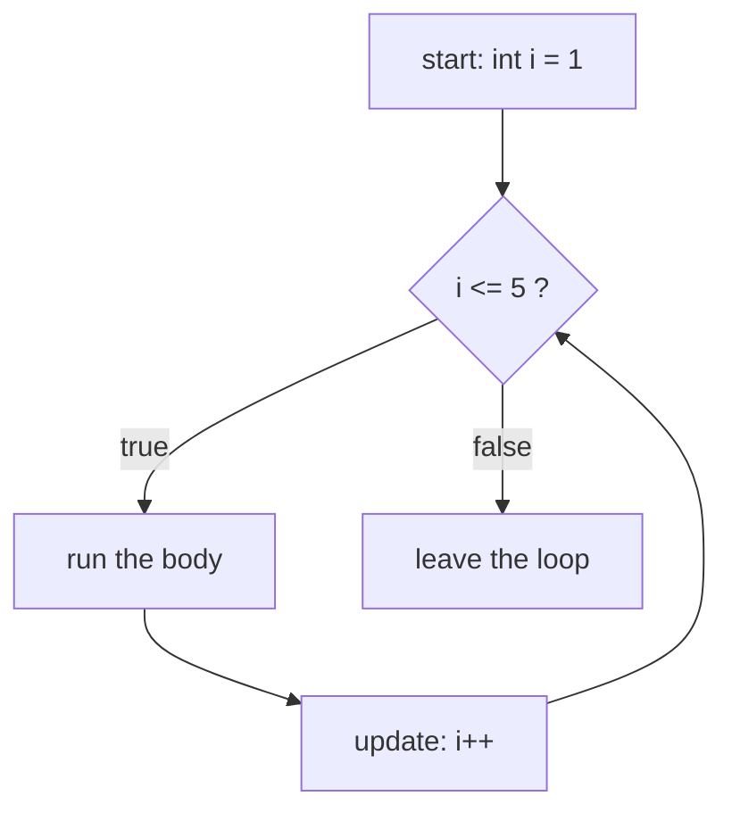

# Day 5 — Loops: Repeating Work

> Trace loops on paper: write down the loop variable's value on each round. Five minutes of tracing saves an hour of confusion.

**Today's goal:** repeat code with `for`, `while` and `do-while`, control loops with `break` and `continue`, and draw patterns with nested loops.

<!-- topic: b5_t1 -->
## ☕ Java — Loops

<!-- subtopic: b5_t1_s1 -->
### The for loop

To print 1 to 5 you could write five `println`s. To print 1 to 1000 you need a **loop**.

```java
for (int i = 1; i <= 5; i++) {
    System.out.println(i);
}
```

The three parts inside the brackets:

```text
for ( start ; condition ; update ) { body }
      int i = 1   i <= 5      i++
```



1. **Start** runs once.
2. **Condition** is checked before every round. If it's false, the loop ends.
3. **Body** runs.
4. **Update** runs, then back to step 2.

Trace it:

| Round | i | i <= 5? | Prints |
|---|---|---|---|
| 1 | 1 | true | 1 |
| 2 | 2 | true | 2 |
| … | … | … | … |
| 5 | 5 | true | 5 |
| — | 6 | **false** | loop ends |

Variations:

```java
for (int i = 5; i >= 1; i--) { ... }      // count down: 5 4 3 2 1
for (int i = 0; i < 10; i += 2) { ... }   // even numbers: 0 2 4 6 8
for (int i = 0; i < n; i++) { ... }       // runs exactly n times (the most common form)
```

**Accumulating** a result is the pattern you'll use most:

```java
int sum = 0;                    // start the total at 0, OUTSIDE the loop
for (int i = 1; i <= 100; i++) {
    sum += i;
}
System.out.println(sum);        // 5050
```

The loop variable `i` only exists inside the loop. Using it after the closing `}` is a compile error.

<details>
<summary>How many times does for (int i = 0; i < 10; i++) run, and what is i on the last round?</summary>

10 times; `i` goes 0, 1, …, 9. On the last round `i` is 9.
</details>

<!-- subtopic: b5_t1_s2 -->
### while and do-while

A `while` loop only has a condition. Use it when you **don't know in advance** how many rounds you need.

```java
int n = 4721;
int digits = 0;
while (n > 0) {
    n = n / 10;      // chop the last digit
    digits++;
}
System.out.println(digits);   // 4
```

Every `for` loop can be written as a `while`:

```java
int i = 1;            // start
while (i <= 5) {      // condition
    System.out.println(i);
    i++;              // update (forget this and the loop never ends!)
}
```

**`do-while`** runs the body **first** and checks afterwards, so the body always runs at least once. That's perfect for menus and "ask until valid":

```java
Scanner in = new Scanner(System.in);
int choice;
do {
    System.out.println("1) Play  2) Quit");
    choice = in.nextInt();
} while (choice != 1 && choice != 2);   // note the ; at the end
```

Which loop to use:

| Situation | Loop |
|---|---|
| Known number of rounds, or counting through a range | `for` |
| Repeat until something happens (number of rounds unknown) | `while` |
| Must run at least once (menus, input validation) | `do-while` |

<details>
<summary>What is the difference between while and do-while?</summary>

`while` checks the condition before each round, so it may run zero times. `do-while` runs the body first and checks after, so it always runs at least once.
</details>

<!-- subtopic: b5_t1_s3 -->
### break and continue

- **`break`** leaves the loop immediately.
- **`continue`** skips the rest of this round and moves to the next one.

```java
// find the first number above 100 that is divisible by 7
for (int i = 101; ; i++) {          // no condition: runs until break
    if (i % 7 == 0) {
        System.out.println(i);       // 105
        break;
    }
}

// print 1–10 but skip multiples of 3
for (int i = 1; i <= 10; i++) {
    if (i % 3 == 0) {
        continue;                    // jump straight to i++
    }
    System.out.print(i + " ");       // 1 2 4 5 7 8 10
}
```

Both are useful, but don't overuse them: a loop with many `break`s and `continue`s is hard to follow. Often a clearer condition does the same job.

Inside nested loops, `break` only leaves the **innermost** loop.

<details>
<summary>break vs continue?</summary>

`break` exits the whole loop. `continue` skips the rest of the current round and goes on with the next one.
</details>

<!-- subtopic: b5_t1_s4 -->
### Nested loops

A loop inside a loop: for **every** round of the outer loop, the inner loop runs completely. Think rows and columns.

```java
for (int row = 1; row <= 3; row++) {
    for (int col = 1; col <= 4; col++) {
        System.out.print("* ");
    }
    System.out.println();        // new line after each row
}
```

```text
* * * *
* * * *
* * * *
```

The inner loop ran 4 times for each of the 3 rows: 12 stars in total. That's why nested loops get slow on big inputs: 1000 × 1000 is a million rounds. You'll measure this properly with Big-O on Day 11.

**Patterns depend on the row number.** Make the inner loop's limit use `row`:

```java
for (int row = 1; row <= 4; row++) {
    for (int col = 1; col <= row; col++) {   // row 1 → 1 star, row 4 → 4 stars
        System.out.print("* ");
    }
    System.out.println();
}
```

```text
*
* *
* * *
* * * *
```

A multiplication table is the same idea: `System.out.print(row * col + "\t");`

<details>
<summary>An outer loop runs 5 times and the inner loop 3 times. How many times does the inner body run?</summary>

5 × 3 = 15 times.
</details>

<!-- subtopic: b5_t1_s5 -->
### Common loop mistakes and how to spot them

**1. Off-by-one:** one round too many or too few.

```java
for (int i = 1; i < 10; i++)    // runs 1–9, not 1–10! Use <= 10, or i = 0; i < 10 for 10 rounds
```

Check the **first and last** values of the loop variable every time.

**2. Infinite loop:** the condition never becomes false.

```java
int i = 1;
while (i <= 5) {
    System.out.println(i);
    // forgot i++  → prints 1 forever
}

for (int i = 10; i > 0; i++) { }   // i grows, so i > 0 stays true (until overflow)
```

If your program seems frozen or prints forever, press the red ■ **Stop** button in IntelliJ (or Ctrl+C in the terminal), then look for the missing or wrong update.

**3. Resetting inside the loop:**

```java
for (int i = 1; i <= 5; i++) {
    int sum = 0;         // ✗ reset to 0 every round
    sum += i;
}
```

Declare accumulators (`sum`, `count`, `max`) **before** the loop.

**4. Semicolon after the loop header:** `for (int i = 0; i < 5; i++);` runs an empty body 5 times, and the block below runs once.

**How to debug a loop:** add a temporary `System.out.println("i=" + i + " sum=" + sum);` inside it and watch the values change. (On Day 9 you'll learn the debugger, which does this without editing code.)

<details>
<summary>for (int i = 0; i <= 5; i++) runs how many times?</summary>

6 times (i = 0, 1, 2, 3, 4, 5). A frequent off-by-one surprise.
</details>

<!-- topic: b5_t2 -->
## 🧮 Practice — Loops & Patterns

<!-- subtopic: b5_t2_s1 -->
### Multiplication table

Print the table of any number `n` from 1 to 10:

```text
7 x 1 = 7
7 x 2 = 14
...
7 x 10 = 70
```

Then print the full 1–10 grid with a nested loop, using `\t` between numbers so the columns line up.

<!-- subtopic: b5_t2_s2 -->
### Sum of 1 to N, and of the even numbers

Add up 1 to N with a loop (for N = 100 the answer is 5050). Then add only the even numbers, in two ways: with `if (i % 2 == 0)` inside the loop, and by stepping `i += 2`. The second version does half the rounds. 👉 Exercise 1 in **Code Practice**.

<!-- subtopic: b5_t2_s3 -->
### Star patterns

With nested loops, print:

```text
*            * * * *          *
* *          * * *           * *
* * *        * *            * * *
* * * *      *             * * * *
```

The right triangle uses `col <= row`, the inverted one `col <= n - row + 1`. The pyramid needs **spaces** before the stars: on row `r`, print `n - r` spaces, then `r` stars. Work out the counts for each row on paper first. 👉 Exercise 2 in **Code Practice**.

<!-- subtopic: b5_t2_s4 -->
### Count the digits and add them up

For `n = 4721`: 4 digits, digit sum 14. The trick from the `%` section: `n % 10` gives the last digit, and `n / 10` removes it. Repeat with a `while (n > 0)` loop. (What should happen for `n = 0`? It has one digit. Handle that case.) 👉 Exercise 3 in **Code Practice**.

## 📝 Day 5 Recap

1. The three parts of a for loop header? → **start; condition; update**
2. When is the condition checked? → **before every round**
3. Loop for an unknown number of rounds? → **while**
4. Loop that always runs at least once? → **do-while**
5. break vs continue? → **break leaves the loop; continue skips to the next round**
6. Where do you declare a sum variable? → **before the loop, so it isn't reset every round**
7. Sum of 1 to 100? → **5050**
8. Outer loop 4 rounds, inner loop 6 rounds: inner body runs? → **24 times**
9. Most common cause of an infinite while loop? → **forgetting to update the loop variable**
10. Last digit of n, and n without it? → **n % 10, and n / 10**
