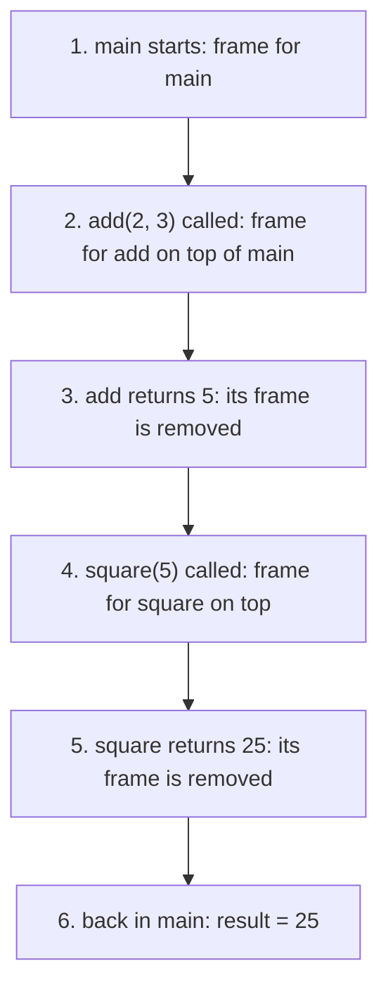

# Day 6 — Methods: Reusable Blocks of Code

> From today, try to keep `main` short: let it call well-named methods that do the real work.

**Today's goal:** write your own methods with parameters and return values, understand scope and the call stack, and know what "Java passes copies" means.

<!-- topic: b6_t1 -->
## ☕ Java — Methods

<!-- subtopic: b6_t1_s1 -->
### Why methods

A **method** is a named block of code you can run (call) whenever you need it. You've been calling methods since Day 1: `System.out.println(...)`, `Math.max(...)`, `in.nextInt()`. Now you'll write your own.

Without methods, the same logic gets copy-pasted:

```java
// checking three numbers for "prime" by copy-pasting the same loop three times… ✗
```

With a method, you write it once and give it a name:

```java
public class Primes {
    public static void main(String[] args) {
        System.out.println(isPrime(7));    // true
        System.out.println(isPrime(10));   // false
        System.out.println(isPrime(97));   // true
    }

    static boolean isPrime(int n) {
        if (n < 2) return false;
        for (int i = 2; i < n; i++) {
            if (n % i == 0) return false;
        }
        return true;
    }
}
```

Benefits:

1. **No repetition.** Fix a bug once, and it's fixed everywhere.
2. **Readable.** `if (isPrime(n))` reads like English; the details live inside the method.
3. **Testable.** You can check one small method on its own.

A good method does **one** thing, and its name says what: `calculateTotal`, `isEven`, `printMenu`. Method names are camelCase, usually starting with a verb.

<details>
<summary>Give two reasons to put code in a method instead of repeating it.</summary>

Write it once and reuse it (a fix applies everywhere), and the name makes the calling code readable. It's also easier to test on its own.
</details>

<!-- subtopic: b6_t1_s2 -->
### Parameters and return values

```java
static int add(int a, int b) {
    return a + b;
}
```

```text
static   int         add    (int a, int b)     { return a + b; }
  │       │           │           │                   │
  │   return type   name      parameters            body
  └ (explained below)
```

- **Parameters** are the inputs, each with a type: `(int a, int b)`. The values you pass when calling are called **arguments**: in `add(3, 4)`, 3 and 4 are the arguments.
- **Return type** says what comes back: `int`, `double`, `boolean`, `String`…
- **`return`** sends the value back to the caller and **ends the method immediately**.

```java
int total = add(3, 4);              // 7: the returned value is stored
System.out.println(add(10, 20));    // 30: or used directly
add(1, 2);                          // allowed, but the result is thrown away
```

**`void`** means "returns nothing". Such a method just does something (like printing):

```java
static void printLine(int length) {
    for (int i = 0; i < length; i++) {
        System.out.print("-");
    }
    System.out.println();
}
```

The compiler checks everything: you must pass the right number and types of arguments, a non-void method must return a value on **every** path, and you can't store the result of a `void` method.

```java
static String grade(int marks) {
    if (marks >= 40) {
        return "Pass";
    }
    // ✗ compile error: missing return statement (what if marks < 40?)
}
```

**What's `static`?** For now: methods called directly from `main` need `static`. On Day 15 you'll learn exactly what it means, and on Day 13 you'll write methods without it.

<details>
<summary>What does void mean as a return type?</summary>

The method doesn't return a value. It performs an action (like printing) and you can't store its result.
</details>

<details>
<summary>What is the difference between a parameter and an argument?</summary>

A parameter is the variable in the method definition (`int a`). An argument is the actual value passed in a call (`add(3, 4)` passes 3 and 4).
</details>

<!-- subtopic: b6_t1_s3 -->
### Method overloading

Several methods can share a **name** if their **parameter lists** differ (in number or types of parameters):

```java
static int add(int a, int b)            { return a + b; }
static int add(int a, int b, int c)     { return a + b + c; }
static double add(double a, double b)   { return a + b; }

add(2, 3);        // calls the first:  5
add(2, 3, 4);     // calls the second: 9
add(2.5, 1.5);    // calls the third:  4.0
```

Java picks the right one from the arguments you pass. You've already used this: `System.out.println` is overloaded to accept an `int`, a `double`, a `String`, a `boolean`…

The **return type alone is not enough** to tell them apart:

```java
static int    total(int a, int b) { ... }
static double total(int a, int b) { ... }   // ✗ compile error: same name and same parameters
```

<details>
<summary>Can two methods differ only by their return type?</summary>

No. Overloaded methods must differ in their parameter lists (number or types of parameters).
</details>

<!-- subtopic: b6_t1_s4 -->
### Scope: where a variable exists

A variable exists only inside the block `{ }` where it's declared, from the line where it's declared to the closing `}`. That region is its **scope**.

```java
public static void main(String[] args) {
    int x = 10;
    if (x > 5) {
        int y = 20;                 // y exists only inside this if block
        System.out.println(x + y);  // ✓ x is visible here too
    }
    System.out.println(y);          // ✗ compile error: cannot find symbol y
}
```

Each method has its own variables. Two methods can both have a variable called `count`, and they are completely separate:

```java
static void a() { int count = 1; }
static void b() { int count = 99; }   // no conflict: different methods, different variables
```

A method **can't see** the caller's variables. If it needs a value, pass it as a parameter; if the caller needs a result, return it.

```java
static void doubleIt() {
    total = total * 2;   // ✗ which total? doubleIt can't see main's variables
}
```

Keep variables in the **smallest scope** that works: declare them where they're first needed. It keeps code easier to follow and prevents accidental reuse.

<details>
<summary>Can a method use a local variable declared in main?</summary>

No. Local variables exist only inside their own method (and block). Pass the value in as a parameter instead.
</details>

<!-- subtopic: b6_t1_s5 -->
### How method calls work: the call stack

When a method is called, Java pauses the current method, runs the called one, and then comes back to exactly where it left off. It keeps track using the **call stack**: a pile of **frames**, one per running method. Each frame holds that call's parameters and local variables.

```java
public static void main(String[] args) {
    int result = square(add(2, 3));
    System.out.println(result);
}
static int add(int a, int b) { return a + b; }
static int square(int n) { return n * n; }
```



Key points:

- The method on **top** of the stack is the one running right now.
- When a method returns, its frame (with all its local variables) disappears.
- That's why local variables don't survive between calls.

If a method keeps calling itself without stopping, frames pile up until the stack runs out of room and the program crashes with **`StackOverflowError`**. You'll meet that on Day 14 (recursion).

When a program crashes, Java prints a **stack trace**: the list of frames at the moment of the crash, top first. You'll learn to read it on Day 9.

<details>
<summary>What is stored in a stack frame?</summary>

One running method call's parameters and local variables (plus where to return to). The frame is removed when the method returns.
</details>

<!-- subtopic: b6_t1_s6 -->
### Java passes copies (pass-by-value)

When you call a method, Java **copies** each argument's value into the parameter. The method works on its copy, so it can't change the caller's variable:

```java
static void addTen(int n) {
    n = n + 10;                  // changes the copy only
    System.out.println("inside: " + n);
}

public static void main(String[] args) {
    int score = 5;
    addTen(score);               // inside: 15
    System.out.println(score);   // 5: unchanged!
}
```

If you want the caller to get a new value, **return** it and assign it:

```java
static int addTen(int n) {
    return n + 10;
}

score = addTen(score);           // now score is 15
```

This is called **pass-by-value**, and Java always works this way. On Day 7 you'll see that for arrays and objects the copied value is a *reference* (an address), which makes it look different. Same rule, different kind of value.

<details>
<summary>A method sets its int parameter to 100. Does the caller's variable change?</summary>

No. Java passes a copy of the value; the method only changes its own copy. Return the new value instead.
</details>

<!-- topic: b6_t2 -->
## 🧮 Practice — Methods

<!-- subtopic: b6_t2_s1 -->
### isPrime(n) and all primes up to 100

Write `static boolean isPrime(int n)`: a number is prime if it's at least 2 and has no divisor other than 1 and itself. Then loop from 1 to 100 and print the ones where `isPrime(i)` is true (there are 25).

You only need to try divisors up to √n: if `n` had a divisor bigger than √n, it would also have one smaller. Loop with `i * i <= n`. You'll see why that's much faster on Day 11. 👉 Exercise 1 in **Code Practice**.

<!-- subtopic: b6_t2_s2 -->
### factorial(n) with a loop

`5! = 5 × 4 × 3 × 2 × 1 = 120`, and `0! = 1` by definition. Write `static long factorial(int n)` with a loop.

Why `long`? Factorials grow very fast: `13!` is already too big for an `int` (it overflows silently, as on Day 2), and `long` lasts until `20!`. 👉 Exercise 2 in **Code Practice**.

<!-- subtopic: b6_t2_s3 -->
### A calculator with one method per operation

Write `add`, `subtract`, `multiply` and `divide` methods, and a `calculate(double a, char op, double b)` method that uses a `switch` on `op` to call the right one. Handle division by zero by printing a message instead of returning `Infinity`.

`main` should be just a few `calculate(...)` calls. Notice how readable that makes it. 👉 Exercise 3 in **Code Practice**.

## 📝 Day 6 Recap

1. What does return do? → **sends a value back to the caller and ends the method immediately**
2. Return type of a method that only prints? → **void**
3. Parameter vs argument? → **parameter is in the definition; argument is the value passed in the call**
4. What is overloading? → **same method name, different parameter lists**
5. Can overloads differ only in return type? → **no**
6. Can a method read main's local variables? → **no, pass them as parameters**
7. What is a stack frame? → **the memory for one method call: its parameters and local variables**
8. Error when frames pile up forever? → **StackOverflowError**
9. Does changing an int parameter change the caller's variable? → **no, Java passes a copy (pass-by-value)**
10. Why use long for factorial? → **13! overflows an int; long holds up to 20!**
