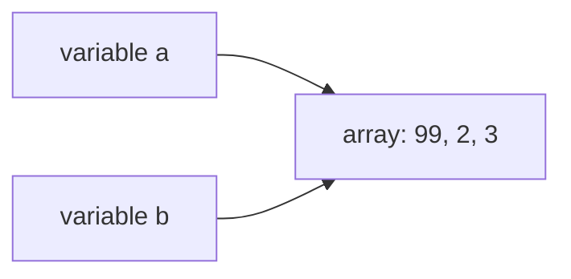

# Day 7 — Arrays

> Arrays are where programming meets problem solving: from today, the DSA problems start.

**Today's goal:** store many values in one array, loop over it, use the `Arrays` helpers, work with 2D grids, and understand that array variables hold a *reference*.

<!-- topic: b7_t1 -->
## ☕ Java — Arrays

<!-- subtopic: d2_t2_s1 -->
### What an array is

Storing the marks of 50 students in 50 variables (`m1`, `m2`, …) would be awful. An **array** stores many values of the **same type** under one name, in a fixed-size row of numbered slots.

```java
int[] marks = new int[5];        // 5 slots for ints, all start at 0
marks[0] = 87;                   // slots are numbered from 0
marks[1] = 92;
marks[4] = 60;                   // the last slot is length - 1

int[] primes = {2, 3, 5, 7, 11}; // create and fill in one go
String[] days = {"Mon", "Tue", "Wed"};
```

```text
index:   0    1    2    3    4
marks: [ 87 | 92 |  0 |  0 | 60 ]
```

Key facts:

- **Index starts at 0.** The first element is `marks[0]`, the last is `marks[marks.length - 1]`.
- **`marks.length`** gives the number of slots (no brackets: it's not a method).
- **Fixed size.** Once created, an array can't grow or shrink. (On Day 25 you'll meet `ArrayList`, which can.)
- **Default values:** `0` for numbers, `false` for booleans, `null` for Strings and other objects.
- Reading or writing a slot by index is instant, no matter how big the array is. The slots sit next to each other in memory, so Java can jump straight to slot `i`.

<details>
<summary>An array has length 8. What are its first and last indexes?</summary>

0 and 7 (`length - 1`).
</details>

<!-- subtopic: b7_t1_s2 -->
### Looping over arrays

The classic loop uses the index:

```java
int[] marks = {87, 92, 45, 60, 78};

for (int i = 0; i < marks.length; i++) {
    System.out.println("Student " + (i + 1) + ": " + marks[i]);
}
```

Use `i < marks.length`, not `<=`. That's the most common array bug:

```java
for (int i = 0; i <= marks.length; i++) {
    System.out.println(marks[i]);   // ✗ when i == 5: ArrayIndexOutOfBoundsException: Index 5 out of bounds for length 5
}
```

**for-each loop**: when you just need every value and not the index, it's shorter and can't go out of bounds:

```java
int total = 0;
for (int m : marks) {        // read as: "for each m in marks"
    total += m;
}
double average = (double) total / marks.length;
```

| Use | Loop |
|---|---|
| Need the index (position), or want to change slots | `for (int i = 0; i < a.length; i++)` |
| Just reading every value | `for (int x : a)` |

Assigning to `m` inside a for-each loop does **not** change the array (`m` is a copy, as on Day 6). To change slots, use the index loop: `marks[i] += 5;`.

<details>
<summary>What causes ArrayIndexOutOfBoundsException in a loop?</summary>

Using an index outside 0 to length − 1, usually by writing `i <= arr.length` instead of `i < arr.length`.
</details>

<!-- subtopic: b7_t1_s3 -->
### The Arrays helper class

`java.util.Arrays` has ready-made tools. Add `import java.util.Arrays;` at the top.

```java
int[] a = {5, 2, 9, 1};

System.out.println(a);                    // [I@1b6d3586  ← not useful! (that's the reference)
System.out.println(Arrays.toString(a));   // [5, 2, 9, 1]

Arrays.sort(a);                           // sorts the array itself, smallest first
System.out.println(Arrays.toString(a));   // [1, 2, 5, 9]

int[] filled = new int[4];
Arrays.fill(filled, 7);                   // [7, 7, 7, 7]

int[] bigger = Arrays.copyOf(a, 6);       // [1, 2, 5, 9, 0, 0]: a new, longer copy
int[] part = Arrays.copyOfRange(a, 1, 3); // [2, 5]: from index 1 up to (not including) 3

int[] b = {1, 2, 5, 9};
System.out.println(a == b);               // false: different arrays (see the last section)
System.out.println(Arrays.equals(a, b));  // true: same contents
```

Remember `Arrays.toString` whenever you print an array, and `Arrays.equals` whenever you compare two.

<details>
<summary>How do you print an array's contents, and why doesn't println(arr) work?</summary>

`System.out.println(Arrays.toString(arr))`. `println(arr)` prints the array's type and reference code (like `[I@1b6d3586`), not its contents.
</details>

<!-- subtopic: b7_t1_s4 -->
### 2D arrays: rows and columns

A 2D array is an array of arrays: a grid. The first index is the **row**, the second is the **column**.

```java
int[][] grid = {
    {1, 2, 3},
    {4, 5, 6}
};
System.out.println(grid[1][2]);        // 6  (row 1, column 2)
System.out.println(grid.length);       // 2  rows
System.out.println(grid[0].length);    // 3  columns in row 0

int[][] board = new int[3][3];         // 3 × 3, all zeros
board[1][1] = 5;                        // the centre
```

Loop with nested loops (Day 5):

```java
for (int r = 0; r < grid.length; r++) {
    for (int c = 0; c < grid[r].length; c++) {
        System.out.print(grid[r][c] + " ");
    }
    System.out.println();
}
```

```text
1 2 3
4 5 6
```

Grids show up everywhere: game boards, seating plans, images (pixels), and DSA problems like "Number of Islands" and "Spiral Matrix" later in the course. `Arrays.deepToString(grid)` prints a 2D array in one line: `[[1, 2, 3], [4, 5, 6]]`.

<details>
<summary>In int[][] g = new int[4][6], what are g.length and g[0].length?</summary>

`g.length` is 4 (rows) and `g[0].length` is 6 (columns).
</details>

<!-- subtopic: b7_t1_s5 -->
### Arrays are references

An `int` variable holds the number itself. An **array variable holds a reference**: the address where the array lives in memory. Copying the variable copies the address, not the array.

```java
int[] a = {1, 2, 3};
int[] b = a;          // b points to the SAME array
b[0] = 99;
System.out.println(a[0]);   // 99!  a and b are two names for one array
```



To get an independent copy, make a new array: `int[] c = a.clone();` or `Arrays.copyOf(a, a.length)`.

This is also why a method **can** change an array you pass in, even though Java passes copies (Day 6): the method gets a copy of the *reference*, which still points at the same array.

```java
static void reset(int[] arr) {
    arr[0] = 0;          // changes the caller's array
}
static void replace(int[] arr) {
    arr = new int[]{7};  // only changes the local copy of the reference: caller unaffected
}
```

The same will be true for every object (Day 13 onwards). It's one of the most important ideas in Java, so take your time with it.

<details>
<summary>int[] b = a; b[0] = 5; Does a[0] change?</summary>

Yes. `b = a` copies the reference, so both variables point to the same array.
</details>

<!-- topic: b7_t2 -->
## 🧮 DSA — Arrays: First Problems

These four problems are written up in interview style (the same notes the Interview track uses). They're all solvable with what you know: a loop over an array, a variable or two, and maybe two indexes. Try each one yourself before reading the solution, and don't worry if the "complexity" lines don't mean much yet; that's Day 11.

Tips for your first DSA problems:

1. **Work an example by hand** first: write the array on paper and do the steps yourself.
2. Then turn your hand steps into a loop.
3. Test with small and awkward inputs: an array of one element, all equal values, negatives.

## 📝 Day 7 Recap

1. Index of the first element? → **0**
2. Index of the last element? → **arr.length - 1**
3. Can an array change its size? → **no, arrays have a fixed size**
4. Default value in a new int[]? → **0**
5. Correct loop condition over an array? → **i < arr.length**
6. Print an array's contents? → **Arrays.toString(arr)**
7. Compare two arrays' contents? → **Arrays.equals(a, b)**
8. Element at row 2, column 0 of grid? → **grid[2][0]**
9. After int[] b = a; changing b[0] changes a? → **yes, both refer to the same array**
10. Make an independent copy of an array? → **a.clone() or Arrays.copyOf(a, a.length)**
