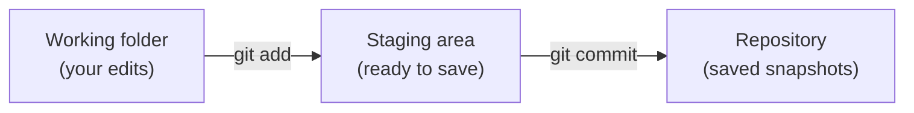

# Day 12 — Git, GitHub and Your First Mini Project

> Every software job uses Git every day. And a GitHub profile with real projects is part of your CV from today on.

**Today's goal:** use the terminal comfortably, save your work with Git, put it on GitHub, and build a complete little game that uses everything from Phase 1.

<!-- topic: b12_t1 -->
## 🗄️ Tools — Terminal, Git & GitHub

<!-- subtopic: b12_t1_s1 -->
### Terminal basics

The terminal (command line) lets you control the computer by typing commands. You'll need it for Git, for running Java without an IDE, and later for Maven, Docker and servers.

| Task | macOS / Linux | Windows (PowerShell) |
|---|---|---|
| Where am I? | `pwd` | `pwd` |
| List files | `ls` | `ls` or `dir` |
| Go into a folder | `cd projects` | `cd projects` |
| Go up one level | `cd ..` | `cd ..` |
| Go to your home folder | `cd ~` | `cd ~` |
| Make a folder | `mkdir notes` | `mkdir notes` |
| Show a file | `cat Hello.java` | `cat Hello.java` (or `type`) |
| Clear the screen | `clear` | `cls` |

Tips that save a lot of typing:

- **Tab** completes file and folder names: type `cd pro` then Tab.
- **↑ (up arrow)** brings back your previous commands.
- **Ctrl+C** stops a running program (useful for infinite loops).
- Paths with spaces need quotes: `cd "My Projects"`.

IntelliJ has a built-in terminal (*View → Tool Windows → Terminal*) that opens in your project folder.

Running Java from the terminal (Day 1) now with a package:

```bash
cd java-practice/src
javac com/asha/practice/day05/Patterns.java
java com.asha.practice.day05.Patterns
```

<details>
<summary>Which command goes up one folder, and which key autocompletes names?</summary>

`cd ..` goes up one level; the Tab key autocompletes file and folder names.
</details>

<!-- subtopic: b12_t1_s2 -->
### Git: snapshots of your project

**Git** is a version control system: it saves **snapshots** (called **commits**) of your project over time. You can see what changed, when and why, go back to any earlier version, and work with other people without overwriting each other.

Think of it as unlimited, labelled "Save as…" copies, without the mess of `project_final_v2_REAL.zip`.

Install Git from [git-scm.com](https://git-scm.com), then tell it who you are (once per computer):

```bash
git config --global user.name "Asha Verma"
git config --global user.email "asha@example.com"
```

The everyday workflow:

```bash
cd java-practice
git init                      # start tracking this folder (once per project)
git status                    # what has changed? (run this all the time)
git add Hello.java            # stage a file: "include this in the next snapshot"
git add .                     # stage everything that changed
git commit -m "Add hello world program"   # take the snapshot with a message
git log --oneline             # list the snapshots
```



**Staging** lets you choose exactly which changes go into a commit. **Commit messages** should say what the change does, in the present tense: "Add digit sum program", "Fix off-by-one in pattern loop". Not "stuff" or "changes".

Commit small and often: every time something works is a good moment.

<details>
<summary>What do git add and git commit each do?</summary>

`git add` stages changes (chooses what goes into the next snapshot). `git commit -m "message"` saves the staged changes as a snapshot in the repository's history.
</details>

<!-- subtopic: b12_t1_s3 -->
### GitHub: your code online

**Git** runs on your computer. **GitHub** is a website that hosts Git repositories online: a backup, a way to collaborate, and a portfolio employers look at.

1. Create a free account at [github.com](https://github.com).
2. Click **New repository**, name it `java-practice`, leave it empty (no README), and create it.
3. GitHub shows commands like these. Run them in your project folder:

```bash
git remote add origin https://github.com/your-username/java-practice.git
git branch -M main
git push -u origin main
```

Your code is now online. From then on, after committing:

```bash
git push        # upload your new commits
git pull        # download commits made elsewhere (another computer, a teammate)
```

`git clone <url>` downloads a whole repository onto a new computer.

The first time you push, Git asks you to sign in. The easiest way is to install **GitHub Desktop** or the **GitHub CLI** (`gh auth login`), which handles it for you. (GitHub no longer accepts your account password on the command line.)

**A README** is the front page of a repository: a `README.md` file in the project root written in Markdown. Say what the project is, how to run it and what you learned. Recruiters read these.

```markdown
# Java Practice

My exercises from learning Java, organised by day.

## How to run
Open in IntelliJ and run any class with a `main` method, or `java Hello.java`.
```

<details>
<summary>git push vs git pull?</summary>

`git push` uploads your local commits to GitHub; `git pull` downloads new commits from GitHub into your local copy.
</details>

<!-- subtopic: b12_t1_s4 -->
### Branches and .gitignore

A **branch** is a separate line of work. You make changes on a branch without touching `main`, and merge them in when they're ready. Every team works this way.

```bash
git switch -c add-game        # create a branch and move to it
# …edit files, then git add + git commit as usual…
git switch main               # back to main (your branch's changes aren't here yet)
git merge add-game            # bring the branch's commits into main
git branch -d add-game        # delete the branch once merged
```

On GitHub, teams usually merge through a **Pull Request**: push the branch, open a PR, someone reviews it, then it's merged. You'll learn team workflows on Day 84.

**`.gitignore`** lists files Git should never track: compiled output, IDE settings, secrets. Create a file named `.gitignore` in the project root:

```text
# compiled classes and build output
*.class
out/
target/
build/

# IntelliJ settings
.idea/
*.iml

# OS clutter
.DS_Store
```

Never commit passwords or API keys. If you do by accident, assume they're leaked and change them; deleting the file later doesn't remove it from history.

<details>
<summary>Why add *.class and out/ to .gitignore?</summary>

They're generated by compiling, so they can always be rebuilt from the source. Committing them only adds noise and conflicts.
</details>

<!-- topic: b12_t2 -->
## ☕ Project — Guess the Number

<!-- subtopic: b12_t2_s1 -->
### Build the game

The computer picks a secret number from 1 to 100. The player guesses; after each guess the program says **Too high**, **Too low** or **Correct**.

```text
I'm thinking of a number between 1 and 100.
Your guess: 50
Too high!
Your guess: 25
Too low!
Your guess: 37
Correct! You got it in 3 tries.
```

Plan it before coding:

| Need | Tool from Phase 1 |
|---|---|
| A random secret number | `(int) (Math.random() * 100) + 1` (Day 3) |
| Read guesses | `Scanner.nextInt()` (Day 3) |
| Compare | `if / else if / else` (Day 4) |
| Repeat until correct | `while` or `do-while` (Day 5) |

Build it in small steps and run after each one: first pick and print the secret (to test), then read one guess and compare, then add the loop, then hide the secret.

<!-- subtopic: b12_t2_s2 -->
### Attempts, play again, and methods

Improve it:

1. **Count the attempts** and print them at the end.
2. **Validate input**: guesses outside 1–100 print a warning and don't count as an attempt.
3. **Play again?** After a win, ask `Play again? (y/n)` and loop the whole game. Remember the leftover-newline trap from Day 3 if you mix `nextInt()` and `nextLine()`.
4. **Split into methods**: `playRound(Scanner in)` returns the number of attempts; `askPlayAgain(Scanner in)` returns a `boolean`; `main` just loops and keeps the best score.

A tidy `main` might look like:

```java
public static void main(String[] args) {
    Scanner in = new Scanner(System.in);
    int best = Integer.MAX_VALUE;
    do {
        int attempts = playRound(in);
        best = Math.min(best, attempts);
        System.out.println("Best so far: " + best);
    } while (askPlayAgain(in));
    System.out.println("Thanks for playing!");
}
```

**Stretch goals:** difficulty levels (1–10, 1–100, 1–1000), a maximum of 7 guesses (with binary search thinking, 7 is always enough for 1–100: try it!), or let the computer guess *your* number.

👉 **Code Practice** has the core game logic as a testable exercise, plus a full reference solution.

<!-- subtopic: b12_t2_s3 -->
### Push it to GitHub

1. Make sure `.gitignore` is in place, then `git add .` and `git commit -m "Add guess the number game"`.
2. `git push`.
3. Write a `README.md`: what the game does, how to run it (`java GuessTheNumber.java`), and a sample run pasted in a code block.
4. Commit and push the README.

Open your repository on GitHub and look at it as a stranger would. That's your first portfolio project. 🎉

## 📝 Day 12 Recap

1. List files in the terminal? → **ls (or dir on Windows)**
2. What is a commit? → **a saved snapshot of the project with a message**
3. Stage all changes? → **git add .**
4. Save staged changes? → **git commit -m "message"**
5. See what changed since the last commit? → **git status (and git diff)**
6. Upload commits to GitHub? → **git push**
7. Create and switch to a new branch? → **git switch -c branch-name**
8. Purpose of .gitignore? → **lists files Git must not track, like build output and IDE settings**
9. Should you commit passwords? → **never: treat a committed secret as leaked**
10. Most guesses ever needed for 1–100 with halving? → **7 (2^7 = 128 ≥ 100)**
