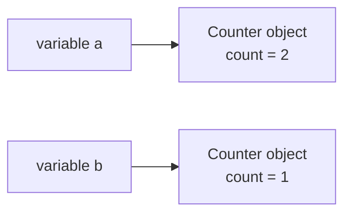

# Day 13 — Classes and Objects

> **Phase 2 starts today: object-oriented Java.** From here on, some sections are the full notes from the Interview track. Each one opens with a 🌱 **In simple words** box written for you. Read that first, then the main explanation. Parts marked 🚀 **Go deeper** are folded away; leave them for a second pass.

**Today's goal:** understand why we group data and behaviour into classes, create objects with `new`, call their methods, and avoid the most common crash in Java: `NullPointerException`.

<!-- topic: b13_t1 -->
## ☕ Java — Classes & Objects

<!-- subtopic: b13_t1_s1 -->
### Why object-oriented programming

So far your programs have been loose variables and `static` methods. That works for small problems, but imagine a library app with 10,000 books. Each book has a title, an author, a price and an "is it borrowed?" flag. You'd need four parallel arrays and a lot of care to keep index 4,237 of each array in sync.

**Object-oriented programming (OOP)** groups things that belong together:

| Real thing | Its data (fields) | What it can do (methods) |
|---|---|---|
| a bank account | owner, balance | deposit, withdraw |
| a book | title, author, isBorrowed | borrow, giveBack |
| a car | brand, speed | accelerate, brake |

A **class** is the design (the blueprint, the cookie cutter). An **object** is one real thing made from it (one house built from the blueprint, one cookie). One `Book` class, 10,000 `Book` objects.

Why this helps:

1. **Everything about a book lives in one place**, so it can't get out of sync.
2. **Code reads like the problem:** `book.borrow()` instead of `borrowed[4237] = true`.
3. **Each object protects its own data** (Day 14): a balance can only change through `deposit` and `withdraw`, which can check the amounts.
4. **Classes can build on each other** (inheritance, Day 16) and be swapped for each other (polymorphism, Day 17).

The four big ideas of OOP, which the next ten days cover one by one, are **encapsulation**, **inheritance**, **polymorphism** and **abstraction**.

<details>
<summary>Class vs object, in one sentence each?</summary>

A class is a blueprint that describes what data and behaviour things of that kind have. An object is one concrete thing created from that blueprint, with its own values.
</details>

<!-- intro: d1_t1_s1 -->
A class has three kinds of parts: **fields** (the data each object remembers), **methods** (what an object can do) and **constructors** (special methods that run once, when an object is created, to give the fields their starting values).

```java
public class Book {
    String title;          // fields
    boolean borrowed;

    Book(String title) {   // constructor: same name as the class, no return type
        this.title = title;
    }

    void borrow() {        // method: no "static", so it works on one object
        borrowed = true;
    }
}
```

`this.title` means "the field `title` of **this** object", to tell it apart from the parameter `title`. The section below goes into each part in detail; skip the 🚀 memory-layout panel for now.

<!-- subtopic: b13_t1_s3 -->
### Creating objects with new and using the dot

`new` builds an object from a class and runs its constructor. You keep a **reference** to the object in a variable, exactly like arrays on Day 7:

```java
Book b1 = new Book("Clean Code");
Book b2 = new Book("Head First Java");
```

The **dot** (`.`) reaches inside an object: `object.field` or `object.method(...)`.

```java
b1.borrow();                          // call a method on b1
System.out.println(b1.title);         // Clean Code
System.out.println(b1.borrowed);      // true
System.out.println(b2.borrowed);      // false: b2 is a different object
```

Methods without `static` are **instance methods**: they always run *on* a particular object, and they can use that object's fields directly. That's why `borrow()` can write `borrowed = true` without saying which book: it's the book you called it on.

| | `static` method (Phase 1) | instance method (from now on) |
|---|---|---|
| Called as | `ClassName.method()` or just `method()` | `someObject.method()` |
| Sees fields of | no particular object | the object it was called on |
| Example | `Math.max(3, 4)` | `account.deposit(500)` |

Print an object and you'll see something like `Book@1b6d3586`. On Day 19 you'll teach your classes to print themselves nicely with `toString()`.

<details>
<summary>What does new do?</summary>

It creates a new object from a class (reserving memory for its fields), runs the constructor, and gives back a reference to the object.
</details>

<!-- subtopic: b13_t1_s4 -->
### null and NullPointerException

A reference variable can also point to **no object at all**: the value `null`.

```java
Book b = null;         // b doesn't refer to any book yet
b.borrow();            // 💥 NullPointerException
```

```text
Exception in thread "main" java.lang.NullPointerException:
    Cannot invoke "Book.borrow()" because "b" is null
```

Using the dot on `null` means "go to the object and…" but there is no object, so Java throws a **NullPointerException** (often called an NPE). It is the most common runtime error in Java. Modern Java's message even names the variable that was null.

Where nulls come from:

- Fields of object type start as `null` if you don't set them (a `String title;` field is `null` until assigned).
- Array slots of object type start as `null`: `new Book[3]` is three empty slots, **not** three books.
- Methods may return `null` to mean "not found".

```java
Book[] shelf = new Book[3];
shelf[0].borrow();             // 💥 NPE: slot 0 is empty
shelf[0] = new Book("Dune");   // now slot 0 holds a book
```

Guard when something may be null:

```java
if (b != null) {
    b.borrow();
}
```

Better still, design so that things are never null: give fields values in the constructor, and create objects before storing them. Day 37 introduces `Optional`, a cleaner way to say "maybe no value".

<details>
<summary>What causes a NullPointerException?</summary>

Using a reference that is `null` as if it pointed to an object: calling a method on it, reading a field through it, or indexing it if it's an array.
</details>

<!-- subtopic: b13_t1_s5 -->
### Each object keeps its own field values

Every object gets its **own copy** of the (non-static) fields. Changing one object never changes another:

```java
public class Counter {
    int count;                 // each Counter has its own count

    void click() {
        count++;
    }
}

Counter a = new Counter();
Counter b = new Counter();
a.click();
a.click();
b.click();
System.out.println(a.count);   // 2
System.out.println(b.count);   // 1
```



But two **variables** can point to the **same** object, and then a change through one is visible through the other (the same idea as `int[] b = a` on Day 7):

```java
Counter c = a;     // c and a are the same object
c.click();
System.out.println(a.count);   // 3
```

`==` on two references asks "same object?", not "same contents?" (`a == c` is `true`, `a == b` is `false`). Comparing contents properly is Day 19's topic (`equals`).

<details>
<summary>Two Counter objects each have a count field. Does clicking one change the other?</summary>

No. Each object has its own copy of its instance fields. Only references that point to the same object share changes.
</details>

<!-- topic: b13_t2 -->
## 🧮 DSA — Two Pointers: Easy

**The two-pointer idea in simple words:** keep two index variables in the same array and move them according to a rule, instead of trying every pair with nested loops. You already did it when reversing an array on Day 7 (one index at each end, moving towards the middle) and checking palindromes on Day 8. Those loops were O(n) instead of O(n²).

Today's problems use the two most common shapes: **both ends moving inwards** (on sorted arrays) and **a slow and a fast index moving the same way** (overwriting elements in place).

## 📝 Day 13 Recap

1. Class vs object? → **a class is the blueprint; an object is one thing built from it**
2. What are fields and methods? → **fields hold an object's data; methods are what it can do**
3. What does a constructor do? → **runs once when an object is created to set up its fields**
4. Constructor return type? → **none: it has the class's name and no return type**
5. What does this.title mean? → **the field title of the current object**
6. Book[] shelf = new Book[3]; how many books exist? → **none: three null slots**
7. Cause of NullPointerException? → **using a null reference as if it pointed to an object**
8. Static method vs instance method? → **static belongs to the class; instance methods run on one object**
9. Do two objects share their instance fields? → **no, each object has its own copy**
10. Counter c = a; then c.click(). Does a change? → **yes, both variables point to the same object**
