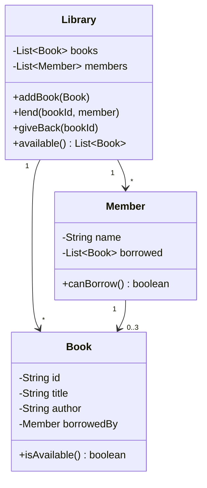

# Day 23 — OOP Project and Phase 2 Review

> Project day. You'll design a small system from scratch using everything from Phase 2, then check what has stuck.

**Today's goal:** turn a short description into classes, decide where inheritance and interfaces fit, protect the rules with encapsulation and exceptions, and put the result on GitHub.

<!-- topic: b23_t1 -->
## ☕ Project — Library Management (console)

<!-- subtopic: b23_t1_s1 -->
### Design the classes

**The brief:** a small library lends books to members. A member can borrow at most 3 books at a time. A book can only be lent to one member at a time. The library needs to add books, register members, lend and return books, and list what's available.

**Step 1: find the nouns and verbs.** Nouns are candidate classes and fields; verbs are candidate methods.

| Nouns | Verbs |
|---|---|
| library, book, member, title, author, limit | add, register, lend (borrow), return, list |

**Step 2: sketch the classes** before writing code:



(Lists of things will be `ArrayList` from Day 25. For today, plain arrays with a counter are fine, or peek ahead.)

**Step 3: decide who owns each rule.** "At most 3 books" is about a member → a method on `Member`. "Only one borrower at a time" is about a book → `Book` knows who has it. `Library` **coordinates**: it finds the book and the member and asks them.

A good design question for every method: *which object has the data this needs?* Put the method there.

<!-- subtopic: b23_t1_s2 -->
### Use inheritance or an interface where it fits

Extend the brief: the library also lends **e-books**, which never run out (any number of members can borrow them at once), and **DVDs**, which can only be borrowed for 3 days instead of 14.

Options:

- **Inheritance:** an abstract `Item` with title, id and an abstract `loanDays()`; `Book`, `EBook` and `Dvd` extend it. Each overrides `loanDays()` (14, 21, 3), and `Library` works with `Item`s, so polymorphism (Day 17) picks the right value.
- **Interface:** if only some items have a behaviour (say, `Reservable`), make it an interface that just those classes implement.

Don't force inheritance: "a `Member` is a `Book`?" No. A `Member` *has* borrowed items (composition, Day 18).

<!-- subtopic: b23_t1_s3 -->
### Protect the rules with your own exceptions

Use exceptions for things that must never silently happen:

```java
public class BookNotAvailableException extends RuntimeException {
    public BookNotAvailableException(String title) {
        super("'" + title + "' is already borrowed");
    }
}

public class BorrowLimitException extends RuntimeException {
    public BorrowLimitException(String member) {
        super(member + " already has 3 books");
    }
}
```

`Library.lend(...)` throws them; the menu code in `main` catches them and prints a friendly message, and the program keeps running. Private fields and checks in constructors (Day 14) mean a book can't be created without a title, and nobody can set `borrowedBy` except through `lend`/`giveBack`.

👉 **Code Practice** has the core of this project as a testable exercise with a reference solution.

<!-- subtopic: b23_t1_s4 -->
### Push it to GitHub with a README and a diagram

1. Commit in small steps as you build (classes first, then lending, then exceptions, then the menu).
2. Write a `README.md`: what the program does, how to run it, a sample session, and the class diagram above. GitHub renders `mermaid` code blocks in READMEs, so you can paste the diagram as-is.
3. Add a "What I learned" section: two or three lines about a design decision you made (for example, why the borrow limit lives in `Member`). Interviewers love asking about exactly this.

<!-- topic: b23_t2 -->
## 🧮 Practice — Phase 2 Review

<!-- subtopic: b23_t2_s1 -->
### Re-solve five problems without looking

Pick five problems from Days 7–22 (try to include one from arrays, strings, recursion, binary search and linked lists). Close your old solutions and solve each one again from a blank file. Time yourself.

If you get stuck, don't look straight at the solution: re-read the problem's notes for the **idea** (two pointers? halving? slow/fast?), then try again. Note the ones that needed a peek; they go to the top of your revision list. (The **Revise** page's "Solve again" flag is made for this.)

<!-- subtopic: b23_t2_s2 -->
### Explain it out loud

Answer each question aloud in under a minute, then open the flashcard to check.

<details>
<summary>What is the difference between overloading and overriding?</summary>

Overloading: same method name, different parameter lists, chosen at compile time. Overriding: a subclass replaces an inherited method with the same signature, chosen at run time by the real object.
</details>

<details>
<summary>When would you use an abstract class rather than an interface?</summary>

An abstract class when related classes share state (fields) and some implemented behaviour, in an "is a" family. An interface for a capability that unrelated classes can have, and when a class needs several of them.
</details>

<details>
<summary>What is the difference between a checked and an unchecked exception?</summary>

The compiler forces you to catch or declare checked exceptions (expected problems like missing files). Unchecked exceptions extend RuntimeException and usually signal bugs; handling them isn't enforced.
</details>

<details>
<summary>Why make fields private?</summary>

So the object controls every change to its data and can enforce its rules (encapsulation). Other code can only go through methods that validate.
</details>

<details>
<summary>What are the four pillars of OOP?</summary>

Encapsulation (protect data behind methods), inheritance (build on an existing class), polymorphism (one call, behaviour chosen by the object), abstraction (expose what, hide how).
</details>

## 📝 Day 23 Recap

1. How do you find candidate classes in a description? → **look for the nouns; verbs become methods**
2. Where should a rule like "max 3 books" live? → **in the class that has the data it needs (Member)**
3. What does the Library class mainly do? → **coordinates: finds objects and asks them to act**
4. Book vs EBook vs Dvd with different loan days? → **an abstract Item with an overridden loanDays() method**
5. Is a Member a Book? → **no: a Member has borrowed books (composition)**
6. Why custom exceptions? → **they name the problem clearly and stop invalid actions**
7. Where are those exceptions caught? → **in the menu/main code, which shows a friendly message**
8. What should a project README include? → **what it does, how to run it, a sample run, and what you learned**
9. Four pillars of OOP? → **encapsulation, inheritance, polymorphism, abstraction**
10. Stuck re-solving a problem? → **re-read the idea first, then try again before looking at code**
