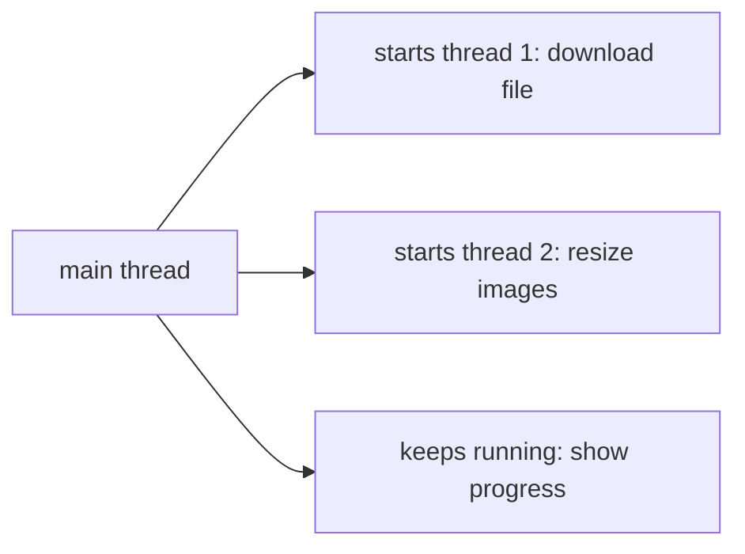

# Day 38 — Threads: Doing Several Things at Once

> **Phase 5: Concurrency & the JVM.** This is the hardest phase of core Java. Go slowly, run every example several times (the output can change between runs, which is the whole point), and read each 🌱 **In simple words** box first.

**Today's goal:** understand what a thread is, start your own, and know the states a thread passes through.

<!-- topic: b38_t1 -->
## ☕ Java — Thread Basics

<!-- subtopic: b38_t1_s1 -->
### Why concurrency

Picture a restaurant kitchen. With **one cook**, every order waits for the previous one to finish, even while the cook just stands there waiting for water to boil. With **several cooks**, orders are prepared at the same time, and while one cook waits for the oven, another chops vegetables.

A **thread** is one cook: a single path of execution through your program. Every program you've written so far had exactly one thread, the **main thread**, which starts in `main` and runs your statements one after another. A program can start **more** threads that run **at the same time**.

Why bother?

1. **Waiting without wasting time.** A web server talks to thousands of users. While one request waits for the database, another thread can serve someone else. This is the main reason backend developers care (and Spring Boot does it for you, Day 54).
2. **Using every processor core.** Your laptop has several cores; one thread can only use one of them.
3. **Keeping things responsive.** A long download on its own thread doesn't freeze the rest of the app.

The catch: when cooks **share** things (one knife, one stove), they can get in each other's way. Two threads changing the same variable at the same time can corrupt it, and those bugs appear only *sometimes*, which makes them the hardest bugs in programming. That's what Days 39–42 are about.



<details>
<summary>What is a thread?</summary>

One independent path of execution through a program. A program starts with the main thread and can start more threads that run at the same time.
</details>

<details>
<summary>Why are bugs between threads hard to find?</summary>

They depend on the exact timing of the threads, which changes from run to run, so the program can work many times and then fail occasionally.
</details>

<!-- intro: d8_t1_s2 -->
To run code on a new thread, give the thread a task and call **`start()`**. The modern way is to pass a lambda (Day 34) as a `Runnable`:

```java
Thread worker = new Thread(() -> System.out.println("Hello from " + Thread.currentThread().getName()));
worker.start();     // runs the lambda on a NEW thread
worker.join();      // main waits here until worker finishes
```

Call `start()`, not `run()`: `run()` would just execute the code on the current thread like any method call. `Callable` is like `Runnable` but returns a value; it becomes useful with thread pools on Day 40.

<!-- intro: d8_t1_s1 -->
A thread moves through states: **NEW** (created, not started), **RUNNABLE** (running or ready to run), **BLOCKED** / **WAITING** / **TIMED_WAITING** (paused, waiting for a lock, another thread or a timer) and **TERMINATED** (finished). The diagram below shows how a thread moves between them; you'll meet what causes each pause over the next days.

<!-- intro: d8_t1_s8 -->
`Thread.sleep(ms)` pauses the current thread for a while (it keeps any locks it holds). `wait()` also pauses, but releases its lock and waits to be woken by another thread (Day 39). They look similar and are a favourite interview comparison.

<!-- topic: b38_t2 -->
## 🧮 DSA — Dynamic Programming: Medium (2D)

DP where the answer depends on **two** things, so the table is a grid: `dp[i][j]` for "the first i letters of one word and the first j of another" (Longest Common Subsequence, Edit Distance) or "row i, column j" (Unique Paths). Fill the grid row by row; each cell looks at its neighbours above and to the left. Draw a small grid for a tiny example and fill it by hand first: the pattern of arrows *is* the recurrence.

## 📝 Day 38 Recap

1. What is a thread? → **one path of execution; programs can run several at once**
2. Which thread runs main? → **the main thread**
3. Two reasons to use threads? → **do other work while waiting (e.g. for a database) and use several CPU cores**
4. Start a new thread? → **new Thread(runnable).start()**
5. start() vs run()? → **start() runs the task on a new thread; run() just calls it on the current thread**
6. Wait for a thread to finish? → **thread.join()**
7. Runnable vs Callable? → **Callable returns a value (and can throw checked exceptions); Runnable doesn't**
8. Name the thread states? → **NEW, RUNNABLE, BLOCKED, WAITING, TIMED_WAITING, TERMINATED**
9. sleep vs wait? → **sleep keeps locks and resumes after a time; wait releases the lock until notified**
10. 2D DP table cell dp[i][j] usually depends on? → **neighbouring cells above and to the left**
