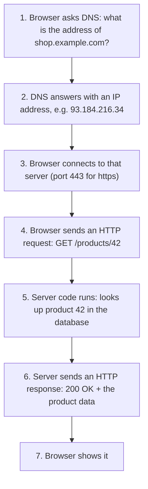

# Day 45 — How the Web Works: HTTP, REST and JSON

> **Phase 6: Backend Foundations.** Before Spring Boot, you need to know what a backend actually *does*: receive requests over the network and send back responses. These seven days give you the web, build tools and databases. No new Java syntax today, just the ideas every backend developer uses daily.

**Today's goal:** explain what happens when you open a web page, read and write HTTP requests and responses, know what a REST API is, and read JSON.

<!-- topic: b45_t1 -->
## 🌿 Web — HTTP, REST & JSON

<!-- subtopic: b45_t1_s1 -->
### Clients and servers

Every time you use an app, two programs are talking:

- the **client** asks for something: your browser, a mobile app, or another program;
- the **server** answers: a program running on a computer somewhere, waiting for requests. **This is what you'll build with Spring Boot.**

What happens when you open `https://shop.example.com/products/42`:



The pieces of a URL:

```text
https://shop.example.com:443/products/42?currency=INR&sort=price
└─┬─┘   └──────┬───────┘ └┬┘└────┬─────┘ └──────────┬─────────┘
scheme       host       port   path          query parameters
```

- **scheme**: `http` or `https` (the S means encrypted; always use it for real sites).
- **host**: the server's name, turned into an IP address by **DNS** (the internet's phone book).
- **port**: which program on that computer to talk to. Defaults: 80 for http, 443 for https. Your Spring Boot app will listen on **8080** while you develop.
- **path**: which thing you want.
- **query parameters**: extra options after `?`, as `key=value` pairs joined by `&`.

When you run a server on your own computer, its host is `localhost` (your own machine): `http://localhost:8080/hello`.

<details>
<summary>What does DNS do?</summary>

It turns a host name like shop.example.com into the IP address of the server, so the client knows where to connect.
</details>

<details>
<summary>In https://site.com/search?q=java&page=2, what is the path and what are the query parameters?</summary>

The path is `/search`; the query parameters are `q=java` and `page=2`.
</details>

<!-- subtopic: b45_t1_s2 -->
### HTTP requests

**HTTP** is the language clients and servers speak. A request is just text with a fixed shape:

```text
POST /api/orders HTTP/1.1                ← request line: METHOD  PATH  VERSION
Host: shop.example.com                   ← headers: extra information, one per line
Content-Type: application/json
Authorization: Bearer eyJhbGciOi...
                                         ← empty line: headers end here
{"productId": 42, "quantity": 2}         ← body: the data being sent (optional)
```

The **method** says what you want to do. The five you'll use:

| Method | Meaning | Example | Has a body? |
|---|---|---|---|
| **GET** | read something | `GET /products/42` | no |
| **POST** | create something new | `POST /orders` with the order in the body | yes |
| **PUT** | replace something completely | `PUT /users/7` with the whole user | yes |
| **PATCH** | change part of something | `PATCH /users/7` with just the new email | yes |
| **DELETE** | remove something | `DELETE /cart/items/3` | usually no |

Two words worth knowing:

- **Safe**: GET only reads; it should never change anything on the server. (So a "delete" link that uses GET is a bug: a web crawler following links would delete things.)
- **Idempotent**: doing it twice has the same effect as once. GET, PUT and DELETE are; POST isn't (posting an order twice makes two orders).

Common **headers**: `Content-Type` (what format the body is in), `Accept` (what format the client wants back), `Authorization` (who you are, Day 61), `User-Agent` (which client).

<details>
<summary>Which HTTP method creates a new resource, and which reads one?</summary>

POST creates; GET reads.
</details>

<details>
<summary>What does idempotent mean, and is POST idempotent?</summary>

Repeating the request has the same effect as doing it once. POST is not idempotent: sending it twice usually creates two things.
</details>

<!-- subtopic: b45_t1_s3 -->
### HTTP responses and status codes

The server answers with a response of the same shape: a status line, headers, an empty line and a body.

```text
HTTP/1.1 201 Created
Content-Type: application/json
Location: /api/orders/1001

{"id": 1001, "status": "PLACED", "total": 1998.00}
```

The three-digit **status code** tells the client at a glance how it went. The first digit is the family:

| Family | Meaning | Codes you'll use |
|---|---|---|
| **2xx** | success | **200 OK**, **201 Created** (POST made something), **204 No Content** (success, nothing to send back) |
| **3xx** | go somewhere else | 301 Moved Permanently, 302 Found (redirects) |
| **4xx** | **the client** made a mistake | **400 Bad Request** (invalid data), **401 Unauthorized** (not logged in), **403 Forbidden** (logged in, not allowed), **404 Not Found**, **409 Conflict** (e.g. email already registered) |
| **5xx** | **the server** failed | **500 Internal Server Error** (a bug or crash on the server), 503 Service Unavailable |

The 4xx/5xx split matters: 4xx means "fix your request", 5xx means "our fault, try again later". Returning the right code is part of designing a good API (Day 55), and returning 200 with an error message inside is a classic beginner mistake.

<details>
<summary>401 vs 403?</summary>

401 Unauthorized: we don't know who you are (not logged in or bad token). 403 Forbidden: we know who you are, but you're not allowed to do this.
</details>

<details>
<summary>What do 4xx and 5xx codes mean?</summary>

4xx: the client's request was wrong (bad data, not found, not allowed). 5xx: the server failed while handling a valid request.
</details>

<!-- subtopic: b45_t1_s4 -->
### APIs and REST

An **API** (application programming interface) is a set of requests a program accepts from other programs. A backend usually exposes a **web API**: a list of URLs and methods that mobile apps, websites and other services call.

**REST** is the most common style for designing web APIs. Its main ideas, in simple words:

1. **URLs name things (resources), as nouns**: `/products`, `/products/42`, `/users/7/orders`.
2. **HTTP methods say what to do with them**, so you don't put verbs in the URL.

| ✓ REST style | ✗ Not REST style |
|---|---|
| `GET /products` | `GET /getAllProducts` |
| `GET /products/42` | `GET /product?action=view&id=42` |
| `POST /products` | `POST /createProduct` |
| `PUT /products/42` | `POST /updateProduct` |
| `DELETE /products/42` | `GET /deleteProduct?id=42` |

3. **Status codes report the outcome** (201 for created, 404 for missing…).
4. **Stateless**: every request carries everything the server needs (including who you are), so any server copy can answer it. This is what lets backends scale to many servers (Day 75).

Collections are plural (`/products`), one item is `/products/{id}`, and things that belong to something else nest: `/users/7/orders`. Filtering, sorting and paging go in query parameters: `/products?category=books&sort=price&page=2`.

<details>
<summary>REST URL and method to delete product 42?</summary>

`DELETE /products/42`.
</details>

<!-- subtopic: b45_t1_s5 -->
### JSON

Request and response bodies need a format both sides understand. Almost every modern API uses **JSON** (JavaScript Object Notation): plain text that's easy for humans to read and for programs to parse.

```json
{
  "id": 42,
  "name": "Wireless Mouse",
  "price": 799.50,
  "inStock": true,
  "tags": ["electronics", "accessories"],
  "seller": { "id": 7, "name": "TechMart" },
  "discount": null
}
```

The building blocks:

| JSON | Example | Java equivalent |
|---|---|---|
| object `{ }` with `"key": value` pairs | `{"id": 42}` | an object of a class with fields |
| array `[ ]` | `["a", "b"]` | an array or `List` |
| string (double quotes only) | `"Mouse"` | `String` |
| number | `799.50` | `int`, `double`… |
| boolean | `true` | `boolean` |
| null | `null` | `null` |

Keys are always strings in double quotes, and there are no comments and no trailing commas.

**JSON ↔ Java objects.** A library (Jackson, built into Spring Boot) converts automatically: matching keys go into matching fields. A Java record

```java
record Product(long id, String name, double price, boolean inStock) { }
```

turns into `{"id": 42, "name": "Wireless Mouse", "price": 799.5, "inStock": true}` and back. Turning an object into JSON is called **serialisation**, the reverse **deserialisation** (the same words as Day 22, with text instead of bytes). In Spring Boot you'll simply return objects from your methods, and they arrive at the client as JSON.

<details>
<summary>Which quotes does JSON use for strings and keys?</summary>

Double quotes only. Single quotes aren't valid JSON.
</details>

<!-- subtopic: b45_t1_s6 -->
### Try it: browser, curl and Postman

Seeing real requests makes all of this concrete. Try a free public test API such as `https://jsonplaceholder.typicode.com`.

**1. The browser** can only easily send GET requests. Open `https://jsonplaceholder.typicode.com/users/1`: you'll see JSON. Press **F12** → **Network** tab, reload, click the request, and look at the method, the status code, and the request and response headers.

**2. curl** sends any request from the terminal (built into Windows 10+, macOS and Linux):

```bash
curl https://jsonplaceholder.typicode.com/posts/1
curl -i https://jsonplaceholder.typicode.com/posts/999           # -i shows status and headers: 404
curl -X POST https://jsonplaceholder.typicode.com/posts \
     -H "Content-Type: application/json" \
     -d '{"title": "Hello", "body": "My first POST", "userId": 1}'   # 201 Created
```

(On Windows PowerShell, use `curl.exe` and put the JSON in double quotes with the inner quotes escaped, or simply use Postman.)

**3. Postman** (free app, postman.com) or the **HTTP Client** built into IntelliJ Ultimate gives you a form for method, URL, headers and body, and keeps a history. You'll use one of these constantly once you build your own API on Day 54.

Do this now: send a GET, a GET for something that doesn't exist (see the 404), and a POST, and look at the status code each time.

👉 **Code Practice** today has you parse a raw HTTP request in plain Java, so the request format above becomes something you've handled yourself.

<!-- topic: b45_t2 -->
## 🧮 DSA — String Advanced

DSA continues alongside the backend work, at a lighter pace. Today: harder string problems. Longest Palindromic Substring **expands around every centre** (each character, and each gap between two characters). String Compression is Day 8's exercise in its in-place form. Repeated Substring Pattern has a neat trick: a string made of a repeated piece appears inside itself doubled with the first and last characters removed. KMP is read-only today: understand *why* it never re-checks characters, not every line.

## 📝 Day 45 Recap

1. Client vs server? → **the client sends requests; the server waits for and answers them**
2. What does DNS do? → **turns a host name into the server's IP address**
3. Default port for https, and the usual port for a local Spring Boot app? → **443, and 8080**
4. Parts of an HTTP request? → **request line (method, path, version), headers, an empty line, an optional body**
5. Method to read / create / delete? → **GET / POST / DELETE**
6. What does 201 mean? → **Created: a new resource was made**
7. 404 vs 500? → **404: the resource doesn't exist (client side); 500: the server failed**
8. REST URLs should be? → **nouns naming resources, e.g. /products/42, with the method saying what to do**
9. What is JSON? → **a text format of objects, arrays, strings, numbers, booleans and null**
10. Turning a Java object into JSON is called? → **serialisation**
