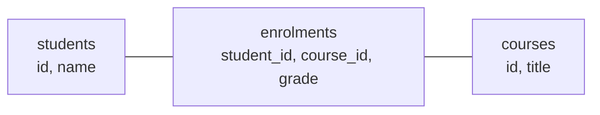

# Day 47 — Databases and SQL Basics

> Almost every backend stores its data in a database, and SQL is how you talk to it. SQL is its own small language; it reads almost like English. Type every query yourself.

**Today's goal:** understand tables, rows and keys, create a table and fill it, and write `SELECT` queries that filter, sort, count and group.

<!-- topic: b47_t1 -->
## 🗄️ SQL — Basics

<!-- subtopic: b47_t1_s1 -->
### What a database is

When your Java program ends, every variable and object is gone. A **database** stores data **permanently**, lets many users read and change it at the same time safely, and finds things quickly even among millions of rows.

A **relational database** (PostgreSQL, MySQL, Oracle, SQL Server, SQLite) stores data in **tables**, like spreadsheets with strict rules:

**students**

| id | name | city | age |
|---|---|---|---|
| 1 | Asha | Pune | 21 |
| 2 | Ravi | Delhi | 23 |
| 3 | Meera | Pune | 22 |

- A **row** is one record (one student).
- A **column** is one property, with a fixed **type** (`id` is a number, `name` is text).
- The **primary key** (`id` here) uniquely identifies each row: no two students share an id, and it's never empty. Think of it as the roll number.

**SQL** (Structured Query Language, said "S-Q-L" or "sequel") is the language for all of them. The basics you learn today work almost unchanged in every relational database.

A table is a lot like a Java class (columns ↔ fields, rows ↔ objects), which is exactly how Spring Data JPA will connect them on Day 58.

<details>
<summary>What is a primary key?</summary>

A column (or columns) whose value uniquely identifies each row and is never null, like a student's id.
</details>

<!-- subtopic: b47_t1_s2 -->
### Get a database to practise on

Pick one:

- **Quickest: an online playground.** Open [sqliteonline.com](https://sqliteonline.com) or [db-fiddle.com](https://www.db-fiddle.com) (choose PostgreSQL), paste SQL, and press Run. Nothing to install.
- **Real setup: PostgreSQL.** Download the installer from postgresql.org (Windows/macOS) or `sudo apt install postgresql` (Linux). It includes **psql** (a terminal client) and **pgAdmin** (a visual one). Then create a database for practice:

```sql
CREATE DATABASE practice;
```

You'll use PostgreSQL with Spring Boot later, so installing it now is worth it. IntelliJ Ultimate and the free **DBeaver** app are also good visual clients.

SQL keywords are **not** case-sensitive (`select` = `SELECT`), but writing them in capitals makes queries easier to read. Text values go in **single** quotes: `'Pune'`. Statements end with `;`.

<!-- subtopic: b47_t1_s3 -->
### Create a table and change its rows

**Create** a table by listing its columns and their types:

```sql
CREATE TABLE students (
    id    INTEGER PRIMARY KEY,
    name  VARCHAR(100) NOT NULL,     -- text up to 100 characters, must be given
    city  VARCHAR(50),
    age   INTEGER,
    email VARCHAR(100) UNIQUE        -- no two students may share an email
);
```

Common types: `INTEGER` / `BIGINT` (whole numbers), `DECIMAL(10, 2)` (exact decimals: use it for money), `VARCHAR(n)` (text), `BOOLEAN`, `DATE` / `TIMESTAMP`. Rules like `NOT NULL` and `UNIQUE` are **constraints**: the database refuses data that breaks them, just like your setters on Day 14.

**Insert** rows:

```sql
INSERT INTO students (id, name, city, age) VALUES (1, 'Asha', 'Pune', 21);
INSERT INTO students (id, name, city, age) VALUES
    (2, 'Ravi', 'Delhi', 23),
    (3, 'Meera', 'Pune', 22);
```

**Update** rows:

```sql
UPDATE students SET city = 'Mumbai' WHERE id = 2;
```

**Delete** rows:

```sql
DELETE FROM students WHERE id = 3;
```

⚠️ **Always write the `WHERE`** on `UPDATE` and `DELETE`. `DELETE FROM students;` with no `WHERE` deletes **every** row, with no undo. Many developers write the `WHERE` first, then the rest.

Together, create/read/update/delete are called **CRUD**, and they map onto HTTP's POST/GET/PUT/DELETE from Day 45.

<details>
<summary>What happens if you run UPDATE or DELETE without a WHERE?</summary>

It changes or deletes every row in the table.
</details>

<!-- subtopic: b47_t1_s4 -->
### SELECT: reading data

`SELECT` reads rows. Its parts are written in a fixed order:

```sql
SELECT name, age              -- which columns (* means all)
FROM students                 -- which table
WHERE city = 'Pune'           -- which rows
ORDER BY age DESC             -- in what order (ASC is the default)
LIMIT 10;                     -- at most how many
```

Filtering with `WHERE`:

| Condition | Meaning |
|---|---|
| `age >= 21 AND city = 'Pune'` | both must be true |
| `city = 'Pune' OR city = 'Delhi'` | at least one |
| `city IN ('Pune', 'Delhi')` | same thing, shorter |
| `age BETWEEN 20 AND 25` | 20 ≤ age ≤ 25 (inclusive) |
| `name LIKE 'A%'` | starts with A (`%` = any characters, `_` = exactly one) |
| `email IS NULL` | has no email (never write `= NULL`, it's never true) |
| `NOT`, `<>` or `!=` | not / not equal |

Rename a column in the result with `AS`: `SELECT name AS student_name ...`. Remove duplicate rows with `SELECT DISTINCT city FROM students;`.

<details>
<summary>How do you find students whose name starts with M?</summary>

`SELECT * FROM students WHERE name LIKE 'M%';`
</details>

<details>
<summary>Why is WHERE email = NULL wrong?</summary>

Nothing is ever equal to NULL in SQL (it means "unknown"). Use `email IS NULL`.
</details>

<!-- subtopic: b47_t1_s5 -->
### Counting and grouping

**Aggregate functions** turn many rows into one value:

```sql
SELECT COUNT(*)  FROM students;                    -- how many rows
SELECT AVG(age)  FROM students WHERE city = 'Pune';
SELECT MIN(age), MAX(age) FROM students;
SELECT SUM(amount) FROM orders;
```

**`GROUP BY`** splits rows into groups and calculates one result **per group**, like Day 36's `groupingBy`:

```sql
SELECT city, COUNT(*) AS students, AVG(age) AS avg_age
FROM students
GROUP BY city
ORDER BY students DESC;
```

| city | students | avg_age |
|---|---|---|
| Pune | 2 | 21.5 |
| Delhi | 1 | 23.0 |

The rule that trips everyone up: with `GROUP BY`, every column in `SELECT` must be either **in the GROUP BY** or **inside an aggregate**. `SELECT city, name, COUNT(*) ... GROUP BY city` is an error in most databases: which of the city's names should it show?

<details>
<summary>Count how many students live in each city?</summary>

`SELECT city, COUNT(*) FROM students GROUP BY city;`
</details>

<!-- intro: d51_t1_s5 -->
To filter **groups** rather than rows, use `HAVING`: "cities with more than 10 students" is `GROUP BY city HAVING COUNT(*) > 10`. The difference: `WHERE` filters rows **before** grouping, `HAVING` filters groups **after** the counting. The full order SQL runs a query in is FROM → WHERE → GROUP BY → HAVING → SELECT → ORDER BY → LIMIT.

<!-- subtopic: b47_t1_s7 -->
### Relationships and foreign keys

Real data is connected: students enrol in courses, customers place orders. Instead of copying a customer's name and address into every order (and having to update all of them when they move), you store each thing **once** and link tables with **foreign keys**.

**One-to-many**: one customer has many orders, each order belongs to one customer. The "many" side holds the link:

```sql
CREATE TABLE customers (
    id   INTEGER PRIMARY KEY,
    name VARCHAR(100) NOT NULL
);

CREATE TABLE orders (
    id          INTEGER PRIMARY KEY,
    customer_id INTEGER NOT NULL REFERENCES customers(id),   -- foreign key
    total       DECIMAL(10, 2)
);
```

The **foreign key** `customer_id` must match an existing customer's `id`. The database enforces it: you can't create an order for customer 99 if there's no customer 99, or delete a customer who still has orders. This is called **referential integrity**.

**Many-to-many**: a student takes many courses and a course has many students. Neither table can hold a single link, so you add a **join table** in between:



Each row of `enrolments` says "this student takes this course". Tomorrow's **joins** combine these tables back together in a query, and on Day 59 JPA maps them to Java objects with `@OneToMany` and `@ManyToMany`.

<details>
<summary>In a one-to-many relationship, which table holds the foreign key?</summary>

The "many" side: each order holds its customer's id.
</details>

<details>
<summary>How do you model a many-to-many relationship?</summary>

With a join table holding pairs of foreign keys (e.g. enrolments with student_id and course_id).
</details>

👉 **Code Practice** today has SQL exercises with a ready-made table to load into any playground, and expected results to check against.

<!-- topic: b47_t2 -->
## 🧮 DSA — Hard DP Practice

Three hard DP problems for when you have energy left: Regular Expression Matching and Longest Valid Parentheses use a 2D or 1D table like Days 37–38, and Burst Balloons is "interval DP" (the answer for a range depends on smaller ranges inside it). These are stretch goals during this phase. Don't let them block the SQL; come back to them in a revision week.

## 📝 Day 47 Recap

1. Table, row, column? → **a table holds rows (records); each column is one typed property**
2. What is a primary key? → **a unique, never-null identifier for each row**
3. Type for money in SQL? → **DECIMAL (exact), not a floating-point type**
4. Add a row? → **INSERT INTO table (cols) VALUES (...)**
5. Danger of UPDATE or DELETE without WHERE? → **it changes or deletes every row**
6. Order of SELECT clauses? → **SELECT, FROM, WHERE, GROUP BY, HAVING, ORDER BY, LIMIT**
7. Test for a missing value? → **IS NULL (never = NULL)**
8. Starts-with search? → **LIKE 'A%'**
9. WHERE vs HAVING? → **WHERE filters rows before grouping; HAVING filters groups after**
10. What is a foreign key? → **a column that must match the primary key of a row in another table**
