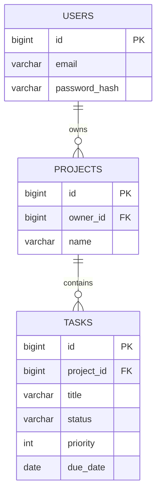

# Day 54 — Your First Spring Boot App

> Today you build and run a real web server. By the end you'll call your own Java code from a browser.

**Today's goal:** create a Spring Boot project, understand what `@SpringBootApplication` and auto-configuration do for you, configure the app, and return text and JSON from your first endpoints.

<!-- topic: b54_t1 -->
## 🌿 Spring Boot — Getting Started

<!-- subtopic: b54_t1_s1 -->
### Create and run a project

**Spring** is the framework (DI, web, data…). **Spring Boot** is Spring with sensible defaults and a built-in web server, so a project runs with zero setup.

1. Open [start.spring.io](https://start.spring.io) (the **Spring Initializr**).
2. Choose: **Maven**, **Java**, the latest stable Spring Boot, Group `com.example`, Artifact `demo`, Java **21**.
3. Add dependencies: **Spring Web** and **Spring Boot DevTools**.
4. Click **Generate**, unzip, and open the folder in IntelliJ (*File → Open*, pick the folder with `pom.xml`).

You get the Maven layout from Day 46, plus:

```text
src/main/java/com/example/demo/DemoApplication.java    ← the starting point
src/main/resources/application.properties              ← configuration
pom.xml                                                ← spring-boot-starter-web, etc.
mvnw / mvnw.cmd                                        ← the Maven wrapper
```

Run `DemoApplication` (▶ next to `main`) or `./mvnw spring-boot:run`. The log ends with something like:

```text
Tomcat started on port 8080 (http)
Started DemoApplication in 1.8 seconds
```

**Tomcat** is a web server, embedded inside your app. Open `http://localhost:8080`: you'll see an error page ("Whitelabel Error Page", 404). That's good: the server is running, it just has no endpoints yet.

**DevTools** restarts the app automatically when you rebuild, so you don't need to stop and start it after every change (in IntelliJ: *Build → Build Project*, or enable automatic building).

<details>
<summary>What is the embedded server in a Spring Boot web app, and which port does it use by default?</summary>

Tomcat, on port 8080.
</details>

<!-- intro: d20_t1_s1 -->
Look at `DemoApplication`: one annotation, `@SpringBootApplication`, does three jobs. It marks the class as a configuration class (Day 53), turns on **auto-configuration** (next section), and turns on **component scanning**: Spring looks for `@Component`, `@Service`, `@RestController`… in this class's package **and every package below it**. That's why your classes must live under `com.example.demo`: a controller in a different package would never be found.

<!-- intro: d20_t1_s2 -->
How does adding "Spring Web" give you a running web server with zero code? **Auto-configuration**: Spring Boot contains hundreds of ready-made `@Configuration` classes, each guarded by conditions like "if Tomcat is on the classpath and you haven't defined your own web server, create one". Your dependencies decide what gets configured, and anything you define yourself takes priority. Run the app with `--debug` to see the report of what was configured and why.

<!-- subtopic: b54_t1_s4 -->
### application.properties

Spring Boot reads settings from `src/main/resources/application.properties` (or the same thing in YAML format, `application.yml`):

```properties
server.port=8081
spring.application.name=demo
logging.level.com.example.demo=DEBUG

# your own settings
app.greeting=Hello
app.max-items=50
```

```yaml
# the same settings in application.yml
server:
  port: 8081
app:
  greeting: Hello
  max-items: 50
```

Read your own settings in a bean with `@Value`:

```java
@Service
public class GreetingService {
    private final String greeting;

    public GreetingService(@Value("${app.greeting}") String greeting) {
        this.greeting = greeting;
    }
}
```

Keeping settings out of code means the same JAR can run with different values on your laptop and on a server. Day 63 covers profiles, typed configuration classes and environment variables. Never put real passwords in this file once it's committed to Git (Day 12).

<details>
<summary>Where do Spring Boot settings like server.port go?</summary>

In `src/main/resources/application.properties` (or `application.yml`).
</details>

<!-- subtopic: b54_t1_s5 -->
### Your first endpoints

A **controller** handles HTTP requests. Create it in the same package as `DemoApplication` (or below it):

```java
package com.example.demo;

import org.springframework.web.bind.annotation.GetMapping;
import org.springframework.web.bind.annotation.RestController;

@RestController
public class HelloController {

    @GetMapping("/hello")
    public String hello() {
        return "Hello from Spring Boot!";
    }

    @GetMapping("/greeting")
    public Greeting greeting() {
        return new Greeting("Hello", "Asha", 2026);
    }

    record Greeting(String message, String name, int year) { }
}
```

Restart, then open:

- `http://localhost:8080/hello` → `Hello from Spring Boot!`
- `http://localhost:8080/greeting` → `{"message":"Hello","name":"Asha","year":2026}`

What just happened:

1. `@RestController` made this class a bean that handles web requests and returns data (not HTML pages).
2. `@GetMapping("/hello")` connected `GET /hello` to the `hello()` method.
3. Returning a `String` sends it as the response body; returning an **object** sends it as **JSON**, converted automatically by Jackson (Day 45). You never wrote any JSON code.

Try it with curl or Postman too: `curl -i http://localhost:8080/greeting` shows the `200` status and the `Content-Type: application/json` header.

👉 **Code Practice** today builds this controller with a test that checks it.

<details>
<summary>What happens when a @RestController method returns a Java object?</summary>

Spring converts it to JSON (with Jackson) and sends it as the response body.
</details>

<!-- topic: b54_t2 -->
## 🛠️ Project — Task Manager API (Step 1)

<!-- subtopic: b54_t2_s1 -->
### Step 1: plan the API, create the project, and make the first commit

From today until Day 67 you build one real backend, a step a day, each step using what that day taught. It's a task manager like a simple Trello or Todoist: people sign up, create **projects**, and add **tasks** to them. At the end you have a portfolio project you can explain in an interview, and on Day 69 the React app from the Frontend section (Module 29) connects to it.

**Where it's going.** This is the finished API. You'll build it one piece at a time, so don't worry if some words are new.

| Method | Path | Does | Success |
|---|---|---|---|
| POST | `/api/auth/signup` | create an account | 201 |
| POST | `/api/auth/login` | log in, get a token | 200 |
| POST | `/api/projects` | create a project | 201 |
| GET | `/api/projects` | my projects, with task counts | 200 |
| GET | `/api/projects/{id}` | one project | 200 |
| DELETE | `/api/projects/{id}` | delete a project and its tasks | 204 |
| POST | `/api/projects/{id}/tasks` | add a task | 201 |
| GET | `/api/projects/{id}/tasks` | a page of tasks, filtered and sorted | 200 |
| GET | `/api/tasks/{id}` | one task | 200 |
| PATCH | `/api/tasks/{id}` | change some fields | 200 |
| DELETE | `/api/tasks/{id}` | delete a task | 204 |

And the data, as tables (Day 51's ER diagrams):



The rules: a task's title is required (at most 200 characters), its priority is 1 to 5 (3 if not given), its status is `TODO`, `IN_PROGRESS` or `DONE` (new tasks start as `TODO`), and a due date can't be in the past. Users only ever see their own projects and tasks.

| Day | Step |
|---|---|
| 54 | 1. the project and a first endpoint |
| 55 | 2. projects and tasks, stored in memory |
| 56 | 3. validation and error responses |
| 57 | 4. tests |
| 58 | 5. a real database with JPA |
| 59 | 6. relationships, paging and the N+1 problem |
| 60 | 7. Flyway migrations and transactions |
| 61 | 8. users, sign-up and Spring Security |
| 62 | 9. JWT login, and each user sees only their data |
| 63 | 10. configuration, profiles and health checks |
| 64 | 11. an aspect that times every service call |
| 65–67 | 12–22. finish: docs, end-to-end tests, a security review, a runnable jar, a README, GitHub |

Every step ends with a ✅ **Checkpoint** (what should work now) and a commit, so you can always go back to a version that worked.

**1. Create the project.** At [start.spring.io](https://start.spring.io): **Maven**, **Java**, Spring Boot **4.0.x**, Group `com.example`, Artifact `taskmanager`, Java **21**. Dependencies: **Spring Web**, **Validation** and **Spring Boot DevTools**. Generate, unzip into your projects folder and open it in IntelliJ. Your package is `com.example.taskmanager`; every class goes in it or below it.

**2. A first endpoint**, to prove the app runs:

```java
// src/main/java/com/example/taskmanager/PingController.java
package com.example.taskmanager;

import java.util.Map;

import org.springframework.web.bind.annotation.GetMapping;
import org.springframework.web.bind.annotation.RestController;

// A tiny endpoint that proves the app is up: GET /api/ping → {"status":"ok"}
@RestController
public class PingController {

    @GetMapping("/api/ping")
    public Map<String, String> ping() {
        return Map.of("status", "ok");
    }
}
```

**3. Run it** (▶ next to `main` in `TaskManagerApplication`, or `./mvnw spring-boot:run`) and call it:

```bash
curl http://localhost:8080/api/ping
```

```text
{"status":"ok"}
```

(No curl? Open the address in your browser, or use Postman. On Windows, `curl.exe` is built in; in PowerShell type `curl.exe`, not `curl`.)

**4. Your first commit.** The Initializr already made a `.gitignore` that leaves out `target/` and IDE files.

```bash
git init
git add .
git commit -m "step 1: project and ping endpoint"
```

**✅ Checkpoint**

- [ ] `GET /api/ping` answers `{"status":"ok"}`.
- [ ] `git log` shows your first commit.

**If it doesn't work:** "Port 8080 was already in use" means another app (maybe an old run) has the port: stop it, or set `server.port=8081` in `application.properties`. A 404 on `/api/ping` usually means the controller is outside the `com.example.taskmanager` package, so component scanning never finds it.

<!-- topic: b54_t3 -->
## 🧮 DSA — Timed Practice

Interviews have time limits, so practise with one: solve one easy and two medium problems in 60 minutes, without looking anything up. Then two design-flavoured problems (Design Twitter, Flatten Nested List Iterator) that combine maps, lists and heaps, and Task Scheduler (heap + greedy). Note which problems ran over time; those patterns go on your revision list.

## 📝 Day 54 Recap

1. Spring vs Spring Boot? → **Spring is the framework; Spring Boot adds defaults, auto-configuration and an embedded server**
2. Where do you generate a project? → **start.spring.io (Spring Initializr)**
3. Embedded web server and default port? → **Tomcat on 8080**
4. Three things @SpringBootApplication turns on? → **configuration, auto-configuration and component scanning**
5. Why must controllers be under the main class's package? → **component scanning only searches that package and below**
6. What is auto-configuration? → **beans Spring Boot creates automatically based on your dependencies and settings, unless you define your own**
7. Change the port? → **server.port=8081 in application.properties**
8. Read a custom property into a bean? → **@Value("${app.greeting}")**
9. Map GET /hello to a method? → **@GetMapping("/hello") in a @RestController**
10. Returning an object from a controller sends? → **JSON**
