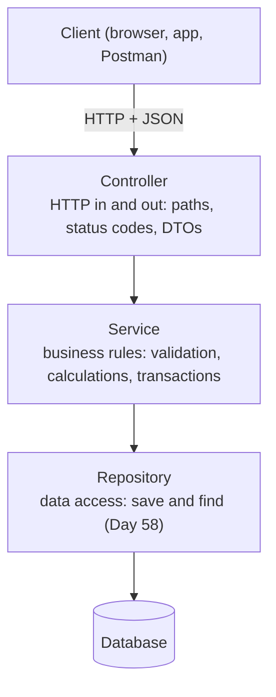

# Day 55 — Building a REST API

> Read each 🌱 **In simple words** box first. The 🚀 **Go deeper** panels are for a second pass.

**Today's goal:** build a complete CRUD API: every HTTP method, reading data from the URL and the body, returning the right status codes, and organising the code in layers.

<!-- topic: b55_t1 -->
## 🌿 Spring Boot — REST APIs

<!-- intro: d20_t1_s3 -->
`@RestController` = a controller whose methods return data (JSON) instead of web pages. Each HTTP method from Day 45 has an annotation: `@GetMapping`, `@PostMapping`, `@PutMapping`, `@PatchMapping`, `@DeleteMapping`. Put `@RequestMapping("/api/products")` on the class so every method's path starts there, and you've built Day 45's REST table in code.

<!-- intro: d20_t1_s4 -->
Four ways to read data from a request: **`@PathVariable`** takes a piece of the path (`/products/{id}` → `id`), **`@RequestParam`** takes a query parameter (`/products?category=books`), **`@RequestBody`** turns the JSON body into a Java object (for POST and PUT), and **`@RequestHeader`** reads a header. Spring converts types for you: `{id}` becomes a `long` if your parameter is a `long`.

<!-- intro: d20_t1_s5 -->
Returning an object gives `200 OK` by default. To choose the status, return a **`ResponseEntity`**: `ResponseEntity.status(HttpStatus.CREATED).body(product)` for a POST, `ResponseEntity.noContent().build()` for a DELETE (204), `ResponseEntity.notFound().build()` when the id doesn't exist (404). The right status code is part of your API's contract (Day 45).

<!-- subtopic: b55_t1_s4 -->
### Layers: controller, service, repository, and DTOs

Putting everything in the controller works for a demo and becomes a mess for a real app. Backends are organised in **layers**, each with one job:



| Layer | Annotation | Knows about | Must NOT know about |
|---|---|---|---|
| Controller | `@RestController` | HTTP, JSON, status codes | SQL |
| Service | `@Service` | business rules | HTTP (no `ResponseEntity` here) |
| Repository | `@Repository` | storage | HTTP, business rules |

Each layer receives the one below through constructor injection (Day 52). The benefit: the business rules in the service can be tested without a web server or a database, and the same service could be used by a different kind of controller later.

**DTOs (data transfer objects)** are simple classes, usually records, that define exactly what goes over the wire:

```java
public record CreateProductRequest(String name, double price) { }      // what a client may send
public record ProductResponse(long id, String name, double price) { }  // what a client gets back
```

Why not send your internal objects directly? Because they may contain things clients must never see or set (a password hash, an internal status, an `id` the server should choose), and because your database model can then change without breaking every client.

Until Day 58 connects a database, a simple in-memory repository works fine: a `@Repository` class holding a `Map<Long, Product>` and an `AtomicLong` (Day 41) for the next id.

<details>
<summary>Which layer contains business rules, and which handles HTTP?</summary>

The service holds business rules; the controller handles HTTP (paths, request data, status codes).
</details>

<details>
<summary>Why use DTOs instead of returning internal objects?</summary>

To control exactly which fields clients can send and see (hiding things like password hashes or internal ids) and to keep the API stable when the internal model changes.
</details>

<!-- subtopic: b55_t1_s5 -->
### Test every endpoint, including the errors

After building each endpoint, call it, and not just the happy path. A useful checklist for a products API:

| Request | Expect |
|---|---|
| `POST /api/products` with valid JSON | `201 Created`, body with the new id |
| `GET /api/products` | `200`, a JSON array |
| `GET /api/products/1` | `200`, the product |
| `GET /api/products/999` | `404 Not Found` |
| `PUT /api/products/1` with new data | `200`, the updated product |
| `DELETE /api/products/1` | `204 No Content` |
| `DELETE /api/products/1` again | `404` |
| `POST` with broken JSON (missing a quote) | `400 Bad Request` |

Save these requests in a Postman collection (or an IntelliJ `.http` file), so you can re-run them all after every change. On Day 57 you'll turn exactly this list into automated tests with MockMvc.

<!-- topic: b55_t2 -->
## 🧮 DSA — Mixed Revision

Four medium problems from different patterns (a heap or binary search on a sorted matrix, linked-list copying with a hash map, linked-list addition, and rotating an array three ways). Mixed practice like this is what an interview round feels like: identify the pattern first.

## 📝 Day 55 Recap

1. Annotation for a JSON-returning controller? → **@RestController**
2. Mapping annotations for the HTTP methods? → **@GetMapping, @PostMapping, @PutMapping, @PatchMapping, @DeleteMapping**
3. Read {id} from /products/{id}? → **@PathVariable**
4. Read ?category=books? → **@RequestParam**
5. Turn the JSON body into an object? → **@RequestBody**
6. Return 201 with a body? → **ResponseEntity.status(HttpStatus.CREATED).body(x)**
7. Return 204 for a delete? → **ResponseEntity.noContent().build()**
8. The three backend layers? → **controller (HTTP), service (business rules), repository (data access)**
9. What is a DTO? → **a simple object defining exactly the data sent or received over the API**
10. Expected status for GET of a missing id? → **404 Not Found**
