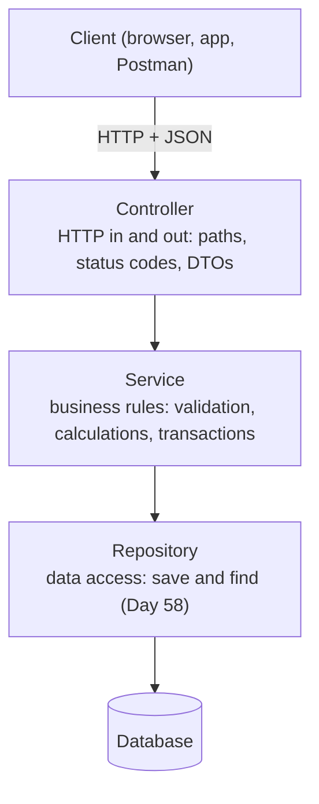

# Day 55 — Building a REST API

> Read each 🌱 **In simple words** box first. The 🚀 **Go deeper** panels are for a second pass.

**Today's goal:** build a complete CRUD API: every HTTP method, reading data from the URL and the body, returning the right status codes, and organising the code in layers.

<!-- topic: b55_t1 -->
## 🌿 Spring Boot — REST APIs

<!-- intro: d20_t1_s3 -->
`@RestController` = a controller whose methods return data (JSON) instead of web pages. Each HTTP method from Day 45 has an annotation: `@GetMapping`, `@PostMapping`, `@PutMapping`, `@PatchMapping`, `@DeleteMapping`. Put `@RequestMapping("/api/products")` on the class so every method's path starts there, and you've built Day 45's REST table in code.

<!-- intro: d20_t1_s4 -->
Four ways to read data from a request: **`@PathVariable`** takes a piece of the path (`/products/{id}` → `id`), **`@RequestParam`** takes a query parameter (`/products?category=books`), **`@RequestBody`** turns the JSON body into a Java object (for POST and PUT), and **`@RequestHeader`** reads a header. Spring converts types for you: `{id}` becomes a `long` if your parameter is a `long`.

<!-- intro: d20_t1_s5 -->
Returning an object gives `200 OK` by default. To choose the status, return a **`ResponseEntity`**: `ResponseEntity.status(HttpStatus.CREATED).body(product)` for a POST, `ResponseEntity.noContent().build()` for a DELETE (204), `ResponseEntity.notFound().build()` when the id doesn't exist (404). The right status code is part of your API's contract (Day 45).

<!-- subtopic: b55_t1_s4 -->
### Layers: controller, service, repository, and DTOs

Putting everything in the controller works for a demo and becomes a mess for a real app. Backends are organised in **layers**, each with one job:



| Layer | Annotation | Knows about | Must NOT know about |
|---|---|---|---|
| Controller | `@RestController` | HTTP, JSON, status codes | SQL |
| Service | `@Service` | business rules | HTTP (no `ResponseEntity` here) |
| Repository | `@Repository` | storage | HTTP, business rules |

Each layer receives the one below through constructor injection (Day 52). The benefit: the business rules in the service can be tested without a web server or a database, and the same service could be used by a different kind of controller later.

**DTOs (data transfer objects)** are simple classes, usually records, that define exactly what goes over the wire:

```java
public record CreateProductRequest(String name, double price) { }      // what a client may send
public record ProductResponse(long id, String name, double price) { }  // what a client gets back
```

Why not send your internal objects directly? Because they may contain things clients must never see or set (a password hash, an internal status, an `id` the server should choose), and because your database model can then change without breaking every client.

Until Day 58 connects a database, a simple in-memory repository works fine: a `@Repository` class holding a `Map<Long, Product>` and an `AtomicLong` (Day 41) for the next id.

<details>
<summary>Which layer contains business rules, and which handles HTTP?</summary>

The service holds business rules; the controller handles HTTP (paths, request data, status codes).
</details>

<details>
<summary>Why use DTOs instead of returning internal objects?</summary>

To control exactly which fields clients can send and see (hiding things like password hashes or internal ids) and to keep the API stable when the internal model changes.
</details>

<!-- subtopic: b55_t1_s5 -->
### Test every endpoint, including the errors

After building each endpoint, call it, and not just the happy path. A useful checklist for a products API:

| Request | Expect |
|---|---|
| `POST /api/products` with valid JSON | `201 Created`, body with the new id |
| `GET /api/products` | `200`, a JSON array |
| `GET /api/products/1` | `200`, the product |
| `GET /api/products/999` | `404 Not Found` |
| `PUT /api/products/1` with new data | `200`, the updated product |
| `DELETE /api/products/1` | `204 No Content` |
| `DELETE /api/products/1` again | `404` |
| `POST` with broken JSON (missing a quote) | `400 Bad Request` |

Save these requests in a Postman collection (or an IntelliJ `.http` file), so you can re-run them all after every change. On Day 57 you'll turn exactly this list into automated tests with MockMvc.

<!-- topic: b55_t2 -->
## 🛠️ Project — Task Manager API (Step 2)

<!-- subtopic: b55_t2_s1 -->
### Step 2: projects and tasks, stored in memory

**Goal:** every project and task endpoint working, with the layers from today: controller → service → storage, and DTOs for what goes in and out. The data lives in a `Map` for now, so it's gone when the app restarts; Day 58 moves it into PostgreSQL without changing the controllers.

**Package by feature.** Put everything about projects in `project/`, everything about tasks in `task/`, and shared code in `common/`. When you work on tasks, everything you need is in one folder.

```text
com.example.taskmanager
├── TaskManagerApplication.java
├── PingController.java
├── common/   NotFoundException
├── project/  Project, ProjectService, ProjectController, CreateProjectRequest, ProjectResponse
└── task/     Task, TaskStatus, TaskService, TaskController, CreateTaskRequest, UpdateTaskRequest, TaskResponse
```

**1. One exception for "doesn't exist".** `@ResponseStatus` tells Spring to answer 404 when it's thrown (Day 56 replaces this with proper error bodies):

```java
// src/main/java/com/example/taskmanager/common/NotFoundException.java
package com.example.taskmanager.common;

import org.springframework.http.HttpStatus;
import org.springframework.web.bind.annotation.ResponseStatus;

// Thrown when a project or task doesn't exist; Spring turns it into a 404
@ResponseStatus(HttpStatus.NOT_FOUND)
public class NotFoundException extends RuntimeException {

    public NotFoundException(String message) {
        super(message);
    }
}
```

**2. Projects.** The model, the two DTOs, the service and the controller:

```java
// src/main/java/com/example/taskmanager/project/Project.java
package com.example.taskmanager.project;

// A project groups tasks. For now it lives in memory; Day 58 turns it into a database table.
public class Project {

    private final Long id;
    private final String name;

    public Project(Long id, String name) {
        this.id = id;
        this.name = name;
    }

    public Long getId() { return id; }
    public String getName() { return name; }
}
```

Why separate DTO records instead of sending `Project` itself? The request DTO only has what a client may set (not the `id`), and the response DTO is the API's promise to clients: you can change `Project` later without breaking them.

```java
// src/main/java/com/example/taskmanager/project/CreateProjectRequest.java
package com.example.taskmanager.project;

// What a client sends to create a project: {"name": "Website"}
public record CreateProjectRequest(String name) {
}
```

```java
// src/main/java/com/example/taskmanager/project/ProjectResponse.java
package com.example.taskmanager.project;

// What the API sends back for a project
public record ProjectResponse(Long id, String name) {

    public static ProjectResponse from(Project project) {
        return new ProjectResponse(project.getId(), project.getName());
    }
}
```

```java
// src/main/java/com/example/taskmanager/project/ProjectService.java
package com.example.taskmanager.project;

import java.util.Comparator;
import java.util.List;
import java.util.Map;
import java.util.concurrent.ConcurrentHashMap;
import java.util.concurrent.atomic.AtomicLong;

import org.springframework.stereotype.Service;

import com.example.taskmanager.common.NotFoundException;

@Service
public class ProjectService {

    // In-memory storage until Day 58 swaps it for a database. Thread-safe, because requests run in parallel.
    private final Map<Long, Project> projects = new ConcurrentHashMap<>();
    private final AtomicLong nextId = new AtomicLong(1);

    public ProjectResponse create(CreateProjectRequest request) {
        Project project = new Project(nextId.getAndIncrement(), request.name());
        projects.put(project.getId(), project);
        return ProjectResponse.from(project);
    }

    public List<ProjectResponse> list() {
        return projects.values().stream()
                .sorted(Comparator.comparing(Project::getId))
                .map(ProjectResponse::from)
                .toList();
    }

    public ProjectResponse get(Long id) {
        return ProjectResponse.from(find(id));
    }

    // The project itself, for TaskService; 404 if there's no such project
    public Project find(Long id) {
        Project project = projects.get(id);
        if (project == null) throw new NotFoundException("Project " + id + " not found");
        return project;
    }
}
```

```java
// src/main/java/com/example/taskmanager/project/ProjectController.java
package com.example.taskmanager.project;

import java.net.URI;
import java.util.List;

import org.springframework.http.ResponseEntity;
import org.springframework.web.bind.annotation.GetMapping;
import org.springframework.web.bind.annotation.PathVariable;
import org.springframework.web.bind.annotation.PostMapping;
import org.springframework.web.bind.annotation.RequestBody;
import org.springframework.web.bind.annotation.RequestMapping;
import org.springframework.web.bind.annotation.RestController;

@RestController
@RequestMapping("/api/projects")
public class ProjectController {

    private final ProjectService projectService;

    public ProjectController(ProjectService projectService) {
        this.projectService = projectService;
    }

    // 201 Created, with a Location header pointing at the new project
    @PostMapping
    public ResponseEntity<ProjectResponse> create(@RequestBody CreateProjectRequest request) {
        ProjectResponse created = projectService.create(request);
        return ResponseEntity.created(URI.create("/api/projects/" + created.id())).body(created);
    }

    @GetMapping
    public List<ProjectResponse> list() {
        return projectService.list();
    }

    @GetMapping("/{id}")
    public ProjectResponse get(@PathVariable Long id) {
        return projectService.get(id);
    }
}
```

**3. Tasks.** Same pattern. A task remembers its project's id, and the service checks the project exists before adding or listing tasks:

```java
// src/main/java/com/example/taskmanager/task/TaskStatus.java
package com.example.taskmanager.task;

public enum TaskStatus {
    TODO, IN_PROGRESS, DONE
}
```

```java
// src/main/java/com/example/taskmanager/task/Task.java
package com.example.taskmanager.task;

import java.time.LocalDate;

// A task in a project. In memory for now; Day 58 makes it a database entity.
public class Task {

    private Long id;
    private Long projectId;
    private String title;
    private String description;
    private TaskStatus status = TaskStatus.TODO;   // every task starts as TODO
    private int priority = 3;                      // 1 (low) to 5 (urgent)
    private LocalDate dueDate;                     // optional

    public Long getId() { return id; }
    public void setId(Long id) { this.id = id; }
    public Long getProjectId() { return projectId; }
    public void setProjectId(Long projectId) { this.projectId = projectId; }
    public String getTitle() { return title; }
    public void setTitle(String title) { this.title = title; }
    public String getDescription() { return description; }
    public void setDescription(String description) { this.description = description; }
    public TaskStatus getStatus() { return status; }
    public void setStatus(TaskStatus status) { this.status = status; }
    public int getPriority() { return priority; }
    public void setPriority(int priority) { this.priority = priority; }
    public LocalDate getDueDate() { return dueDate; }
    public void setDueDate(LocalDate dueDate) { this.dueDate = dueDate; }
}
```

```java
// src/main/java/com/example/taskmanager/task/CreateTaskRequest.java
package com.example.taskmanager.task;

import java.time.LocalDate;

// {"title": "Write tests", "description": "...", "priority": 4, "dueDate": "2026-12-01"}; only title is required
public record CreateTaskRequest(String title, String description, Integer priority, LocalDate dueDate) {
}
```

```java
// src/main/java/com/example/taskmanager/task/UpdateTaskRequest.java
package com.example.taskmanager.task;

import java.time.LocalDate;

// PATCH body: send only the fields you want to change; a missing (null) field stays as it is
public record UpdateTaskRequest(String title, String description, TaskStatus status, Integer priority, LocalDate dueDate) {
}
```

```java
// src/main/java/com/example/taskmanager/task/TaskResponse.java
package com.example.taskmanager.task;

import java.time.LocalDate;

public record TaskResponse(Long id, String title, String description, TaskStatus status, int priority, LocalDate dueDate) {

    public static TaskResponse from(Task task) {
        return new TaskResponse(task.getId(), task.getTitle(), task.getDescription(),
                task.getStatus(), task.getPriority(), task.getDueDate());
    }
}
```

```java
// src/main/java/com/example/taskmanager/task/TaskService.java
package com.example.taskmanager.task;

import java.util.Comparator;
import java.util.List;
import java.util.Map;
import java.util.concurrent.ConcurrentHashMap;
import java.util.concurrent.atomic.AtomicLong;

import org.springframework.stereotype.Service;

import com.example.taskmanager.common.NotFoundException;
import com.example.taskmanager.project.ProjectService;

@Service
public class TaskService {

    private final Map<Long, Task> tasks = new ConcurrentHashMap<>();
    private final AtomicLong nextId = new AtomicLong(1);
    private final ProjectService projectService;

    public TaskService(ProjectService projectService) {
        this.projectService = projectService;
    }

    public TaskResponse create(Long projectId, CreateTaskRequest request) {
        projectService.find(projectId);                     // 404 if the project doesn't exist
        Task task = new Task();
        task.setId(nextId.getAndIncrement());
        task.setProjectId(projectId);
        task.setTitle(request.title());
        task.setDescription(request.description());
        if (request.priority() != null) task.setPriority(request.priority());
        task.setDueDate(request.dueDate());
        tasks.put(task.getId(), task);
        return TaskResponse.from(task);
    }

    // A project's tasks, oldest first; status is optional (null = all)
    public List<TaskResponse> list(Long projectId, TaskStatus status) {
        projectService.find(projectId);
        return tasks.values().stream()
                .filter(t -> t.getProjectId().equals(projectId))
                .filter(t -> status == null || t.getStatus() == status)
                .sorted(Comparator.comparing(Task::getId))
                .map(TaskResponse::from)
                .toList();
    }

    public TaskResponse get(Long id) {
        return TaskResponse.from(find(id));
    }

    // Only the fields the client sent change
    public TaskResponse update(Long id, UpdateTaskRequest request) {
        Task task = find(id);
        if (request.title() != null) task.setTitle(request.title());
        if (request.description() != null) task.setDescription(request.description());
        if (request.status() != null) task.setStatus(request.status());
        if (request.priority() != null) task.setPriority(request.priority());
        if (request.dueDate() != null) task.setDueDate(request.dueDate());
        return TaskResponse.from(task);
    }

    public void delete(Long id) {
        if (tasks.remove(id) == null) throw new NotFoundException("Task " + id + " not found");
    }

    private Task find(Long id) {
        Task task = tasks.get(id);
        if (task == null) throw new NotFoundException("Task " + id + " not found");
        return task;
    }
}
```

```java
// src/main/java/com/example/taskmanager/task/TaskController.java
package com.example.taskmanager.task;

import java.net.URI;
import java.util.List;

import org.springframework.http.HttpStatus;
import org.springframework.http.ResponseEntity;
import org.springframework.web.bind.annotation.DeleteMapping;
import org.springframework.web.bind.annotation.GetMapping;
import org.springframework.web.bind.annotation.PatchMapping;
import org.springframework.web.bind.annotation.PathVariable;
import org.springframework.web.bind.annotation.PostMapping;
import org.springframework.web.bind.annotation.RequestBody;
import org.springframework.web.bind.annotation.RequestMapping;
import org.springframework.web.bind.annotation.RequestParam;
import org.springframework.web.bind.annotation.ResponseStatus;
import org.springframework.web.bind.annotation.RestController;

@RestController
@RequestMapping("/api")
public class TaskController {

    private final TaskService taskService;

    public TaskController(TaskService taskService) {
        this.taskService = taskService;
    }

    @PostMapping("/projects/{projectId}/tasks")
    public ResponseEntity<TaskResponse> create(@PathVariable Long projectId, @RequestBody CreateTaskRequest request) {
        TaskResponse created = taskService.create(projectId, request);
        return ResponseEntity.created(URI.create("/api/tasks/" + created.id())).body(created);
    }

    // GET /api/projects/1/tasks or /api/projects/1/tasks?status=TODO
    @GetMapping("/projects/{projectId}/tasks")
    public List<TaskResponse> list(@PathVariable Long projectId, @RequestParam(required = false) TaskStatus status) {
        return taskService.list(projectId, status);
    }

    @GetMapping("/tasks/{id}")
    public TaskResponse get(@PathVariable Long id) {
        return taskService.get(id);
    }

    @PatchMapping("/tasks/{id}")
    public TaskResponse update(@PathVariable Long id, @RequestBody UpdateTaskRequest request) {
        return taskService.update(id, request);
    }

    @DeleteMapping("/tasks/{id}")
    @ResponseStatus(HttpStatus.NO_CONTENT)
    public void delete(@PathVariable Long id) {
        taskService.delete(id);
    }
}
```

**4. Try every endpoint** (restart the app first). Each command and what it answered:

```bash
curl -i -X POST localhost:8080/api/projects -H "Content-Type: application/json" -d '{"name":"Website"}'
```

```text
HTTP/1.1 201
Location: /api/projects/1
{"id":1,"name":"Website"}
```

```bash
curl -X POST localhost:8080/api/projects/1/tasks -H "Content-Type: application/json" \
     -d '{"title":"Design the home page","priority":4,"dueDate":"2026-12-01"}'
curl -X POST localhost:8080/api/projects/1/tasks -H "Content-Type: application/json" -d '{"title":"Write the README"}'
curl -X PATCH localhost:8080/api/tasks/1 -H "Content-Type: application/json" -d '{"status":"IN_PROGRESS"}'
curl "localhost:8080/api/projects/1/tasks?status=TODO"
```

```text
[{"id":2,"title":"Write the README","description":null,"status":"TODO","priority":3,"dueDate":null}]
```

Task 1 is `IN_PROGRESS` now, so only task 2 is listed, with the default priority 3. Then the error cases:

```bash
curl -i -X DELETE localhost:8080/api/tasks/2      # HTTP/1.1 204, no body
curl -i localhost:8080/api/tasks/2                # HTTP/1.1 404
curl -i -X POST localhost:8080/api/projects -H "Content-Type: application/json" -d '{"name":""}'
```

The last one answers **201** and creates a project with no name. That's a bug, and tomorrow's step fixes it. The 404 has a body like `{"timestamp":"…","status":404,"error":"Not Found","path":"/api/tasks/2"}`, which doesn't say *what* wasn't found; tomorrow fixes that too.

(On Windows PowerShell, use `curl.exe` and put JSON in double quotes with the inner quotes escaped, or use Postman, which is easier for POST and PATCH.)

A PATCH changes only the fields you send. One limit of this simple approach: sending `"dueDate": null` can't clear a due date, because `null` means "not sent". That's fine for this project; real APIs solve it with JSON Merge Patch.

**✅ Checkpoint**

- [ ] Creating a project or task answers 201 with a `Location` header, and the new id in the body.
- [ ] `GET /api/projects/1/tasks?status=TODO` filters; `PATCH` changes only what you send; `DELETE` answers 204.
- [ ] A missing task or project answers 404. Commit: `step 2: projects and tasks in memory`.

**If it doesn't work:** a 415 (Unsupported Media Type) means the `Content-Type: application/json` header is missing. A 400 on PATCH with a status usually means a typo: the values are exactly `TODO`, `IN_PROGRESS` and `DONE`.

<!-- topic: b55_t3 -->
## 🧮 DSA — Mixed Revision

Four medium problems from different patterns (a heap or binary search on a sorted matrix, linked-list copying with a hash map, linked-list addition, and rotating an array three ways). Mixed practice like this is what an interview round feels like: identify the pattern first.

## 📝 Day 55 Recap

1. Annotation for a JSON-returning controller? → **@RestController**
2. Mapping annotations for the HTTP methods? → **@GetMapping, @PostMapping, @PutMapping, @PatchMapping, @DeleteMapping**
3. Read {id} from /products/{id}? → **@PathVariable**
4. Read ?category=books? → **@RequestParam**
5. Turn the JSON body into an object? → **@RequestBody**
6. Return 201 with a body? → **ResponseEntity.status(HttpStatus.CREATED).body(x)**
7. Return 204 for a delete? → **ResponseEntity.noContent().build()**
8. The three backend layers? → **controller (HTTP), service (business rules), repository (data access)**
9. What is a DTO? → **a simple object defining exactly the data sent or received over the API**
10. Expected status for GET of a missing id? → **404 Not Found**
