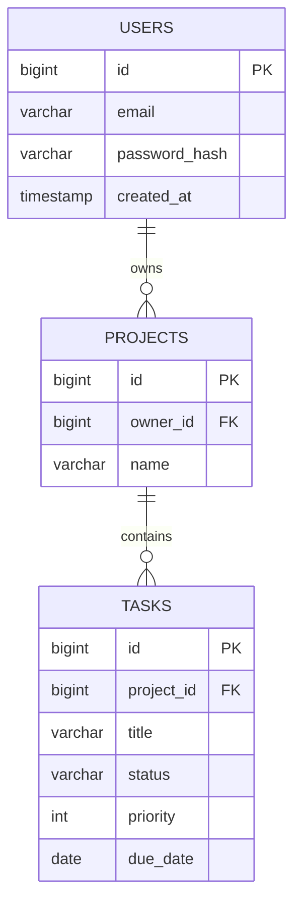

# Day 65 — Project Day 1: Plan and Build a Task Manager API

> Three project days that put all of Phase 7 together into one real backend, the kind of project you can show in interviews. Today: plan it and build the core.

**Today's goal:** design the data and endpoints, set up the project with a real database and migrations, and build working CRUD endpoints for tasks.

<!-- topic: b65_t1 -->
## 🌿 Project — Task Manager API (Part 1)

<!-- subtopic: b65_t1_s1 -->
### Plan the app

**The idea:** a task manager like a simple Trello or Todoist. Users sign up, create **projects**, and add **tasks** to them. Each task has a title, an optional description, a status (TODO, IN_PROGRESS, DONE), a priority and a due date.

**Step 1: the data (Day 51's ER diagram).**



**Step 2: the endpoints (Day 45's REST rules).**

| Method | Path | Does | Success |
|---|---|---|---|
| POST | `/api/projects` | create a project | 201 |
| GET | `/api/projects` | list my projects | 200 |
| POST | `/api/projects/{projectId}/tasks` | add a task | 201 |
| GET | `/api/projects/{projectId}/tasks` | list a project's tasks | 200 |
| GET | `/api/tasks/{id}` | one task | 200 / 404 |
| PATCH | `/api/tasks/{id}` | change status or fields | 200 |
| DELETE | `/api/tasks/{id}` | delete | 204 |

(Sign-up and login come tomorrow; for today, assume a single test user.)

**Step 3: the rules.** A title is required (max 200 characters); priority is 1–5; status starts as TODO; a due date can't be in the past. Write these down now: they become validation annotations and service checks.

Planning first takes half an hour and saves days. Put this table and diagram in your README right away.

<!-- subtopic: b65_t1_s2 -->
### Create the project

At [start.spring.io](https://start.spring.io): Maven, Java 21, artifact `taskmanager`, with **Spring Web**, **Spring Data JPA**, **Validation**, **PostgreSQL Driver**, **Flyway Migration** and **Spring Boot DevTools**. (Security comes tomorrow; adding it now would lock every endpoint while you build.)

Create a database `taskmanager` in PostgreSQL (Day 47), then configure:

```properties
spring.datasource.url=jdbc:postgresql://localhost:5432/taskmanager
spring.datasource.username=${DB_USER:postgres}
spring.datasource.password=${DB_PASSWORD:postgres}
spring.jpa.hibernate.ddl-auto=validate      # Flyway creates tables; Hibernate only checks they match
spring.jpa.show-sql=true
```

`${DB_PASSWORD:postgres}` reads an environment variable, falling back to `postgres` locally (Day 63), so no real password ever goes into Git. Initialise Git (Day 12) and make your first commit now.

Package by feature, so related code sits together:

```text
com.example.taskmanager
├── project/   Project, ProjectRepository, ProjectService, ProjectController, dto/
├── task/      Task, TaskStatus, TaskRepository, TaskService, TaskController, dto/
└── common/    GlobalExceptionHandler, NotFoundException
```

<!-- subtopic: b65_t1_s3 -->
### Entities, repositories and migrations

**The migration first** (`src/main/resources/db/migration/V1__create_projects_and_tasks.sql`, Day 60):

```sql
CREATE TABLE projects (
    id         BIGSERIAL PRIMARY KEY,
    name       VARCHAR(100) NOT NULL,
    created_at TIMESTAMP NOT NULL DEFAULT now()
);

CREATE TABLE tasks (
    id          BIGSERIAL PRIMARY KEY,
    project_id  BIGINT NOT NULL REFERENCES projects(id) ON DELETE CASCADE,
    title       VARCHAR(200) NOT NULL,
    description TEXT,
    status      VARCHAR(20) NOT NULL DEFAULT 'TODO',
    priority    INT NOT NULL DEFAULT 3 CHECK (priority BETWEEN 1 AND 5),
    due_date    DATE
);

CREATE INDEX idx_tasks_project ON tasks(project_id);
```

**Then the entities** that match it (Day 58–59):

```java
@Entity
@Table(name = "tasks")
public class Task {
    @Id @GeneratedValue(strategy = GenerationType.IDENTITY)
    private Long id;

    @ManyToOne(fetch = FetchType.LAZY, optional = false)
    @JoinColumn(name = "project_id")
    private Project project;

    private String title;
    private String description;

    @Enumerated(EnumType.STRING)          // store "TODO", not 0 (Day 20's enum)
    private TaskStatus status = TaskStatus.TODO;

    private int priority = 3;
    private LocalDate dueDate;

    protected Task() { }                  // for JPA
    // a constructor for your code, getters, and only the setters you need
}
```

**And the repositories**, with derived queries for what the API needs:

```java
public interface TaskRepository extends JpaRepository<Task, Long> {
    List<Task> findByProjectIdOrderByPriorityDesc(Long projectId);
    long countByProjectIdAndStatus(Long projectId, TaskStatus status);
}
```

Start the app: Flyway runs V1, Hibernate validates the entities against the tables, and any mismatch stops startup with a clear message. Commit.

<!-- subtopic: b65_t1_s4 -->
### CRUD endpoints with DTOs and validation

Now the layers from Day 55, one feature at a time:

```java
public record CreateTaskRequest(
        @NotBlank @Size(max = 200) String title,
        String description,
        @Min(1) @Max(5) Integer priority,
        @FutureOrPresent LocalDate dueDate) { }

public record TaskResponse(Long id, String title, String status, int priority, LocalDate dueDate) { }
```

```java
@RestController
@RequestMapping("/api")
public class TaskController {
    private final TaskService service;

    public TaskController(TaskService service) {
        this.service = service;
    }

    @PostMapping("/projects/{projectId}/tasks")
    public ResponseEntity<TaskResponse> create(@PathVariable Long projectId,
                                               @Valid @RequestBody CreateTaskRequest request) {
        TaskResponse created = service.create(projectId, request);
        return ResponseEntity.status(HttpStatus.CREATED).body(created);
    }

    @GetMapping("/tasks/{id}")
    public TaskResponse get(@PathVariable Long id) {
        return service.get(id);                       // throws NotFoundException → 404 via the advice
    }
}
```

The service holds the rules (the project must exist; status starts as TODO) and is `@Transactional`. A `@RestControllerAdvice` (Day 56) maps `NotFoundException` to 404 and validation errors to 400.

Build one endpoint at a time and test it with Day 55's checklist before moving on, including the error cases. Commit after each one works.

**End of day 1:** you can create projects and tasks, list them, fetch one, update its status and delete it, all stored in PostgreSQL.

## 📝 Day 65 Recap

1. What do you design before writing code? → **the data (ER diagram), the endpoints and the rules**
2. Why leave Spring Security out on day one? → **it would lock every endpoint while you build**
3. Why ddl-auto=validate with Flyway? → **Flyway creates the tables; Hibernate only checks entities match them**
4. Keep the database password out of Git? → **read it from an environment variable: ${DB_PASSWORD:postgres}**
5. Where do Flyway scripts go? → **src/main/resources/db/migration**
6. Store an enum as text in JPA? → **@Enumerated(EnumType.STRING)**
7. Why package by feature? → **related code for one feature sits together**
8. Where do business rules go? → **in the @Service, which is @Transactional**
9. What maps NotFoundException to 404? → **a @RestControllerAdvice with an @ExceptionHandler**
10. When do you commit? → **after each piece works: small, frequent commits**
