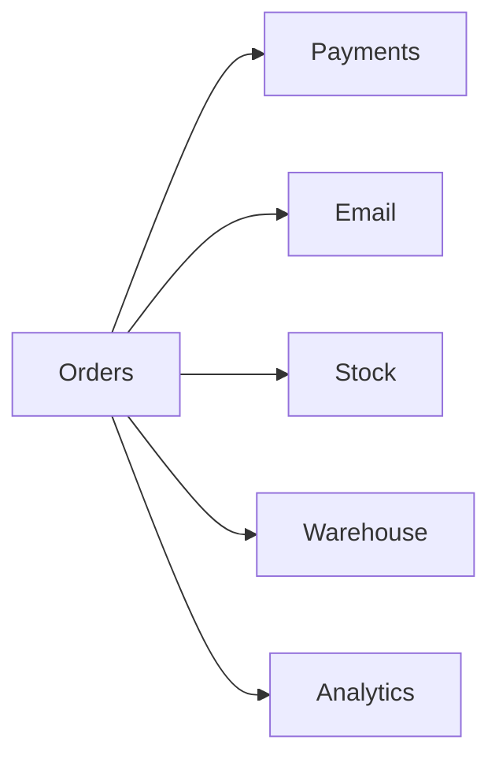
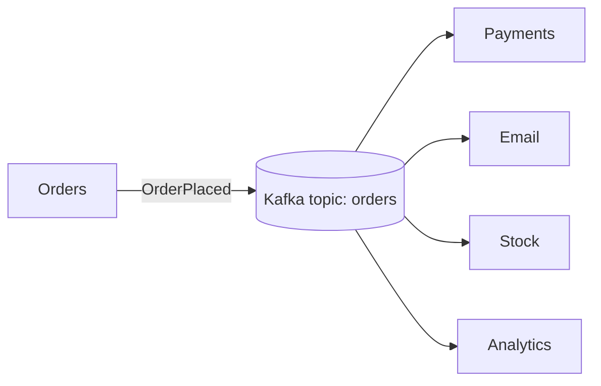

# Day 79 — Kafka: Core Concepts

> Kafka is the event backbone of a huge number of companies, and a favourite topic in Java backend interviews. Five days, starting with the ideas. Read each 🌱 **In simple words** box first.

**Today's goal:** understand why services exchange events, and Kafka's building blocks: topics, partitions, offsets, producers, consumer groups and brokers.

<!-- topic: b79_t1 -->
## 🏗️ Kafka — Fundamentals

<!-- subtopic: b79_t1_s1 -->
### Messaging: why services publish events

When an order is placed, many things should happen: charge the card, email the customer, update stock, notify the warehouse, update analytics. The direct way: the orders service **calls** each of them (Day 55's REST):

Problems: orders must know every other service, waits for all of them, fails if any one is down, and must be changed whenever a new service cares about orders.

With **events**, the orders service just announces **"OrderPlaced"** once, to a message broker, and carries on. Every interested service **subscribes** and reacts in its own time:

- **Loose coupling:** orders doesn't know who listens. A new service subscribes without anyone changing orders (Day 68's Open/Closed, at system scale).
- **Resilience:** if Email is down for ten minutes, the events wait for it; nothing is lost and orders keeps working.
- **Load levelling:** a burst of 10,000 orders is absorbed by the broker, and consumers work through it at their own pace.

It's Day 70's **Observer** pattern across services, and Day 42's producer–consumer across machines. **Kafka** is the most widely used tool for it: a distributed, durable, very fast log of events.

Give two benefits of publishing an event instead of calling other services directly.

The publisher doesn't need to know or wait for its consumers (loose coupling), and consumers that are temporarily down catch up later without losing events (resilience). Bursts are also absorbed (load levelling).

<!-- intro: d35_t1_s1 -->
Kafka stores events in **topics** (named streams like `orders`). A topic is an **append-only log**: new events go on the end, and nothing is changed in place. Each topic is split into **partitions** so it can be spread over machines and processed in parallel, and each event in a partition has a position number, its **offset**. Events stay for a configured time (days or longer), even after they've been read.

<!-- intro: d35_t1_s2 -->
A **producer** writes events. Events with the **same key** (say, the order id) always go to the **same partition**, which keeps them in order relative to each other. Without a key, events are spread across partitions. The `acks` setting trades speed for safety: `acks=all` waits until the event is safely copied before confirming.

<!-- intro: d35_t1_s3 -->
Consumers read in **consumer groups**. Within one group, each partition is read by **exactly one** consumer, so the group shares the work; different groups (payments, email) each get **every** event independently. A group can't usefully have more consumers than the topic has partitions: the extra ones sit idle.

<!-- intro: d35_t1_s4 -->
Kafka runs on several servers called **brokers**. Each partition is copied to several brokers: one **leader** handles reads and writes, and **followers** keep copies. The followers that are fully caught up are the **ISR** (in-sync replicas); if the leader's broker dies, one of them takes over, and no data is lost.

<!-- intro: d35_t1_s5 -->
Kafka used to need a separate system, **ZooKeeper**, to keep track of brokers and leaders. Modern Kafka uses its own built-in **KRaft** mode instead, which is simpler to run. You'll mostly see KRaft in new setups and ZooKeeper in older ones.

👉 **Code Practice** builds a tiny in-memory "Kafka" (partitions by key, offsets, consumer groups) so these ideas become code you've written.

## 📝 Day 79 Recap

1. Main benefit of events over direct calls? → **loose coupling: the publisher doesn't know or wait for consumers**
2. What is a topic? → **a named, append-only log of events**
3. Why split topics into partitions? → **to spread data across machines and process in parallel**
4. What is an offset? → **an event's position number within a partition**
5. Events with the same key go to? → **the same partition, so their order is kept**
6. What does acks=all mean? → **the producer waits until the event is safely replicated**
7. Within one consumer group, who reads a partition? → **exactly one consumer of that group**
8. Do two different consumer groups both get every event? → **yes**
9. More consumers than partitions in a group? → **the extra consumers sit idle**
10. Modern replacement for ZooKeeper? → **KRaft mode**
