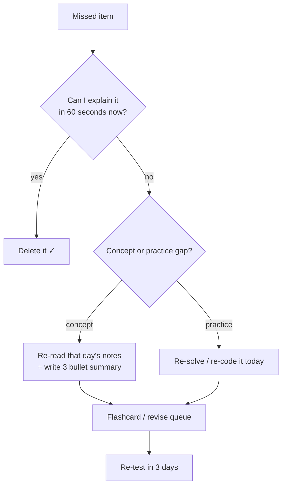
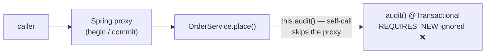
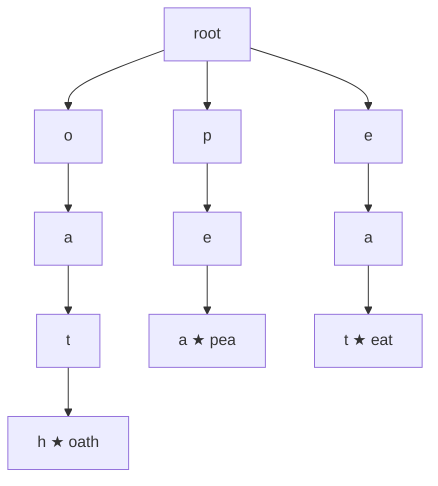
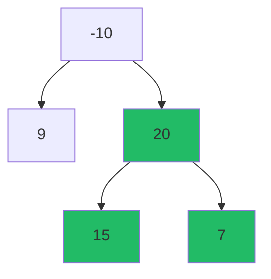

# Day 41 — Mixed Revision: Java + Spring + DSA Weak Areas

> **How to use these notes:** today is a **closed-book** day. For every rapid-fire block, cover the answers, say yours out loud, *then* check. Anything you miss goes straight into "What I Missed" — that list is tomorrow's study plan. 🚀 marks senior-level details.

**Today's goal:** turn 40 days of notes into **reliable recall**: clear your "What I Missed" backlog, answer ~60 rapid-fire questions across Java, Collections, Spring and Kafka, then solve three classic Hards — **Word Search II**, **Binary Tree Maximum Path Sum** and **Wildcard Matching** — plus one timed Hard.

| Block | Time | Done when |
|---|---|---|
| Backlog sweep | 45 min | Every "missed" item is either fixed or scheduled |
| Rapid-fire (4 rounds) | 60 min | ≥ 80% correct without notes |
| Hard problems | 90 min | Each solved, explained, complexity stated |
| Timed Hard | 40 min | Submitted or a clean post-mortem written |

<!-- topic: d41_t1 -->
## 🔁 Comprehensive — Weak Area Focus

<!-- subtopic: d41_t1_s1 -->
### 1. Sweep the "What I Missed" backlog (Days 1–40)

Open **Backlog & Stats** in this app — it lists every day where you wrote something under *What I Missed / Spillover*. Work through it with a simple triage:



**Rules that make the sweep work**

| Rule | Why |
|---|---|
| Rewrite each item as a **question** ("Why does `@Transactional` not work on private methods?") | Questions are testable; topics aren't |
| Max **15 minutes** per item | Avoid rabbit holes — schedule the long ones |
| Tick the subtopic again only when you can **teach** it | Ticking ≠ knowing |
| Note the **pattern** of misses (e.g. "concurrency keeps coming up") | That's your Day 50 weak-area list |

A useful classification for the leftovers:

| Bucket | Typical examples | Fix |
|---|---|---|
| Forgot a fact | Default `session.timeout.ms`, Integer cache range | Flashcards (Revise → Flashcards) |
| Can't explain a mechanism | HashMap resize, JWT validation flow | Draw it, then explain aloud |
| Can't code it | LRU cache, producer–consumer | Code from memory twice (Code Practice tab) |
| Can't apply it | "Which pattern fits this scenario?" | Do scenario questions from Days 34 and 40 |

<!-- subtopic: d41_t1_s2 -->
### 2. Rapid-fire Java — 20 questions without notes

Cover the right column. Target: **under 30 seconds each**.

| # | Question | Answer |
|---|---|---|
| 1 | Four pillars of OOP | Encapsulation, inheritance, polymorphism, abstraction |
| 2 | Overloading vs overriding | Compile-time (signature) vs runtime (dynamic dispatch) |
| 3 | Can you override a static method? | No — it's **hidden**; resolved by declared type |
| 4 | `equals`/`hashCode` contract | Equal objects ⇒ equal hash codes (not the reverse) |
| 5 | Why is `String` immutable? | Pool sharing, security, thread safety, cached hash |
| 6 | Abstract class vs interface | State + constructors vs multiple inheritance of type; default methods since 8 |
| 7 | Checked vs unchecked | Must declare/handle vs `RuntimeException` subclasses |
| 8 | PECS | Producer `extends`, consumer `super` |
| 9 | Type erasure consequence | No `new T()`, no `instanceof List<String>` |
| 10 | `map` vs `flatMap` | 1→1 vs 1→many then flatten |
| 11 | Intermediate vs terminal ops | Lazy, return stream vs triggers execution |
| 12 | `orElse` vs `orElseGet` | Always evaluated vs lazily evaluated |
| 13 | `volatile` gives you… | Visibility + ordering, **not** atomicity |
| 14 | `synchronized` gives you… | Mutual exclusion + visibility (happens-before) |
| 15 | `wait()` vs `sleep()` | Releases the monitor vs keeps all locks |
| 16 | `Runnable` vs `Callable` | No result/checked exception vs returns `V`, throws |
| 17 | `CompletableFuture.thenApply` vs `thenCompose` | Map vs flatMap of futures |
| 18 | `ReentrantLock` over `synchronized` when… | tryLock/timeout, interruptible, fairness, multiple conditions |
| 19 | Virtual threads are good for… | Many blocking I/O tasks; not CPU-bound work |
| 20 | Records give you… | Final fields, canonical ctor, accessors, `equals`/`hashCode`/`toString` |

🚀 **Follow-ups interviewers chain onto these:** "So what breaks if `hashCode` isn't overridden?" (HashSet duplicates), "Why can't `volatile` fix `count++`?" (read-modify-write), "What is pinning with virtual threads?" (`synchronized` blocks on JDK ≤ 23 pin the carrier thread during blocking I/O — fixed in JDK 24).

<!-- subtopic: d41_t1_s3 -->
### 3. Rapid-fire Collections

| # | Question | Answer |
|---|---|---|
| 1 | HashMap default capacity / load factor | 16 / 0.75 → resize at 12 entries |
| 2 | How is the bucket index computed? | `(n - 1) & (h ^ (h >>> 16))` |
| 3 | When does a bucket become a tree? | ≥ 8 entries **and** table ≥ 64 (else resize) |
| 4 | Treeified bucket lookup | O(log n) instead of O(n) |
| 5 | Why must keys be immutable? | Changed hash ⇒ entry lost in the wrong bucket |
| 6 | HashMap null keys? | One null key (bucket 0); `ConcurrentHashMap` allows none |
| 7 | ConcurrentHashMap (Java 8+) locking | CAS for empty bins, `synchronized` on the bin head otherwise |
| 8 | Fail-fast vs fail-safe iterators | `modCount` → CME vs snapshot / weakly consistent |
| 9 | LRU cache in one class | `LinkedHashMap(cap, 0.75f, true)` + `removeEldestEntry` |
| 10 | LRU in O(1) by hand | HashMap + doubly linked list |
| 11 | TreeMap structure / ops | Red-black tree, O(log n) |
| 12 | `floorKey` / `ceilingKey` | Greatest ≤ key / smallest ≥ key |
| 13 | ArrayList growth | ~1.5× (`old + old >> 1`) |
| 14 | ArrayList vs LinkedList for `get(i)` | O(1) vs O(n) — LinkedList almost never wins |
| 15 | PriorityQueue `peek`/`poll` cost | O(1) / O(log n) |

```java
class LRUCache<K, V> extends LinkedHashMap<K, V> {
    private final int capacity;
    LRUCache(int capacity) { super(capacity, 0.75f, true); this.capacity = capacity; }  // accessOrder = true
    @Override protected boolean removeEldestEntry(Map.Entry<K, V> eldest) { return size() > capacity; }
}
```

<!-- subtopic: d41_t1_s4 -->
### 4. Rapid-fire Spring

| # | Question | Answer |
|---|---|---|
| 1 | Why doesn't `@Transactional` work on a self-call? | The call bypasses the proxy |
| 2 | …on a `private` method? | Proxies can't intercept it |
| 3 | Default rollback rule | Rolls back on unchecked exceptions and `Error`, **not** checked |
| 4 | `REQUIRES_NEW` | Suspends the outer TX, commits independently |
| 5 | N+1 problem | 1 query for parents + N lazy queries for children |
| 6 | N+1 fixes | `JOIN FETCH`, `@EntityGraph`, `@BatchSize`, DTO projections |
| 7 | `LazyInitializationException` | Lazy access after the session closed |
| 8 | JWT validation steps | Signature, `exp`, issuer/audience, then load authorities |
| 9 | Where does the JWT filter sit? | Before `UsernamePasswordAuthenticationFilter`, sets the `SecurityContext` |
| 10 | Bean lifecycle hooks order | Constructor → injection → `@PostConstruct` → … → `@PreDestroy` |
| 11 | How does auto-config decide? | `@Conditional*` (OnClass, OnMissingBean, OnProperty) |
| 12 | `@MockBean`/`@MockitoBean` vs `@Mock` | Replaces a bean in the context vs plain Mockito mock |
| 13 | `@WebMvcTest` loads… | Web layer only (controllers, advice, filters) |
| 14 | Constructor injection benefits | Immutability, required deps, easy testing, detects cycles |
| 15 | Profile-specific config | `application-{profile}.yml`, `spring.profiles.active` |



<!-- subtopic: d41_t1_s5 -->
### 5. Rapid-fire Kafka

| # | Question | Answer |
|---|---|---|
| 1 | Ordering guarantee | Per partition only (same key → same partition) |
| 2 | `acks=all` + `min.insync.replicas=2` + RF 3 | Survives one broker loss without data loss |
| 3 | At-most-once | Commit **before** processing |
| 4 | At-least-once | Commit **after** processing (duplicates possible) |
| 5 | Exactly-once (Kafka → Kafka) | Idempotent producer + transactions + `read_committed` |
| 6 | Consumer lag | Log-end offset − committed offset |
| 7 | Lag growing — first checks | Slow handler, too few partitions/consumers, rebalancing loops, poison pill |
| 8 | What triggers a rebalance? | Member joins/leaves, session timeout, `max.poll.interval.ms` exceeded, partition change |
| 9 | Cooperative rebalancing | Only moved partitions are revoked (`CooperativeStickyAssignor`) |
| 10 | Static membership | `group.instance.id` — quick restarts don't rebalance |
| 11 | DLT | Records that failed after retries, with exception headers |
| 12 | Idempotent consumer | Dedupe by event id with a unique constraint in the same TX |

> 🚀 **Combine them in a story:** "Lag alert fires → I check the rebalance rate first (a rebalance storm looks like lag), then per-partition lag (one hot partition = skewed key or poison pill), then handler latency. Fix: DLT for the poison pill, batch writes for latency, more partitions only if consumers are saturated."

<!-- topic: d41_t2 -->
## 🧮 DSA — Mixed Hard Practice

<!-- subtopic: d41_t2_s1 -->
### 6. Word Search II (LeetCode 212 — Hard)

**Problem:** given a board of letters and a list of words, return every word that can be traced through adjacent (up/down/left/right) cells without reusing a cell.

**Idea:** running Word Search I once per word is O(words × cells × 4^L). Instead build a **Trie of all words** and do **one DFS per cell**, walking the Trie as you walk the board — one traversal finds every word sharing a prefix.



```java
class Solution {
    static class Node { Node[] next = new Node[26]; String word; }

    public List<String> findWords(char[][] board, String[] words) {
        Node root = new Node();
        for (String w : words) {
            Node cur = root;
            for (char c : w.toCharArray()) {
                if (cur.next[c - 'a'] == null) cur.next[c - 'a'] = new Node();
                cur = cur.next[c - 'a'];
            }
            cur.word = w;                                   // store the word at its end node
        }
        List<String> found = new ArrayList<>();
        for (int i = 0; i < board.length; i++)
            for (int j = 0; j < board[0].length; j++)
                dfs(board, i, j, root, found);
        return found;
    }

    private void dfs(char[][] b, int i, int j, Node parent, List<String> found) {
        if (i < 0 || j < 0 || i >= b.length || j >= b[0].length) return;
        char c = b[i][j];
        if (c == '#' || parent.next[c - 'a'] == null) return;
        Node node = parent.next[c - 'a'];
        if (node.word != null) { found.add(node.word); node.word = null; }   // de-duplicate
        b[i][j] = '#';                                                      // mark visited
        dfs(b, i + 1, j, node, found); dfs(b, i - 1, j, node, found);
        dfs(b, i, j + 1, node, found); dfs(b, i, j - 1, node, found);
        b[i][j] = c;                                                        // backtrack
        if (isLeaf(node)) parent.next[c - 'a'] = null;                       // prune finished branches
    }

    private boolean isLeaf(Node n) {
        for (Node x : n.next) if (x != null) return false;
        return n.word == null;
    }
}
```

**Complexity:** building the Trie O(total letters); search O(cells × 4 × 3^(L−1)) worst case, much less with pruning. **Space:** O(total letters) for the Trie.

**Why the two tricks matter:** setting `node.word = null` stops duplicate results; pruning leaf nodes stops re-walking branches whose words were already found — that's what turns TLE into AC on big boards.

<!-- subtopic: d41_t2_s2 -->
### 7. Binary Tree Maximum Path Sum (LeetCode 124 — Hard)

**Problem:** a path is any sequence of connected nodes (it may not pass through the root). Return the maximum sum of node values on any path.

**Idea:** post-order DFS. Each call returns the best **downward** path starting at that node (one branch only, so the parent can extend it), while updating a global answer with the best path that **bends** at that node (left + node + right). Negative branches are dropped with `max(0, …)`.



At node 20: gain(15) = 15, gain(7) = 7 → path bending at 20 = 15 + 20 + 7 = **42** (the answer). It returns 20 + 15 = 35 upward; at −10 the bend is 9 − 10 + 35 = 34 < 42.

```java
class Solution {
    private int best = Integer.MIN_VALUE;

    public int maxPathSum(TreeNode root) {
        gain(root);
        return best;
    }

    private int gain(TreeNode node) {
        if (node == null) return 0;
        int left = Math.max(0, gain(node.left));      // ignore negative branches
        int right = Math.max(0, gain(node.right));
        best = Math.max(best, node.val + left + right); // path that bends here
        return node.val + Math.max(left, right);        // path the parent can extend
    }
}
```

**Complexity:** O(n) time, O(h) recursion stack. **Edge case:** all negative values → `best` starts at `Integer.MIN_VALUE`, so a single node (the least negative) wins — that's why you can't start `best` at 0.

**Same "return one thing, record another" pattern:** Diameter of Binary Tree (LC 543), Longest Univalue Path (LC 687), House Robber III (LC 337).

<!-- subtopic: d41_t2_s3 -->
### 8. Wildcard Matching (LeetCode 44 — Hard)

**Problem:** `?` matches any single character, `*` matches any sequence (including empty). Does pattern `p` match the **whole** string `s`?

**DP state:** `dp[i][j]` = does `s[0..i)` match `p[0..j)`?

| Case | Transition |
|---|---|
| `p[j-1]` is a letter or `?` | `dp[i][j] = dp[i-1][j-1] && (p[j-1] == '?' or s[i-1] == p[j-1])` |
| `p[j-1] == '*'` | `dp[i][j] = dp[i][j-1]` (star matches empty) **or** `dp[i-1][j]` (star eats one more char) |
| Base | `dp[0][0] = true`; `dp[0][j] = dp[0][j-1]` only while `p` has stars |

```java
public boolean isMatch(String s, String p) {
    int m = s.length(), n = p.length();
    boolean[][] dp = new boolean[m + 1][n + 1];
    dp[0][0] = true;
    for (int j = 1; j <= n && p.charAt(j - 1) == '*'; j++) dp[0][j] = true;   // leading stars match ""
    for (int i = 1; i <= m; i++) {
        for (int j = 1; j <= n; j++) {
            char pc = p.charAt(j - 1);
            if (pc == '*') dp[i][j] = dp[i][j - 1] || dp[i - 1][j];
            else dp[i][j] = dp[i - 1][j - 1] && (pc == '?' || pc == s.charAt(i - 1));
        }
    }
    return dp[m][n];
}
```

**Complexity:** O(m·n) time and space (reducible to O(n) with one rolling row).

🚀 **Greedy O(m·n) worst / O(m+n) typical:** remember the last `*` position and the string index it matched; on mismatch, backtrack to "star eats one more char". Mention it as the follow-up after the DP.

**Don't confuse with Regular Expression Matching (LC 10):** there `*` means "zero or more of the **previous** character", so the star transition looks at `p[j-2]`.

<!-- subtopic: d41_t2_s4 -->
### 9. Timed: 1 Hard in 40 minutes

> **Goal:** practise staying calm on a Hard. A *partial* solution with a clear explanation scores better than silence. Suggested unseen picks: *Minimum Window Substring (76)*, *Merge k Sorted Lists (23)*, *Largest Rectangle in Histogram (84)*, *Serialize and Deserialize Binary Tree (297)*.

| Minute | Target |
|---|---|
| 0–5 | Clarify, write 2 examples including an edge case |
| 5–12 | Brute force out loud with its complexity — then improve |
| 12–30 | Code the optimised version |
| 30–37 | Dry-run an example line by line, fix bugs |
| 37–40 | State complexity, mention trade-offs and follow-ups |

**If you're stuck at minute 15:** say the brute force, code it, then optimise the bottleneck. Interviewers grade *signal*, not just the green tick.

---

## 📝 Day 41 Revision Cheat Sheet

| Area | Must-say points |
|---|---|
| Backlog | Turn misses into questions, 15-min cap, classify fact / mechanism / code / apply |
| Java | Static methods hide; `volatile` ≠ atomic; `orElseGet` is lazy; virtual threads for blocking I/O |
| Collections | 16/0.75, treeify at 8 with table ≥ 64, LRU = LinkedHashMap access order |
| Spring | Self-call bypasses proxy; rollback on unchecked only; N+1 → JOIN FETCH / EntityGraph |
| Kafka | Per-partition order; acks=all + min ISR 2; commit after processing; static membership |
| Word Search II | Trie of words + one DFS per cell + null out found words + prune leaves |
| Max path sum | Return one branch up; record the bend; drop negatives |
| Wildcard | `*` → `dp[i][j-1] or dp[i-1][j]`; leading stars match empty |

### ⚡ Rapid-fire self-test

1. HashMap treeify threshold? → **8 entries per bin, once the table has at least 64 buckets**
2. Default rollback behaviour of `@Transactional`? → **Rolls back on unchecked exceptions and errors only**
3. Fastest way to build an LRU cache in Java? → **LinkedHashMap with accessOrder = true and removeEldestEntry**
4. Why prune Trie leaves in Word Search II? → **So finished branches are never walked again**
5. Max path sum: what does the recursive call return? → **The best single downward path from that node**
6. Why not start the best path sum at 0? → **All-negative trees would wrongly return 0**
7. Wildcard `*` transition? → **dp[i][j-1] (empty) or dp[i-1][j] (one more character)**
8. Exactly-once in Kafka needs? → **Idempotent producer, transactions and read_committed consumers**
9. What does `volatile` not give you? → **Atomicity of compound actions like count++**
10. Ideal time for a timed Hard's brute force? → **Within the first 12 minutes, said out loud**
