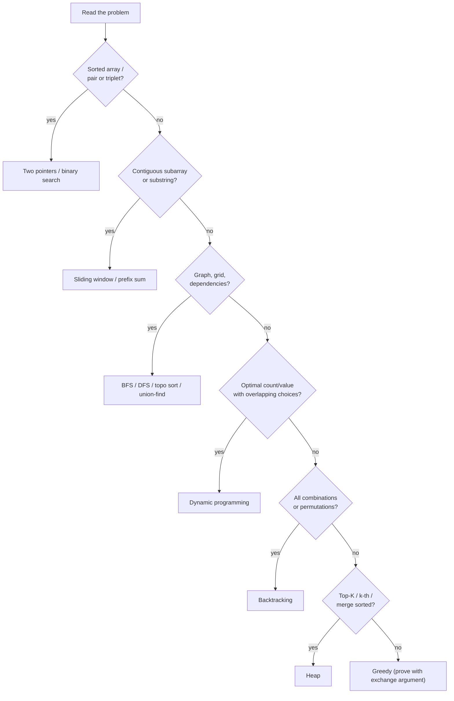

# Day 42 — DSA Revision Sprint: All Patterns Review

> **How to use these notes:** today you **build your own cheat sheet**. For each template below, write it **from memory first** on paper or in your IDE, then diff against the version here. The templates are deliberately short — the goal is that you can type them in under 3 minutes each. 🚀 marks senior-level details.

**Today's goal:** a one-page set of templates for **every pattern** (two pointers → heaps), plus re-coding the four structures and nine problems that show up most: **LRU Cache, Trie, Union-Find, Coin Change, House Robber, LIS, LCS, Number of Islands, Course Schedule, Merge Intervals**.

**Pattern recognition — the 10-second scan:**



<!-- topic: d42_t1 -->
## 📋 DSA — Pattern Cheat Sheet Creation

<!-- subtopic: d42_t1_s1 -->
### 1. Two Pointers, Sliding Window, Binary Search

**Two pointers (sorted array, converge from both ends)** — Two Sum II, 3Sum, Container With Most Water:

```java
int lo = 0, hi = a.length - 1;
while (lo < hi) {
    int sum = a[lo] + a[hi];
    if (sum == target) return new int[]{lo, hi};
    if (sum < target) lo++; else hi--;      // move the pointer that can improve the sum
}
```

**Fast/slow pointers** — cycle detection, middle of list, remove duplicates in place:

```java
ListNode slow = head, fast = head;
while (fast != null && fast.next != null) {
    slow = slow.next; fast = fast.next.next;
    if (slow == fast) return true;           // cycle
}
```

**Sliding window (variable size)** — Longest Substring Without Repeating, Minimum Window Substring:

```java
Map<Character, Integer> count = new HashMap<>();
int left = 0, best = 0;
for (int right = 0; right < s.length(); right++) {
    count.merge(s.charAt(right), 1, Integer::sum);           // 1. expand
    while (/* window invalid, e.g. */ count.get(s.charAt(right)) > 1) {
        count.merge(s.charAt(left), -1, Integer::sum);       // 2. shrink until valid
        left++;
    }
    best = Math.max(best, right - left + 1);                 // 3. record
}
```

**Binary search — three templates you must not mix up:**

| Goal | Loop | Update | Return |
|---|---|---|---|
| Exact match | `lo <= hi` | `lo = mid + 1` / `hi = mid - 1` | `mid` or −1 |
| First index where `ok(mid)` is true | `lo < hi` | `ok ? hi = mid : lo = mid + 1` | `lo` |
| Last index where `ok(mid)` is true | `lo < hi`, `mid = lo + (hi - lo + 1) / 2` | `ok ? lo = mid : hi = mid - 1` | `lo` |

```java
// "Binary search on the answer": smallest capacity/speed/day that works (Koko, Ship Packages)
int lo = minPossible, hi = maxPossible;
while (lo < hi) {
    int mid = lo + (hi - lo) / 2;            // no overflow
    if (feasible(mid)) hi = mid; else lo = mid + 1;
}
return lo;
```

<!-- subtopic: d42_t1_s2 -->
### 2. BFS, DFS, Topological Sort, Union-Find

**BFS with levels** (shortest path in unweighted graph / grid, level-order traversal):

```java
Deque<int[]> q = new ArrayDeque<>();
q.offer(start); seen[start[0]][start[1]] = true;
int steps = 0;
int[][] dirs = {{1, 0}, {-1, 0}, {0, 1}, {0, -1}};
while (!q.isEmpty()) {
    for (int size = q.size(); size > 0; size--) {          // one level at a time
        int[] cur = q.poll();
        if (isTarget(cur)) return steps;
        for (int[] d : dirs) {
            int r = cur[0] + d[0], c = cur[1] + d[1];
            if (r >= 0 && c >= 0 && r < rows && c < cols && !seen[r][c] && open(r, c)) {
                seen[r][c] = true;                         // mark when ENQUEUED, not when polled
                q.offer(new int[]{r, c});
            }
        }
    }
    steps++;
}
```

**DFS on a grid** (flood fill, islands, connected regions):

```java
void dfs(char[][] g, int r, int c) {
    if (r < 0 || c < 0 || r >= g.length || c >= g[0].length || g[r][c] != '1') return;
    g[r][c] = '0';                                          // mark visited
    dfs(g, r + 1, c); dfs(g, r - 1, c); dfs(g, r, c + 1); dfs(g, r, c - 1);
}
```

**Topological sort — Kahn's algorithm** (course schedule, build order, alien dictionary):

```java
int[] indeg = new int[n];
List<List<Integer>> adj = new ArrayList<>();
for (int i = 0; i < n; i++) adj.add(new ArrayList<>());
for (int[] e : edges) { adj.get(e[1]).add(e[0]); indeg[e[0]]++; }   // e = [course, prerequisite]
Deque<Integer> q = new ArrayDeque<>();
for (int i = 0; i < n; i++) if (indeg[i] == 0) q.offer(i);
List<Integer> order = new ArrayList<>();
while (!q.isEmpty()) {
    int u = q.poll(); order.add(u);
    for (int v : adj.get(u)) if (--indeg[v] == 0) q.offer(v);
}
return order.size() == n ? order : List.of();                       // fewer than n ⇒ cycle
```

**Union-Find with path compression + union by rank** (connected components, redundant connection, accounts merge):

```java
int[] parent, rank;
int find(int x) { return parent[x] == x ? x : (parent[x] = find(parent[x])); }   // path compression
boolean union(int a, int b) {
    int ra = find(a), rb = find(b);
    if (ra == rb) return false;                           // already connected → cycle edge
    if (rank[ra] < rank[rb]) { int t = ra; ra = rb; rb = t; }
    parent[rb] = ra;
    if (rank[ra] == rank[rb]) rank[ra]++;
    return true;
}
```

| Tool | Use when | Complexity |
|---|---|---|
| BFS | Shortest path with equal edge weights, levels | O(V + E) |
| DFS | Reachability, components, cycle detection, backtracking | O(V + E) |
| Kahn's | Ordering with dependencies, cycle detection in DAG | O(V + E) |
| Union-Find | Dynamic connectivity, "are these connected?" many times | ≈ O(α(n)) per op |
| Dijkstra | Weighted shortest path, non-negative weights | O(E log V) |

<!-- subtopic: d42_t1_s3 -->
### 3. DP patterns — 1D, 2D, knapsack, LIS, LCS

**The 4-step recipe:** (1) define the state in words, (2) write the recurrence, (3) base cases, (4) iteration order (dependencies computed first). Then optimise space.

| Pattern | State | Recurrence | Classic problems |
|---|---|---|---|
| 1D linear | `dp[i]` = best up to i | `dp[i] = f(dp[i-1], dp[i-2])` | Climbing Stairs, House Robber, Decode Ways |
| Unbounded knapsack | `dp[x]` = best for amount x | `dp[x] = min(dp[x - coin] + 1)` | Coin Change, Perfect Squares |
| 0/1 knapsack | `dp[c]` iterate **c downwards** | `dp[c] = max(dp[c], dp[c - w] + v)` | Partition Equal Subset Sum, Target Sum |
| LIS | `dp[i]` = LIS ending at i | `max(dp[j] + 1)` for `j < i, a[j] < a[i]` | LIS, Russian Doll Envelopes |
| Two strings | `dp[i][j]` on prefixes | match → diagonal + 1, else max/min of neighbours | LCS, Edit Distance |
| Grid | `dp[r][c]` | from top / left | Unique Paths, Min Path Sum |
| Interval | `dp[i][j]` on a range | split point k | Burst Balloons, Palindrome Partitioning |

```java
// 0/1 knapsack in one row: iterate capacity DOWN so each item is used at most once
for (int[] item : items)                     // item = {weight, value}
    for (int c = cap; c >= item[0]; c--)
        dp[c] = Math.max(dp[c], dp[c - item[0]] + item[1]);

// Unbounded knapsack: iterate capacity UP so items can be reused
for (int c = 1; c <= cap; c++)
    for (int[] item : items)
        if (c >= item[0]) dp[c] = Math.max(dp[c], dp[c - item[0]] + item[1]);
```

<!-- subtopic: d42_t1_s4 -->
### 4. Backtracking, Greedy, Heap (Top-K, Merge-K)

**Backtracking — choose / explore / un-choose** (subsets, permutations, combination sum, N-Queens):

```java
void backtrack(int start, List<Integer> path, List<List<Integer>> out, int[] nums) {
    out.add(new ArrayList<>(path));                  // record (subsets record every node)
    for (int i = start; i < nums.length; i++) {
        if (i > start && nums[i] == nums[i - 1]) continue;   // skip duplicates (sort first)
        path.add(nums[i]);                           // choose
        backtrack(i + 1, path, out, nums);           // explore (i for reuse, i+1 for no reuse)
        path.remove(path.size() - 1);                // un-choose
    }
}
```

| Variant | Start index | Used array? | Record when |
|---|---|---|---|
| Subsets | `i + 1` | no | every call |
| Combinations / combination sum (no reuse) | `i + 1` | no | target reached |
| Combination sum (reuse allowed) | `i` | no | target reached |
| Permutations | always 0 | `boolean[] used` | `path.size() == n` |

**Greedy** — make the locally best choice; justify it ("exchange argument": swapping in any other choice can't do better):

| Problem | Greedy rule |
|---|---|
| Merge / non-overlapping intervals | Sort by start (merge) or by **end** (keep max count) |
| Jump Game | Track the farthest reachable index |
| Gas Station | If the tank goes negative, restart from the next station |
| Meeting Rooms II | Sort starts and ends, or min-heap of end times |

**Heap templates:**

```java
// Top-K largest: min-heap of size k (evict the smallest) — O(n log k)
PriorityQueue<Integer> heap = new PriorityQueue<>();
for (int x : nums) { heap.offer(x); if (heap.size() > k) heap.poll(); }
// heap.peek() is the k-th largest

// Merge K sorted lists: heap of current heads — O(N log k)
PriorityQueue<ListNode> pq = new PriorityQueue<>(Comparator.comparingInt(n -> n.val));
for (ListNode l : lists) if (l != null) pq.offer(l);
ListNode dummy = new ListNode(0), tail = dummy;
while (!pq.isEmpty()) {
    ListNode n = pq.poll(); tail.next = n; tail = n;
    if (n.next != null) pq.offer(n.next);
}
```

🚀 **Two heaps** (Find Median from Data Stream): max-heap for the lower half, min-heap for the upper half, keep sizes within 1.

<!-- topic: d42_t2 -->
## 🧮 DSA — Revision Problems

<!-- subtopic: d42_t2_s1 -->
### 5. Code from memory: LRU Cache, Trie, Union-Find

**LRU Cache (LC 146) — HashMap + doubly linked list, O(1) get/put:**

```java
class LRUCache {
    private static class Node { int key, val; Node prev, next; Node(int k, int v) { key = k; val = v; } }
    private final Map<Integer, Node> map = new HashMap<>();
    private final Node head = new Node(0, 0), tail = new Node(0, 0);   // sentinels
    private final int capacity;

    LRUCache(int capacity) { this.capacity = capacity; head.next = tail; tail.prev = head; }

    public int get(int key) {
        Node n = map.get(key);
        if (n == null) return -1;
        remove(n); addFront(n);                     // mark as most recently used
        return n.val;
    }

    public void put(int key, int value) {
        Node n = map.get(key);
        if (n != null) { n.val = value; remove(n); addFront(n); return; }
        if (map.size() == capacity) { Node lru = tail.prev; remove(lru); map.remove(lru.key); }
        n = new Node(key, value); map.put(key, n); addFront(n);
    }

    private void remove(Node n) { n.prev.next = n.next; n.next.prev = n.prev; }
    private void addFront(Node n) { n.next = head.next; n.prev = head; head.next.prev = n; head.next = n; }
}
```

**Trie (LC 208):**

```java
class Trie {
    private final Trie[] next = new Trie[26];
    private boolean end;

    public void insert(String w) {
        Trie cur = this;
        for (char c : w.toCharArray()) {
            if (cur.next[c - 'a'] == null) cur.next[c - 'a'] = new Trie();
            cur = cur.next[c - 'a'];
        }
        cur.end = true;
    }
    public boolean search(String w) { Trie n = walk(w); return n != null && n.end; }
    public boolean startsWith(String p) { return walk(p) != null; }

    private Trie walk(String s) {
        Trie cur = this;
        for (char c : s.toCharArray()) { cur = cur.next[c - 'a']; if (cur == null) return null; }
        return cur;
    }
}
```

**Union-Find:** see section 2 — practise writing `find` with path compression in one line.

**Self-check:** can you write all three in **15 minutes total** with no bugs? If not, repeat tomorrow.

<!-- subtopic: d42_t2_s2 -->
### 6. Revise: Coin Change, House Robber, LIS, LCS

```java
// Coin Change (LC 322) — unbounded knapsack, min coins. O(amount · coins)
int coinChange(int[] coins, int amount) {
    int[] dp = new int[amount + 1];
    Arrays.fill(dp, amount + 1);                 // "infinity" that can't overflow
    dp[0] = 0;
    for (int x = 1; x <= amount; x++)
        for (int c : coins)
            if (c <= x) dp[x] = Math.min(dp[x], dp[x - c] + 1);
    return dp[amount] > amount ? -1 : dp[amount];
}

// House Robber (LC 198) — take i (+ best up to i-2) or skip i. O(n) time, O(1) space
int rob(int[] nums) {
    int prev2 = 0, prev1 = 0;
    for (int n : nums) { int cur = Math.max(prev1, prev2 + n); prev2 = prev1; prev1 = cur; }
    return prev1;
}

// LIS (LC 300) — patience sorting, O(n log n). tails[k] = smallest tail of an IS of length k+1
int lengthOfLIS(int[] nums) {
    int[] tails = new int[nums.length];
    int size = 0;
    for (int x : nums) {
        int lo = 0, hi = size;
        while (lo < hi) { int mid = (lo + hi) >>> 1; if (tails[mid] < x) lo = mid + 1; else hi = mid; }
        tails[lo] = x;
        if (lo == size) size++;
    }
    return size;
}

// LCS (LC 1143) — two-string DP. O(m · n)
int lcs(String a, String b) {
    int[][] dp = new int[a.length() + 1][b.length() + 1];
    for (int i = 1; i <= a.length(); i++)
        for (int j = 1; j <= b.length(); j++)
            dp[i][j] = a.charAt(i - 1) == b.charAt(j - 1)
                    ? dp[i - 1][j - 1] + 1
                    : Math.max(dp[i - 1][j], dp[i][j - 1]);
    return dp[a.length()][b.length()];
}
```

| Problem | State in one sentence |
|---|---|
| Coin Change | Fewest coins to make amount x |
| House Robber | Max loot from the first i houses |
| LIS (O(n²)) | Longest increasing subsequence ending at i |
| LCS | LCS of the first i chars of a and first j chars of b |

<!-- subtopic: d42_t2_s3 -->
### 7. Revise: Number of Islands, Course Schedule, Merge Intervals

```java
// Number of Islands (LC 200) — count DFS launches. O(m · n)
int numIslands(char[][] g) {
    int count = 0;
    for (int r = 0; r < g.length; r++)
        for (int c = 0; c < g[0].length; c++)
            if (g[r][c] == '1') { count++; dfs(g, r, c); }    // dfs from section 2 sinks the island
    return count;
}

// Course Schedule (LC 207) — Kahn's; can finish iff every course gets processed
boolean canFinish(int n, int[][] prereq) {
    int[] indeg = new int[n];
    List<List<Integer>> adj = new ArrayList<>();
    for (int i = 0; i < n; i++) adj.add(new ArrayList<>());
    for (int[] p : prereq) { adj.get(p[1]).add(p[0]); indeg[p[0]]++; }
    Deque<Integer> q = new ArrayDeque<>();
    for (int i = 0; i < n; i++) if (indeg[i] == 0) q.offer(i);
    int done = 0;
    while (!q.isEmpty()) {
        int u = q.poll(); done++;
        for (int v : adj.get(u)) if (--indeg[v] == 0) q.offer(v);
    }
    return done == n;
}

// Merge Intervals (LC 56) — sort by start, extend or append. O(n log n)
int[][] merge(int[][] intervals) {
    Arrays.sort(intervals, Comparator.comparingInt(a -> a[0]));
    List<int[]> out = new ArrayList<>();
    for (int[] cur : intervals) {
        if (out.isEmpty() || out.get(out.size() - 1)[1] < cur[0]) out.add(cur);
        else out.get(out.size() - 1)[1] = Math.max(out.get(out.size() - 1)[1], cur[1]);
    }
    return out.toArray(new int[0][]);
}
```

**Edge cases to say out loud:** empty grid, a grid of all water; a course that is its own prerequisite (self-loop = cycle); touching intervals `[1,2],[2,3]` (they merge because `2 < 2` is false).

<!-- subtopic: d42_t2_s4 -->
### 8. Two random problems from your weak categories

1. Open **Question Sets** in this app → filter **unsolved** → pick the set where your solved % is lowest.
2. Pick one **Medium** you haven't seen and one you **failed** before (Revise → Solve again).
3. Before coding, write the pattern name and the template you'll use from today's sheet.
4. After solving, log it with the 📝 button: approach, time/space, attempts, how it felt.

| If your weak area is… | Try |
|---|---|
| Sliding window | Longest Repeating Character Replacement (424), Permutation in String (567) |
| Binary search on answer | Koko Eating Bananas (875), Capacity To Ship Packages (1011) |
| Graphs | Pacific Atlantic Water Flow (417), Rotting Oranges (994) |
| DP | Decode Ways (91), Word Break (139) |
| Backtracking | Combination Sum II (40), Palindrome Partitioning (131) |
| Heap | K Closest Points to Origin (973), Task Scheduler (621) |

---

## 📝 Day 42 Revision Cheat Sheet

| Pattern | Signal in the problem | Core move |
|---|---|---|
| Two pointers | Sorted, pairs, in-place | Move the pointer that can improve the answer |
| Sliding window | Contiguous, "longest/shortest with condition" | Expand right, shrink left while invalid |
| Binary search | Sorted or monotonic "works for x" | `lo < hi`, `hi = mid` when ok |
| BFS | Shortest steps, levels | Queue, mark on enqueue, level loop |
| DFS | Regions, all paths | Recursion + visited |
| Topo sort | Prerequisites, order | In-degrees + queue, count = n |
| Union-Find | Connectivity, merging groups | find with compression, union by rank |
| DP | Count/optimise with overlapping subproblems | State → recurrence → base → order |
| Backtracking | All combinations / permutations | Choose, explore, un-choose |
| Greedy | Local choice provably optimal | Sort by the right key |
| Heap | Top-K, k-th, merge sorted | Min-heap of size k |

### ⚡ Rapid-fire self-test

1. Binary search loop for "first index where condition is true"? → **while (lo < hi), hi = mid if ok else lo = mid + 1**
2. In BFS, when do you mark a cell visited? → **When it is enqueued, not when it is polled**
3. How does Kahn's algorithm detect a cycle? → **Fewer than n nodes get processed**
4. 0/1 knapsack in one row: which direction is capacity iterated? → **Downwards, so each item is used once**
5. Top-K largest uses which heap? → **A min-heap of size k**
6. Union-Find near-constant time needs which two tricks? → **Path compression and union by rank**
7. LIS in O(n log n) — what does tails[k] hold? → **The smallest tail of an increasing subsequence of length k+1**
8. Permutations vs subsets in backtracking? → **Permutations use a used[] array and start at 0; subsets use a start index**
9. LRU cache O(1) structure? → **HashMap plus doubly linked list with sentinel nodes**
10. Merge intervals sorting key? → **Start time**
