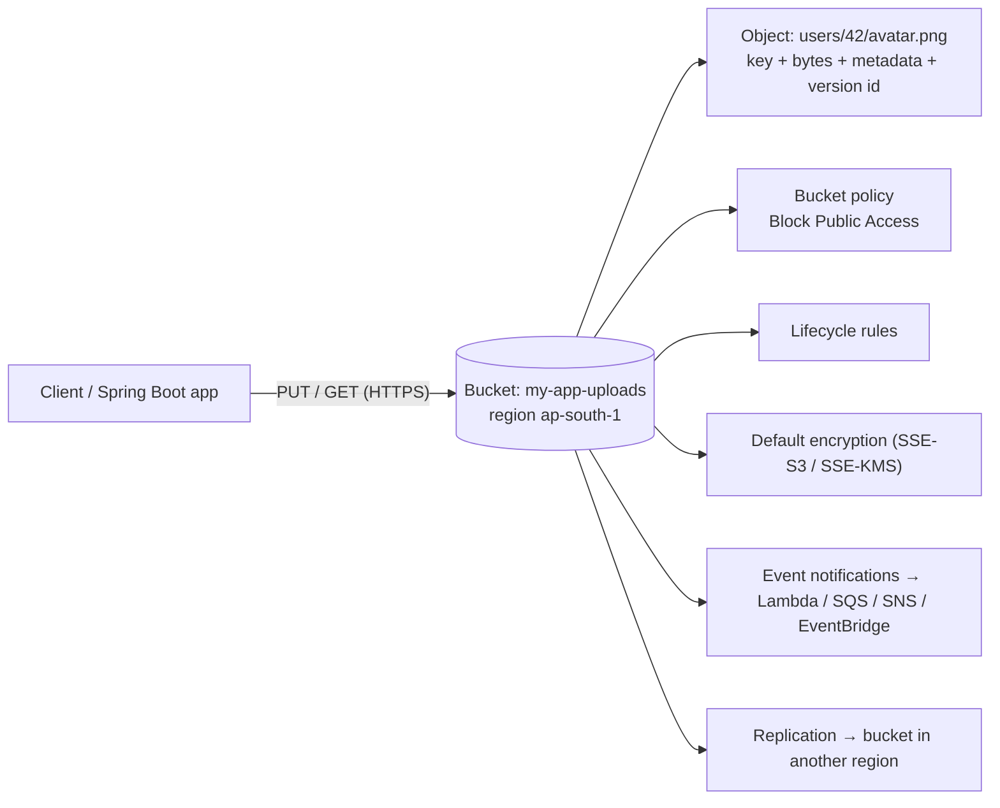
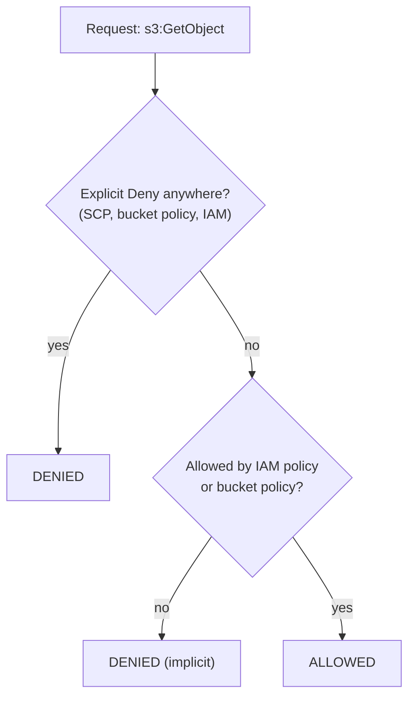
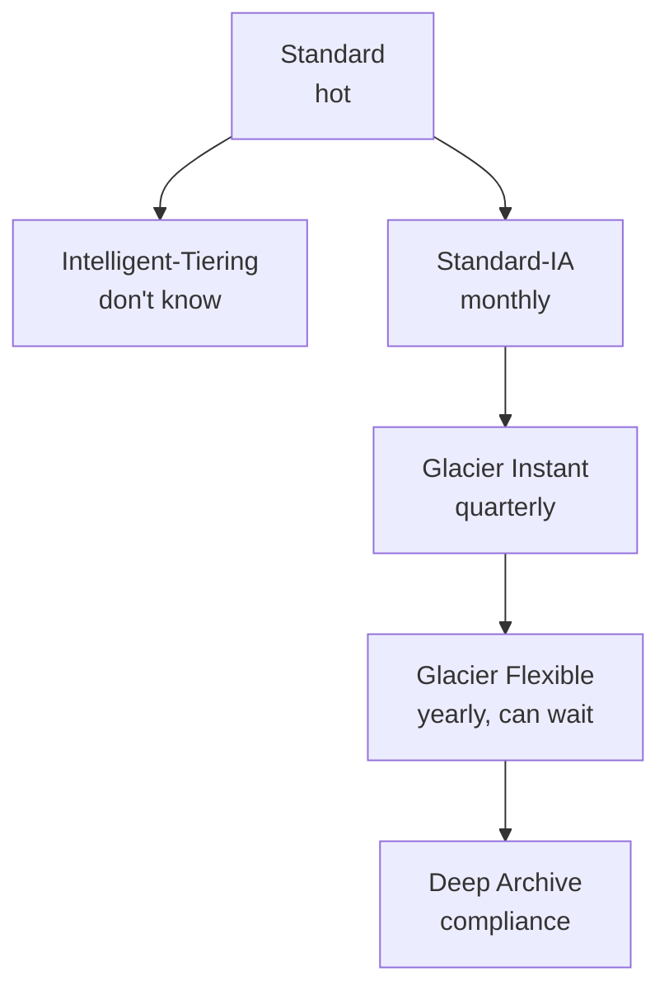
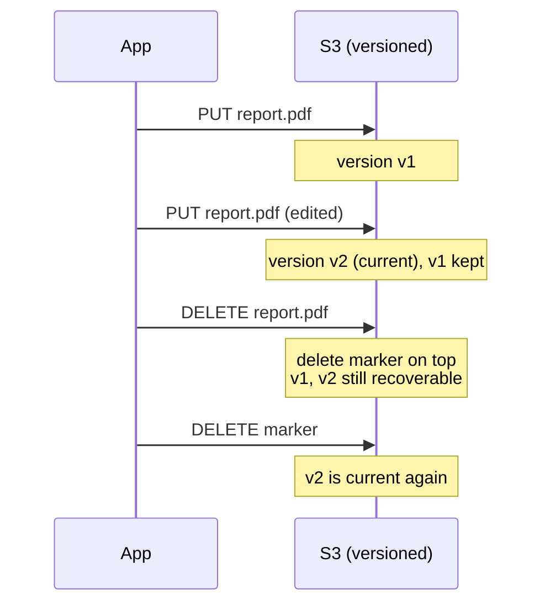
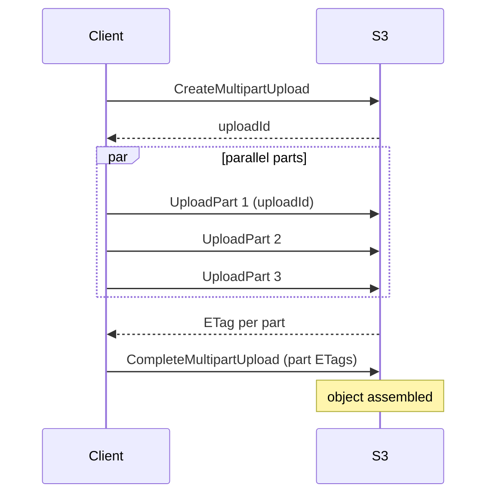
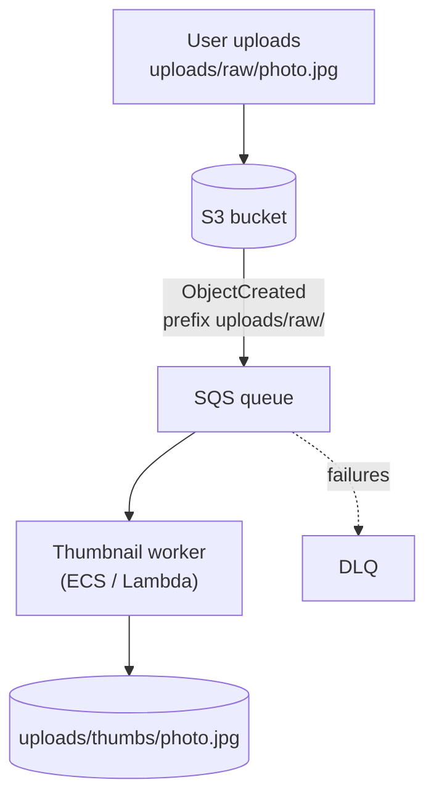
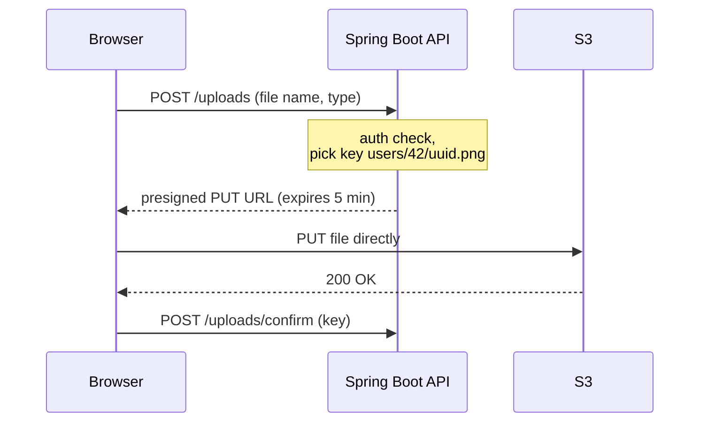
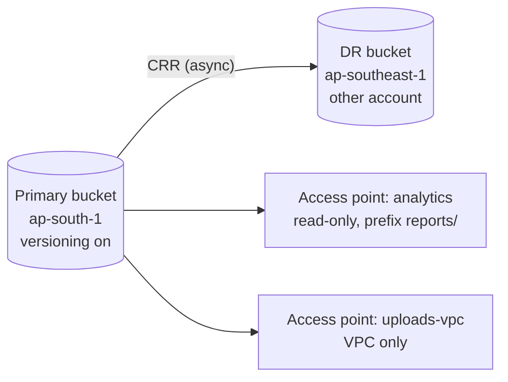

# Day 43 — Amazon S3: Storage Classes, Security & Access

> **How to use these notes:** Phase 6 (AWS) starts today. Interviewers for backend roles rarely ask for console clicks — they ask **"how would you store user uploads securely and cheaply?"** Read each section with that question in mind, and practise the model answers out loud. 🚀 marks senior-level details.

**Today's goal:** explain how S3 **access control** works (IAM vs bucket policies vs ACLs), pick the right **storage class** and **lifecycle** rules, protect data with **versioning, Object Lock and encryption**, upload large files with **multipart**, react to uploads with **event notifications**, and share files safely with **presigned URLs**.

**S3 in one picture:**



| Fact | Value |
|---|---|
| Object size | Up to **5 TB**; a single PUT up to **5 GB** |
| Durability | 99.999999999 % (11 nines) across ≥ 3 AZs (except One Zone classes) |
| Consistency | **Strong** read-after-write for all operations (since Dec 2020) |
| Namespace | Bucket names are globally unique; "folders" are just key prefixes |
| Defaults (new buckets) | Block Public Access on, ACLs disabled, SSE-S3 encryption on |

<!-- topic: d43_t1 -->
## ☁️ AWS — S3 Deep Dive

<!-- subtopic: d43_t1_s1 -->
### 1. Bucket policies vs IAM policies vs ACLs

| Mechanism | Attached to | Type | Use it for |
|---|---|---|---|
| **IAM policy** | User, group or **role** | Identity-based | "What can *this app/role* do?" — your default choice |
| **Bucket policy** | The bucket | Resource-based | Cross-account access, enforcing HTTPS/encryption, restricting to a VPC endpoint |
| **ACL** | Bucket or object | Legacy | Almost never — disabled by default ("Bucket owner enforced") |

**How a request is evaluated** (same account): allowed if an IAM policy **or** the bucket policy allows it, and **nothing explicitly denies** it. Cross-account: **both** sides must allow.



**Bucket policy that forces HTTPS and only lets your app role read/write:**

```json
{
  "Version": "2012-10-17",
  "Statement": [
    {
      "Sid": "DenyInsecureTransport",
      "Effect": "Deny",
      "Principal": "*",
      "Action": "s3:*",
      "Resource": ["arn:aws:s3:::my-app-uploads", "arn:aws:s3:::my-app-uploads/*"],
      "Condition": { "Bool": { "aws:SecureTransport": "false" } }
    },
    {
      "Sid": "AppRoleReadWrite",
      "Effect": "Allow",
      "Principal": { "AWS": "arn:aws:iam::111122223333:role/order-service-task-role" },
      "Action": ["s3:GetObject", "s3:PutObject"],
      "Resource": "arn:aws:s3:::my-app-uploads/*"
    }
  ]
}
```

> **Model answer:** "I give the application an **IAM role** with least-privilege S3 permissions scoped to a prefix. The bucket stays private with **Block Public Access** on and ACLs disabled; I use a **bucket policy** only for things that belong to the bucket itself — denying non-HTTPS, requiring encryption, or granting another account access."

<!-- subtopic: d43_t1_s2 -->
### 2. Storage classes

| Class | Use for | Retrieval | Min duration | Notes |
|---|---|---|---|---|
| **Standard** | Hot data, frequent reads | ms | — | Highest storage price, no retrieval fee |
| **Intelligent-Tiering** | Unknown / changing access | ms (frequent & infrequent tiers) | — | Small monitoring fee per object; moves data automatically |
| **Standard-IA** | Read < once a month, needs ms access | ms | 30 days | Retrieval fee; min 128 KB billed |
| **One Zone-IA** | Re-creatable infrequent data | ms | 30 days | Single AZ — lost if the AZ is lost |
| **Glacier Instant Retrieval** | Archives read ~quarterly | ms | 90 days | Cheaper storage, higher retrieval cost |
| **Glacier Flexible Retrieval** | Archives, can wait | minutes–hours (expedited 1–5 min, standard 3–5 h, bulk 5–12 h) | 90 days | Must **restore** before reading |
| **Glacier Deep Archive** | Compliance archives (7–10 years) | within 12 h (bulk up to 48 h) | 180 days | Cheapest storage in AWS |



**Decision rule:** "Do I know the access pattern?" No → **Intelligent-Tiering**. Yes → pick by how often it's read and how long you can wait. Watch the **minimum duration** and **128 KB minimum** — lots of tiny short-lived objects in IA cost *more* than Standard.

<!-- subtopic: d43_t1_s3 -->
### 3. Lifecycle policies

Lifecycle rules run automatically per bucket, filtered by **prefix** or **tags**:

| Action | Example |
|---|---|
| Transition current versions | Standard → Standard-IA after 30 days → Glacier Flexible after 90 → Deep Archive after 365 |
| Expire current versions | Delete `tmp/` objects after 7 days |
| Noncurrent version rules | Move old versions to Glacier after 30 days, delete after 365 |
| Clean up | Abort **incomplete multipart uploads** after 7 days; remove expired delete markers |

```json
{
  "Rules": [{
    "ID": "invoices-archive",
    "Filter": { "Prefix": "invoices/" },
    "Status": "Enabled",
    "Transitions": [
      { "Days": 30, "StorageClass": "STANDARD_IA" },
      { "Days": 90, "StorageClass": "GLACIER" },
      { "Days": 365, "StorageClass": "DEEP_ARCHIVE" }
    ],
    "Expiration": { "Days": 2555 },
    "AbortIncompleteMultipartUpload": { "DaysAfterInitiation": 7 }
  }]
}
```

🚀 **Cost gotcha:** incomplete multipart uploads are invisible in the console object list but you pay for their parts — **always** add the abort rule.

<!-- subtopic: d43_t1_s4 -->
### 4. Versioning, MFA Delete, Object Lock

| Feature | What it does | Remember |
|---|---|---|
| **Versioning** | Every PUT creates a new version id; DELETE adds a **delete marker** | Once enabled it can only be *suspended*, never disabled; you pay for every version |
| **MFA Delete** | Requires MFA to permanently delete versions or change versioning state | Only the **root user** can enable it (CLI/API) |
| **Object Lock** | **WORM** — write once, read many; prevents deletion/overwrite until a retain-until date | Needs versioning; for SEC 17a-4, FINRA, banking audit logs |

Object Lock modes:

| Mode | Who can delete early? |
|---|---|
| **Governance** | Users with `s3:BypassGovernanceRetention` |
| **Compliance** | **Nobody**, not even root, until retention expires |
| **Legal hold** | On/off flag with no expiry; independent of retention |



> **Model answer (ransomware / accidental delete):** "Versioning + lifecycle on noncurrent versions gives us recovery from overwrites and deletes; MFA Delete or Object Lock in compliance mode stops even a compromised admin from purging backups; replication to another account adds isolation."

<!-- subtopic: d43_t1_s5 -->
### 5. Encryption: SSE-S3, SSE-KMS, SSE-C

| Option | Who manages keys | Audit | Use when |
|---|---|---|---|
| **SSE-S3** (AES-256) | AWS, fully | No per-request key audit | Default; good enough for most data |
| **SSE-KMS** | KMS key (AWS-managed or **customer-managed**) | **CloudTrail logs every key use**; key policy controls who can decrypt | Compliance, separation of duties, revocable access |
| **DSSE-KMS** | KMS, two layers | Same as KMS | Regulations that demand dual-layer encryption |
| **SSE-C** | You send the key with every request | AWS never stores it | You must manage keys yourself; HTTPS mandatory |
| **Client-side** | Your app encrypts before upload | Fully yours | Zero trust in the provider |

**In transit:** HTTPS everywhere — enforce with the `aws:SecureTransport` deny shown in section 1.

🚀 **SSE-KMS at scale:** every object read/write calls KMS, which has request quotas and costs. Enable **S3 Bucket Keys** — S3 gets a bucket-level data key from KMS and reuses it, cutting KMS calls by up to ~99 %.

> **Model answer:** "Encryption at rest is on by default with SSE-S3. For PII I use **SSE-KMS with a customer-managed key** so access to the data also requires `kms:Decrypt` permission — two separate permissions to leak data — and every decrypt is in CloudTrail. I enable Bucket Keys to keep KMS cost and throttling down."

<!-- subtopic: d43_t1_s6 -->
### 6. Multipart upload & Transfer Acceleration

**Multipart:** split a file into parts (5 MB–5 GB each, up to 10,000 parts), upload them **in parallel**, then `CompleteMultipartUpload`. Recommended above **100 MB**, required above **5 GB**.



| Benefit | Why |
|---|---|
| Throughput | Parallel parts use more bandwidth |
| Resilience | Retry only the failed part |
| Pause/resume | Parts persist until completed or aborted |
| Start before you know the size | Stream parts as data is produced |

In Java, the **S3 Transfer Manager** (SDK v2, CRT-based client) does multipart and parallelism for you:

```java
S3TransferManager tm = S3TransferManager.create();
FileUpload upload = tm.uploadFile(b -> b
        .putObjectRequest(r -> r.bucket("my-app-uploads").key("videos/intro.mp4"))
        .source(Paths.get("intro.mp4")));
upload.completionFuture().join();
```

**Transfer Acceleration:** clients upload to the nearest **CloudFront edge location**, then data travels over AWS's backbone to the bucket region. Use it for users far from the bucket (e.g. uploads from the US to `ap-south-1`); it costs extra per GB, and only helps over long distances.

<!-- subtopic: d43_t1_s7 -->
### 7. S3 Event Notifications

S3 can emit events on `ObjectCreated:*`, `ObjectRemoved:*`, restore and replication events, filtered by **prefix/suffix**, to **Lambda, SQS, SNS** — or send everything to **EventBridge** for richer filtering and many targets.



| Target | Choose it when |
|---|---|
| Lambda | Small, fast processing (thumbnails, metadata extraction) |
| SQS | You want buffering, retries, a DLQ, and your own consumers |
| SNS | Fan-out to several subscribers |
| EventBridge | Content filtering on metadata, many targets, archive/replay |

**Gotchas:** delivery is **at-least-once** (make processing idempotent); avoid **infinite loops** — never write the output into the same prefix that triggers the function; events usually arrive in seconds but ordering isn't guaranteed.

<!-- subtopic: d43_t1_s8 -->
### 8. Presigned URLs

A presigned URL embeds a signature made with **your app's credentials**, so a browser or mobile client can GET or PUT **one object** for a limited time without AWS credentials.



```java
try (S3Presigner presigner = S3Presigner.create()) {
    PutObjectRequest put = PutObjectRequest.builder()
            .bucket("my-app-uploads")
            .key("users/42/" + UUID.randomUUID() + ".png")
            .contentType("image/png")
            .build();
    PresignedPutObjectRequest presigned = presigner.presignPutObject(b -> b
            .signatureDuration(Duration.ofMinutes(5))
            .putObjectRequest(put));
    return presigned.url().toString();
}
```

| Fact | Detail |
|---|---|
| Max expiry | **7 days** with long-term IAM user keys (SigV4); with role credentials it ends when the **session** expires (often ≤ 1–12 h) |
| Permissions | The URL can only do what the signer is allowed to do |
| Revoking | You can't revoke one URL — keep expiry short, or remove the signer's permission |

> **Model answer:** "Large uploads shouldn't stream through our API servers — the API authorises the user, generates a **short-lived presigned PUT** for a server-chosen key, and the client uploads straight to S3. An S3 event then triggers post-processing (virus scan, thumbnails). The bucket stays private."

<!-- subtopic: d43_t1_s9 -->
### 9. Access Points, S3 Select, Cross-Region Replication

**Access Points** — named endpoints for one bucket, each with its **own policy** (and optionally **VPC-only**). Instead of one giant bucket policy for 10 teams, each team/app gets an access point scoped to its prefix.

**S3 Select** — ran simple SQL (`SELECT … WHERE`) on a single CSV/JSON/Parquet object to fetch only matching rows. AWS has stopped offering it to new customers; today use **Athena** (SQL over many objects, serverless) or read Parquet with column pruning.

**Replication:**

| Type | Use for |
|---|---|
| **CRR** (cross-region) | Disaster recovery, lower latency for users in another region, compliance copies |
| **SRR** (same-region) | Aggregating logs, copying prod data to a test account |

| Rule | Detail |
|---|---|
| Versioning | Required on **both** source and destination |
| Existing objects | Not replicated automatically — use **S3 Batch Replication** |
| Deletes | Delete markers optional; version deletes are never replicated (protects against malicious deletes) |
| RTC | Replication Time Control: 99.99 % of objects within 15 minutes (SLA, extra cost) |
| Chaining | A → B → C doesn't happen automatically — configure each hop |



---

## 📝 Day 43 Revision Cheat Sheet

| Topic | Key points |
|---|---|
| Access | IAM role for apps; bucket policy for bucket-wide rules & cross-account; ACLs off; explicit deny wins |
| Classes | Standard → Intelligent-Tiering (unknown) → IA (30 d min) → Glacier Instant/Flexible (90 d) → Deep Archive (180 d) |
| Lifecycle | Transition + expire by prefix/tag; noncurrent versions; abort incomplete multipart |
| Protection | Versioning (delete markers), MFA Delete (root), Object Lock governance/compliance, legal hold |
| Encryption | SSE-S3 default; SSE-KMS for audit/control + Bucket Keys; SSE-C you hold keys; HTTPS enforced |
| Big files | Multipart > 100 MB (required > 5 GB), parallel parts; Transfer Acceleration via edge |
| Events | Lambda / SQS / SNS / EventBridge; at-least-once; avoid trigger loops |
| Sharing | Presigned URLs: short expiry, signer's permissions, max 7 days |
| Extras | Access points per app; Athena over S3 Select; CRR/SRR needs versioning, Batch Replication for old objects |

<details><summary>Q1. How would you let users upload profile pictures securely?</summary>

Private bucket with Block Public Access. The API authenticates the user and returns a short-lived presigned PUT URL for a server-generated key under the user's prefix, with a content-type restriction. The browser uploads directly to S3. An S3 event (via SQS) triggers validation and thumbnail generation. Images are served through CloudFront with Origin Access Control rather than making the bucket public.

</details>

<details><summary>Q2. Bucket policy or IAM policy — which do you use?</summary>

IAM policies on the application's role for "what can this workload do". Bucket policies for rules about the bucket itself: denying non-HTTPS or unencrypted uploads, restricting access to a VPC endpoint, or granting access to another AWS account. For cross-account access both the bucket policy and the caller's IAM policy must allow the action.

</details>

<details><summary>Q3. Logs must be kept 7 years and nobody may delete them. Design it.</summary>

Enable versioning and Object Lock in compliance mode with a 7-year default retention, so not even root can delete them early. Lifecycle rules move objects to Glacier Deep Archive after 30–90 days to cut cost. Use SSE-KMS for audited encryption and replicate to a separate account/region for disaster recovery.

</details>

<details><summary>Q4. What's the difference between SSE-S3 and SSE-KMS?</summary>

Both encrypt at rest with AES-256. SSE-S3 keys are fully managed by S3. SSE-KMS uses a KMS key: you control the key policy, can disable or rotate it, and every use is logged in CloudTrail — so reading data requires both S3 and KMS permissions. KMS adds cost and request quotas, which S3 Bucket Keys reduce.

</details>

<details><summary>Q5. A 20 GB file upload keeps failing halfway. What do you do?</summary>

Use multipart upload (a single PUT is limited to 5 GB anyway): parallel 100 MB parts, retry only failed parts, resume using the uploadId. The SDK's Transfer Manager handles this. For distant users enable Transfer Acceleration. Add a lifecycle rule to abort incomplete multipart uploads so failed attempts don't keep costing money.

</details>

### ⚡ Rapid-fire self-test

1. Maximum object size in S3? → **5 TB (single PUT up to 5 GB)**
2. Minimum storage duration of Standard-IA? → **30 days**
3. Cheapest storage class? → **Glacier Deep Archive**
4. What does a DELETE do on a versioned bucket? → **Adds a delete marker; older versions remain**
5. Object Lock mode that even root can't override? → **Compliance mode**
6. Encryption option that logs every key use in CloudTrail? → **SSE-KMS**
7. Feature that cuts KMS calls for SSE-KMS buckets? → **S3 Bucket Keys**
8. When is multipart upload required? → **For objects larger than 5 GB**
9. Maximum validity of a presigned URL signed with IAM user keys? → **7 days**
10. What must be enabled on both buckets for replication? → **Versioning**
