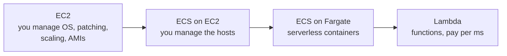
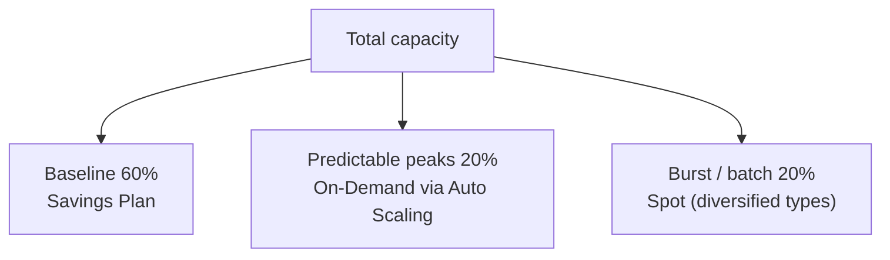
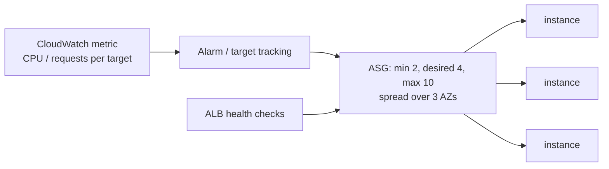
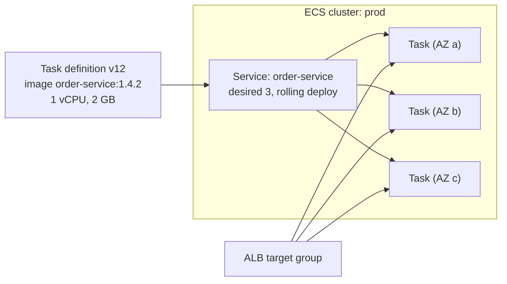
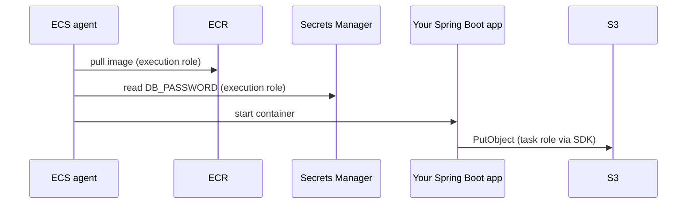
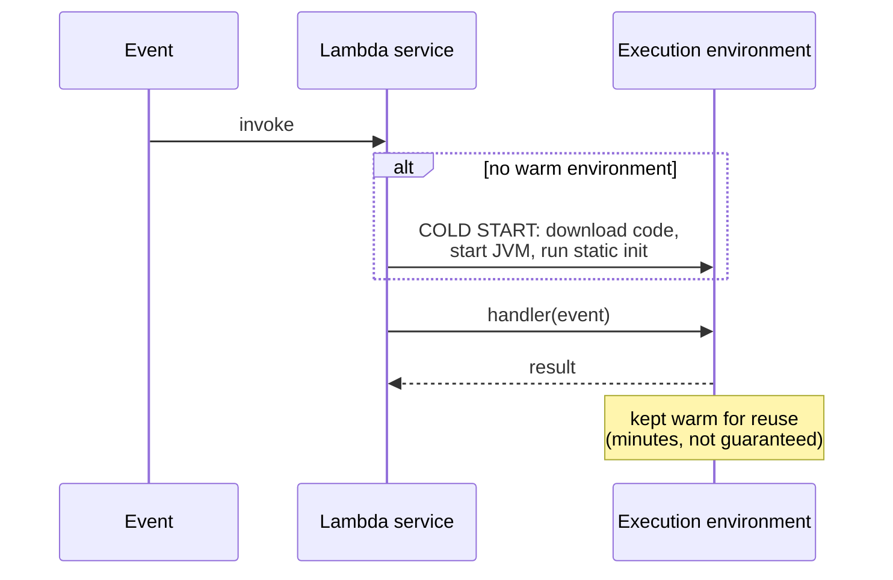
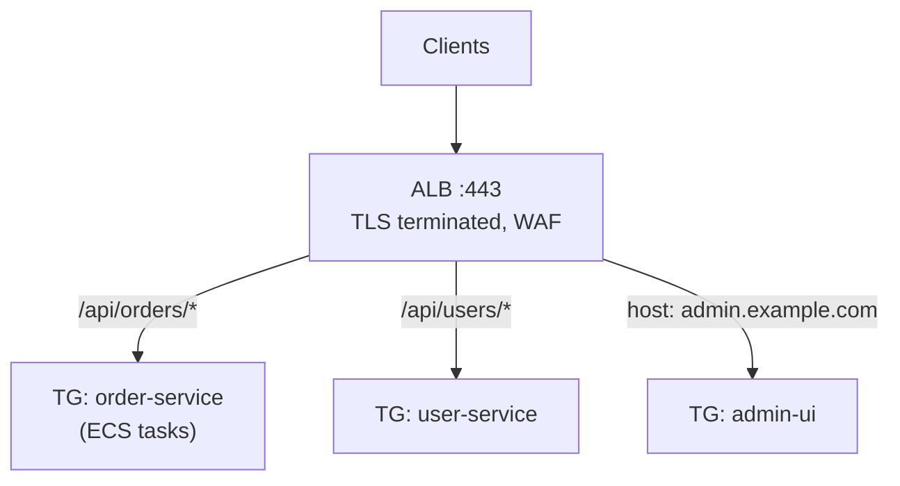

# Day 44 — EC2, ECS & Compute Services

> **How to use these notes:** focus on **choices and trade-offs** — "why Fargate and not EC2?", "why ALB and not NLB?", "how do you make Lambda cold starts acceptable for Java?". Every table here is a decision you should be able to defend in one or two sentences. 🚀 marks senior-level details.

**Today's goal:** choose EC2 **instance families** and **pricing models**, design **Auto Scaling**, deploy containers on **ECS** (Fargate vs EC2, task role vs execution role), know where **Lambda** fits and its limits, and pick between **ALB and NLB**.

**Compute spectrum — more control ↔ less ops:**



| Choose | When |
|---|---|
| **EC2** | Full OS control, special hardware (GPU, local NVMe), licensed software, long-running stateful nodes |
| **ECS Fargate** | Containerised microservices (Spring Boot), no host management — the default for most teams |
| **ECS on EC2** | Large steady fleets where cheaper bin-packed hosts, GPUs or Spot capacity matter |
| **EKS** | Kubernetes skills/tooling already in the company, multi-cloud portability |
| **Lambda** | Event-driven, spiky, short tasks (≤ 15 min): S3/SQS triggers, cron jobs, glue code |

<!-- topic: d44_t1 -->
## ☁️ AWS — Compute Services

<!-- subtopic: d44_t1_s1 -->
### 1. EC2 instance types

Name anatomy: **`m7g.xlarge`** = family **m** (general) · generation **7** · attribute **g** (Graviton/ARM) · size **xlarge** (4 vCPU, 16 GiB).

| Family | Optimised for | Typical workload |
|---|---|---|
| **t3 / t4g** | Burstable general purpose (CPU credits) | Dev/test, low-traffic services, bastions |
| **m6i / m7g** | Balanced CPU : memory (1 : 4 GiB) | Most Spring Boot apps, app servers |
| **c6i / c7g** | Compute (1 : 2 GiB) | Batch, encoding, high-throughput APIs, gaming |
| **r6i / r7g** | Memory (1 : 8 GiB) | In-memory caches, large JVM heaps, analytics |
| **i3 / i4i** | Local NVMe storage, high IOPS | Self-managed databases, Cassandra, Elasticsearch |
| **g5 / p5** | GPUs | ML training and inference |

| Attribute letter | Meaning |
|---|---|
| `g` | AWS Graviton (ARM) — typically ~20–40 % better price/performance; Java runs fine on ARM |
| `a` | AMD processors |
| `d` | Local NVMe instance storage |
| `n` | Enhanced networking |

🚀 **T-family trap:** burstable instances earn CPU credits while idle and spend them under load. A busy service on `t3` in *standard* mode gets throttled to its baseline (e.g. 20 %); in *unlimited* mode it bursts but you pay for surplus credits. Use `m`/`c` for steady load.

<!-- subtopic: d44_t1_s2 -->
### 2. EC2 pricing models

| Model | Discount vs On-Demand | Commitment | Best for |
|---|---|---|---|
| **On-Demand** | — | None, per-second billing (Linux) | Spiky, unknown, short-lived |
| **Reserved Instances** | up to ~72 % | 1 or 3 years, specific instance family/region | Steady databases and baseline fleets |
| **Savings Plans** | up to ~66 % (Compute) / ~72 % (EC2 Instance) | $/hour spend for 1 or 3 years | Steady spend that may change family, region, or move to Fargate/Lambda (Compute SP) |
| **Spot** | up to ~90 % | None — AWS can reclaim with a **2-minute warning** | Stateless, fault-tolerant: batch, CI runners, extra workers |
| **Dedicated Hosts** | — | Physical server for you | BYOL licences, compliance |

**A typical production mix:**



> **Model answer:** "Cover the always-on baseline with a **Compute Savings Plan** (it also discounts Fargate and Lambda), scale peaks on-demand, and put interruption-tolerant work on **Spot** across several instance types and AZs, handling the 2-minute notice by draining work."

<!-- subtopic: d44_t1_s3 -->
### 3. Auto Scaling Groups

An **ASG** keeps between `min` and `max` instances (aiming for `desired`) across AZs, replaces unhealthy ones, and scales on policies.

| Policy | How it works | Example |
|---|---|---|
| **Target tracking** | Keep a metric at a target, like a thermostat | Average CPU at 50 %, or ALB requests per target at 1000 |
| **Step scaling** | Add/remove N instances per alarm threshold band | CPU > 70 % → +2, > 90 % → +4 |
| **Scheduled** | Change min/desired at times | Scale up at 09:00 IST on weekdays |
| **Predictive** | ML forecast from 14 days of history, scales ahead of time | Daily traffic cycles |



| Concept | Why it matters |
|---|---|
| **Health check type** | Use **ELB** health checks so an app that's up but returning 500s gets replaced, not just dead VMs |
| **Health check grace period** | Give Spring Boot time to start before the first check (e.g. 120–300 s) |
| **Cooldown / warm-up** | Avoid flapping while new instances warm up |
| **Warm pools** | Pre-initialised stopped instances → faster scale-out for slow-booting apps |
| **Instance refresh** | Rolling replacement when you change the AMI or launch template |
| **Lifecycle hooks** | Run scripts on launch/terminate (register, drain connections, ship logs) |

🚀 For JVM services scale on **requests per target** or a latency metric rather than CPU alone — JIT warm-up and GC can make CPU misleading right after launch.

<!-- subtopic: d44_t1_s4 -->
### 4. Launch Templates vs Launch Configurations, user data

**Launch template** = the recipe for an instance: AMI, instance type, key pair, security groups, IAM instance profile, EBS volumes, **user data**, tags. **Versioned**, supports **mixed instance types + Spot** in one ASG, and works with EC2 Fleet. **Launch configurations** are the legacy, immutable, deprecated predecessor — new features only arrive in launch templates, so always use templates.

**User data** runs once at first boot (as root, via cloud-init):

```bash
#!/bin/bash
dnf install -y java-21-amazon-corretto-headless
aws s3 cp s3://my-artifacts/order-service-1.4.2.jar /opt/app/app.jar
cat >/etc/systemd/system/app.service <<'EOF'
[Unit]
Description=order-service
[Service]
ExecStart=/usr/bin/java -XX:MaxRAMPercentage=75 -jar /opt/app/app.jar
Restart=always
[Install]
WantedBy=multi-user.target
EOF
systemctl enable --now app
```

| Practice | Why |
|---|---|
| Keep user data small; bake heavy setup into an **AMI** (Packer / EC2 Image Builder) | Faster, more reliable scale-out |
| Read secrets at runtime from Secrets Manager / Parameter Store | User data is visible to anyone with `ec2:DescribeInstanceAttribute` |
| Use an **instance profile** (IAM role), never access keys on disk | Credentials rotate automatically via the metadata service (IMDSv2) |

<!-- subtopic: d44_t1_s5 -->
### 5. ECS: task definitions, services, clusters — Fargate vs EC2

| Concept | What it is | Kubernetes analogy |
|---|---|---|
| **Task definition** | JSON blueprint: image, CPU/memory, ports, env, secrets, log config, roles | Pod spec |
| **Task** | A running instance of a task definition | Pod |
| **Service** | Keeps N tasks running, does rolling deploys, registers with a load balancer | Deployment + Service |
| **Cluster** | Logical group of services and capacity | Cluster / namespace |
| **Capacity provider** | Where tasks run: Fargate, Fargate Spot, or an EC2 ASG | Node pool |



| | **Fargate** | **EC2 launch type** |
|---|---|---|
| Servers | None to manage | You run, patch and scale the container instances |
| Billing | Per task vCPU/GB per second | Per instance, whether full or not |
| Isolation | Each task in its own micro-VM | Tasks share hosts |
| Fits | Most microservices, variable load | Very large steady fleets, GPUs, special kernels, daemon tasks |
| Spot | Fargate Spot (~70 % off, interruptible) | Spot instances in the ASG |

```json
{
  "family": "order-service",
  "requiresCompatibilities": ["FARGATE"],
  "networkMode": "awsvpc",
  "cpu": "1024",
  "memory": "2048",
  "taskRoleArn": "arn:aws:iam::111122223333:role/order-service-task-role",
  "executionRoleArn": "arn:aws:iam::111122223333:role/ecsTaskExecutionRole",
  "containerDefinitions": [{
    "name": "app",
    "image": "111122223333.dkr.ecr.ap-south-1.amazonaws.com/order-service:1.4.2",
    "portMappings": [{ "containerPort": 8080 }],
    "secrets": [{ "name": "DB_PASSWORD", "valueFrom": "arn:aws:secretsmanager:ap-south-1:111122223333:secret:prod/db" }],
    "logConfiguration": { "logDriver": "awslogs", "options": {
      "awslogs-group": "/ecs/order-service", "awslogs-region": "ap-south-1", "awslogs-stream-prefix": "app" } },
    "healthCheck": { "command": ["CMD-SHELL", "curl -f http://localhost:8080/actuator/health || exit 1"] }
  }]
}
```

<!-- subtopic: d44_t1_s6 -->
### 6. ECS Task Role vs Execution Role — the critical distinction

| Role | Used by | Typical permissions |
|---|---|---|
| **Execution role** | The **ECS agent / Fargate platform**, *before and around* your container | Pull the image from ECR, write logs to CloudWatch, fetch secrets referenced in the task definition |
| **Task role** | **Your application code** at runtime (via the AWS SDK) | `s3:PutObject` on your bucket, `sqs:SendMessage`, `dynamodb:Query`… |



> **Model answer:** "The **execution role** is for ECS itself — pulling images, shipping logs and injecting secrets. The **task role** is what my application assumes; the SDK picks it up automatically from the container credentials endpoint. Mixing them up is the classic bug: the app gets `AccessDenied` on S3 because the permission was added to the execution role."

<!-- subtopic: d44_t1_s7 -->
### 7. AWS Lambda — cold starts, concurrency

| Limit / fact | Value |
|---|---|
| Max timeout | **15 minutes** |
| Memory | 128 MB – 10,240 MB (CPU scales with memory) |
| Ephemeral `/tmp` | 512 MB default, up to 10 GB |
| Sync payload | 6 MB request / response |
| Default concurrency | 1,000 per account per region (soft limit) |



**Cold start** = new environment: download code, start runtime, run initialisation. Java is the slowest (JVM + class loading + Spring context) — often **seconds**. **Warm start** reuses an environment: just the handler call.

| Fix for Java cold starts | How it helps |
|---|---|
| **SnapStart** | Snapshots the initialised environment (Firecracker microVM) and restores it — sub-second starts |
| More memory | More CPU → faster init |
| Lighter frameworks / no classpath scanning | Less init work (Micronaut, Quarkus, plain handlers) |
| Initialise SDK clients **outside** the handler | Reused across warm invocations |
| **Provisioned concurrency** | Keeps N environments initialised — no cold starts, costs money even when idle |

| Concurrency setting | Meaning |
|---|---|
| **Reserved concurrency** | Guarantees *and caps* concurrency for one function (protects a downstream DB; 0 = disabled) |
| **Provisioned concurrency** | Pre-warmed environments ready to serve instantly |
| Throttling | Beyond the limit, sync calls get **429**; async events are retried, then go to a DLQ/destination |

🚀 **Lambda + relational DB:** hundreds of concurrent functions = hundreds of DB connections. Use **RDS Proxy**, and cap with reserved concurrency.

<!-- subtopic: d44_t1_s8 -->
### 8. ALB vs NLB

| | **ALB** (Layer 7) | **NLB** (Layer 4) |
|---|---|---|
| Protocols | HTTP, HTTPS, HTTP/2, gRPC, WebSockets | TCP, UDP, TLS |
| Routing | Path, host, header, query string, method, source IP | Port only |
| Performance | Very high | **Millions of rps, ultra-low latency** |
| IPs | DNS name, IPs change | **Static IP per AZ** (Elastic IP possible) |
| Client IP | `X-Forwarded-For` header | Preserved at the network level |
| Targets | Instances, IPs, **Lambda** | Instances, IPs, ALB |
| Extras | Auth (Cognito/OIDC), WAF, redirects, fixed responses | PrivateLink endpoint services, TLS passthrough |



**Target groups & health checks:** each target group has a health check (e.g. `GET /actuator/health`, healthy after 2 checks, unhealthy after 2–3 failures). Use **deregistration delay** (connection draining, e.g. 30 s) so in-flight requests finish during deploys. Enable **cross-zone load balancing** for even spread.

> **Model answer:** "For HTTP microservices I use an **ALB** — path- and host-based routing to multiple target groups, TLS termination with ACM, WAF in front. I choose an **NLB** for non-HTTP protocols, when clients need **static IPs** to allow-list, extreme throughput or PrivateLink."

---

## 📝 Day 44 Revision Cheat Sheet

| Topic | Key points |
|---|---|
| Instance families | t burstable, m general, c compute, r memory, i storage, g/p GPU; `g` suffix = Graviton |
| Pricing | On-Demand; RI/Savings Plans up to ~72 %; Spot up to 90 % with 2-min notice |
| Auto Scaling | Target tracking first; ELB health checks; grace period for JVM start; warm pools |
| Launch templates | Versioned, mixed instances/Spot; launch configs deprecated; bake AMIs |
| ECS | Task def → task → service → cluster; Fargate = no hosts |
| Roles | Execution role = ECS pulls image, logs, secrets; task role = your app's AWS calls |
| Lambda | 15 min max, 10 GB memory; cold starts → SnapStart / provisioned concurrency; reserved concurrency caps |
| Load balancers | ALB L7 routing, Lambda targets; NLB L4, static IPs, PrivateLink |

<details><summary>Q1. How would you deploy a Spring Boot microservice on AWS?</summary>

Build a container image, push to ECR. Run it as an ECS service on Fargate across three AZs in private subnets, behind an ALB with a target group health check on /actuator/health. Task role for the app's AWS permissions, execution role for image pulls, logs and secrets from Secrets Manager. Auto scale with target tracking on CPU or requests per target, logs to CloudWatch, rolling or blue/green deploys.

</details>

<details><summary>Q2. Task role vs execution role?</summary>

The execution role is used by the ECS agent/Fargate to pull the image from ECR, send logs to CloudWatch and fetch secrets referenced in the task definition. The task role is assumed by the application code inside the container for its own AWS API calls, such as writing to S3 or sending to SQS.

</details>

<details><summary>Q3. When would you pick Lambda over ECS?</summary>

Lambda for event-driven, short (under 15 minutes), spiky or infrequent work — S3 or SQS triggers, scheduled jobs, lightweight APIs — where paying per invocation and having zero idle cost wins. ECS for long-running services, steady traffic, heavy frameworks with slow startup, persistent connections, or work beyond Lambda's limits.

</details>

<details><summary>Q4. How do you reduce Java Lambda cold starts?</summary>

Enable SnapStart, give the function more memory (more CPU), keep the deployment package and initialisation light, initialise SDK clients outside the handler for reuse, and use provisioned concurrency for latency-critical paths.

</details>

<details><summary>Q5. ALB or NLB?</summary>

ALB for HTTP/HTTPS/gRPC with content-based routing, TLS termination, WAF and Lambda targets. NLB for TCP/UDP, static or Elastic IPs, very high throughput with low latency, preserving source IPs, or exposing a service through PrivateLink.

</details>

### ⚡ Rapid-fire self-test

1. Which EC2 family suits a large in-memory cache? → **R (memory optimised)**
2. How much warning does a Spot interruption give? → **Two minutes**
3. Pricing option that also discounts Fargate and Lambda? → **Compute Savings Plans**
4. Which ASG health check type replaces instances that return HTTP 500s? → **ELB health checks**
5. Legacy alternative to launch templates? → **Launch configurations**
6. Role used to pull an image from ECR in ECS? → **The task execution role**
7. Maximum Lambda timeout? → **15 minutes**
8. Feature that snapshots an initialised Java Lambda? → **SnapStart**
9. Lambda setting that both guarantees and caps concurrency? → **Reserved concurrency**
10. Load balancer that gives a static IP per AZ? → **Network Load Balancer**
