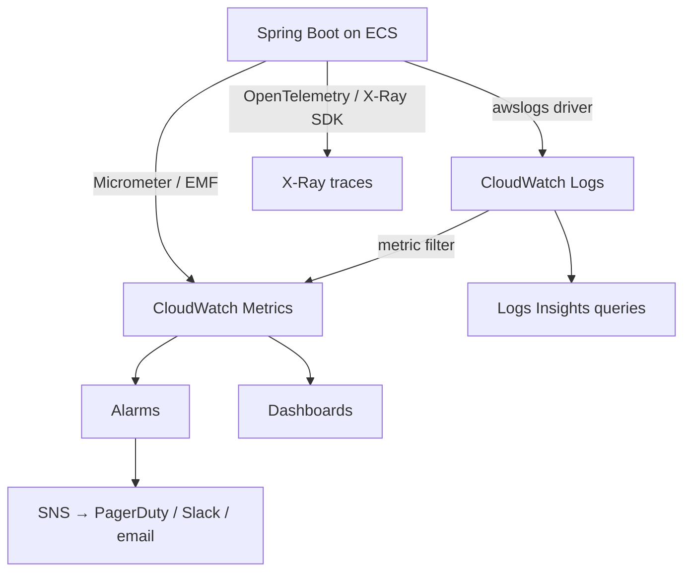
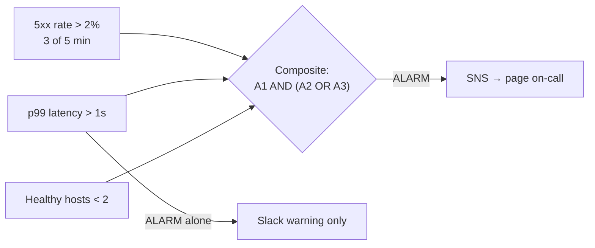
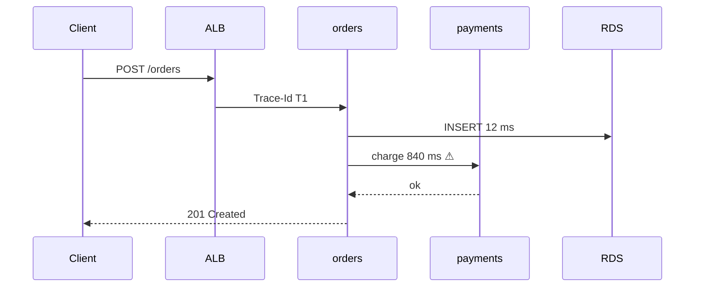
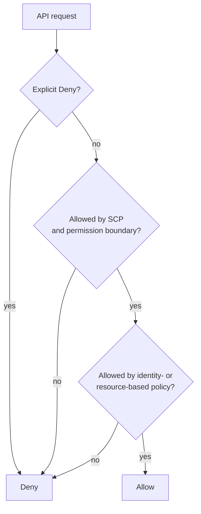
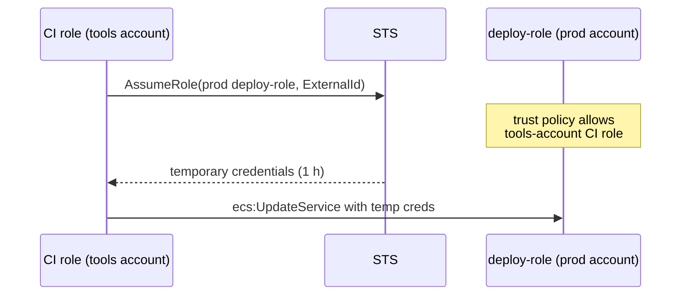
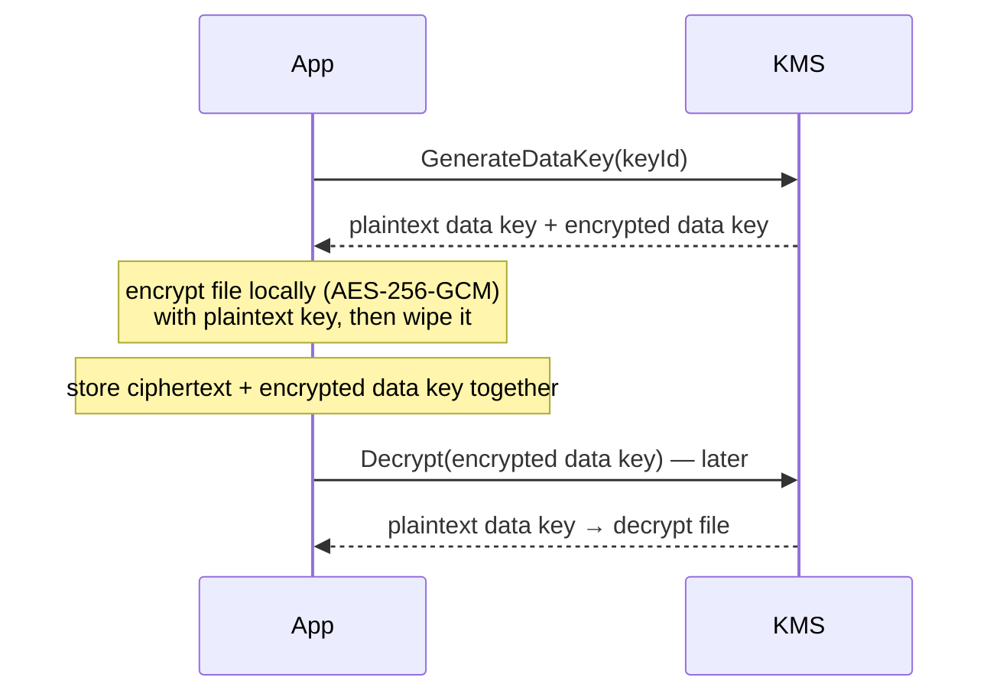
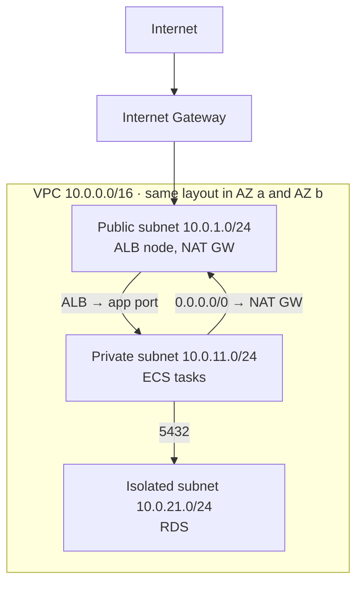

# Day 45 — CloudWatch, Monitoring & AWS Security

> **How to use these notes:** two halves — **observability** (metrics, logs, alarms, traces) and **security** (IAM, KMS, secrets, network). For each, picture a production Spring Boot service on ECS and ask: *"How would I know it's broken, and how is it protected?"* 🚀 marks senior-level details.

**Today's goal:** publish and query **CloudWatch metrics and logs**, build **alarms** that page for the right reasons, trace requests with **X-Ray**, write **least-privilege IAM** with roles and STS, protect data with **KMS** and the right secrets store, and explain a **VPC** with public/private subnets, NAT, Security Groups and NACLs.



<!-- topic: d45_t1 -->
## ☁️ AWS — Monitoring & Security

<!-- subtopic: d45_t1_s1 -->
### 1. CloudWatch Metrics

| Concept | Meaning | Example |
|---|---|---|
| **Namespace** | Container for metrics | `AWS/ECS`, `AWS/ApplicationELB`, `OrderService` |
| **Metric** | A time series | `CPUUtilization`, `orders.placed` |
| **Dimension** | Name/value pair identifying the series (max 30) | `ServiceName=order-service`, `Env=prod` |
| **Statistic** | Aggregation over a period | Average, Sum, Max, p99 |
| **Resolution** | Standard **60 s**; **high-resolution 1 s** for custom metrics | EC2 basic monitoring is 5 min, detailed 1 min |

Retention is automatic and roll-up based: 1-second data for 3 hours, 1-minute for 15 days, 5-minute for 63 days, 1-hour for 455 days (15 months).

**Custom metrics from Spring Boot** — Micrometer with the CloudWatch registry:

```java
// build.gradle: implementation "io.micrometer:micrometer-registry-cloudwatch2"
@Service
class OrderService {
    private final Counter placed;
    private final Timer paymentLatency;

    OrderService(MeterRegistry registry) {
        this.placed = Counter.builder("orders.placed").tag("channel", "web").register(registry);
        this.paymentLatency = Timer.builder("payment.latency").publishPercentiles(0.99).register(registry);
    }

    Order place(OrderRequest req) {
        Order order = paymentLatency.record(() -> charge(req));
        placed.increment();
        return order;
    }
}
```

```yaml
management:
  cloudwatch:
    metrics:
      export:
        namespace: OrderService
        step: 1m
```

🚀 **Embedded Metric Format (EMF):** write a JSON log line with a `_aws` block and CloudWatch extracts metrics from logs asynchronously — no `PutMetricData` calls, no throttling. **Cardinality warning:** each unique dimension combination is a separate (billed) metric — never use user ids or order ids as dimensions.

<!-- subtopic: d45_t1_s2 -->
### 2. CloudWatch Logs & Logs Insights

| Concept | Meaning |
|---|---|
| **Log group** | One per application/environment (e.g. `/ecs/order-service`); has **retention** (default: never expire — set it!) and optional KMS encryption |
| **Log stream** | One per source — e.g. one per ECS task / container |
| **Metric filter** | Pattern on log events → a metric (e.g. count `"level":"ERROR"`) |
| **Subscription filter** | Stream logs to Lambda, Kinesis/Firehose, OpenSearch |
| **Logs Insights** | Pipe-based query language across log groups |

Log **structured JSON** (Logback/Logstash encoder) so fields are queryable:

```text
fields @timestamp, level, traceId, message
| filter service = "order-service" and level = "ERROR"
| sort @timestamp desc
| limit 50
```

```text
fields @timestamp, durationMs
| filter path like /\/api\/orders/
| stats avg(durationMs) as avgMs, pct(durationMs, 99) as p99Ms, count(*) as requests by bin(5m)
```

```text
filter level = "ERROR"
| stats count(*) as errors by exceptionClass
| sort errors desc
| limit 10
```

| Practice | Why |
|---|---|
| Set retention (e.g. 30 days prod, 7 days dev) | Logs are a major hidden cost |
| Include `traceId`/`requestId` in every line | Jump from a trace to its logs |
| Never log secrets, tokens or full PII | Logs are widely readable and kept a long time |

<!-- subtopic: d45_t1_s3 -->
### 3. CloudWatch Alarms

An alarm watches one metric (or a math expression) and moves between **OK**, **ALARM** and **INSUFFICIENT_DATA**.

| Setting | Meaning | Example |
|---|---|---|
| Period | Aggregation window | 60 s |
| Evaluation periods / datapoints to alarm | **M out of N** | 3 of 5 minutes above threshold → avoids flapping on a single spike |
| Missing data | `notBreaching`, `breaching`, `ignore`, `missing` | Heartbeat metrics should treat missing as **breaching** |
| Actions | SNS, Auto Scaling, EC2 stop/reboot, Systems Manager | Page on-call via SNS |
| **Anomaly detection** | Alarm outside an ML-learned band | Traffic that's normal at 2 pm but odd at 3 am |
| **Composite alarm** | Boolean logic over alarms | `ALARM(high-5xx) AND ALARM(high-latency)` → one page, less noise |



**What to alarm on for a web service (the "golden signals"):** latency (p99), traffic, **errors** (5xx rate), saturation (CPU/memory, DB connections, consumer lag). Alarm on **symptoms users feel**; send causes (high CPU) to dashboards or low-priority channels.

<!-- subtopic: d45_t1_s4 -->
### 4. AWS X-Ray — distributed tracing

| Concept | Meaning |
|---|---|
| **Trace** | One request's end-to-end journey, shared **trace id** |
| **Segment** | Work done by one service for that request |
| **Subsegment** | A downstream call inside it — DB query, HTTP call, S3 request |
| **Annotations** | Indexed key/values you can **filter** traces by (`orderId`, `tenant`) |
| **Metadata** | Non-indexed extra data |
| **Trace map (service map)** | Graph of services with latency and error rates per edge |
| **Sampling rules** | Default: first request each second + 5 % of the rest, per host |



The trace immediately shows that **payment-service** owns 840 ms of a 900 ms request. 🚀 Today AWS recommends instrumenting with **OpenTelemetry** (the AWS Distro for OpenTelemetry, ADOT) and exporting to X-Ray — vendor-neutral, and the same instrumentation works with Jaeger, Tempo or Datadog (ties back to Day 29's Micrometer Tracing).

<!-- subtopic: d45_t1_s5 -->
### 5. IAM — users, groups, roles, policies

| Identity | What it is | Use for |
|---|---|---|
| **Root user** | Owns the account | Billing and a few account tasks only — lock it away |
| **IAM user** | Long-term credentials (password / access keys) | Avoid for humans (use SSO) and for apps (use roles) |
| **Group** | Collection of users | Attach policies once |
| **Role** | Identity **assumed** temporarily via STS, no long-term keys | EC2/ECS/Lambda workloads, cross-account access, SSO users |
| **Policy** | JSON document of permissions | Identity-based (on user/role) or resource-based (on bucket, queue, key) |

```json
{
  "Version": "2012-10-17",
  "Statement": [{
    "Effect": "Allow",
    "Action": ["sqs:SendMessage"],
    "Resource": "arn:aws:sqs:ap-south-1:111122223333:order-events",
    "Condition": { "StringEquals": { "aws:RequestedRegion": "ap-south-1" } }
  }]
}
```

**Policy evaluation:** start at **deny** → an **explicit Deny** anywhere wins → otherwise need an **Allow** from an applicable policy, and it must also pass any guardrails: **SCPs** (organisation), **permission boundaries** (max permissions for a role), session policies.



**Least privilege in practice:** specific actions (not `s3:*`), specific resource ARNs (not `*`), conditions where possible; generate policies from real usage with **IAM Access Analyzer**.

<!-- subtopic: d45_t1_s6 -->
### 6. IAM best practices, cross-account roles with STS

| Practice | Detail |
|---|---|
| No root usage | MFA on root, no root access keys, use it only for the few root-only tasks |
| MFA everywhere for humans | Enforce with a policy condition `aws:MultiFactorAuthPresent` |
| Humans via **IAM Identity Center (SSO)** | Short-lived role sessions instead of IAM users with keys |
| Workloads via **roles** | Instance profiles, ECS task roles, Lambda execution roles, IRSA on EKS |
| Rotate or eliminate access keys | Prefer roles; if keys exist, rotate ≤ 90 days and alert on unused ones |
| Separate accounts per environment | AWS Organizations: prod / staging / dev / security / logging accounts with SCPs |
| Audit | CloudTrail in all regions to a locked logging account; GuardDuty for threats |

**Cross-account access** — the CI pipeline in the *tools* account deploys into *prod*:



The **trust policy** on `deploy-role` says *who may assume it*; its **permissions policy** says *what it can do*. Both are needed.

<!-- subtopic: d45_t1_s7 -->
### 7. KMS, Secrets Manager vs Parameter Store

**KMS keys** (formerly "CMKs") never leave KMS unencrypted.

| Key type | Who controls | Notes |
|---|---|---|
| AWS owned | AWS, shared | Invisible to you |
| AWS managed (`aws/s3`) | AWS, in your account | Can't change policy; rotates yearly |
| **Customer managed** | You | Own **key policy**, enable/disable, rotation (configurable), grants, cross-account use |

Every KMS key has a **key policy** (resource policy); without it allowing access, even an admin's IAM policy isn't enough.

**Envelope encryption** — KMS `Encrypt` only takes up to **4 KB**, so for real data:



Benefits: large data never travels to KMS, only small keys do; revoking access to the KMS key makes all data keys useless.

| | **Secrets Manager** | **SSM Parameter Store** |
|---|---|---|
| Purpose | Secrets: DB passwords, API keys | Config + secrets (`SecureString` via KMS) |
| **Rotation** | **Built in** (Lambda; native for RDS/Aurora) | None built in |
| Cost | ~$0.40 per secret per month + API calls | Standard tier free (4 KB, 10,000 params); advanced paid |
| Extras | Cross-region replication, versioning stages | Hierarchies `/prod/order-service/…`, history |
| Pick for | Credentials that must rotate | Feature flags, URLs, non-rotating config |

Spring Boot reads both via **Spring Cloud AWS** (`spring.config.import=aws-secretsmanager:prod/db`), or ECS injects them as env vars through the task definition's `secrets`.

<!-- subtopic: d45_t1_s8 -->
### 8. VPC — subnets, routing, NAT, Security Groups vs NACLs



| Piece | Role |
|---|---|
| **Public subnet** | Route table has `0.0.0.0/0 → Internet Gateway`; hosts load balancers, NAT gateways, bastions |
| **Private subnet** | `0.0.0.0/0 → NAT Gateway`: outbound internet (pull packages, call APIs) but no inbound |
| **Isolated subnet** | No internet route at all — databases |
| **NAT Gateway** | Managed, per AZ — deploy **one per AZ** for HA; charged per hour + per GB (a classic cost surprise) |
| **VPC endpoints** | Reach AWS services privately: **Gateway** endpoints (S3, DynamoDB, free) and **Interface** endpoints (PrivateLink, paid) — also cut NAT costs |

| | **Security Group** | **Network ACL** |
|---|---|---|
| Level | ENI / instance / task | Subnet |
| State | **Stateful** — return traffic allowed automatically | **Stateless** — must allow return traffic (ephemeral ports 1024–65535) |
| Rules | **Allow only** | Allow **and deny**, numbered, evaluated in order |
| References | Can reference other security groups ("allow from the ALB's SG") | CIDR ranges only |
| Typical use | Main tool: ALB SG → app SG :8080 → DB SG :5432 | Coarse subnet guardrails, blocking a bad IP range |

> **Model answer:** "Three subnet tiers in at least two AZs: public for the ALB and NAT gateways, private for ECS tasks, isolated for RDS. Security groups chain by reference — the DB only accepts 5432 from the app's security group. S3 traffic goes through a gateway endpoint. NACLs stay mostly default; I'd use them only for explicit subnet-wide denies."

---

## 📝 Day 45 Revision Cheat Sheet

| Topic | Key points |
|---|---|
| Metrics | Namespace / dimensions; 60 s standard, 1 s high-res; Micrometer or EMF; watch cardinality |
| Logs | Log group + retention, streams per task; JSON logs; Logs Insights `fields / filter / stats by bin()` |
| Alarms | M of N datapoints; missing-data handling; anomaly detection; composite alarms to cut noise |
| X-Ray | Trace → segments → subsegments; annotations are indexed; sampling; OpenTelemetry (ADOT) |
| IAM | Roles over users; explicit deny wins; SCPs and boundaries cap; least privilege + Access Analyzer |
| STS | AssumeRole → temporary credentials; trust policy + permissions policy |
| KMS | Customer-managed key + key policy; envelope encryption (data key) for > 4 KB |
| Secrets | Secrets Manager rotates (paid); Parameter Store cheap config, no rotation |
| VPC | Public/private/isolated subnets, NAT per AZ, endpoints; SG stateful allow-only vs NACL stateless allow+deny |

<details><summary>Q1. How do you monitor a Spring Boot service in production on AWS?</summary>

Metrics via Micrometer to CloudWatch (latency percentiles, error rate, throughput, JVM and pool metrics), structured JSON logs to CloudWatch Logs with trace ids and a retention policy, distributed tracing with OpenTelemetry to X-Ray, dashboards per service, and alarms on user-facing symptoms (p99 latency, 5xx rate) combined with composite alarms routed through SNS to on-call.

</details>

<details><summary>Q2. Security group vs NACL?</summary>

Security groups are stateful, attach to network interfaces, only have allow rules and can reference other security groups. NACLs are stateless, apply to whole subnets, support allow and deny rules evaluated in number order, and need explicit rules for return traffic on ephemeral ports.

</details>

<details><summary>Q3. Secrets Manager or Parameter Store for the database password?</summary>

Secrets Manager, because it provides managed automatic rotation (native for RDS), versioning and cross-region replication. Parameter Store SecureString is fine for config values and secrets that don't need rotation, and its standard tier is free.

</details>

<details><summary>Q4. What is envelope encryption and why use it?</summary>

KMS generates a data key; the application encrypts the data locally with the plaintext data key and stores only the encrypted copy of that key alongside the data. To decrypt, KMS decrypts the data key. It avoids KMS's 4 KB limit and network cost for large data, and access is still controlled and audited through the KMS key.

</details>

<details><summary>Q5. How does an application in one AWS account access resources in another?</summary>

The target account creates a role whose trust policy allows the source account's role to assume it (optionally with an external id). The source calls STS AssumeRole, gets temporary credentials, and uses them. Alternatively a resource-based policy (S3 bucket, SQS queue, KMS key) can grant the other account directly — then the caller's IAM policy must allow it too.

</details>

### ⚡ Rapid-fire self-test

1. Standard and high resolution for CloudWatch custom metrics? → **60 seconds and 1 second**
2. Default retention of a CloudWatch log group? → **Never expire — set it explicitly**
3. Alarm type that combines other alarms with AND/OR? → **Composite alarm**
4. X-Ray data you can filter traces by? → **Annotations (metadata is not indexed)**
5. In IAM policy evaluation, what always wins? → **An explicit Deny**
6. Which policy says who may assume a role? → **The role's trust policy**
7. Maximum data size for a direct KMS Encrypt call? → **4 KB**
8. Which secrets store has built-in rotation? → **AWS Secrets Manager**
9. Which is stateless: security group or NACL? → **NACL**
10. What gives private subnets outbound internet access? → **A NAT Gateway in a public subnet**
