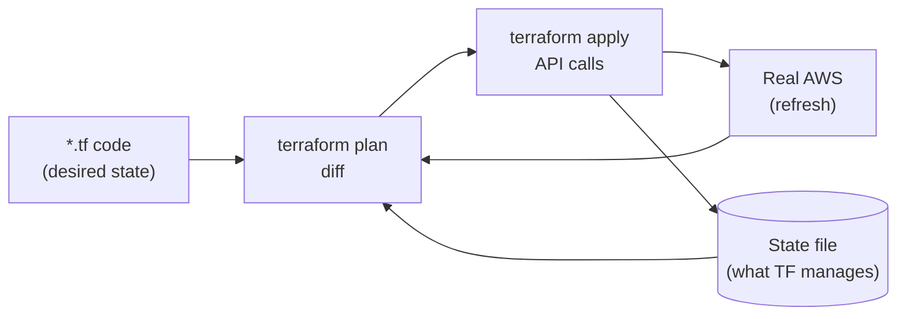
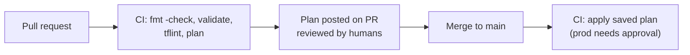
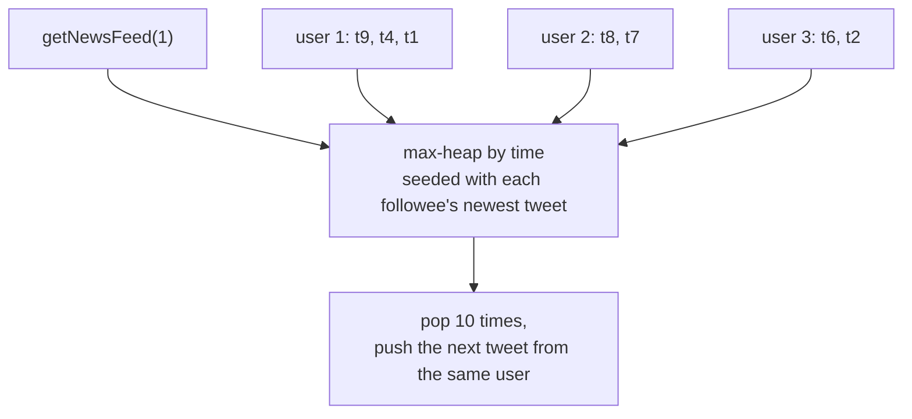
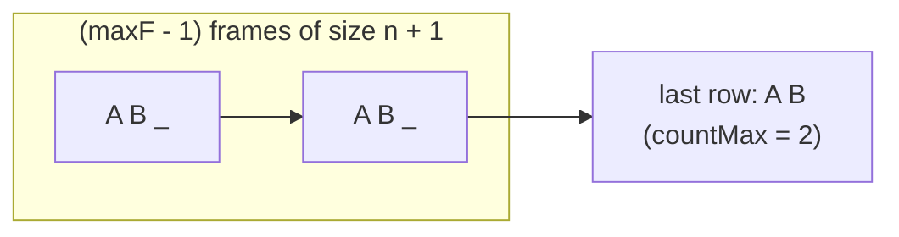

# Day 46 — Terraform: Infrastructure as Code

> **How to use these notes:** install Terraform (`terraform -version`) and follow along — every snippet here is valid HCL. You can `plan` most of it without an AWS account by reading the output; `apply` only in a sandbox account. Then switch to the DSA half: three classic Mediums plus a timed set. 🚀 marks senior-level details.

**Today's goal:** read and write **HCL** (resources, data sources, variables, outputs, locals, modules), run the **init → plan → apply** workflow, manage **remote state with locking**, reuse code with **modules**, choose **for_each over count**, use **lifecycle** rules, and **import** existing resources. DSA: **Design Twitter**, **Flatten Nested List Iterator**, **Task Scheduler**.

**Why IaC?** Infrastructure that is **reviewed** (pull requests), **repeatable** (dev = staging = prod), **versioned** (git history), and **recoverable** (rebuild a region from code). Clicking in the console gives you none of that.



<!-- topic: d46_t1 -->
## 🏗️ DevOps — Terraform IaC

<!-- subtopic: d46_t1_s1 -->
### 1. HCL syntax: resource, data, variable, output, locals, module

```hcl
terraform {
  required_version = ">= 1.6"
  required_providers {
    aws = { source = "hashicorp/aws", version = "~> 5.0" }
  }
}

provider "aws" {
  region = var.region
  default_tags { tags = local.common_tags }       # tag everything automatically
}

variable "region" {
  type        = string
  default     = "ap-south-1"
  description = "AWS region to deploy into"
}

variable "env" {
  type = string
  validation {
    condition     = contains(["dev", "staging", "prod"], var.env)
    error_message = "env must be dev, staging or prod."
  }
}

locals {
  name        = "order-service-${var.env}"
  common_tags = { Project = "orders", Env = var.env, ManagedBy = "terraform" }
}

data "aws_vpc" "main" {                            # READ something that already exists
  tags = { Name = "main-${var.env}" }
}

resource "aws_s3_bucket" "uploads" {               # CREATE / manage something
  bucket = "${local.name}-uploads"
}

module "queue" {                                   # REUSE a packaged set of resources
  source = "./modules/sqs-with-dlq"
  name   = "${local.name}-events"
}

output "bucket_arn" {
  value = aws_s3_bucket.uploads.arn                # reference: type.name.attribute
}
```

| Block | Purpose | Reference syntax |
|---|---|---|
| `resource` | Something Terraform creates and owns | `aws_s3_bucket.uploads.arn` |
| `data` | Look up something that exists (not managed) | `data.aws_vpc.main.id` |
| `variable` | Input (from `-var`, `*.tfvars`, `TF_VAR_x` env) | `var.env` |
| `locals` | Named expressions, computed once | `local.name` |
| `output` | Values printed after apply / consumed by other configs | `module.queue.queue_url` |
| `module` | Call a reusable folder of `.tf` files | `module.queue.<output>` |
| `provider` | Plugin + settings (region, credentials) | — |

Terraform builds a **dependency graph** from references — `aws_s3_bucket.uploads.arn` in another resource means "create the bucket first". Use `depends_on` only for hidden dependencies.

<!-- subtopic: d46_t1_s2 -->
### 2. Workflow: init → validate → plan → apply → destroy

| Command | What it does |
|---|---|
| `terraform init` | Download providers and modules, configure the backend (state) |
| `terraform fmt` | Format code (run in CI with `-check`) |
| `terraform validate` | Syntax and internal consistency, no API calls |
| `terraform plan -out=tfplan` | Refresh real state, compute the diff, save the exact plan |
| `terraform apply tfplan` | Execute **exactly** that saved plan |
| `terraform destroy` | Delete everything in this state (careful!) |

**Reading a plan:**

| Symbol | Meaning |
|---|---|
| `+` | create |
| `~` | update in place |
| `-/+` | **destroy and re-create** (replacement — check why! e.g. changing a bucket name) |
| `-` | destroy |
| `<=` | read (data source) |



🚀 Always `apply` a **saved plan** in CI — otherwise the infrastructure may change between the plan you reviewed and the apply.

<!-- subtopic: d46_t1_s3 -->
### 3. State management — local vs remote, locking, workspaces

The **state file** maps your code to real resource ids (`aws_s3_bucket.uploads` → `order-service-prod-uploads`). Without it Terraform can't know what it manages.

| Local state (`terraform.tfstate` on disk) | Remote state (S3 backend) |
|---|---|
| Fine for experiments | **Required for teams** |
| Lost laptop = lost mapping | Durable, versioned bucket |
| No locking → two applies corrupt it | **Locking** prevents concurrent applies |
| Secrets in plain text on disk | Encrypted at rest, access via IAM |

```hcl
terraform {
  backend "s3" {
    bucket       = "acme-terraform-state"
    key          = "orders/prod/terraform.tfstate"
    region       = "ap-south-1"
    encrypt      = true
    use_lockfile = true                   # Terraform 1.10+: native S3 locking
    # dynamodb_table = "terraform-locks"  # older setups: DynamoDB lock table (now deprecated)
  }
}
```

| Rule | Why |
|---|---|
| Versioning on the state bucket | Roll back a corrupted state |
| Never edit state by hand | Use `terraform state mv / rm / list`, `moved {}` blocks |
| State contains secrets (DB passwords, keys) | Restrict access, encrypt, prefer generating secrets outside TF |
| Split state per environment and per component | Smaller blast radius, faster plans |

**Workspaces** (`terraform workspace new staging`) give several states from **one** config — handy for short-lived copies. For long-lived environments, most teams prefer **separate directories / backends per env** (`envs/dev`, `envs/prod`) so prod has different access, variables and review rules.

<!-- subtopic: d46_t1_s4 -->
### 4. Modules — reusable configurations

A module is just a folder with `variables.tf`, `main.tf`, `outputs.tf`.

```hcl
# modules/sqs-with-dlq/main.tf
variable "name" { type = string }
variable "max_receive_count" {
  type    = number
  default = 5
}

resource "aws_sqs_queue" "dlq" {
  name                      = "${var.name}-dlq"
  message_retention_seconds = 1209600            # 14 days
}

resource "aws_sqs_queue" "main" {
  name = var.name
  redrive_policy = jsonencode({
    deadLetterTargetArn = aws_sqs_queue.dlq.arn
    maxReceiveCount     = var.max_receive_count
  })
}

output "queue_url" { value = aws_sqs_queue.main.url }
output "dlq_arn"   { value = aws_sqs_queue.dlq.arn }
```

| Source | Example |
|---|---|
| Local path | `source = "./modules/sqs-with-dlq"` |
| Terraform Registry | `source = "terraform-aws-modules/vpc/aws"` + `version = "~> 5.0"` |
| Git | `source = "git::https://github.com/acme/tf-modules.git//ecs-service?ref=v1.4.0"` |

**Good module design:** small and focused (one concept), sensible defaults, validated inputs, outputs for everything callers need, **pinned versions** (`ref=v1.4.0`, `version = "~> 5.0"`), no provider blocks inside.

<!-- subtopic: d46_t1_s5 -->
### 5. count vs for_each, dynamic blocks

```hcl
# count — addresses are positions: aws_iam_user.dev[0], [1], [2]
resource "aws_iam_user" "dev" {
  count = length(var.users)               # ["asha", "ravi", "neha"]
  name  = var.users[count.index]
}
```

Remove `"asha"` from the list → `ravi` moves from `[1]` to `[0]` → Terraform **destroys and re-creates** ravi and neha. 😱

```hcl
# for_each — addresses are keys: aws_iam_user.dev["ravi"]
resource "aws_iam_user" "dev" {
  for_each = toset(var.users)
  name     = each.key
}
```

Remove `"asha"` → only `aws_iam_user.dev["asha"]` is destroyed. **Prefer `for_each`** for collections; use `count` for "0 or 1" toggles (`count = var.enable_alarm ? 1 : 0`).

**Dynamic blocks** generate repeated nested blocks:

```hcl
variable "ingress_ports" {
  type    = list(number)
  default = [80, 443]
}

resource "aws_security_group" "alb" {
  name   = "alb-sg"
  vpc_id = data.aws_vpc.main.id

  dynamic "ingress" {
    for_each = var.ingress_ports
    content {
      from_port   = ingress.value
      to_port     = ingress.value
      protocol    = "tcp"
      cidr_blocks = ["0.0.0.0/0"]
    }
  }
}
```

<!-- subtopic: d46_t1_s6 -->
### 6. Lifecycle rules

```hcl
resource "aws_db_instance" "orders" {
  # ...
  lifecycle {
    prevent_destroy = true                         # plan fails if anything would delete it
    ignore_changes  = [password]                   # rotated outside Terraform
  }
}

resource "aws_launch_template" "app" {
  # ...
  lifecycle {
    create_before_destroy = true                   # new one first, then delete old (no gap)
  }
}
```

| Rule | Use for |
|---|---|
| `create_before_destroy` | Replacements that must not cause downtime (launch templates, certificates, SGs attached to running things) |
| `prevent_destroy` | Databases, state buckets, KMS keys — anything irreplaceable |
| `ignore_changes` | Attributes changed by something else: ASG `desired_capacity` (autoscaling), rotated passwords, tags added by other tools |
| `replace_triggered_by` | Force replacement when another resource changes |
| `precondition` / `postcondition` | Assert assumptions (e.g. the AMI is for `arm64`) |

<!-- subtopic: d46_t1_s7 -->
### 7. terraform import, Terragrunt

**Bringing existing (click-ops) resources under management:**

```hcl
# Terraform 1.5+: declarative import block — reviewed in a plan like any change
import {
  to = aws_s3_bucket.legacy
  id = "acme-legacy-reports"
}

resource "aws_s3_bucket" "legacy" {
  bucket = "acme-legacy-reports"
}
```

```bash
terraform plan -generate-config-out=generated.tf   # Terraform writes the resource block for you
terraform apply                                      # records it in state, changes nothing in AWS
```

The older CLI form `terraform import aws_s3_bucket.legacy acme-legacy-reports` updates state immediately without a plan. After importing, iterate until `plan` shows **no changes** — then the code truly matches reality.

**Terragrunt** — a thin wrapper that keeps multi-environment setups DRY: one module, and per-env folders that only contain inputs; it generates backend config per folder and can run `plan`/`apply` across many stacks in dependency order.

```text
live/
├── terragrunt.hcl          # remote state config defined once
├── dev/orders/terragrunt.hcl     → source = modules/orders, inputs = { env = "dev",  size = "small" }
└── prod/orders/terragrunt.hcl    → source = modules/orders, inputs = { env = "prod", size = "large" }
```

🚀 **Drift:** someone edits a security group in the console → the next `plan` shows a diff. Run scheduled `terraform plan -detailed-exitcode` in CI (exit code 2 = changes) to alert on drift.

<!-- topic: d38_t2 -->
## 🧮 DSA — Timed Practice

<!-- subtopic: d38_t2_s1 -->
### 8. Timed: 1 Easy + 2 Medium in 60 minutes

| Problem | Budget | Suggested unseen picks |
|---|---|---|
| Easy | 12 min | Valid Anagram (242), Merge Two Sorted Lists (21), Majority Element (169) |
| Medium 1 | 22 min | Longest Consecutive Sequence (128), Product of Array Except Self (238) |
| Medium 2 | 22 min | Top K Frequent Elements (347), Daily Temperatures (739) |
| Review | 4 min | Note the slowest part for each problem |

**Pace check:** if the Easy takes more than 15 minutes, the issue is usually **typing speed / syntax recall** — drill the Day 42 templates. If Mediums stall before coding, the issue is **pattern recognition** — re-read the decision flowchart from Day 42.

<!-- subtopic: d38_t2_s2 -->
### 9. Design Twitter (LeetCode 355)

**API:** `postTweet(userId, tweetId)`, `getNewsFeed(userId)` → 10 most recent tweet ids from the user and people they follow, `follow`, `unfollow`.

**Design:** each user keeps their own tweets newest-first; the feed is a **merge of k sorted lists** using a max-heap keyed by a global timestamp — only the top 10 are ever pulled.



```java
class Twitter {
    private static int clock = 0;
    private record Tweet(int id, int time) { }

    private final Map<Integer, Set<Integer>> following = new HashMap<>();
    private final Map<Integer, List<Tweet>> tweets = new HashMap<>();     // appended in time order

    public void postTweet(int userId, int tweetId) {
        tweets.computeIfAbsent(userId, k -> new ArrayList<>()).add(new Tweet(tweetId, clock++));
    }

    public List<Integer> getNewsFeed(int userId) {
        // heap entries: {time, tweetId, userId, indexInThatUsersList}
        PriorityQueue<int[]> heap = new PriorityQueue<>((a, b) -> b[0] - a[0]);
        Set<Integer> users = new HashSet<>(following.getOrDefault(userId, Set.of()));
        users.add(userId);
        for (int u : users) {
            List<Tweet> list = tweets.get(u);
            if (list != null && !list.isEmpty()) {
                int i = list.size() - 1;
                heap.offer(new int[]{list.get(i).time(), list.get(i).id(), u, i});
            }
        }
        List<Integer> feed = new ArrayList<>();
        while (!heap.isEmpty() && feed.size() < 10) {
            int[] top = heap.poll();
            feed.add(top[1]);
            int next = top[3] - 1;
            if (next >= 0) {
                Tweet t = tweets.get(top[2]).get(next);
                heap.offer(new int[]{t.time(), t.id(), top[2], next});
            }
        }
        return feed;
    }

    public void follow(int followerId, int followeeId) {
        if (followerId != followeeId) following.computeIfAbsent(followerId, k -> new HashSet<>()).add(followeeId);
    }

    public void unfollow(int followerId, int followeeId) {
        following.getOrDefault(followerId, new HashSet<>()).remove(followeeId);
    }
}
```

**Complexity:** `postTweet`/`follow` O(1); `getNewsFeed` O(f + 10 log f) for f followees. 🚀 **System design link:** this is "fan-out on read". Real Twitter mixes in **fan-out on write** (push tweet ids into followers' cached timelines) for normal users and on-read for celebrities — a classic Day 57 discussion.

<!-- subtopic: d38_t2_s3 -->
### 10. Flatten Nested List Iterator (LeetCode 341)

**Problem:** iterate over `[[1,1],2,[1,1]]` as `1,1,2,1,1`, where elements are integers or nested lists of any depth.

**Idea:** a **stack of iterators**, flattened **lazily** in `hasNext()` — only as deep as needed, so huge nested inputs aren't copied up front.

```java
public class NestedIterator implements Iterator<Integer> {
    private final Deque<Iterator<NestedInteger>> stack = new ArrayDeque<>();
    private Integer nextValue;

    public NestedIterator(List<NestedInteger> nestedList) {
        stack.push(nestedList.iterator());
    }

    @Override
    public boolean hasNext() {
        while (nextValue == null && !stack.isEmpty()) {
            Iterator<NestedInteger> top = stack.peek();
            if (!top.hasNext()) { stack.pop(); continue; }      // finished this list
            NestedInteger ni = top.next();
            if (ni.isInteger()) nextValue = ni.getInteger();   // found the next value
            else stack.push(ni.getList().iterator());          // go one level deeper
        }
        return nextValue != null;
    }

    @Override
    public Integer next() {
        if (!hasNext()) throw new NoSuchElementException();
        Integer v = nextValue;
        nextValue = null;
        return v;
    }
}
```

**Complexity:** O(1) amortised per element; O(depth) space. **Interview points:** `hasNext()` must be **idempotent** (calling it twice doesn't skip values — hence caching `nextValue`), and empty nested lists like `[[]]` must yield nothing.

<!-- subtopic: d38_t2_s4 -->
### 11. Task Scheduler (LeetCode 621)

**Problem:** tasks `A,A,A,B,B,B` with cooldown `n = 2` between same tasks → minimum time slots (idle allowed) = **8**: `A B idle A B idle A B`.

**Greedy math:** the most frequent task decides the skeleton. With max frequency `maxF` and `countMax` tasks having that frequency:

```text
slots = (maxF - 1) * (n + 1) + countMax
answer = max(slots, tasks.length)          // if there are many tasks, no idle is needed
```



For `A×3, B×3, n=2`: (3−1)·3 + 2 = 8.

```java
public int leastInterval(char[] tasks, int n) {
    int[] freq = new int[26];
    for (char t : tasks) freq[t - 'A']++;
    int maxF = 0, countMax = 0;
    for (int f : freq) {
        if (f > maxF) { maxF = f; countMax = 1; }
        else if (f == maxF) countMax++;
    }
    return Math.max(tasks.length, (maxF - 1) * (n + 1) + countMax);
}
```

**Complexity:** O(T) time, O(1) space. **Alternative (simulation):** max-heap of counts + a cooldown queue — O(T log 26); explain it if asked to *output the schedule*, not just its length.

---

## 📝 Day 46 Revision Cheat Sheet

| Topic | Key points |
|---|---|
| HCL | resource (managed) vs data (read); variables with validation; locals; outputs; modules |
| Workflow | init → fmt → validate → plan -out → apply saved plan; `-/+` means replacement |
| State | Remote S3 backend, encrypted + versioned, locking (`use_lockfile` or DynamoDB); never hand-edit |
| Environments | Separate dirs/backends per env for prod; workspaces for light copies |
| Modules | Small, validated inputs, outputs, pinned versions, no providers inside |
| count vs for_each | for_each keys are stable; count for 0/1 toggles; dynamic blocks for nested repeats |
| Lifecycle | create_before_destroy, prevent_destroy, ignore_changes |
| Import | `import {}` block + `-generate-config-out`; plan must show no changes; Terragrunt for DRY envs |
| Twitter | Per-user tweet lists + heap merge of followees, top 10 |
| Nested iterator | Stack of iterators, lazy `hasNext()` caches the value |
| Task scheduler | `max(n_tasks, (maxF−1)(n+1) + countMax)` |

<details><summary>Q1. Why does Terraform need a state file?</summary>

It maps resources in your code to real infrastructure ids, stores attributes for dependencies and outputs, and lets plan compute a diff. For teams it lives in a remote backend (S3) with encryption, versioning and locking so two people can't apply at once.

</details>

<details><summary>Q2. count or for_each?</summary>

for_each, for collections — resources are addressed by stable keys, so removing one item only destroys that item. With count, addresses are list indexes and removing an element shifts everything after it, causing unwanted destroy/re-create. count is fine for 0-or-1 conditional resources.

</details>

<details><summary>Q3. How do you manage dev, staging and prod with Terraform?</summary>

Shared modules for the building blocks, then a separate root configuration per environment (its own directory, backend key and tfvars) so prod has its own state, access controls and approval gates. Plans run in CI on pull requests; applies run from saved plans after review. Terragrunt or workspaces can reduce duplication.

</details>

<details><summary>Q4. Someone changed a resource in the console. What happens?</summary>

That's drift. The next plan refreshes state from AWS and shows a diff to revert it to the code. Either update the code to match (if the change was intentional) or apply to restore it. Scheduled drift-detection plans in CI catch this early, and restricting console write access prevents it.

</details>

### ⚡ Rapid-fire self-test

1. Block for reading an existing resource without managing it? → **A data source (data block)**
2. What does `-/+` mean in a plan? → **The resource will be destroyed and re-created**
3. Why apply a saved plan file in CI? → **So exactly the reviewed changes are applied**
4. Terraform 1.10+ S3 backend option for locking without DynamoDB? → **use_lockfile = true**
5. Why prefer for_each over count? → **Stable key-based addresses, so removing one item doesn't shift others**
6. Lifecycle rule to stop a database from being deleted? → **prevent_destroy = true**
7. Lifecycle rule for attributes changed outside Terraform? → **ignore_changes**
8. Terraform 1.5+ declarative way to adopt existing resources? → **The import block**
9. Task Scheduler formula? → **max(tasks, (maxF − 1) × (n + 1) + countMax)**
10. Design Twitter feed uses which technique? → **Merge k sorted lists with a max-heap**
