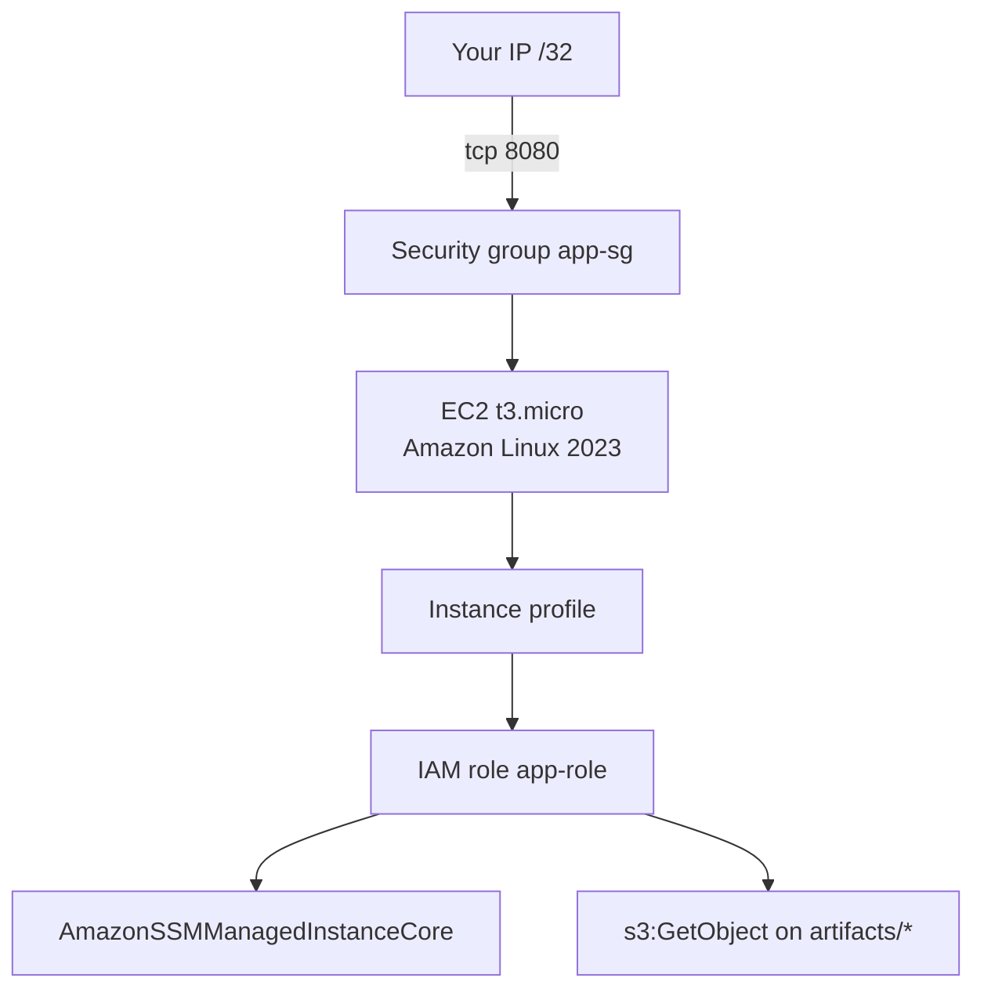
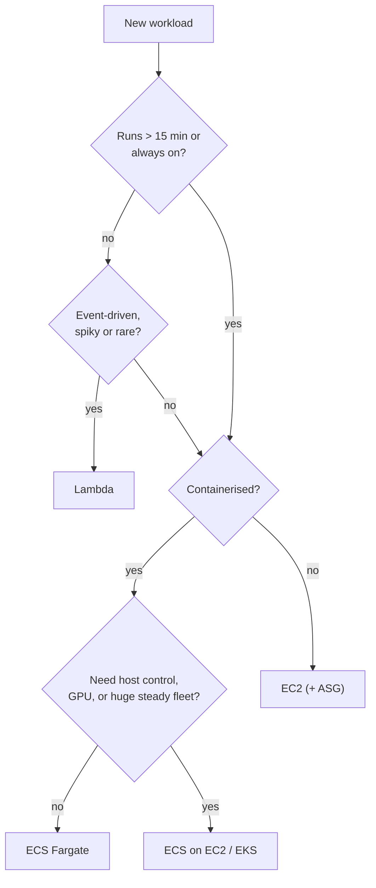
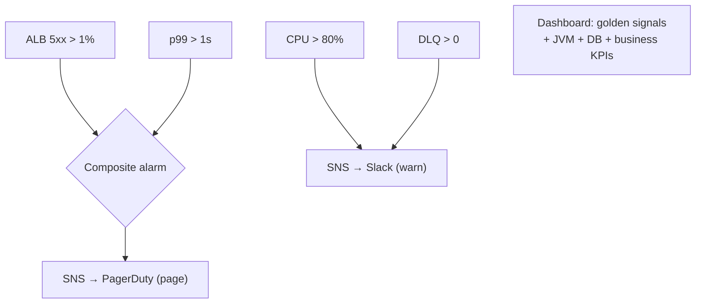
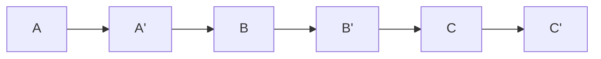

# Day 47 — Terraform Practice + AWS Review

> **How to use these notes:** write each Terraform file **yourself first** (use yesterday's notes and the AWS provider docs), run `terraform validate` and `terraform plan`, then compare with the reference below. The AWS reviews are decision drills — answer the scenario before reading the table. 🚀 marks senior-level details.

**Today's goal:** write two realistic Terraform configs — an **EC2 instance with a security group and IAM role**, and a **hardened S3 bucket** — then consolidate S3, EC2, ECS/Lambda, VPC, IAM and CloudWatch into decision trees. DSA: **Kth Smallest in a Sorted Matrix**, **Copy List with Random Pointer**, **Add Two Numbers**, **Rotate Array**.

> ⚠️ **Cost safety:** run `apply` only in a personal sandbox account, use `t3.micro`/`t4g.micro`, and finish with `terraform destroy`. Set an AWS **Budget alert** (e.g. $5) before you start.

<!-- topic: d47_t1 -->
## 🏗️ DevOps — Terraform Practice & AWS Review

<!-- subtopic: d47_t1_s1 -->
### 1. Write Terraform: EC2 instance + Security Group + IAM role

**Spec:** one Amazon Linux 2023 instance in the default VPC, reachable on port 8080 from your IP only, **no SSH keys** (use SSM Session Manager), with an IAM role that can read one S3 prefix.



```hcl
variable "my_ip" { type = string }                       # e.g. "203.0.113.10/32"

data "aws_vpc" "default" { default = true }

data "aws_ami" "al2023" {
  most_recent = true
  owners      = ["amazon"]
  filter {
    name   = "name"
    values = ["al2023-ami-2023.*-x86_64"]
  }
}

resource "aws_security_group" "app" {
  name   = "app-sg"
  vpc_id = data.aws_vpc.default.id

  ingress {
    description = "App port from my IP"
    from_port   = 8080
    to_port     = 8080
    protocol    = "tcp"
    cidr_blocks = [var.my_ip]
  }

  egress {                                             # SGs are stateful; this allows outbound calls
    from_port   = 0
    to_port     = 0
    protocol    = "-1"
    cidr_blocks = ["0.0.0.0/0"]
  }
}

data "aws_iam_policy_document" "ec2_trust" {
  statement {
    actions = ["sts:AssumeRole"]
    principals {
      type        = "Service"
      identifiers = ["ec2.amazonaws.com"]               # who may assume the role
    }
  }
}

resource "aws_iam_role" "app" {
  name               = "app-role"
  assume_role_policy = data.aws_iam_policy_document.ec2_trust.json
}

resource "aws_iam_role_policy_attachment" "ssm" {
  role       = aws_iam_role.app.name
  policy_arn = "arn:aws:iam::aws:policy/AmazonSSMManagedInstanceCore"
}

data "aws_iam_policy_document" "read_artifacts" {
  statement {
    actions   = ["s3:GetObject"]
    resources = ["arn:aws:s3:::acme-artifacts/order-service/*"]   # least privilege: one prefix
  }
}

resource "aws_iam_role_policy" "read_artifacts" {
  name   = "read-artifacts"
  role   = aws_iam_role.app.id
  policy = data.aws_iam_policy_document.read_artifacts.json
}

resource "aws_iam_instance_profile" "app" {
  name = "app-profile"
  role = aws_iam_role.app.name
}

resource "aws_instance" "app" {
  ami                    = data.aws_ami.al2023.id
  instance_type          = "t3.micro"
  vpc_security_group_ids = [aws_security_group.app.id]
  iam_instance_profile   = aws_iam_instance_profile.app.name

  metadata_options {
    http_tokens = "required"                           # enforce IMDSv2
  }

  user_data = <<-EOT
    #!/bin/bash
    dnf install -y java-21-amazon-corretto-headless
  EOT

  tags = { Name = "order-service-sandbox" }
}

output "public_ip" { value = aws_instance.app.public_ip }
```

| Check yourself | Why it matters |
|---|---|
| Trust policy vs permissions policy | Trust = *who* can assume (EC2 service); permissions = *what* it can do |
| Instance profile | EC2 can't use a role directly — it needs the profile wrapper |
| No `key_name`, SSM instead | No SSH keys to leak, no port 22 open, sessions are audited |
| IMDSv2 required | Blocks SSRF attacks that steal role credentials from the metadata endpoint |
| `aws_iam_policy_document` data source | Validated HCL instead of hand-written JSON strings |

<!-- subtopic: d47_t1_s2 -->
### 2. Write Terraform: S3 bucket with versioning, encryption, lifecycle

In AWS provider v4+, each bucket setting is its **own resource**:

```hcl
resource "aws_s3_bucket" "reports" {
  bucket = "acme-reports-${var.env}"
}

resource "aws_s3_bucket_public_access_block" "reports" {
  bucket                  = aws_s3_bucket.reports.id
  block_public_acls       = true
  block_public_policy     = true
  ignore_public_acls      = true
  restrict_public_buckets = true
}

resource "aws_s3_bucket_versioning" "reports" {
  bucket = aws_s3_bucket.reports.id
  versioning_configuration { status = "Enabled" }
}

resource "aws_kms_key" "reports" {
  description         = "reports bucket key"
  enable_key_rotation = true
}

resource "aws_s3_bucket_server_side_encryption_configuration" "reports" {
  bucket = aws_s3_bucket.reports.id
  rule {
    apply_server_side_encryption_by_default {
      sse_algorithm     = "aws:kms"
      kms_master_key_id = aws_kms_key.reports.arn
    }
    bucket_key_enabled = true                          # fewer KMS calls, lower cost
  }
}

resource "aws_s3_bucket_lifecycle_configuration" "reports" {
  bucket     = aws_s3_bucket.reports.id
  depends_on = [aws_s3_bucket_versioning.reports]

  rule {
    id     = "archive"
    status = "Enabled"
    filter { prefix = "monthly/" }

    transition {
      days          = 30
      storage_class = "STANDARD_IA"
    }
    transition {
      days          = 180
      storage_class = "GLACIER"
    }
    noncurrent_version_expiration { noncurrent_days = 90 }
  }

  rule {
    id     = "cleanup-multipart"
    status = "Enabled"
    filter {}
    abort_incomplete_multipart_upload { days_after_initiation = 7 }
  }
}
```

**Then try:** add a bucket policy that denies non-HTTPS requests (`aws:SecureTransport = false`), and a `lifecycle { prevent_destroy = true }` on the bucket. Run `terraform plan` after changing the transition from 30 to 45 days — it should be an in-place update `~`, not a replacement.

<!-- subtopic: d47_t1_s3 -->
### 3. AWS review: S3 classes, EC2 pricing, ECS vs Lambda decision tree

**Storage class drill** — answer before reading:

| Scenario | Class |
|---|---|
| Product images served on every page view | Standard (+ CloudFront) |
| User uploads; some viral, most never read again | Intelligent-Tiering |
| Monthly reports read a few times in the first month | Standard → IA after 30 days |
| Thumbnails you can regenerate | One Zone-IA |
| Audit logs kept 7 years, read only for investigations | Deep Archive (+ Object Lock) |
| Medical images rarely viewed but needed instantly | Glacier Instant Retrieval |

**Pricing drill:**

| Scenario | Model |
|---|---|
| Production database running 24/7 for years | Reserved Instance / Savings Plan |
| Nightly batch job that can restart | Spot |
| New service, traffic unknown | On-Demand, review after a month |
| Mixed EC2 + Fargate + Lambda steady spend | Compute Savings Plan |

**Compute decision tree:**



<!-- subtopic: d47_t1_s4 -->
### 4. AWS review: VPC, Security Groups vs NACLs, IAM best practices

**Whiteboard from memory (5 min):** VPC with 2 AZs × (public, private, isolated) subnets, IGW, NAT per AZ, ALB, ECS tasks, RDS, S3 gateway endpoint. Then check against Day 45.

| Question | Answer |
|---|---|
| What makes a subnet "public"? | Its route table sends `0.0.0.0/0` to an Internet Gateway |
| Private instances need to download packages | NAT Gateway in a public subnet (one per AZ for HA) |
| Avoid NAT costs for S3 traffic | S3 **gateway endpoint** (free) |
| Allow DB access only from the app | DB SG inbound 5432 from the **app SG id** |
| Block one malicious CIDR for the whole subnet | NACL **deny** rule (SGs can't deny) |
| Response traffic blocked although inbound allowed | NACL is stateless — allow ephemeral ports outbound |

**IAM best-practice checklist:**

| ✔ | Practice |
|---|---|
| ☐ | Root has MFA, no access keys, unused day to day |
| ☐ | Humans log in through IAM Identity Center (SSO) with MFA |
| ☐ | Every workload uses a role (instance profile / task role / Lambda role) |
| ☐ | Policies scoped to specific actions and ARNs; Access Analyzer reviews unused permissions |
| ☐ | Separate AWS accounts for prod and non-prod, guardrails via SCPs |
| ☐ | CloudTrail on in every region, logs in a separate locked account |

<!-- subtopic: d47_t1_s5 -->
### 5. AWS review: CloudWatch monitoring for a production Spring Boot microservice

**Design exercise:** "order-service runs on ECS Fargate behind an ALB with RDS. Design its monitoring."

| Layer | Metrics / signals | Alarm (example) |
|---|---|---|
| User-facing (ALB) | `HTTPCode_Target_5XX_Count`, `TargetResponseTime` p99, `RequestCount` | 5xx rate > 1 % for 3 of 5 min; p99 > 1 s |
| Service (ECS) | `CPUUtilization`, `MemoryUtilization`, running task count | Running tasks < desired for 5 min |
| JVM (Micrometer) | heap used, GC pause, threads, Hikari active/pending connections | Hikari pending > 0 for 5 min |
| Business | `orders.placed` per minute | Anomaly detection band (sudden drop = silent failure) |
| Database (RDS) | CPU, `DatabaseConnections`, `FreeStorageSpace`, read/write latency, replica lag | Free storage < 10 GB |
| Async | SQS `ApproximateAgeOfOldestMessage`, DLQ depth / Kafka lag | DLQ > 0 messages |



Plus: JSON logs with trace ids and 30-day retention, OpenTelemetry traces to X-Ray, a runbook link in every alarm description, and **synthetic checks** (CloudWatch Synthetics canary hitting `/actuator/health` and a key API from outside).

<!-- topic: d47_t2 -->
## 🧮 DSA — Mixed Revision

<!-- subtopic: d47_t2_s1 -->
### 6. Kth Smallest Element in a Sorted Matrix (LeetCode 378)

**Problem:** rows and columns are sorted ascending; return the k-th smallest element.

**Approach A — min-heap (merge k sorted rows):** push the first element of each row; pop k−1 times, pushing the next element in that row. O(k log n).

**Approach B — binary search on the value range (best):** for a candidate `mid`, count elements ≤ mid in O(n) using a staircase walk from the bottom-left. Find the smallest value with count ≥ k.

```java
public int kthSmallest(int[][] m, int k) {
    int n = m.length, lo = m[0][0], hi = m[n - 1][n - 1];
    while (lo < hi) {
        int mid = lo + (hi - lo) / 2;
        if (countLessOrEqual(m, mid) >= k) hi = mid;   // answer is mid or smaller
        else lo = mid + 1;
    }
    return lo;                                         // lo is guaranteed to be in the matrix
}

private int countLessOrEqual(int[][] m, int target) {
    int n = m.length, row = n - 1, col = 0, count = 0;
    while (row >= 0 && col < n) {
        if (m[row][col] <= target) { count += row + 1; col++; }   // whole column above is ≤ target
        else row--;
    }
    return count;
}
```

**Complexity:** O(n log(max − min)) time, O(1) space. **Why is `lo` an element of the matrix?** It's the smallest value whose count ≥ k; any smaller value has a smaller count, so `lo` itself must appear in the matrix.

<!-- subtopic: d47_t2_s2 -->
### 7. Copy List with Random Pointer (LeetCode 138)

**Problem:** deep-copy a linked list where each node also has a `random` pointer to any node or null.

**Approach A — HashMap old → new** (two passes, O(n) space): create all copies, then wire `next` and `random` through the map.

**Approach B — interleaving (O(1) extra space):**



1. Insert each copy right after its original: `A → A' → B → B' …`
2. Set `copy.random = original.random.next`.
3. Split the two lists apart.

```java
public Node copyRandomList(Node head) {
    if (head == null) return null;
    for (Node cur = head; cur != null; cur = cur.next.next) {          // 1. interleave
        Node copy = new Node(cur.val);
        copy.next = cur.next;
        cur.next = copy;
    }
    for (Node cur = head; cur != null; cur = cur.next.next) {          // 2. random pointers
        if (cur.random != null) cur.next.random = cur.random.next;
    }
    Node newHead = head.next;
    for (Node cur = head; cur != null; cur = cur.next) {               // 3. un-weave
        Node copy = cur.next;
        cur.next = copy.next;
        copy.next = copy.next == null ? null : copy.next.next;
    }
    return newHead;
}
```

**Complexity:** O(n) time, O(1) extra space. **Common bug:** not restoring the original list in step 3 — interviewers check that the input is unchanged.

<!-- subtopic: d47_t2_s3 -->
### 8. Add Two Numbers (LeetCode 2)

**Problem:** two numbers stored as linked lists in **reverse** digit order (`2→4→3` = 342). Return their sum as a list: 342 + 465 = 807 → `7→0→8`.

```java
public ListNode addTwoNumbers(ListNode l1, ListNode l2) {
    ListNode dummy = new ListNode(0), tail = dummy;
    int carry = 0;
    while (l1 != null || l2 != null || carry != 0) {        // carry check handles 5 + 5 = 10
        int sum = carry;
        if (l1 != null) { sum += l1.val; l1 = l1.next; }
        if (l2 != null) { sum += l2.val; l2 = l2.next; }
        carry = sum / 10;
        tail.next = new ListNode(sum % 10);
        tail = tail.next;
    }
    return dummy.next;
}
```

**Complexity:** O(max(m, n)). **Edge cases:** different lengths, final carry (`9→9` + `1` = `0→0→1`). **Follow-up (LC 445, digits in forward order):** push both lists onto stacks (or reverse them), add, and build the result by inserting at the head.

<!-- subtopic: d47_t2_s4 -->
### 9. Rotate Array (LeetCode 189) — 3 approaches

**Problem:** rotate right by k: `[1,2,3,4,5,6,7]`, k = 3 → `[5,6,7,1,2,3,4]`.

| Approach | Time | Space | Idea |
|---|---|---|---|
| Extra array | O(n) | O(n) | `out[(i + k) % n] = a[i]` |
| **Reverse three times** | O(n) | O(1) | Reverse all, reverse first k, reverse the rest |
| Cyclic replacements | O(n) | O(1) | Move each element to its final spot following cycles; `gcd(n, k)` cycles |

```java
// Reverse three times — the one to write in interviews
public void rotate(int[] a, int k) {
    int n = a.length;
    k %= n;                                  // k may be larger than n
    reverse(a, 0, n - 1);                    // 7 6 5 4 3 2 1
    reverse(a, 0, k - 1);                    // 5 6 7 4 3 2 1
    reverse(a, k, n - 1);                    // 5 6 7 1 2 3 4
}

private void reverse(int[] a, int i, int j) {
    while (i < j) { int t = a[i]; a[i++] = a[j]; a[j--] = t; }
}

// Cyclic replacements
public void rotateCyclic(int[] a, int k) {
    int n = a.length, moved = 0;
    k %= n;
    for (int start = 0; moved < n; start++) {
        int cur = start, carry = a[start];
        do {
            int next = (cur + k) % n;
            int tmp = a[next]; a[next] = carry; carry = tmp;
            cur = next;
            moved++;
        } while (cur != start);
    }
}
```

**Say this in the interview:** "Always `k %= n` first", and explain why reversing works: rotating right by k moves the last k elements to the front — a full reverse puts them in front but backwards, and the two partial reverses fix the order inside each block.

---

## 📝 Day 47 Revision Cheat Sheet

| Topic | Key points |
|---|---|
| EC2 in Terraform | SG + role (trust policy) + instance profile + SSM, IMDSv2, no SSH keys |
| S3 in Terraform | Separate resources: public access block, versioning, SSE-KMS + bucket key, lifecycle |
| Storage/pricing drills | Access frequency → class; steady → Savings Plan, interruptible → Spot |
| Compute tree | ≤ 15 min event-driven → Lambda; containers → Fargate; control/GPU → EC2 |
| Network | Public = IGW route; private = NAT; SG references; NACL denies |
| Monitoring | Golden signals at ALB, ECS, JVM, DB, async; composite alarms; synthetics |
| Kth smallest matrix | Binary search on value + staircase count, O(n log range) |
| Random-pointer copy | Interleave → set random → split (restore input) |
| Add two numbers | Dummy head, carry in the loop condition |
| Rotate array | k %= n, reverse all, reverse first k, reverse rest |

### ⚡ Rapid-fire self-test

1. What wraps an IAM role so EC2 can use it? → **An instance profile**
2. Which IAM document says EC2 may assume the role? → **The trust (assume role) policy**
3. Why require IMDSv2? → **It blocks SSRF attacks from stealing instance credentials**
4. In AWS provider v4+, how is S3 versioning configured? → **With a separate aws_s3_bucket_versioning resource**
5. Setting that reduces KMS requests for an encrypted bucket? → **bucket_key_enabled = true**
6. Kth smallest in sorted matrix — what do you binary search on? → **The value range, counting elements ≤ mid**
7. Copy List with Random Pointer in O(1) space — first step? → **Interleave each copy right after its original**
8. Add Two Numbers loop condition? → **While either list has nodes or carry is non-zero**
9. Rotate Array first line? → **k %= n**
10. Order of the three reverses for a right rotation? → **Whole array, first k, remaining n − k**
