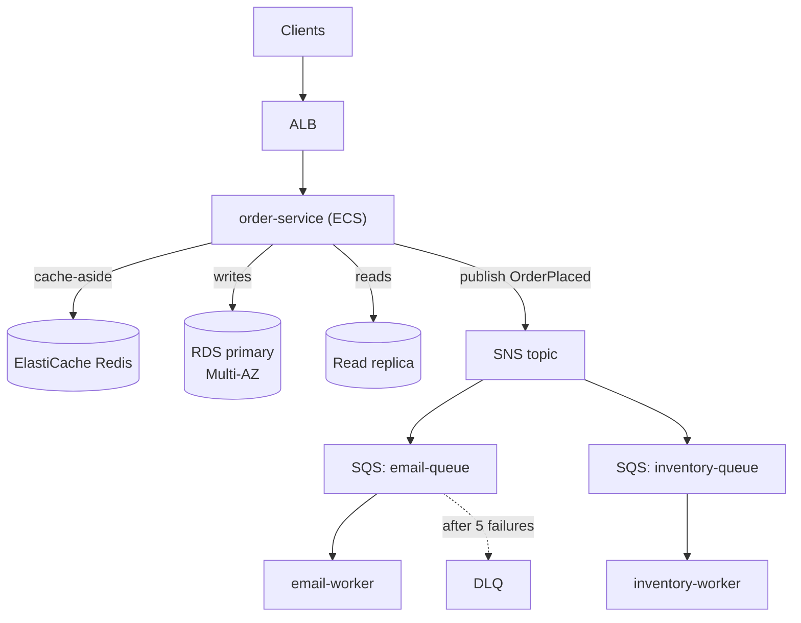
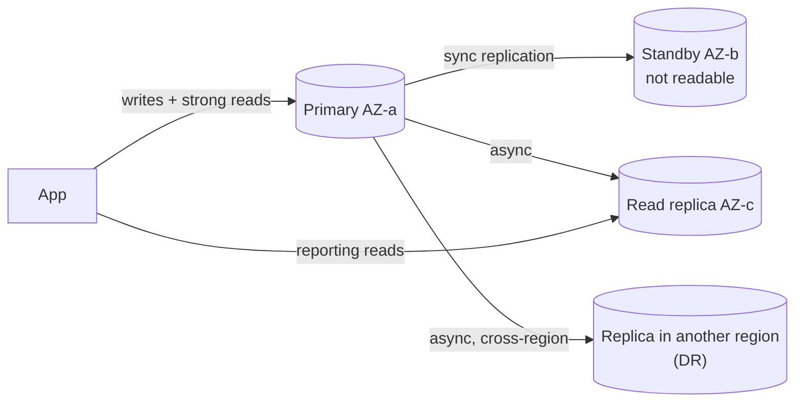
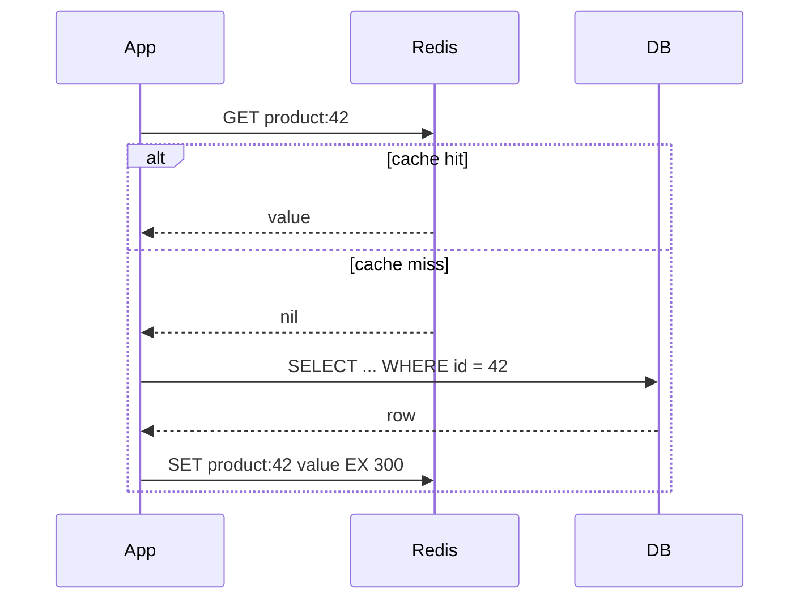
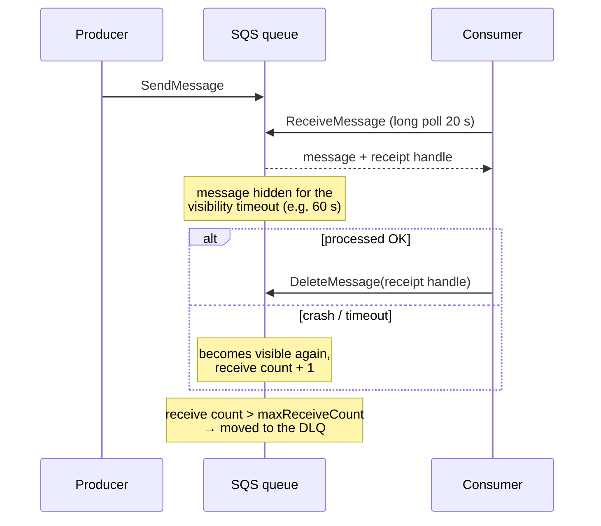
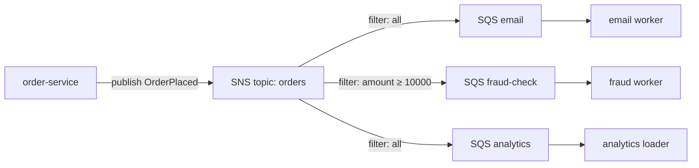
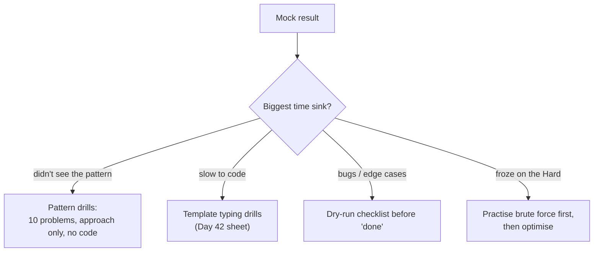

# Day 48 — AWS Final Concepts: RDS, ElastiCache, SQS, SNS

> **How to use these notes:** these four services appear in almost every backend system-design answer on AWS. Learn each one through the **question it answers**: "how does the DB survive an AZ failure?", "how do we take load off the DB?", "how do we decouple services?", "how do we notify many consumers?". Then run the 90-minute mock. 🚀 marks senior-level details.

**Today's goal:** explain **RDS Multi-AZ vs read replicas vs Aurora**, **Redis vs Memcached** and caching patterns, **SQS** (standard vs FIFO, visibility timeout, DLQ, long polling), **SNS fan-out**, and the **six Well-Architected pillars**. DSA: a full **2 Medium + 1 Hard mock**, a post-mortem, and a **top-15 patterns** sheet.

**Where they sit in a typical design:**



<!-- topic: d48_t1 -->
## ☁️ AWS — Additional Services

<!-- subtopic: d48_t1_s1 -->
### 1. RDS — Multi-AZ, read replicas, Aurora

**RDS** = managed MySQL, PostgreSQL, MariaDB, Oracle, SQL Server: AWS handles provisioning, patching, backups and failover. You still own schema, indexes, queries and sizing.

| Feature | Purpose | How it works |
|---|---|---|
| **Multi-AZ (instance)** | **High availability** | Synchronous standby in another AZ, not readable; automatic failover (~1–2 min) — the same DNS endpoint now points to the standby |
| **Multi-AZ DB cluster** | HA + some read scaling | One writer + two **readable** standbys (MySQL/PostgreSQL), faster failover |
| **Read replicas** | **Read scaling** | **Asynchronous** copies (up to 15), own endpoints, can be cross-region, can be promoted for DR — reads may be slightly stale |
| **Automated backups** | Point-in-time recovery | Daily snapshot + transaction logs, 1–35 days retention, restore to any second |
| **RDS Proxy** | Connection pooling | Shares DB connections across many clients (Lambda!), faster failover handling |



**Aurora** — AWS's MySQL/PostgreSQL-compatible engine with a redesigned storage layer:

| Aurora feature | Detail |
|---|---|
| Storage | 6 copies across 3 AZs, auto-grows up to 128 TB, self-healing |
| Replicas | Up to 15 low-lag replicas sharing the same storage; failover typically < 30 s |
| Endpoints | **Writer** (cluster) endpoint and a load-balanced **reader** endpoint |
| Serverless v2 | Capacity scales in fine-grained units with load |
| Global Database | Cross-region replication ~1 s lag, region failover for DR |

> **Model answer:** "**Multi-AZ is for availability, read replicas are for scale.** Multi-AZ keeps a synchronous standby so an AZ failure costs a minute or two of failover without data loss. Read replicas are asynchronous, so I route only reads that tolerate slight staleness — reports, search — to them, and keep read-your-own-writes on the primary. For high read scale or fast failover I'd pick Aurora."

🚀 **Spring Boot tip:** route reads with `@Transactional(readOnly = true)` + an `AbstractRoutingDataSource` (or the AWS Advanced JDBC Wrapper) and handle failover with a sensible Hikari `maxLifetime` and DNS TTL.

<!-- subtopic: d48_t1_s2 -->
### 2. ElastiCache — Redis vs Memcached, caching patterns, locks

| | **Redis** (also Valkey, its open-source fork) | **Memcached** |
|---|---|---|
| Data types | Strings, hashes, lists, sets, sorted sets, streams, geo, bitmaps | Strings only |
| Persistence | Snapshots / AOF | None |
| Replication & failover | Yes (replicas, Multi-AZ automatic failover) | No |
| Scaling | Cluster mode: sharding across nodes | Add nodes, client-side hashing |
| Threads | Mostly single-threaded per shard (I/O threads in newer versions) | **Multi-threaded** |
| Extras | Pub/sub, Lua, transactions, TTL per key | Simple and fast |
| Pick for | Almost everything: caching, sessions, leaderboards, rate limits, locks | Pure, simple, large horizontally-scaled cache |

**Caching patterns:**



| Pattern | Write path | Trade-off |
|---|---|---|
| **Cache-aside** (lazy loading) | App writes DB, then **deletes** the cache key | Simple, only caches what's read; first read is slow; brief staleness possible |
| **Write-through** | App writes cache and DB together | Cache always fresh; caches data nobody reads |
| **Write-behind** | Write cache, flush to DB async | Fast writes; risk of data loss |
| **TTL** on everything | — | Bounds staleness and memory |

```java
@Cacheable(cacheNames = "products", key = "#id")          // Spring cache abstraction + Redis
public ProductDto getProduct(long id) { return repo.findDto(id); }

@CacheEvict(cacheNames = "products", key = "#id")
@Transactional
public void updatePrice(long id, BigDecimal price) { repo.updatePrice(id, price); }
```

**Classic cache problems:**

| Problem | Fix |
|---|---|
| **Stampede** (hot key expires, 1,000 requests hit the DB) | Per-key lock / single-flight, early refresh, jittered TTLs |
| **Penetration** (lookups for ids that don't exist) | Cache "not found" briefly, Bloom filter |
| **Avalanche** (many keys expire together) | Random jitter on TTLs |
| Stale after update | Delete (not update) the key after the DB commit |

**Sessions:** store HTTP sessions in Redis (`spring-session-data-redis`) so any instance can serve any user — stateless app servers.

**Distributed lock (single Redis node):**

```text
SET lock:order:42 <uuid> NX PX 30000     # acquire only if absent, auto-expire after 30 s
... do work ...
# release ONLY if we still own it — atomically, via a Lua script comparing the uuid
```

🚀 Redis locks are **best-effort** (a failover can lose a lock). For correctness, use **fencing tokens** or a DB constraint; use Redisson's lock implementation rather than hand-rolling one.

<!-- subtopic: d48_t1_s3 -->
### 3. SQS — Standard vs FIFO, visibility timeout, DLQ, long polling

| | **Standard** | **FIFO** |
|---|---|---|
| Delivery | **At-least-once** (rare duplicates) | **Exactly-once processing** (dedup within a 5-minute window) |
| Ordering | Best effort | Strict **per message group id** |
| Throughput | Nearly unlimited | 300 msg/s per API action (3,000 with batching); much higher in high-throughput mode |
| Name | any | must end in `.fifo` |

**Message lifecycle and visibility timeout:**



| Setting | Default / limit | Guidance |
|---|---|---|
| Visibility timeout | 30 s (max 12 h) | Longer than your processing time (≈ 6× for Lambda triggers); extend with `ChangeMessageVisibility` for long jobs |
| Retention | 4 days (1 min – 14 days) | Set DLQ retention longer than the source queue |
| Long polling | `WaitTimeSeconds` up to 20 s | Always use it — fewer empty responses, lower cost |
| Delay | up to 15 min | Delay queues / per-message timers |
| Message size | Was 256 KB for many years; AWS raised the limit to 1 MiB in 2025 | Bigger payloads: store in S3 and send a pointer ("claim check", SQS Extended Client) |
| **DLQ** | `redrivePolicy` with `maxReceiveCount` (e.g. 5) | Alarm on DLQ depth; use **DLQ redrive** to replay after fixing |

**Consumer rules:** make processing **idempotent** (standard queues can deliver twice), delete only after success, and batch (`ReceiveMessage` up to 10, `DeleteMessageBatch`). In Spring, `spring-cloud-aws-sqs` gives `@SqsListener` with acknowledgement handled for you.

> **Kafka vs SQS (Day 38 recap):** SQS = managed queue, a message is consumed once and deleted, no replay, zero ops. Kafka = replayable log with multiple consumer groups and per-partition ordering.

<!-- subtopic: d48_t1_s4 -->
### 4. SNS — pub/sub and the SNS → SQS fan-out

**SNS** pushes each published message to **all subscribers** of a topic: SQS queues, Lambda, HTTP/S endpoints, email, SMS, mobile push (APNs/FCM).

**Fan-out pattern:** one event, many independent consumers — each with **its own SQS queue** so a slow or failing consumer never affects the others and messages are buffered when consumers are down.



| Feature | Detail |
|---|---|
| **Message filtering** | Subscription filter policies on message attributes or body — each queue only gets what it needs |
| **FIFO topics** | Ordered, deduplicated fan-out to FIFO queues |
| Retries | Built-in delivery retries; DLQ per subscription |
| SNS vs EventBridge | EventBridge: richer content routing, many AWS/SaaS sources, schema registry, archive & replay; SNS: higher throughput, simpler, cheaper fan-out |

> **Model answer:** "When an order is placed I publish one event to SNS. Email, inventory, and analytics each have their **own SQS queue** subscribed to the topic, with filter policies and their own DLQs. Adding a new consumer means adding a queue — no change to order-service."

<!-- subtopic: d48_t1_s5 -->
### 5. AWS Well-Architected Framework — 6 pillars

| Pillar | Core question | Examples of good practice |
|---|---|---|
| **Operational Excellence** | Can we run and improve it? | IaC, CI/CD, small reversible changes, runbooks, observability, post-mortems |
| **Security** | Is data and access protected? | Least privilege, MFA, encryption at rest/in transit, traceability (CloudTrail), defence in depth |
| **Reliability** | Does it recover from failure? | Multi-AZ, auto scaling, retries with backoff, health checks, backups tested by restore, DR plan (RPO/RTO) |
| **Performance Efficiency** | Are we using the right resources? | Right instance types, caching, CDN, serverless, load testing, measure then tune |
| **Cost Optimization** | Are we paying only for value? | Right-sizing, Savings Plans/Spot, lifecycle policies, turning off idle resources, tagging + budgets |
| **Sustainability** | Are we minimising environmental impact? | High utilisation, Graviton, efficient code, deleting unused data |

**Use it in interviews** as a checklist at the end of any design: "For reliability we're Multi-AZ with backups; security — private subnets and KMS; cost — Savings Plans and S3 lifecycle; operations — Terraform and alarms."

<!-- topic: d48_t2 -->
## 🧮 DSA — Full Timed Practice

<!-- subtopic: d48_t2_s1 -->
### 6. Mock: 2 Medium + 1 Hard in 90 minutes

**Rules:** pick problems you haven't solved, timer on, no hints, talk out loud (record yourself on your phone if possible), write in a plain editor without autocomplete.

| Slot | Budget | Suggested unseen picks |
|---|---|---|
| Medium 1 | 25 min | Longest Palindromic Substring (5), Rotting Oranges (994), Group Anagrams (49) |
| Medium 2 | 25 min | Coin Change II (518), Find Minimum in Rotated Sorted Array (153), Word Break (139) |
| Hard | 40 min | Trapping Rain Water (42), Sliding Window Maximum (239), Median of Two Sorted Arrays (4) |

**Scoring rubric (be honest):**

| Signal | 1 — weak | 3 — good | 5 — strong |
|---|---|---|---|
| Clarification | Started coding immediately | Asked about inputs | Asked inputs, edge cases, constraints, gave examples |
| Approach | Jumped to code | Explained the optimal idea | Brute force → bottleneck → optimal, with complexity |
| Code | Many bugs, messy | Works after fixes | Clean, named well, first-time correct |
| Testing | None | Ran the given example | Dry-ran edge cases, found own bugs |
| Communication | Silent | Explained when asked | Narrated decisions throughout |

<!-- subtopic: d48_t2_s2 -->
### 7. Post-mock analysis

Fill this in **immediately** after the mock:

| Question | Your answer |
|---|---|
| Which problem's pattern did I recognise in < 2 minutes? | |
| Where did I lose the most time — understanding, approach, coding, or debugging? | |
| Which bug did I write, and what habit would have prevented it? | |
| Which template did I have to re-derive instead of recalling? | |
| What would I say differently to an interviewer? | |



Log each problem in this app's Question Sets with the 📝 problem log (approach, complexity, attempts, "solve again" flag) — the Revise page will bring them back.

<!-- subtopic: d48_t2_s3 -->
### 8. Cheat sheet: top 15 DSA patterns

| # | Pattern | Recognise it by | Template core | Example |
|---|---|---|---|---|
| 1 | Two pointers | Sorted array, pairs, palindromes | `lo++` / `hi--` towards each other | 3Sum |
| 2 | Fast & slow pointers | Cycle, middle of a list | `slow = slow.next; fast = fast.next.next` | Linked List Cycle II |
| 3 | Sliding window | Longest/shortest contiguous with a condition | Expand right, shrink left while invalid | Min Window Substring |
| 4 | Prefix sum + hashmap | Subarray sum equals k | `count += seen.get(sum - k)` | Subarray Sum Equals K |
| 5 | Binary search | Sorted / monotonic predicate | `lo < hi`, `hi = mid` | Koko Eating Bananas |
| 6 | Monotonic stack | Next greater/smaller element | Pop while the top is smaller | Daily Temperatures |
| 7 | Heap / Top-K | k largest, k-th, merge sorted | Min-heap of size k | Top K Frequent |
| 8 | Intervals | Overlaps, meeting rooms | Sort by start (or end) | Merge Intervals |
| 9 | BFS | Shortest path in unweighted graph | Queue + level loop | Rotting Oranges |
| 10 | DFS / flood fill | Regions, connected components | Recurse + mark visited | Number of Islands |
| 11 | Topological sort | Dependencies, ordering | Kahn's in-degree queue | Course Schedule II |
| 12 | Union-Find | Dynamic connectivity | find + union by rank | Redundant Connection |
| 13 | Backtracking | All subsets/permutations/combinations | Choose → explore → un-choose | Combination Sum |
| 14 | Dynamic programming | Optimal value, overlapping subproblems | State → recurrence → base → order | Coin Change, LCS |
| 15 | Trie | Prefix search, many words | Node[26] + end flag | Word Search II |

Print it, or paste it into your Day 48 notes box — it's the sheet to re-read on the morning of an interview.

---

## 📝 Day 48 Revision Cheat Sheet

| Topic | Key points |
|---|---|
| RDS | Multi-AZ = sync standby for HA; read replicas = async for read scale; PITR backups; RDS Proxy |
| Aurora | 6 copies / 3 AZs, 15 replicas, < 30 s failover, reader endpoint, Serverless v2, Global DB |
| ElastiCache | Redis for features + HA; Memcached for simple multithreaded cache; cache-aside + TTL + evict on write |
| Cache problems | Stampede (lock/early refresh), penetration (cache misses/Bloom), avalanche (jitter) |
| SQS | Standard at-least-once vs FIFO ordered per group; visibility timeout; long polling 20 s; DLQ via maxReceiveCount |
| SNS | Push pub/sub; fan-out to per-consumer SQS queues; filter policies |
| Well-Architected | OpEx, Security, Reliability, Performance, Cost, Sustainability |
| Mock | 25 + 25 + 40 minutes, rubric, honest post-mortem, log problems |

<details><summary>Q1. Multi-AZ vs read replica?</summary>

Multi-AZ provides high availability: a synchronously replicated standby in another AZ that isn't used for reads, with automatic failover behind the same endpoint. Read replicas provide read scaling: asynchronously replicated, readable copies with their own endpoints, possibly in other regions, which can lag slightly and can be promoted manually for disaster recovery.

</details>

<details><summary>Q2. How do you keep a cache consistent with the database?</summary>

Cache-aside with TTLs: read from the cache, on a miss load from the DB and populate it; on writes, update the DB and then delete the cache key (rather than updating it) so the next read reloads fresh data. TTLs bound any staleness. For hot keys prevent stampedes with locking or early refresh.

</details>

<details><summary>Q3. What is the SQS visibility timeout and what goes wrong if it's too short?</summary>

After a consumer receives a message, SQS hides it for the visibility timeout. If the consumer deletes it in time, it's gone; otherwise it becomes visible again for another consumer. If the timeout is shorter than processing time, a second consumer picks up the same message while the first is still working — duplicate processing.

</details>

<details><summary>Q4. Why put SQS queues behind SNS instead of subscribing services directly?</summary>

Each consumer gets its own durable buffer: messages wait if the service is down, each consumer processes at its own pace, has its own retries and DLQ, and can be scaled or replaced independently. Adding a consumer means adding a queue subscription with no change to the publisher.

</details>

<details><summary>Q5. Standard or FIFO queue for payment events?</summary>

FIFO if the per-payment order matters (authorize before capture) — use the payment or order id as the message group id so ordering holds per payment while different payments are processed in parallel, with deduplication. Even then make consumers idempotent, because downstream systems can still see retries.

</details>

### ⚡ Rapid-fire self-test

1. Is the RDS Multi-AZ standby readable? → **No — it exists for failover (Multi-AZ DB clusters have readable standbys)**
2. Replication type used by RDS read replicas? → **Asynchronous**
3. How many copies of data does Aurora storage keep? → **Six copies across three AZs**
4. Cache pattern where the app loads on a miss and evicts on write? → **Cache-aside (lazy loading)**
5. Redis command for a simple lock? → **SET key value NX PX ttl**
6. Default SQS visibility timeout? → **30 seconds**
7. Maximum long-poll wait in SQS? → **20 seconds**
8. What sends a message to the DLQ? → **Exceeding maxReceiveCount in the redrive policy**
9. SQS FIFO ordering scope? → **Per message group id**
10. Name the six Well-Architected pillars. → **Operational Excellence, Security, Reliability, Performance Efficiency, Cost Optimization, Sustainability**
