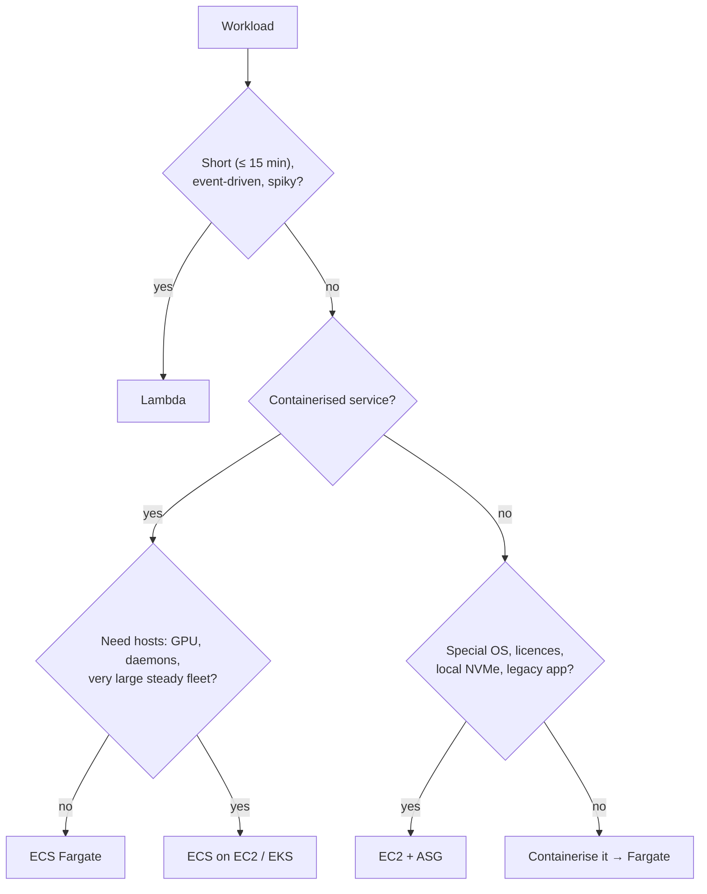
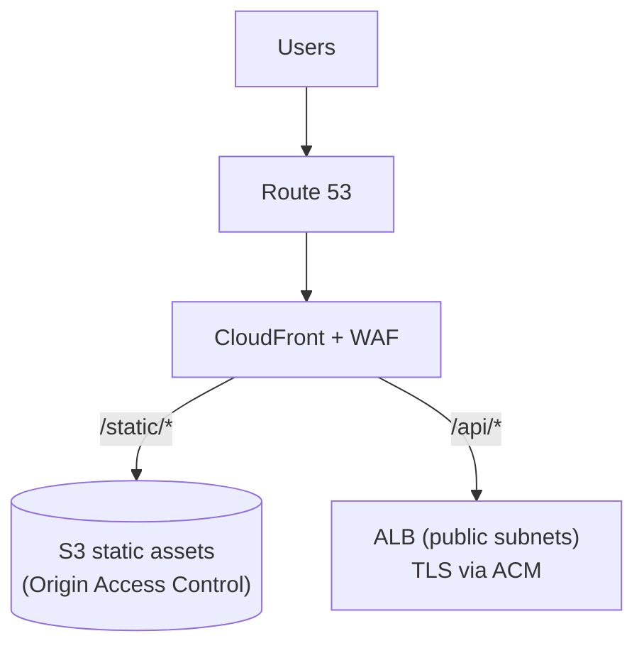
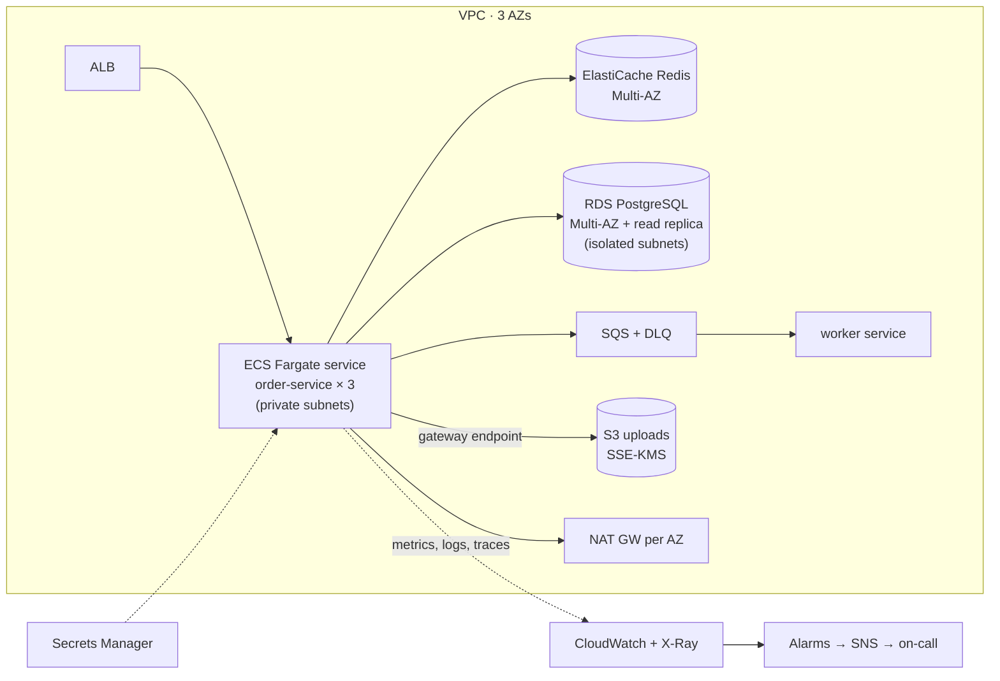
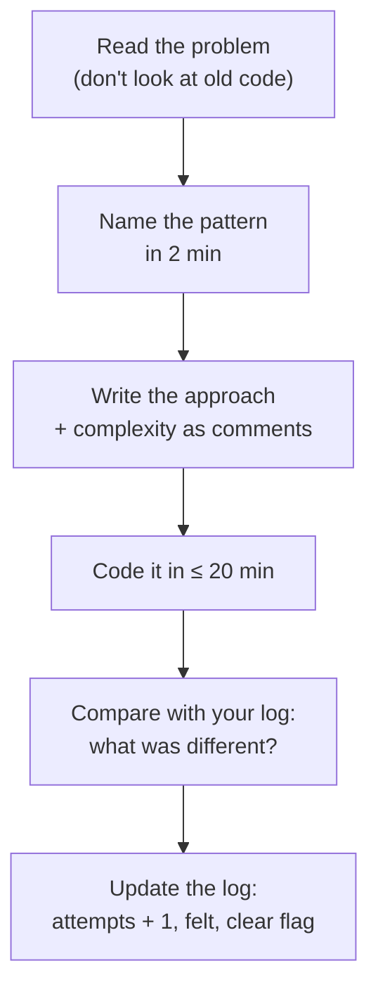

# Day 49 — Phase 6 Review: AWS Rapid-Fire

> **How to use these notes:** a **closed-book review day**. Cover the answer column, answer out loud in one or two sentences, then check. Draw the production architecture **before** looking at the reference. The DSA half is about your **own** weak spots — the backlog in this app tells you what they are. 🚀 marks senior-level details.

**Today's goal:** rapid recall of **S3, compute choices, IAM/KMS/Secrets and Terraform**, a confident 5-minute **whiteboard of a production AWS architecture**, and focused practice on your **weakest 5 problems** with spoken explanations and a timed set.

| Block | Time |
|---|---|
| Rapid-fire rounds 1–4 | 60 min |
| Architecture drawing + narration | 30 min |
| Backlog review | 30 min |
| Re-solve weakest 5 | 75 min |
| Explain aloud + timed set | 75 min |

<!-- topic: d49_t1 -->
## ☁️ AWS — Comprehensive Review

<!-- subtopic: d49_t1_s1 -->
### 1. Rapid-fire: S3 storage classes, presigned URLs, encryption

| # | Question | Answer |
|---|---|---|
| 1 | Unknown access pattern — which class? | Intelligent-Tiering |
| 2 | Minimum storage duration: Standard-IA / Glacier Flexible / Deep Archive | 30 / 90 / 180 days |
| 3 | Glacier Flexible retrieval times | Expedited 1–5 min, standard 3–5 h, bulk 5–12 h |
| 4 | Deep Archive retrieval | Within 12 h (bulk up to 48 h) |
| 5 | Why can tiny objects cost more in IA? | 128 KB minimum billable size + retrieval fees |
| 6 | What does a presigned URL carry? | A signature from the signer's credentials, scoped to one object/operation, time-limited |
| 7 | Max presigned URL lifetime | 7 days (IAM user keys); with role credentials, until the session expires |
| 8 | How to revoke an issued presigned URL? | You can't individually — keep expiry short or remove the signer's permission |
| 9 | Default encryption on new objects | SSE-S3 (AES-256) |
| 10 | SSE-KMS advantage | Key policy control + CloudTrail audit of every decrypt |
| 11 | SSE-KMS throttling fix | S3 Bucket Keys |
| 12 | SSE-C requirement | HTTPS, and you send the key with every request |
| 13 | Protect against deletes by a compromised admin | Object Lock compliance mode / MFA Delete + replication to another account |
| 14 | Upload > 5 GB | Multipart upload (required) |

<!-- subtopic: d49_t1_s2 -->
### 2. Rapid-fire: EC2 vs ECS vs Lambda — decision tree

**Say the tree out loud from memory, then compare:**

| # | Scenario | Answer |
|---|---|---|
| 1 | Resize images when uploaded to S3 | Lambda (S3 event → SQS → Lambda) |
| 2 | Spring Boot REST API, steady traffic | ECS Fargate behind an ALB |
| 3 | Nightly 3-hour batch job | ECS task (Fargate/Spot) or AWS Batch — Lambda's 15 min limit rules it out |
| 4 | Self-managed Elasticsearch with local NVMe | EC2 `i`-family |
| 5 | WebSocket chat server with long connections | ECS/EC2 (or API Gateway WebSockets + Lambda) |
| 6 | Cron every 5 minutes calling an API | EventBridge Scheduler → Lambda |
| 7 | Java Lambda with 4-second cold starts | SnapStart, more memory, provisioned concurrency |
| 8 | Cut cost for a stateless worker fleet | Spot (Fargate Spot / EC2 Spot), diversified |

<!-- subtopic: d49_t1_s3 -->
### 3. Rapid-fire: IAM roles vs policies, KMS vs Secrets Manager

| # | Question | Answer |
|---|---|---|
| 1 | Role vs policy | A role is an identity assumed temporarily; a policy is a permissions document attached to an identity or resource |
| 2 | Identity-based vs resource-based policy | On the user/role vs on the resource (bucket, queue, key) with a `Principal` |
| 3 | Trust policy | Resource policy on a role saying who can assume it |
| 4 | Evaluation order | Explicit deny → SCP/boundary limits → any allow → otherwise implicit deny |
| 5 | Permission boundary | Maximum permissions a role can ever get, regardless of its policies |
| 6 | How do apps on ECS get credentials? | Task role, via the container credentials endpoint — no keys |
| 7 | Cross-account access | STS `AssumeRole` into a role trusted by the other account |
| 8 | KMS vs Secrets Manager | KMS manages **keys** and encrypts; Secrets Manager stores **secret values** (encrypted with KMS) and rotates them |
| 9 | Envelope encryption | Data encrypted with a data key; data key encrypted with the KMS key |
| 10 | Secrets Manager vs Parameter Store | Rotation + replication (paid) vs cheap config/SecureString without rotation |
| 11 | Security group vs NACL | Stateful allow-only on ENIs vs stateless allow/deny on subnets |
| 12 | Private subnet internet egress | NAT Gateway (one per AZ) or VPC endpoints for AWS services |

<!-- subtopic: d49_t1_s4 -->
### 4. Rapid-fire: Terraform workflow, state, modules

| # | Question | Answer |
|---|---|---|
| 1 | Workflow | `init → fmt → validate → plan -out → apply plan` |
| 2 | What does `init` do? | Downloads providers/modules, configures the backend |
| 3 | Why remote state? | Shared, durable, encrypted, locked, versioned |
| 4 | How is state locked on S3? | `use_lockfile = true` (TF 1.10+) or a DynamoDB table (older) |
| 5 | `resource` vs `data` | Managed by Terraform vs read-only lookup |
| 6 | `count` vs `for_each` | Index addresses (shift on removal) vs stable keys |
| 7 | `-/+` in a plan | Replacement — destroy and re-create |
| 8 | Protect a production DB from `destroy` | `lifecycle { prevent_destroy = true }` |
| 9 | Adopt a manually created bucket | `import {}` block (TF 1.5+) or `terraform import`, then make plan show no diff |
| 10 | Rename a resource without re-creating it | `moved { from = …, to = … }` block (or `terraform state mv`) |
| 11 | Module version pinning | `version = "~> 5.0"` for registry, `?ref=v1.2.0` for git |
| 12 | Detect console drift | Scheduled `plan -detailed-exitcode` in CI |

<!-- subtopic: d49_t1_s5 -->
### 5. Draw: production architecture — ALB → ECS → RDS + ElastiCache + S3 + CloudWatch

**Exercise:** draw it in 5 minutes, then **narrate a request** end to end in 2 minutes.

**Narration script (practise it):**

1. "DNS in Route 53 points to CloudFront, which caches static files from a private S3 bucket and forwards `/api` to the ALB; WAF blocks common attacks."
2. "The ALB terminates TLS and routes to ECS Fargate tasks spread across three AZs in private subnets; health checks hit `/actuator/health`."
3. "The service reads through Redis (cache-aside) and writes to RDS PostgreSQL, Multi-AZ for failover, with a read replica for reporting queries."
4. "Slow work is published to SQS and handled by a worker service; failures land in a DLQ with an alarm."
5. "Uploads go straight to S3 via presigned URLs; S3 traffic uses a gateway endpoint."
6. "Secrets come from Secrets Manager via the task definition; the task role grants only what the app needs."
7. "Everything ships metrics, JSON logs and traces to CloudWatch/X-Ray; alarms on 5xx rate, p99 latency and DLQ depth page on-call."
8. "It's all in Terraform, deployed by CI with a reviewed plan."

🚀 **Expect follow-ups:** "What happens when AZ-a fails?" (ALB stops routing there, ECS reschedules tasks, RDS fails over to the standby, Redis promotes a replica — a minute or two of elevated errors at most), "Where's your single point of failure?" (a single NAT gateway, a single-AZ Redis — so have one per AZ / Multi-AZ), "How do you deploy without downtime?" (rolling or blue/green with health checks and connection draining).

<!-- topic: d49_t2 -->
## 🧮 DSA — Weak Area Focus

<!-- subtopic: d49_t2_s1 -->
### 6. Review all "What I Missed" notes from Days 1–48

Same triage as Day 41, now across the whole plan. Open **Backlog & Stats** and also check the **Revise** page — "Solve again" lists every problem you flagged in a problem log.

| Step | Output |
|---|---|
| 1. List every open item | One line each, phrased as a question |
| 2. Tag it | Java / Spring / Kafka / AWS / DSA-pattern name |
| 3. Count tags | Your top 3 weak areas (feeds tomorrow's study plan) |
| 4. Fix 15-minute items now | Delete them when you can explain them |
| 5. Schedule the rest | Into Days 51–60 alongside the planned topics |

<!-- subtopic: d49_t2_s2 -->
### 7. Re-solve your weakest 5 problems

Pick from: problems flagged **🔁 solve again**, logs where you felt **"Hard"** or **"Couldn't solve"**, and patterns you tagged above.

**Re-solve protocol** — this is different from the first time:

**If you fail again:** read the solution, close it, and re-code it **from memory** after 30 minutes, then once more in 3 days. Recognition ≠ recall — only re-coding without looking builds recall.

<!-- subtopic: d49_t2_s3 -->
### 8. Practise explaining solutions aloud (verbal fluency)

Interviewers grade the explanation as much as the code. Use one fixed structure for every problem:

| Step | Say | Example (Two Sum) |
|---|---|---|
| 1. Restate | "So I need to…" | "Return indices of two numbers adding to target; exactly one answer exists." |
| 2. Example + edge | "For example… what about…?" | "Duplicates like [3,3] target 6? Negative numbers?" |
| 3. Brute force | "The naive way is… which costs…" | "Check all pairs, O(n²)." |
| 4. Insight | "The bottleneck is… so I'll use…" | "Finding the complement is the slow part — a HashMap gives O(1) lookup." |
| 5. Plan | "I'll iterate… store… return…" | "One pass: check complement, then store the current value." |
| 6. Code | Narrate decisions, not keystrokes | "I store after checking so an element doesn't pair with itself." |
| 7. Test | Walk an example line by line | "[2,7,11,15], 9: i=0 store 2, i=1 complement 2 found → [0,1]." |
| 8. Complexity | Time, space, trade-offs | "O(n) time, O(n) space; sorting + two pointers would be O(1) extra space but loses indices." |

**Drill:** explain 3 problems you've already solved, recording yourself. Listen back for long silences, "um so basically", and skipped complexity.

<!-- subtopic: d49_t2_s4 -->
### 9. Timed: 1 Easy + 2 Medium in 60 minutes

Use the same budget as Day 46 (12 / 22 / 22 + 4 review) but pick from **your weak categories** today.

| Weak category | Easy | Medium |
|---|---|---|
| Arrays & hashing | Contains Duplicate (217) | Longest Consecutive Sequence (128) |
| Two pointers / window | Valid Palindrome (125) | Longest Repeating Character Replacement (424) |
| Stack | Valid Parentheses (20) | Daily Temperatures (739) |
| Binary search | Binary Search (704) | Search in Rotated Sorted Array (33) |
| Trees | Invert Binary Tree (226) | Lowest Common Ancestor of a BST (235) |
| Graphs | Flood Fill (733) | Clone Graph (133) |
| DP | Climbing Stairs (70) | Longest Increasing Subsequence (300) |

Compare your times with Day 46. Faster on the same categories? Your templates are sticking. Slower? Go back to the Day 42 sheet before Day 50.

---

## 📝 Day 49 Revision Cheat Sheet

| Area | One-line recall |
|---|---|
| S3 | Classes by access frequency; presigned = signer's permissions, short-lived; SSE-S3 default, SSE-KMS for audit |
| Compute | ≤ 15 min events → Lambda; services → Fargate; host control → EC2 |
| IAM | Roles not keys; explicit deny wins; trust + permissions policies; STS for cross-account |
| KMS / secrets | KMS = keys; Secrets Manager = rotating secrets; Parameter Store = config |
| Terraform | init/plan/apply saved plan; remote locked state; for_each; prevent_destroy; import/moved blocks |
| Architecture | Route 53 → CloudFront/WAF → ALB → Fargate (private) → Redis + RDS Multi-AZ, SQS workers, S3, CloudWatch |
| Weak areas | Tag misses, re-solve without old code, explain in 8 steps, compare timed results |

### ⚡ Rapid-fire self-test

1. Storage class for unknown access patterns? → **S3 Intelligent-Tiering**
2. Can you revoke a single presigned URL? → **No — keep expiry short or remove the signer's permission**
3. Which compute service is ruled out by a 3-hour job? → **Lambda (15-minute limit)**
4. What says who can assume an IAM role? → **Its trust policy**
5. KMS or Secrets Manager for rotating a DB password? → **Secrets Manager (it uses KMS underneath)**
6. Terraform block to rename a resource address without re-creating it? → **The moved block**
7. What happens to RDS Multi-AZ when an AZ fails? → **Automatic failover to the standby behind the same endpoint**
8. Common single point of failure in a VPC design? → **A single NAT gateway**
9. First thing to say in a coding interview? → **Restate the problem and confirm inputs and edge cases**
10. How do you build recall for a failed problem? → **Re-code it from memory later, without looking at the solution**
