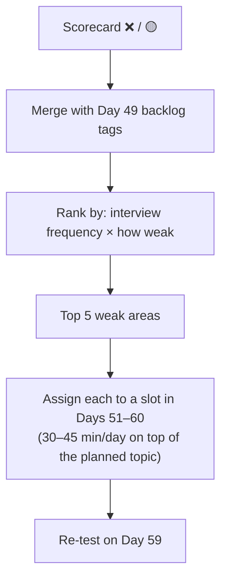

# Day 50 — Midpoint Check: Comprehensive Review

> **How to use these notes:** this is a **self-assessment day**, not a reading day. Each self-test is timed; answer out loud, mark every question ✅ (confident), 🟡 (shaky) or ❌ (didn't know), and only then read the model answers. Your ❌ and 🟡 marks become the study plan for the last ten days. 🚀 marks senior-level details.

**Today's goal:** an honest score across **Java, Spring, Kafka and AWS**, a **top-5 weak-areas plan** for Days 51–60, and interview-style DSA practice: **thinking aloud, edge cases, complexity analysis**, **Encode and Decode Strings**, and a 2-Medium speed round.

**Scorecard (fill it in as you go):**

| Area | Questions | ✅ | 🟡 | ❌ | Score |
|---|---|---|---|---|---|
| Java (30 min) | 15 | | | | /15 |
| Spring (20 min) | 10 | | | | /10 |
| Kafka (15 min) | 8 | | | | /8 |
| AWS (15 min) | 8 | | | | /8 |

Count ✅ as 1 and 🟡 as 0.5. **≥ 80 %** in an area = maintain; **50–80 %** = review; **< 50 %** = priority.

<!-- topic: d50_t1 -->
## 🏁 Midpoint — Full Stack Review

<!-- subtopic: d50_t1_s1 -->
### 1. Java self-test — 30 minutes rapid-fire

Answer each in about two minutes, as you would to an interviewer.

<details><summary>Q1. Explain the four OOP principles with one Java example each.</summary>

Encapsulation: private fields with validated methods (BankAccount.withdraw). Inheritance: class Circle extends Shape. Polymorphism: a List of Shape calling area() dispatches to each subclass at runtime; overloading is the compile-time form. Abstraction: an interface such as PaymentGateway hides how Stripe or Razorpay work behind a charge() method.

</details>

<details><summary>Q2. What happens if you override equals() but not hashCode()?</summary>

Two equal objects can have different hash codes, land in different HashMap/HashSet buckets, and the collection treats them as different keys — duplicates appear in sets and lookups with an equal key return null.

</details>

<details><summary>Q3. How does HashMap work internally, and what changed in Java 8?</summary>

An array of buckets; the index is (n - 1) & spread hash. Collisions chain in a linked list; Java 8 converts a bucket to a red-black tree once it has 8+ entries and the table has at least 64 buckets, making worst-case lookup O(log n). The table doubles when size exceeds capacity × load factor (0.75), and entries are split between the old index and old index + old capacity.

</details>

<details><summary>Q4. How is ConcurrentHashMap thread-safe without locking the whole map?</summary>

It uses CAS to insert into empty bins and synchronizes only on the first node of a bin for updates, so different bins update in parallel. Reads are lock-free via volatile reads. Size is tracked with striped counters (like LongAdder). Iterators are weakly consistent and never throw ConcurrentModificationException.

</details>

<details><summary>Q5. map vs flatMap, and why are streams lazy?</summary>

map transforms each element one-to-one; flatMap maps each element to a stream and flattens the results (one-to-many). Intermediate operations only build a pipeline; elements are pulled through it one at a time when a terminal operation runs, which allows short-circuiting (findFirst, limit) and avoids intermediate collections.

</details>

<details><summary>Q6. Group employees by department and get the average salary — write it.</summary>

employees.stream().collect(Collectors.groupingBy(Employee::getDept, Collectors.averagingDouble(Employee::getSalary))) — use the three-argument groupingBy with TreeMap::new for sorted keys.

</details>

<details><summary>Q7. volatile vs synchronized vs AtomicInteger?</summary>

volatile guarantees visibility and ordering of a single variable but not atomicity of compound actions. synchronized gives mutual exclusion and visibility for a whole block. AtomicInteger provides lock-free atomic operations such as incrementAndGet using CAS — ideal for counters.

</details>

<details><summary>Q8. What is a deadlock and how do you prevent it?</summary>

Two or more threads each hold a lock and wait for one held by another — a circular wait. Prevent it with a global lock ordering, tryLock with timeouts, holding fewer locks for shorter times, or higher-level concurrency utilities. Diagnose with jstack, which reports the deadlock.

</details>

<details><summary>Q9. ExecutorService — how do you size a thread pool?</summary>

CPU-bound work: about the number of cores. I/O-bound work: cores × (1 + wait time / compute time), validated by load testing. Use a bounded queue and an explicit rejection policy instead of unbounded Executors factory methods, and always shut the pool down. For many blocking tasks on Java 21+, consider virtual threads.

</details>

<details><summary>Q10. CompletableFuture: combine two independent calls and handle failure.</summary>

supplyAsync both calls on a dedicated executor, combine with thenCombine, transform with thenApply, recover with exceptionally or handle, and add orTimeout for an upper bound. allOf waits for many futures; join or get only at the edge.

</details>

<details><summary>Q11. What are virtual threads and when should you not use them?</summary>

Lightweight threads scheduled by the JVM onto a few carrier threads; a blocking call unmounts the virtual thread instead of blocking an OS thread, so you can run millions of blocking tasks. Not useful for CPU-bound work, don't pool them, and watch for pinning (synchronized blocks around blocking I/O on JDK 21–23, native calls) and ThreadLocal-heavy code.

</details>

<details><summary>Q12. How do you make a class immutable?</summary>

final class, private final fields, no setters, initialise everything in the constructor, defensive copies of mutable inputs and outputs (List.copyOf), and return new instances from "modifier" methods. Records cover most of this for simple data carriers, but you still need copies for mutable components.

</details>

<details><summary>Q13. Explain the JVM memory areas and how G1 works.</summary>

Heap (young: eden + survivors; old), metaspace for class metadata, per-thread stacks, code cache. G1 divides the heap into regions, collects young regions in short stop-the-world pauses and old regions incrementally in mixed collections, prioritising regions with the most garbage to meet a pause-time goal.

</details>

<details><summary>Q14. Comparable vs Comparator?</summary>

Comparable defines a class's natural order via compareTo inside the class. Comparator defines external orders, composable with Comparator.comparing(...).thenComparing(...).reversed(), without changing the class.

</details>

<details><summary>Q15. What does SOLID's Dependency Inversion mean in a Spring app?</summary>

High-level services depend on abstractions (interfaces such as PaymentGateway, repositories), not concrete classes; Spring injects the implementation through the constructor. That keeps business logic testable with mocks and lets you swap implementations without changing callers.

</details>

<!-- subtopic: d50_t1_s2 -->
### 2. Spring self-test — 20 minutes rapid-fire

<details><summary>Q1. What is dependency injection and why constructor injection?</summary>

The container creates beans and supplies their dependencies instead of the class constructing them. Constructor injection makes dependencies explicit and final, prevents half-initialised objects, works without Spring in unit tests, and surfaces circular dependencies at startup.

</details>

<details><summary>Q2. Explain the N+1 problem and three fixes.</summary>

Loading N parents runs one query, then accessing each parent's lazy collection fires one more query each — N+1 round trips. Fixes: JOIN FETCH in JPQL, @EntityGraph on the repository method, @BatchSize / hibernate.default_batch_fetch_size, or DTO projections that select exactly the needed columns.

</details>

<details><summary>Q3. Why might @Transactional not work?</summary>

Self-invocation bypasses the proxy; private or final methods can't be proxied; the class isn't a Spring bean; a checked exception doesn't trigger rollback by default; the exception is caught inside the method; or the wrong transaction manager is used.

</details>

<details><summary>Q4. Explain propagation REQUIRED vs REQUIRES_NEW with an example.</summary>

REQUIRED joins the existing transaction or starts one — an order and its items commit or roll back together. REQUIRES_NEW suspends the outer transaction and runs in its own — an audit log entry that must persist even if the order fails.

</details>

<details><summary>Q5. Walk through JWT authentication in Spring Security.</summary>

Login endpoint authenticates credentials and issues a signed JWT (short-lived access token, plus a refresh token). On each request a filter reads the Bearer token, verifies signature, expiry, issuer and audience, builds an Authentication with the user's authorities and puts it in the SecurityContext; authorization rules then apply. Stateless sessions, HTTPS, and refresh-token rotation complete it.

</details>

<details><summary>Q6. How does Spring Boot auto-configuration work?</summary>

@SpringBootApplication enables auto-configuration; Boot loads candidate configuration classes listed in META-INF/spring/...AutoConfiguration.imports, and each applies only if its @Conditional checks pass — class on classpath, bean missing, property set. Your own beans win because of @ConditionalOnMissingBean.

</details>

<details><summary>Q7. @WebMvcTest vs @SpringBootTest?</summary>

@WebMvcTest loads only the web layer (controllers, advice, filters, MockMvc) with dependencies mocked — fast slice tests. @SpringBootTest loads the whole application context for integration tests, often with Testcontainers for a real database.

</details>

<details><summary>Q8. What's the bean lifecycle?</summary>

Instantiate → inject dependencies → Aware callbacks → BeanPostProcessor before-init → @PostConstruct / afterPropertiesSet / init-method → post-processor after-init (where proxies are created) → bean in use → @PreDestroy / destroy on shutdown.

</details>

<details><summary>Q9. How do you handle errors globally in a REST API?</summary>

A @RestControllerAdvice with @ExceptionHandler methods mapping exceptions to status codes and a consistent error body (RFC 7807 ProblemDetail), validation errors from @Valid mapped to 400 with field details, and no stack traces leaked to clients.

</details>

<details><summary>Q10. How do you configure different environments?</summary>

Profiles with application-{profile}.yml, environment variables and externalised config overriding defaults, secrets from a vault or AWS Secrets Manager rather than files, and @ConfigurationProperties classes with validation for type-safe settings.

</details>

<!-- subtopic: d50_t1_s3 -->
### 3. Kafka self-test — 15 minutes

<details><summary>Q1. Explain delivery guarantees and how to get each.</summary>

At-most-once: commit offsets before processing (can lose). At-least-once: process then commit (can duplicate) — the usual choice, with idempotent consumers. Exactly-once within Kafka: idempotent producer plus transactions and read_committed consumers (consume-transform-produce); with external systems you need idempotency or the outbox pattern.

</details>

<details><summary>Q2. What is consumer lag and how do you fix growing lag?</summary>

The difference between the log-end offset and the group's committed offset per partition. Check for rebalance storms, poison pills, slow handlers or skewed keys; then speed up processing (batching, async I/O), add consumers up to the partition count, or add partitions.

</details>

<details><summary>Q3. How does partitioning affect ordering and scaling?</summary>

Records with the same key go to the same partition, so ordering is guaranteed per key. Partitions are the unit of parallelism: one consumer per partition per group. More partitions mean more parallelism but more overhead, and changing the count remaps keys.

</details>

<details><summary>Q4. How do you handle failures with a DLT?</summary>

Retry transient failures with backoff (blocking retries or retry topics), mark validation and deserialization errors as non-retryable, and publish exhausted records to a dead-letter topic with exception headers. Alert on DLT volume, fix the cause, and replay.

</details>

<details><summary>Q5. What causes rebalances and how do you reduce their impact?</summary>

Consumers joining or leaving, session timeouts, exceeding max.poll.interval.ms, or partition changes. Reduce impact with the cooperative-sticky assignor, static membership for rolling restarts, and keeping poll loops fast.

</details>

<details><summary>Q6. acks=all — what does it guarantee and what else do you need?</summary>

The leader waits for all in-sync replicas to append the record. Combine with replication factor 3, min.insync.replicas=2 and idempotence so a single broker failure loses no acknowledged data and retries don't create duplicates.

</details>

<details><summary>Q7. What is the outbox pattern?</summary>

Write the business change and an event row in the same database transaction, then a relay (CDC such as Debezium, or a poller) publishes outbox rows to Kafka — avoiding the dual-write problem where the DB commit succeeds but the publish fails.

</details>

<details><summary>Q8. Kafka vs SQS?</summary>

Kafka is a durable, replayable, partitioned log with multiple consumer groups and per-key ordering, suited to event streaming at high throughput. SQS is a fully managed queue where each message is processed once and deleted, simpler with no partitions to manage, and FIFO queues give ordering per message group.

</details>

<!-- subtopic: d50_t1_s4 -->
### 4. AWS self-test — 15 minutes

<details><summary>Q1. Choose S3 storage classes for user uploads, monthly reports and 7-year audit logs.</summary>

Uploads with unknown access: Intelligent-Tiering. Reports: Standard, transition to Standard-IA after 30 days and Glacier later via lifecycle. Audit logs: Deep Archive with Object Lock in compliance mode for retention.

</details>

<details><summary>Q2. How do you allow a browser to upload directly to S3?</summary>

The backend authenticates the user and returns a short-lived presigned PUT URL for a key it chooses; the bucket stays private; an S3 event triggers post-processing.

</details>

<details><summary>Q3. EC2 vs ECS Fargate vs Lambda for a Spring Boot API?</summary>

ECS Fargate: container-based, long-running, no servers to manage, scales with tasks behind an ALB. Lambda only fits if requests are light and cold starts are handled (SnapStart). EC2 only if you need host-level control.

</details>

<details><summary>Q4. Task role vs execution role?</summary>

Execution role: ECS pulls images, writes logs and fetches injected secrets. Task role: what the application code can call in AWS.

</details>

<details><summary>Q5. Describe a secure VPC layout.</summary>

Public subnets for the ALB and NAT gateways, private subnets for application tasks, isolated subnets for databases, across at least two AZs; security groups chained by reference; VPC endpoints for S3 and other AWS services; NACLs only for coarse denies.

</details>

<details><summary>Q6. How do you protect secrets and data?</summary>

Secrets in Secrets Manager with rotation, injected at runtime; KMS customer-managed keys for sensitive data with tight key policies; TLS everywhere; least-privilege IAM roles; CloudTrail auditing.

</details>

<details><summary>Q7. How does Terraform state work for a team?</summary>

Remote S3 backend, encrypted and versioned, with locking so only one apply runs at a time; separate state per environment and component; plans reviewed in CI and the saved plan applied.

</details>

<details><summary>Q8. How do you know your service is healthy in production?</summary>

Golden-signal metrics (latency, traffic, errors, saturation) in CloudWatch, structured logs with trace ids, distributed traces in X-Ray, dashboards, and alarms on user-facing symptoms routed to on-call, plus synthetic canaries.

</details>

<!-- subtopic: d50_t1_s5 -->
### 5. Identify your top 5 weakest areas — plan for Phase 7–8

**Turn the scorecard into a plan.** Combine today's ❌/🟡 marks with the tags from Day 49's backlog review.



**Remaining plan (Days 51–60):** SQL deep dive and window functions, indexing and transactions, NoSQL and Git, system design fundamentals and practice, behavioural prep, resume polish, and the final mock day. Fit your weak areas around them:

| Weak area | Concrete action | When | Re-test |
|---|---|---|---|
| e.g. Concurrency | Re-code producer-consumer + CompletableFuture pipeline (Code Practice Day 8) | Day 51, 52 | Day 59 |
| e.g. JPA N+1 / transactions | Re-read Days 21–22, answer the Q&A cards | Day 53 | Day 59 |
| e.g. DP | 2 DP problems/day from Question Sets | Days 51–56 | Day 58 mock |
| | | | |
| | | | |

**Rules:** maximum **5** areas (more = none get fixed), each with a **concrete output** (code written, questions answered), and a **re-test date**.

<!-- topic: d32_t2 -->
## 🧮 DSA — Timed Interview Practice

<!-- subtopic: d32_t2_s1 -->
### 6. Timed: 1 Easy + 2 Medium in 60 minutes

Third timed set in five days — compare with Days 46 and 49. Today, **simulate the full interview**: camera on (or record your voice), a plain editor, and say everything out loud.

| Problem | Budget | Suggested unseen picks |
|---|---|---|
| Easy | 12 min | Best Time to Buy and Sell Stock (121), Linked List Cycle (141) |
| Medium 1 | 22 min | 3Sum (15), Container With Most Water (11) |
| Medium 2 | 22 min | Number of Connected Components (323), Kth Largest Element (215) |

| Day | Easy time | Medium 1 | Medium 2 | Bugs found by you vs the judge |
|---|---|---|---|---|
| 46 | | | | |
| 49 | | | | |
| 50 | | | | |

<!-- subtopic: d32_t2_s2 -->
### 7. Practise thinking aloud — explain the approach before coding

**Never type before the interviewer has agreed with your approach.** The 60-second approach statement:

> "This looks like a **[pattern]** problem because **[signal]**. Brute force would be **[approach]**, which is **[complexity]**. The bottleneck is **[step]**, so I'll **[optimisation]**, giving **[complexity]**. Does that sound reasonable before I code it?"

**Phrases that keep the interviewer with you:**

| Situation | Say |
|---|---|
| Thinking | "Let me think about this for a moment — I'm considering whether a heap or sorting fits better." |
| Unsure about input | "Can I assume the array fits in memory and values fit in an int?" |
| Choosing a structure | "I'll use a HashMap here because I need O(1) lookups of complements." |
| Found a bug | "Wait — this misses the case where k is larger than n. Let me fix that." |
| Stuck | "I'm stuck on X. Could I start with a simpler version and build up?" |
| Finished | "Let me trace through an example to verify, then go over complexity." |

<!-- subtopic: d32_t2_s3 -->
### 8. Practise edge cases

Run this checklist **before** saying "I'm done":

| Category | Cases to test |
|---|---|
| Empty / tiny | `[]`, `""`, `null`, a single element, two elements |
| Duplicates | All equal values, repeated answer candidates |
| Boundaries | `Integer.MAX_VALUE` / `MIN_VALUE` (overflow in sums and `mid`), k = 0, k = n, k > n |
| Negative numbers | Negative values, negative target, zero |
| Order | Already sorted, reverse sorted |
| Size | Maximum input — does O(n²) time out at n = 10⁵? Recursion depth too deep? |
| Strings | Case sensitivity, spaces, Unicode, characters outside a–z |
| Graphs / trees | Disconnected graph, cycles, self-loops, skewed tree (depth n), single node |

**Overflow habits:** `int mid = lo + (hi - lo) / 2`, use `long` for sums/products of ints, `Integer.compare(a, b)` instead of `a - b` in comparators.

<!-- subtopic: d32_t2_s4 -->
### 9. Time/space complexity analysis after each solution

| Code shape | Time |
|---|---|
| Single loop over n | O(n) |
| Nested loops over n | O(n²) |
| Halving the range each step | O(log n) |
| Sorting | O(n log n) |
| Heap with k elements, n operations | O(n log k) |
| Recursion with 2 branches, depth n (no memo) | O(2ⁿ) |
| Memoised DP with S states, T work each | O(S × T) |
| BFS/DFS on a graph | O(V + E) |
| Permutations / subsets | O(n! × n) / O(2ⁿ × n) |

**Space:** count extra data structures **and the recursion stack** (DFS on a skewed tree is O(n) stack). Mention **amortised** costs where relevant (ArrayList add, union-find), and state **trade-offs** ("O(n) extra space to get O(n) time instead of O(n log n) by sorting").

<!-- subtopic: d29_t2_s4 -->
### 10. Encode and Decode Strings (LeetCode 271)

**Problem:** design `encode(List<String>) → String` and `decode(String) → List<String>` so any list round-trips — strings may contain **any character**, including your delimiter.

**Why naive fails:** joining with `","` breaks on `"a,b"`; escaping works but is fiddly. **Length-prefix framing** is robust: write each string as `length#string`.

```text
["leet", "co#de", ""]  →  "4#leet5#co#de0#"
```

The decoder reads digits up to `#`, then takes exactly that many characters — so a `#` inside the content is never misread.

```java
public String encode(List<String> strs) {
    StringBuilder sb = new StringBuilder();
    for (String s : strs) sb.append(s.length()).append('#').append(s);
    return sb.toString();
}

public List<String> decode(String s) {
    List<String> out = new ArrayList<>();
    int i = 0;
    while (i < s.length()) {
        int hash = s.indexOf('#', i);                      // end of the length prefix
        int len = Integer.parseInt(s.substring(i, hash));
        int start = hash + 1;
        out.add(s.substring(start, start + len));          // take exactly len chars
        i = start + len;
    }
    return out;
}
```

**Complexity:** O(total characters) for both. **Edge cases:** empty list → `""` decodes to `[]`; empty strings → `0#`. 🚀 **Real-world link:** this is exactly how network protocols frame messages — HTTP `Content-Length`, Kafka's record format and Protocol Buffers all use length prefixes rather than delimiters.

<!-- subtopic: d29_t2_s5 -->
### 11. Timed: 2 Medium problems in 30 minutes

**15 minutes each** — faster than interview pace, to build headroom. Pick from patterns you rated ✅ today, so the drill is about **speed**, not learning.

| Pair | Patterns |
|---|---|
| Group Anagrams (49) + Top K Frequent Elements (347) | Hashing + heap/bucket sort |
| Product of Array Except Self (238) + Longest Consecutive Sequence (128) | Prefix products + hash set |
| Valid Sudoku (36) + Encode and Decode Strings (271) | Hashing + string framing |

| Minute | Target |
|---|---|
| 0–2 | Pattern named, approach stated |
| 2–10 | Coded |
| 10–15 | Tested with one normal and one edge case |

If you miss 15 minutes, finish anyway but note **where** the time went — that's tomorrow's micro-drill.

---

## 📝 Day 50 Revision Cheat Sheet

| Item | Takeaway |
|---|---|
| Scoring | ✅ = 1, 🟡 = 0.5; < 50 % = priority, 50–80 % = review |
| Java | HashMap/CHM internals, streams, volatile vs synchronized vs atomics, pools, virtual threads, immutability |
| Spring | Constructor DI, N+1 fixes, @Transactional pitfalls, propagation, JWT filter, auto-config conditions |
| Kafka | Delivery guarantees, lag, partitions = parallelism, DLT, rebalances, acks=all + min ISR, outbox |
| AWS | Storage classes, presigned uploads, Fargate, task vs execution role, VPC tiers, Secrets Manager + KMS, Terraform state |
| Weak-area plan | ≤ 5 areas, concrete actions, slots in Days 51–60, re-test Day 59 |
| Interview habits | Approach before code, narrate, edge-case checklist, state time and space |
| Encode/decode | Length prefix `len#str` — delimiter-safe |

### ⚡ Rapid-fire self-test

1. Score below which an area becomes a priority? → **Below 50 %**
2. Maximum number of weak areas to plan for? → **Five**
3. When should you start coding in an interview? → **After the interviewer agrees with your stated approach**
4. Safe midpoint formula? → **lo + (hi − lo) / 2**
5. Complexity of BFS on a graph? → **O(V + E)**
6. Space of DFS on a skewed tree with n nodes? → **O(n) recursion stack**
7. Encoding format for Encode and Decode Strings? → **Length prefix followed by a delimiter, like 4#leet**
8. Why not just join strings with a comma? → **The strings themselves may contain commas**
9. Heap-based top-K complexity? → **O(n log k)**
10. Budget per Medium in the speed drill? → **15 minutes**
