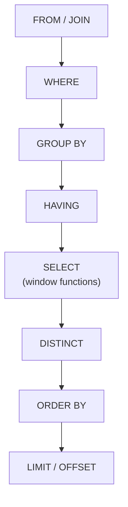
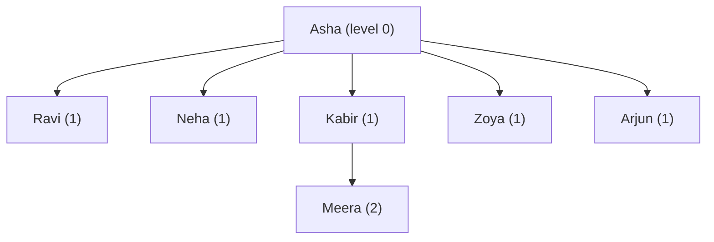

# Day 51 — SQL Deep Dive: Joins, CTEs & Subqueries

> **How to use these notes:** Phase 7 starts with SQL — it shows up in almost every backend loop, often as "write the query on a shared doc". **Type every query** into a real database (PostgreSQL via Docker: `docker run -e POSTGRES_PASSWORD=pw -p 5432:5432 postgres:16`, or an online playground) using the sample schema below. 🚀 marks senior-level details.

**Today's goal:** write every **JOIN** type, **self-joins** for hierarchies and consecutive rows, **scalar / correlated / EXISTS** subqueries, **CTEs** including **recursive** ones, **WHERE vs HAVING**, **CASE**, and the three classic interview queries — **Nth highest salary, consecutive days, top N per group**. DSA: advanced strings and **KMP**.

**Sample schema (used all day):**

```sql
CREATE TABLE departments (id INT PRIMARY KEY, name TEXT NOT NULL);

CREATE TABLE employees (
  id         INT PRIMARY KEY,
  name       TEXT NOT NULL,
  dept_id    INT REFERENCES departments(id),
  manager_id INT REFERENCES employees(id),
  salary     NUMERIC(10,2) NOT NULL,
  hired_on   DATE NOT NULL
);

CREATE TABLE logins (user_id INT, login_date DATE, PRIMARY KEY (user_id, login_date));

INSERT INTO departments VALUES (1,'Engineering'),(2,'Sales'),(3,'HR'),(4,'Legal');
INSERT INTO employees VALUES
 (1,'Asha', 1, NULL, 200000,'2019-01-10'),
 (2,'Ravi', 1, 1,    150000,'2020-03-01'),
 (3,'Neha', 1, 1,    150000,'2021-07-15'),
 (4,'Kabir',2, 1,     90000,'2020-11-20'),
 (5,'Meera',2, 4,     70000,'2022-02-01'),
 (6,'Zoya', 3, 1,     60000,'2023-05-05'),
 (7,'Arjun',NULL,1,   80000,'2024-01-08');
```

**Logical order of a SELECT** — explains most "why doesn't this work?" questions:



That's why you can't use a `SELECT` alias in `WHERE`, but you can in `ORDER BY`.

<!-- topic: d51_t1 -->
## 🗄️ SQL — Advanced Queries

<!-- subtopic: d51_t1_s1 -->
### 1. JOIN types

| Join | Returns | Typical use |
|---|---|---|
| **INNER JOIN** | Only rows that match on both sides | Employees with their department |
| **LEFT JOIN** | All left rows + matches (NULLs when none) | Employees incl. those without a department; "find missing" |
| **RIGHT JOIN** | All right rows + matches | Rarely — rewrite as a LEFT JOIN |
| **FULL OUTER JOIN** | All rows from both sides | Reconciling two data sources |
| **CROSS JOIN** | Every combination (m × n) | Generate calendars, size × colour grids |
| **SELF JOIN** | A table joined to itself | Hierarchies, comparing rows |

```sql
-- INNER: Arjun (no dept) and Legal (no employees) disappear
SELECT e.name, d.name AS dept
FROM employees e
JOIN departments d ON d.id = e.dept_id;

-- LEFT: keep every employee
SELECT e.name, COALESCE(d.name, 'Unassigned') AS dept
FROM employees e
LEFT JOIN departments d ON d.id = e.dept_id;

-- Anti-join: departments with NO employees  → Legal
SELECT d.name
FROM departments d
LEFT JOIN employees e ON e.dept_id = d.id
WHERE e.id IS NULL;

-- FULL OUTER: unmatched rows from both sides  → Arjun and Legal
SELECT e.name, d.name
FROM employees e
FULL OUTER JOIN departments d ON d.id = e.dept_id
WHERE e.id IS NULL OR d.id IS NULL;

-- CROSS: every department × every quarter
SELECT d.name, q.quarter
FROM departments d
CROSS JOIN (VALUES ('Q1'),('Q2'),('Q3'),('Q4')) AS q(quarter);
```

🚀 **The classic LEFT JOIN bug:** putting a condition on the right table in `WHERE` turns it back into an INNER JOIN, because NULL rows fail the test. Put it in `ON` instead:

```sql
-- WRONG: drops departments with no high earners
SELECT d.name, COUNT(e.id) FROM departments d
LEFT JOIN employees e ON e.dept_id = d.id
WHERE e.salary > 100000 GROUP BY d.name;

-- RIGHT: every department, counting only high earners
SELECT d.name, COUNT(e.id) FROM departments d
LEFT JOIN employees e ON e.dept_id = d.id AND e.salary > 100000
GROUP BY d.name;
```

<!-- subtopic: d51_t1_s2 -->
### 2. Self-joins — manager hierarchy, consecutive records

```sql
-- Each employee with their manager's name (LEFT keeps the CEO)
SELECT e.name AS employee, m.name AS manager
FROM employees e
LEFT JOIN employees m ON m.id = e.manager_id;

-- Employees who earn more than their manager  → none here; try raising Meera to 95000
SELECT e.name
FROM employees e
JOIN employees m ON m.id = e.manager_id
WHERE e.salary > m.salary;

-- Pairs of employees in the same department (each pair once)
SELECT a.name, b.name, a.dept_id
FROM employees a
JOIN employees b ON a.dept_id = b.dept_id AND a.id < b.id;
```

**Consecutive records** — users who logged in on 3 consecutive days:

```sql
SELECT DISTINCT a.user_id
FROM logins a
JOIN logins b ON b.user_id = a.user_id AND b.login_date = a.login_date + 1
JOIN logins c ON c.user_id = a.user_id AND c.login_date = a.login_date + 2;
```

The `a.id < b.id` trick avoids pairing a row with itself and listing every pair twice. Self-joins for "consecutive" work for a fixed small N; for "longest streak" use the window-function version in section 7.

<!-- subtopic: d51_t1_s3 -->
### 3. Subqueries — scalar, correlated, EXISTS vs IN

| Kind | Runs | Example |
|---|---|---|
| **Scalar** | Once, returns one value | `WHERE salary > (SELECT AVG(salary) FROM employees)` |
| **Multi-row** | Once, returns a list | `WHERE dept_id IN (SELECT id FROM departments WHERE name LIKE 'E%')` |
| **Correlated** | Conceptually once per outer row (references the outer query) | Salary above *their own department's* average |
| **Derived table** | In `FROM`, used like a table | `FROM (SELECT ...) AS t` |

```sql
-- Correlated: earns more than their department's average
SELECT e.name, e.salary
FROM employees e
WHERE e.salary > (SELECT AVG(x.salary) FROM employees x WHERE x.dept_id = e.dept_id);

-- EXISTS: departments that have at least one employee earning > 100k
SELECT d.name
FROM departments d
WHERE EXISTS (SELECT 1 FROM employees e WHERE e.dept_id = d.id AND e.salary > 100000);
```

**EXISTS vs IN vs JOIN:**

| | Behaviour | Notes |
|---|---|---|
| `EXISTS` | Stops at the first match (semi-join) | Natural for correlated checks; NULL-safe |
| `IN (subquery)` | Membership in a list | Fine for small/uncorrelated lists; modern planners often rewrite IN and EXISTS the same way |
| `NOT IN (subquery)` | ⚠️ Returns **no rows** if the subquery yields any NULL | Use `NOT EXISTS` instead |
| `JOIN` | Can duplicate rows if many matches | Needs `DISTINCT` for a pure existence check |

```sql
-- Trap: Arjun has dept_id NULL, so this returns NOTHING
SELECT name FROM departments WHERE id NOT IN (SELECT dept_id FROM employees);

-- Correct
SELECT name FROM departments d
WHERE NOT EXISTS (SELECT 1 FROM employees e WHERE e.dept_id = d.id);
```

Why: `x NOT IN (1, 2, NULL)` means `x <> 1 AND x <> 2 AND x <> NULL`, and `x <> NULL` is UNKNOWN, so the whole condition is never TRUE.

<!-- subtopic: d51_t1_s4 -->
### 4. CTEs and recursive CTEs

A **CTE** (`WITH name AS (...)`) names a subquery so a long query reads top-down, and can be referenced several times.

```sql
WITH dept_avg AS (
  SELECT dept_id, AVG(salary) AS avg_salary
  FROM employees
  GROUP BY dept_id
)
SELECT e.name, e.salary, ROUND(a.avg_salary) AS dept_avg
FROM employees e
JOIN dept_avg a ON a.dept_id = e.dept_id
WHERE e.salary > a.avg_salary;
```

**Recursive CTE** — walk a hierarchy of any depth (org chart, category tree, bill of materials):

```sql
WITH RECURSIVE chain AS (
  SELECT id, name, manager_id, 0 AS level, name::TEXT AS path      -- anchor: the CEO
  FROM employees
  WHERE manager_id IS NULL
  UNION ALL
  SELECT e.id, e.name, e.manager_id, c.level + 1, c.path || ' > ' || e.name   -- recursive step
  FROM employees e
  JOIN chain c ON e.manager_id = c.id
)
SELECT level, path FROM chain ORDER BY path;
```



| Rule | Why |
|---|---|
| Anchor `UNION ALL` recursive part | The recursive part joins to the CTE itself |
| Recursion stops when a step returns no rows | Leaves have no children |
| Guard against cycles | Track the path or a depth limit (`WHERE c.level < 20`) |

🚀 In PostgreSQL ≥ 12, non-recursive CTEs are **inlined** by default (optimised like subqueries); add `MATERIALIZED` to force computing once. Older versions always materialised — a CTE could be an "optimisation fence".

<!-- subtopic: d51_t1_s5 -->
### 5. GROUP BY with WHERE vs HAVING

| | Filters | Can use aggregates? |
|---|---|---|
| `WHERE` | **Rows**, before grouping | No |
| `HAVING` | **Groups**, after aggregation | Yes |

```sql
-- Departments with more than 1 employee hired after 2020, and their average salary
SELECT d.name, COUNT(*) AS headcount, ROUND(AVG(e.salary)) AS avg_salary
FROM employees e
JOIN departments d ON d.id = e.dept_id
WHERE e.hired_on >= DATE '2020-01-01'      -- row filter
GROUP BY d.name
HAVING COUNT(*) > 1                         -- group filter
ORDER BY avg_salary DESC;
```

| Rule | Detail |
|---|---|
| Every non-aggregated `SELECT` column must be in `GROUP BY` | (PostgreSQL allows columns functionally dependent on the primary key) |
| `COUNT(*)` vs `COUNT(col)` | Counts rows vs non-NULL values of `col` |
| Filter in `WHERE` when you can | Fewer rows to group = faster |

<!-- subtopic: d51_t1_s6 -->
### 6. CASE WHEN THEN ELSE END

```sql
-- Bucketing in SELECT
SELECT name, salary,
       CASE
         WHEN salary >= 150000 THEN 'Senior band'
         WHEN salary >= 80000  THEN 'Mid band'
         ELSE 'Junior band'
       END AS band
FROM employees;

-- Conditional aggregation: pivot rows into columns (very common!)
SELECT d.name,
       COUNT(*) FILTER (WHERE e.salary >= 100000)                AS high_earners,   -- PostgreSQL
       SUM(CASE WHEN e.hired_on >= DATE '2022-01-01' THEN 1 ELSE 0 END) AS recent_hires   -- portable
FROM departments d
LEFT JOIN employees e ON e.dept_id = d.id
GROUP BY d.name;

-- CASE in ORDER BY: custom sort order
SELECT name FROM departments
ORDER BY CASE name WHEN 'Engineering' THEN 1 WHEN 'Sales' THEN 2 ELSE 3 END, name;
```

`CASE` returns the **first** matching branch; with no `ELSE` the result is NULL.

<!-- subtopic: d51_t1_s7 -->
### 7. Practice: Nth highest salary, consecutive days, top N per group

**Nth highest salary** (here N = 2 → 150000; ties count once):

```sql
-- 1. DENSE_RANK (clearest)
SELECT DISTINCT salary FROM (
  SELECT salary, DENSE_RANK() OVER (ORDER BY salary DESC) AS rnk FROM employees
) t WHERE rnk = 2;

-- 2. LIMIT/OFFSET on distinct values
SELECT DISTINCT salary FROM employees ORDER BY salary DESC LIMIT 1 OFFSET 1;

-- 3. Correlated count (works without window functions)
SELECT DISTINCT e1.salary FROM employees e1
WHERE 1 = (SELECT COUNT(DISTINCT e2.salary) FROM employees e2 WHERE e2.salary > e1.salary);
```

Ask: "If there is no Nth salary, return NULL or nothing?" (LeetCode 176 wants NULL → wrap in `SELECT (subquery) AS SecondHighestSalary`.)

**Consecutive days — longest login streak per user ("gaps and islands"):**

```sql
WITH numbered AS (
  SELECT user_id, login_date,
         login_date - (ROW_NUMBER() OVER (PARTITION BY user_id ORDER BY login_date))::INT AS grp
  FROM logins
)
SELECT user_id, MIN(login_date) AS streak_start, COUNT(*) AS streak_days
FROM numbered
GROUP BY user_id, grp
HAVING COUNT(*) >= 3;
```

Consecutive dates minus a consecutive row number give the **same** value, so each streak becomes one group.

| login_date | row_number | date − row_number |
|---|---|---|
| 2026-11-01 | 1 | 2026-10-31 |
| 2026-11-02 | 2 | 2026-10-31 |
| 2026-11-03 | 3 | 2026-10-31 |
| 2026-11-07 | 4 | 2026-11-03 ← new island |

**Top N per group — top 2 earners per department:**

```sql
SELECT dept_id, name, salary
FROM (
  SELECT e.*, DENSE_RANK() OVER (PARTITION BY dept_id ORDER BY salary DESC) AS rnk
  FROM employees e
) ranked
WHERE rnk <= 2;
```

Choose `ROW_NUMBER` for exactly N rows, `DENSE_RANK` to include ties (Ravi and Neha both 150000). Tomorrow's notes cover window functions in depth.

<!-- topic: d51_t2 -->
## 🧮 DSA — String Advanced

<!-- subtopic: d51_t2_s1 -->
### 8. Longest Palindromic Substring (LeetCode 5)

**Idea — expand around centre:** every palindrome has a centre: a character (odd length) or a gap between two characters (even length). There are 2n − 1 centres; expand from each while both ends match.

```java
public String longestPalindrome(String s) {
    int start = 0, end = 0;
    for (int i = 0; i < s.length(); i++) {
        int odd = expand(s, i, i);          // "aba"
        int even = expand(s, i, i + 1);     // "abba"
        int len = Math.max(odd, even);
        if (len > end - start + 1) {
            start = i - (len - 1) / 2;
            end = i + len / 2;
        }
    }
    return s.substring(start, end + 1);
}

private int expand(String s, int l, int r) {
    while (l >= 0 && r < s.length() && s.charAt(l) == s.charAt(r)) { l--; r++; }
    return r - l - 1;                       // length of the palindrome found
}
```

**Complexity:** O(n²) time, O(1) space. The DP table version is also O(n²) but uses O(n²) memory; **Manacher's algorithm** is O(n) — mention it, don't code it unless asked.

<!-- subtopic: d51_t2_s2 -->
### 9. String Compression (LeetCode 443)

**Problem:** compress `['a','a','b','b','c','c','c']` **in place** to `['a','2','b','2','c','3']` and return the new length (6). Single characters get no count; counts ≥ 10 use several digits.

```java
public int compress(char[] chars) {
    int write = 0, read = 0;
    while (read < chars.length) {
        char c = chars[read];
        int runStart = read;
        while (read < chars.length && chars[read] == c) read++;
        chars[write++] = c;
        int count = read - runStart;
        if (count > 1) {
            for (char d : Integer.toString(count).toCharArray()) chars[write++] = d;
        }
    }
    return write;
}
```

**Why in place is safe:** the write pointer never overtakes the read pointer — a run of length k writes at most 1 + digits(k) ≤ k characters. **Complexity:** O(n) time, O(1) extra space.

<!-- subtopic: d51_t2_s3 -->
### 10. Repeated Substring Pattern (LeetCode 459)

**Problem:** can `s` be built by repeating one of its substrings? `"abab"` → true, `"aba"` → false.

**Trick:** if `s` is made of a repeated block, then `s` appears inside `(s + s)` with the first and last characters removed.

```java
public boolean repeatedSubstringPattern(String s) {
    String doubled = (s + s).substring(1, 2 * s.length() - 1);
    return doubled.contains(s);
}
```

**Divisor check (easy to explain):** try every block length `len` that divides n, from 1 to n/2, and compare.

```java
public boolean repeatedSubstringPatternDivisors(String s) {
    int n = s.length();
    for (int len = 1; len <= n / 2; len++) {
        if (n % len == 0 && s.substring(0, len).repeat(n / len).equals(s)) return true;
    }
    return false;
}
```

🚀 With KMP's prefix function: let `p = lps[n-1]`; the answer is true iff `p > 0 && n % (n - p) == 0` — O(n).

<!-- subtopic: d51_t2_s4 -->
### 11. KMP algorithm overview — pattern matching in O(n + m)

**Problem with naive search:** on a mismatch it slides the pattern by 1 and re-compares characters it already saw → O(n·m) worst case (`"aaaa…ab"` in `"aaaa…a"`).

**KMP idea:** precompute for the pattern the **LPS array** — `lps[i]` = length of the longest proper prefix of `pattern[0..i]` that is also a suffix. On a mismatch, jump to `lps[j-1]` instead of restarting; the text pointer **never moves backwards**.

| i | 0 | 1 | 2 | 3 | 4 | 5 | 6 |
|---|---|---|---|---|---|---|---|
| pattern | a | b | a | b | a | c | a |
| lps | 0 | 0 | 1 | 2 | 3 | 0 | 1 |

```java
int[] buildLps(String p) {
    int[] lps = new int[p.length()];
    for (int i = 1, len = 0; i < p.length(); ) {
        if (p.charAt(i) == p.charAt(len)) lps[i++] = ++len;
        else if (len > 0) len = lps[len - 1];       // fall back, don't advance i
        else lps[i++] = 0;
    }
    return lps;
}

int indexOf(String text, String p) {               // LeetCode 28
    if (p.isEmpty()) return 0;
    int[] lps = buildLps(p);
    for (int i = 0, j = 0; i < text.length(); ) {
        if (text.charAt(i) == p.charAt(j)) {
            i++; j++;
            if (j == p.length()) return i - j;      // match found
        } else if (j > 0) j = lps[j - 1];           // reuse what already matched
        else i++;
    }
    return -1;
}
```

**Complexity:** O(n + m) time, O(m) space. Related: **Rabin–Karp** (rolling hash, good for many patterns / plagiarism detection), **Z-algorithm**. In Java interviews `String.indexOf` is acceptable unless they ask you to implement matching.

---

## 📝 Day 51 Revision Cheat Sheet

| Topic | Key points |
|---|---|
| Execution order | FROM → WHERE → GROUP BY → HAVING → SELECT → DISTINCT → ORDER BY → LIMIT |
| Joins | INNER matches; LEFT keeps left (filter right side in ON); anti-join with `IS NULL`; CROSS = all combos |
| Self-join | Manager names, compare to manager, `a.id < b.id` for unique pairs, consecutive dates |
| Subqueries | Scalar / correlated / EXISTS; **NOT IN breaks on NULL** → NOT EXISTS |
| CTEs | Readability; `WITH RECURSIVE` anchor UNION ALL step; guard depth |
| WHERE vs HAVING | Rows before grouping vs groups after |
| CASE | First match wins; conditional aggregation pivots |
| Classics | Nth highest = DENSE_RANK; streaks = date − ROW_NUMBER; top N per group = rank in subquery |
| Strings | Expand around 2n−1 centres; in-place compression; (s+s) trick; KMP LPS array |

<details><summary>Q1. Difference between WHERE and HAVING?</summary>

WHERE filters individual rows before grouping and cannot use aggregate functions. HAVING filters groups after GROUP BY and can use aggregates such as COUNT(*) > 1. Filter in WHERE whenever possible so fewer rows are aggregated.

</details>

<details><summary>Q2. Why can NOT IN return no rows?</summary>

If the subquery returns a NULL, x NOT IN (..., NULL) compares x <> NULL, which is UNKNOWN, so the predicate is never true. Use NOT EXISTS (or filter NULLs out of the subquery).

</details>

<details><summary>Q3. Find the second-highest salary.</summary>

SELECT DISTINCT salary FROM (SELECT salary, DENSE_RANK() OVER (ORDER BY salary DESC) r FROM employees) t WHERE r = 2 — or SELECT MAX(salary) FROM employees WHERE salary < (SELECT MAX(salary) FROM employees), which returns NULL when there is no second salary.

</details>

<details><summary>Q4. How do you query an org chart of unknown depth?</summary>

A recursive CTE: the anchor selects the root (manager_id IS NULL), the recursive part joins employees to the CTE on manager_id = id, carrying level and path, combined with UNION ALL; add a depth limit or path check to guard against cycles.

</details>

<details><summary>Q5. LEFT JOIN with a filter on the right table returns too few rows — why?</summary>

A condition on the right table in WHERE removes the NULL-extended rows, effectively turning the LEFT JOIN into an INNER JOIN. Move the condition into the ON clause.

</details>

### ⚡ Rapid-fire self-test

1. Which runs first: WHERE or GROUP BY? → **WHERE**
2. Join that returns every combination of rows? → **CROSS JOIN**
3. How do you find rows with no match using a LEFT JOIN? → **Filter WHERE right.id IS NULL (anti-join)**
4. Safe replacement for NOT IN with a subquery? → **NOT EXISTS**
5. Keyword to walk a hierarchy of unknown depth? → **WITH RECURSIVE**
6. CASE without a matching branch or ELSE returns? → **NULL**
7. Ranking function that keeps ties without gaps? → **DENSE_RANK()**
8. Gaps-and-islands trick for consecutive dates? → **Subtract ROW_NUMBER from the date and group by the result**
9. Number of centres in expand-around-centre? → **2n − 1**
10. What does KMP's LPS array store? → **Length of the longest proper prefix that is also a suffix for each prefix of the pattern**
