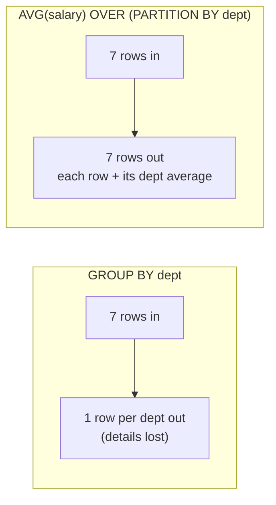
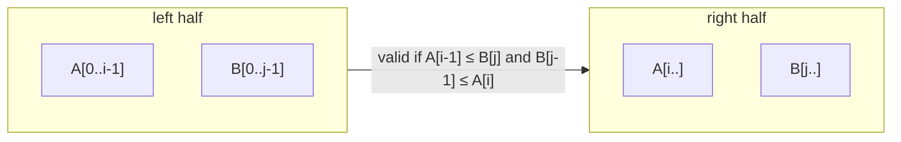

# Day 52 — SQL Window Functions (Most Tested Topic!)

> **How to use these notes:** window functions are the single most-tested SQL topic for backend roles — "second highest per department", "running total", "month-over-month change". Run every query against the tables below and **predict the output before you run it**. 🚀 marks senior-level details.

**Today's goal:** master the `OVER (PARTITION BY … ORDER BY … frame)` syntax, the differences between **ROW_NUMBER, RANK and DENSE_RANK**, **LAG/LEAD/FIRST_VALUE/LAST_VALUE**, **frames** (`ROWS` vs `RANGE`), and write the three classic queries from memory. DSA: binary search and heaps — **Median of Two Sorted Arrays**, **Capacity to Ship Packages**, **K Closest Points**, **Find K Closest Elements**.

Uses the `employees` / `departments` tables from Day 51, plus:

```sql
CREATE TABLE daily_sales (sale_date DATE PRIMARY KEY, amount NUMERIC(10,2) NOT NULL);
INSERT INTO daily_sales VALUES
 ('2026-11-01', 100), ('2026-11-02', 150), ('2026-11-03', 120),
 ('2026-11-04', 180), ('2026-11-05', 90),  ('2026-11-06', 200);
```

**GROUP BY vs window function** — the key mental model:



A window function computes over a **set of related rows** but **keeps every row**.

<!-- topic: d52_t1 -->
## 🪟 SQL — Window Functions

<!-- subtopic: d52_t1_s1 -->
### 1. OVER (PARTITION BY … ORDER BY …) — the syntax foundation

```sql
function_name(args) OVER (
    PARTITION BY col1, ...        -- split rows into groups (optional; default: one big group)
    ORDER BY col2 [DESC], ...     -- order inside each partition (needed for ranking, LAG, running totals)
    ROWS | RANGE BETWEEN ... AND ...   -- frame: which rows around the current row (optional)
)
```

```sql
SELECT name, dept_id, salary,
       AVG(salary)  OVER (PARTITION BY dept_id)        AS dept_avg,
       salary - AVG(salary) OVER (PARTITION BY dept_id) AS diff_from_avg,
       COUNT(*)     OVER ()                              AS total_employees,
       ROUND(100.0 * salary / SUM(salary) OVER (), 1)    AS pct_of_payroll
FROM employees
ORDER BY dept_id, salary DESC;
```

| Clause | Without it |
|---|---|
| `PARTITION BY` | The whole result set is one partition |
| `ORDER BY` | All rows in the partition are "peers"; aggregates cover the full partition |
| Frame | Default with ORDER BY is `RANGE BETWEEN UNBOUNDED PRECEDING AND CURRENT ROW` |

**Rules:** window functions run **after** `WHERE`/`GROUP BY`/`HAVING`, so you **can't filter on them in WHERE** — wrap the query in a subquery or CTE and filter outside. Reuse a definition with a named window: `... OVER w ... WINDOW w AS (PARTITION BY dept_id ORDER BY salary DESC)`.

<!-- subtopic: d52_t1_s2 -->
### 2. ROW_NUMBER() vs RANK() vs DENSE_RANK()

```sql
SELECT name, salary,
       ROW_NUMBER() OVER (ORDER BY salary DESC) AS row_num,
       RANK()       OVER (ORDER BY salary DESC) AS rnk,
       DENSE_RANK() OVER (ORDER BY salary DESC) AS dense
FROM employees;
```

| name | salary | ROW_NUMBER | RANK | DENSE_RANK |
|---|---|---|---|---|
| Asha | 200000 | 1 | 1 | 1 |
| Ravi | 150000 | 2 | 2 | 2 |
| Neha | 150000 | 3 | 2 | 2 |
| Kabir | 90000 | 4 | **4** (gap) | **3** |
| Arjun | 80000 | 5 | 5 | 4 |
| Meera | 70000 | 6 | 6 | 5 |
| Zoya | 60000 | 7 | 7 | 6 |

| Function | Ties | Use for |
|---|---|---|
| `ROW_NUMBER` | Unique numbers, ties broken arbitrarily (add a tiebreaker column!) | Exactly N rows per group, de-duplication, pagination |
| `RANK` | Same rank, then **gaps** (1, 2, 2, 4) | Competition ranking |
| `DENSE_RANK` | Same rank, **no gaps** (1, 2, 2, 3) | "Nth highest distinct value" |
| `NTILE(4)` | Splits into 4 near-equal buckets | Quartiles |

**De-duplication with ROW_NUMBER** (keep the newest row per email) — a very common real task:

```sql
DELETE FROM users WHERE id IN (
  SELECT id FROM (
    SELECT id, ROW_NUMBER() OVER (PARTITION BY email ORDER BY created_at DESC) AS rn
    FROM users
  ) t WHERE rn > 1
);
```

<!-- subtopic: d52_t1_s3 -->
### 3. LAG(), LEAD(), FIRST_VALUE(), LAST_VALUE()

| Function | Returns |
|---|---|
| `LAG(col, n, default)` | Value from n rows **before** (default n = 1) |
| `LEAD(col, n, default)` | Value from n rows **after** |
| `FIRST_VALUE(col)` | First value in the frame |
| `LAST_VALUE(col)` | Last value in the **frame** (⚠️ see below) |
| `NTH_VALUE(col, n)` | n-th value in the frame |

```sql
SELECT sale_date, amount,
       LAG(amount)  OVER (ORDER BY sale_date) AS prev_day,
       LEAD(amount) OVER (ORDER BY sale_date) AS next_day,
       FIRST_VALUE(amount) OVER (ORDER BY sale_date) AS first_day
FROM daily_sales;
```

🚀 **The LAST_VALUE trap:** with `ORDER BY`, the default frame ends at the **current row**, so `LAST_VALUE` just returns the current row's value. Extend the frame:

```sql
-- Highest-paid person's name shown on every row of their department
SELECT name, dept_id, salary,
       FIRST_VALUE(name) OVER (PARTITION BY dept_id ORDER BY salary DESC) AS top_earner,
       LAST_VALUE(name)  OVER (PARTITION BY dept_id ORDER BY salary DESC
                               ROWS BETWEEN UNBOUNDED PRECEDING AND UNBOUNDED FOLLOWING) AS lowest_earner
FROM employees;
```

<!-- subtopic: d52_t1_s4 -->
### 4. Aggregate windows with ROWS BETWEEN / RANGE BETWEEN frames

**Frame bounds:** `UNBOUNDED PRECEDING`, `n PRECEDING`, `CURRENT ROW`, `n FOLLOWING`, `UNBOUNDED FOLLOWING`.

```sql
SELECT sale_date, amount,
       SUM(amount) OVER (ORDER BY sale_date ROWS BETWEEN UNBOUNDED PRECEDING AND CURRENT ROW) AS running_total,
       ROUND(AVG(amount) OVER (ORDER BY sale_date ROWS BETWEEN 2 PRECEDING AND CURRENT ROW), 2) AS moving_avg_3d,
       SUM(amount) OVER () AS grand_total
FROM daily_sales;
```

| sale_date | amount | running_total | moving_avg_3d |
|---|---|---|---|
| 11-01 | 100 | 100 | 100.00 |
| 11-02 | 150 | 250 | 125.00 |
| 11-03 | 120 | 370 | 123.33 |
| 11-04 | 180 | 550 | 150.00 |
| 11-05 | 90 | 640 | 130.00 |
| 11-06 | 200 | 840 | 156.67 |

**ROWS vs RANGE:**

| | `ROWS` | `RANGE` |
|---|---|---|
| Counts | Physical rows | Rows with the same/nearby **ORDER BY value** (peers) |
| Ties in ORDER BY | Each row separate | All peers included together |
| Example difference | Running total over employees ordered by salary: Ravi and Neha get different totals | Ravi and Neha (both 150000) get the **same** total — both included |
| Use | Running totals, moving averages over N rows | Value ranges: `RANGE BETWEEN INTERVAL '7 days' PRECEDING AND CURRENT ROW` |

Prefer explicit `ROWS` frames for running totals — the default `RANGE` frame surprises people when the order column has duplicates.

<!-- subtopic: d52_t1_s5 -->
### 5. Write: 2nd highest salary per department (DENSE_RANK + subquery)

```sql
WITH ranked AS (
  SELECT d.name AS dept, e.name, e.salary,
         DENSE_RANK() OVER (PARTITION BY e.dept_id ORDER BY e.salary DESC) AS rnk
  FROM employees e
  JOIN departments d ON d.id = e.dept_id
)
SELECT dept, name, salary
FROM ranked
WHERE rnk = 2;
```

**Result:** Engineering → Ravi and Neha (150000, tie); Sales → Meera (70000); HR has only one person, so no row.

| Variation the interviewer may ask | Change |
|---|---|
| "Exactly one person per department" | `ROW_NUMBER()` + a tiebreaker (`ORDER BY salary DESC, hired_on`) |
| "Include departments with no 2nd salary as NULL" | LEFT JOIN `departments` to the filtered result |
| "Top 3 per department" | `WHERE rnk <= 3` |
| "Without window functions" | Correlated: `WHERE 1 = (SELECT COUNT(DISTINCT x.salary) FROM employees x WHERE x.dept_id = e.dept_id AND x.salary > e.salary)` |

<!-- subtopic: d52_t1_s6 -->
### 6. Write: running total with SUM() OVER (ORDER BY date)

```sql
SELECT sale_date, amount,
       SUM(amount) OVER (ORDER BY sale_date ROWS UNBOUNDED PRECEDING) AS running_total
FROM daily_sales
ORDER BY sale_date;
```

**Per-group running total** (cumulative salary cost by hire date within each department):

```sql
SELECT dept_id, name, hired_on, salary,
       SUM(salary) OVER (PARTITION BY dept_id ORDER BY hired_on
                         ROWS BETWEEN UNBOUNDED PRECEDING AND CURRENT ROW) AS cumulative_cost
FROM employees
ORDER BY dept_id, hired_on;
```

**Without window functions** (older MySQL) — a correlated subquery, O(n²):

```sql
SELECT a.sale_date, a.amount,
       (SELECT SUM(b.amount) FROM daily_sales b WHERE b.sale_date <= a.sale_date) AS running_total
FROM daily_sales a;
```

<!-- subtopic: d52_t1_s7 -->
### 7. Write: compare with the previous row using LAG() (trend analysis)

```sql
SELECT sale_date, amount,
       LAG(amount) OVER (ORDER BY sale_date)                         AS prev_amount,
       amount - LAG(amount) OVER (ORDER BY sale_date)                AS change,
       ROUND(100.0 * (amount - LAG(amount) OVER (ORDER BY sale_date))
             / LAG(amount) OVER (ORDER BY sale_date), 1)             AS pct_change,
       CASE
         WHEN LAG(amount) OVER (ORDER BY sale_date) IS NULL THEN 'n/a'
         WHEN amount > LAG(amount) OVER (ORDER BY sale_date) THEN 'up'
         WHEN amount < LAG(amount) OVER (ORDER BY sale_date) THEN 'down'
         ELSE 'flat'
       END AS trend
FROM daily_sales;
```

| sale_date | amount | prev | change | pct | trend |
|---|---|---|---|---|---|
| 11-01 | 100 | NULL | NULL | NULL | n/a |
| 11-02 | 150 | 100 | 50 | 50.0 | up |
| 11-03 | 120 | 150 | −30 | −20.0 | down |
| 11-04 | 180 | 120 | 60 | 50.0 | up |
| 11-05 | 90 | 180 | −90 | −50.0 | down |
| 11-06 | 200 | 90 | 110 | 122.2 | up |

**Related classics:** "days where sales rose 3 days in a row" (LAG 1 and LAG 2), "month-over-month revenue growth" (aggregate by `date_trunc('month', …)` first, then LAG), "time between a user's consecutive orders" (`order_ts - LAG(order_ts) OVER (PARTITION BY user_id ORDER BY order_ts)`).

<!-- topic: d52_t2 -->
## 🧮 DSA — Binary Search & Heap Revision

<!-- subtopic: d52_t2_s1 -->
### 8. Median of Two Sorted Arrays (LeetCode 4 — Hard)

**Goal:** O(log(min(m, n))). **Idea:** binary search a **partition** of the smaller array A; the partition of B follows so the left halves together hold half the elements. The partition is correct when every left element ≤ every right element.



```java
public double findMedianSortedArrays(int[] a, int[] b) {
    if (a.length > b.length) return findMedianSortedArrays(b, a);    // search the smaller array
    int m = a.length, n = b.length, half = (m + n + 1) / 2;
    int lo = 0, hi = m;
    while (lo <= hi) {
        int i = (lo + hi) / 2;                 // elements taken from a
        int j = half - i;                      // elements taken from b
        int aLeft = i == 0 ? Integer.MIN_VALUE : a[i - 1];
        int aRight = i == m ? Integer.MAX_VALUE : a[i];
        int bLeft = j == 0 ? Integer.MIN_VALUE : b[j - 1];
        int bRight = j == n ? Integer.MAX_VALUE : b[j];
        if (aLeft <= bRight && bLeft <= aRight) {
            if ((m + n) % 2 == 1) return Math.max(aLeft, bLeft);
            return (Math.max(aLeft, bLeft) + (double) Math.min(aRight, bRight)) / 2;
        } else if (aLeft > bRight) hi = i - 1;  // took too many from a
        else lo = i + 1;                        // took too few from a
    }
    throw new IllegalArgumentException("input arrays must be sorted");
}
```

**Complexity:** O(log min(m, n)) time, O(1) space. **Fallback answer:** merge until the middle — O(m + n) — say it first, then optimise.

<!-- subtopic: d52_t2_s2 -->
### 9. Capacity to Ship Packages Within D Days (LeetCode 1011)

**Binary search on the answer:** capacity ranges from `max(weight)` (must fit the heaviest package) to `sum(weights)` (ship everything in one day). Feasibility is monotonic — if capacity c works, c + 1 works.

```java
public int shipWithinDays(int[] weights, int days) {
    int lo = 0, hi = 0;
    for (int w : weights) { lo = Math.max(lo, w); hi += w; }
    while (lo < hi) {
        int mid = lo + (hi - lo) / 2;
        if (daysNeeded(weights, mid) <= days) hi = mid;   // works → try smaller
        else lo = mid + 1;
    }
    return lo;
}

private int daysNeeded(int[] weights, int capacity) {
    int days = 1, load = 0;
    for (int w : weights) {
        if (load + w > capacity) { days++; load = 0; }    // start a new day (order must be kept)
        load += w;
    }
    return days;
}
```

**Complexity:** O(n log(sum)). Same template: Koko Eating Bananas (875), Split Array Largest Sum (410), Minimum Days to Make Bouquets (1482).

<!-- subtopic: d52_t2_s3 -->
### 10. K Closest Points to Origin (LeetCode 973)

**Max-heap of size k** keyed by squared distance (no `sqrt` needed): keep the k closest seen so far; evict the farthest.

```java
public int[][] kClosest(int[][] points, int k) {
    PriorityQueue<int[]> heap = new PriorityQueue<>(
            (p, q) -> Integer.compare(dist(q), dist(p)));      // max-heap: farthest on top
    for (int[] p : points) {
        heap.offer(p);
        if (heap.size() > k) heap.poll();
    }
    return heap.toArray(new int[0][]);
}

private int dist(int[] p) { return p[0] * p[0] + p[1] * p[1]; }
```

| Approach | Time | When |
|---|---|---|
| Sort all | O(n log n) | Simple, small n |
| **Max-heap of size k** | O(n log k) | Streaming input, k ≪ n |
| Quickselect | O(n) average, O(n²) worst | Fastest on average, input can be modified |

<!-- subtopic: d52_t2_s4 -->
### 11. Find K Closest Elements (LeetCode 658)

**Problem:** sorted array, return the k elements closest to x (ties → smaller element), in sorted order.

**Binary search the left edge of the window:** the answer is a contiguous window `[left, left + k)`. Compare `x - arr[mid]` with `arr[mid + k] - x` to decide whether the window should move right.

```java
public List<Integer> findClosestElements(int[] arr, int k, int x) {
    int lo = 0, hi = arr.length - k;
    while (lo < hi) {
        int mid = lo + (hi - lo) / 2;
        if (x - arr[mid] > arr[mid + k] - x) lo = mid + 1;   // arr[mid] is farther → shift right
        else hi = mid;
    }
    List<Integer> out = new ArrayList<>(k);
    for (int i = lo; i < lo + k; i++) out.add(arr[i]);
    return out;
}
```

**Complexity:** O(log(n − k) + k). **Why it works:** for a window starting at `mid`, either `arr[mid]` or `arr[mid + k]` must be excluded — keep the one closer to x. Alternative: two pointers shrinking from both ends (O(n − k)).

---

## 📝 Day 52 Revision Cheat Sheet

| Topic | Key points |
|---|---|
| Syntax | `fn() OVER (PARTITION BY … ORDER BY … frame)`; keeps all rows |
| Filtering | Can't use window results in WHERE → wrap in CTE/subquery |
| Ranking | ROW_NUMBER unique; RANK gaps; DENSE_RANK no gaps |
| Offset | LAG/LEAD with default; LAST_VALUE needs a full frame |
| Frames | Default with ORDER BY = RANGE … CURRENT ROW; use explicit ROWS for running totals |
| Classics | 2nd per dept = DENSE_RANK = 2; running total = SUM OVER ORDER BY ROWS UNBOUNDED PRECEDING; trend = LAG |
| Median | Binary search the partition of the smaller array |
| Ship packages | Binary search capacity in [max, sum] |
| K closest | Max-heap of size k / quickselect; sorted array → binary search the window start |

<details><summary>Q1. ROW_NUMBER vs RANK vs DENSE_RANK?</summary>

All number rows in a window order. ROW_NUMBER gives unique consecutive numbers (ties broken arbitrarily). RANK gives tied rows the same rank and then skips numbers (1,2,2,4). DENSE_RANK gives ties the same rank without gaps (1,2,2,3), which is what "Nth highest distinct salary" needs.

</details>

<details><summary>Q2. Why can't I filter on a window function in WHERE?</summary>

Window functions are evaluated after WHERE, GROUP BY and HAVING, during SELECT. To filter on their result, compute them in a subquery or CTE and apply the condition in the outer query.

</details>

<details><summary>Q3. Why does LAST_VALUE return the current row's value?</summary>

With an ORDER BY in the window, the default frame is RANGE BETWEEN UNBOUNDED PRECEDING AND CURRENT ROW, so the frame ends at the current row (and its peers). Specify ROWS BETWEEN UNBOUNDED PRECEDING AND UNBOUNDED FOLLOWING to see the whole partition.

</details>

<details><summary>Q4. ROWS vs RANGE frames?</summary>

ROWS counts physical rows relative to the current row. RANGE works on values of the ORDER BY column, so rows with equal values (peers) are included together, and you can use value offsets such as an interval of 7 days.

</details>

<details><summary>Q5. Write a running total per customer.</summary>

SELECT customer_id, order_date, amount, SUM(amount) OVER (PARTITION BY customer_id ORDER BY order_date ROWS BETWEEN UNBOUNDED PRECEDING AND CURRENT ROW) AS running_total FROM orders.

</details>

### ⚡ Rapid-fire self-test

1. Does a window function reduce the number of rows? → **No — every input row stays**
2. Ranks for salaries 100, 90, 90, 80 with RANK()? → **1, 2, 2, 4**
3. Same with DENSE_RANK()? → **1, 2, 2, 3**
4. Function returning the previous row's value? → **LAG()**
5. Default frame when ORDER BY is present? → **RANGE BETWEEN UNBOUNDED PRECEDING AND CURRENT ROW**
6. Frame for a 3-row moving average? → **ROWS BETWEEN 2 PRECEDING AND CURRENT ROW**
7. Which ranking function removes duplicate rows per key? → **ROW_NUMBER() with rn > 1 deleted**
8. Median of two sorted arrays — which array do you binary search? → **The smaller one**
9. Search range for Capacity to Ship Packages? → **From the max weight to the sum of weights**
10. Heap type for K closest points? → **A max-heap of size k (evict the farthest)**
