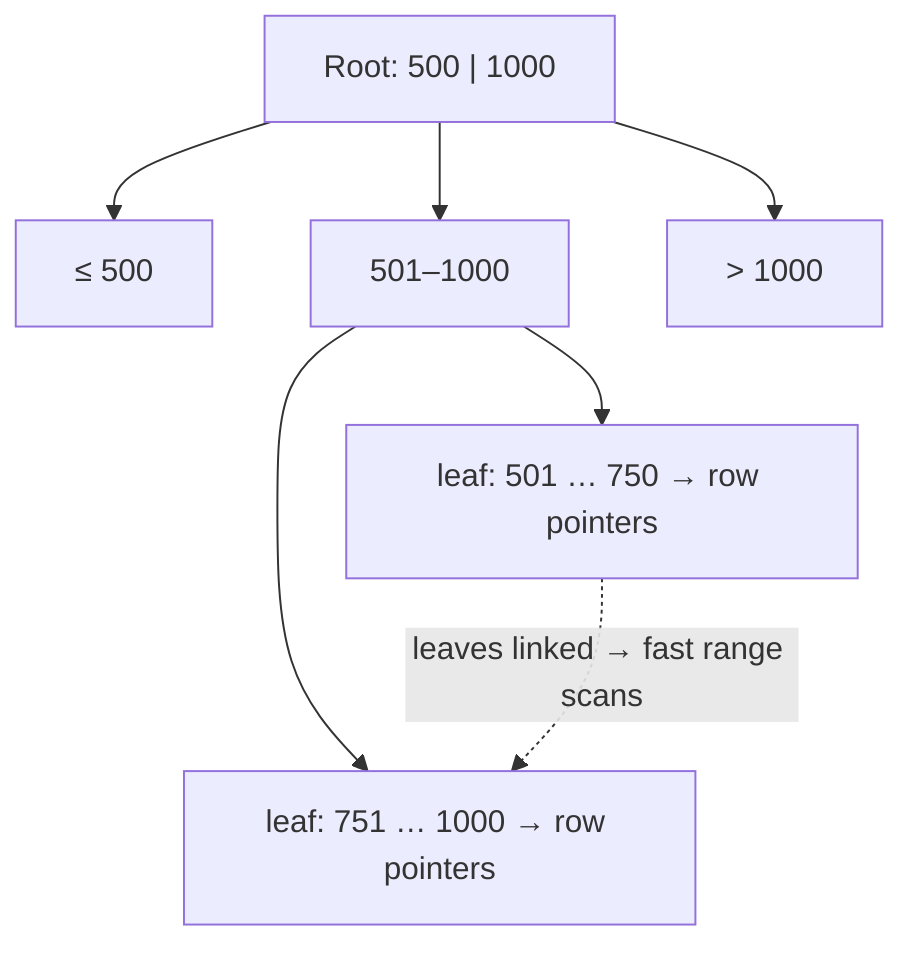
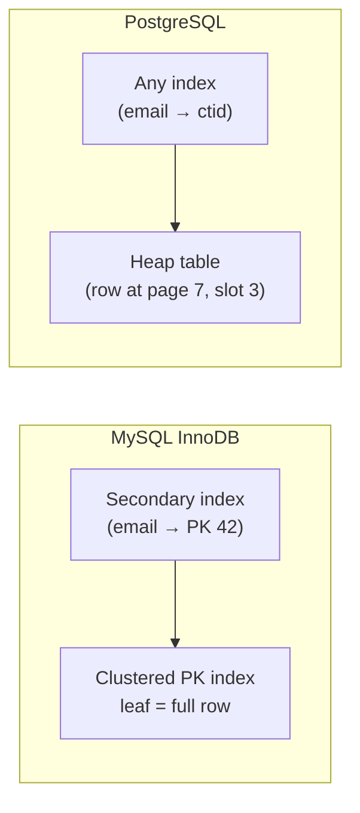
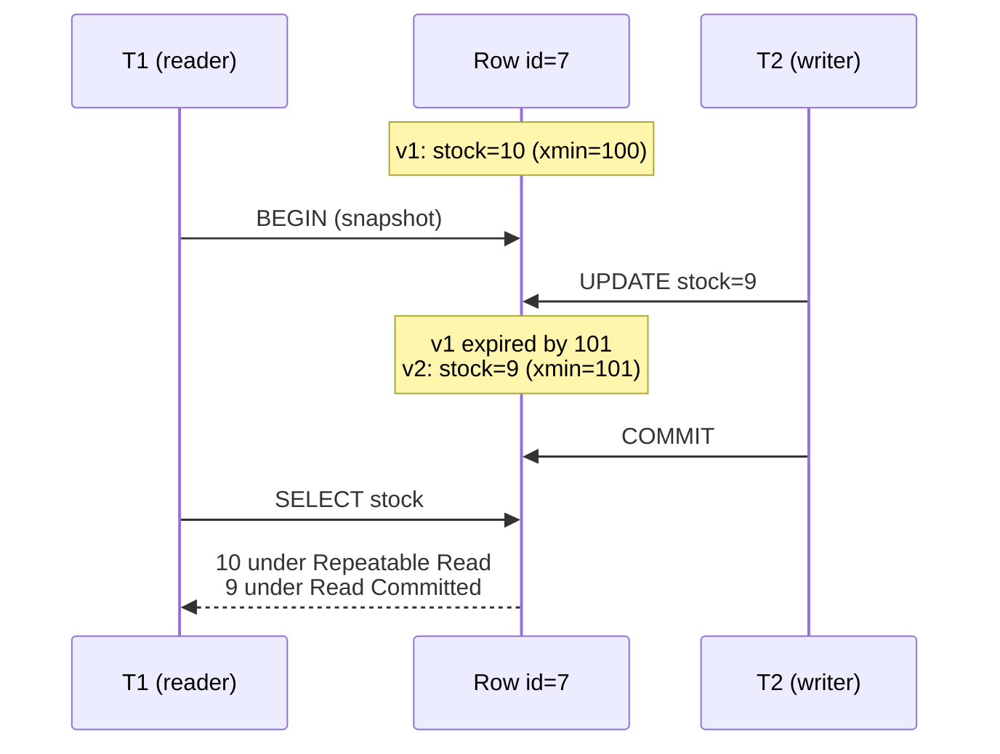
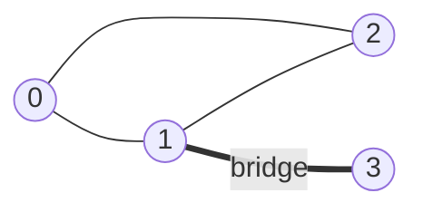

# Day 53 — SQL: Indexing, EXPLAIN & Transactions

> **How to use these notes:** this is the "why is my query slow?" and "what happens when two requests update the same row?" day — both questions you'll get as a backend engineer with 2–3 years' experience. Run the `EXPLAIN` examples on PostgreSQL with a big generated table (script below) so you **see** plans change. 🚀 marks senior-level details.

**Today's goal:** explain **B-tree vs hash** indexes and **composite column order**, **clustered vs non-clustered**, read **EXPLAIN ANALYZE**, define **ACID**, compare **isolation levels** and their anomalies, explain **MVCC** with vacuum, and use **PostgreSQL** features (JSONB, arrays, `pg_stat_activity`, partitioning). DSA: **Dijkstra**, **topological sort** (both ways), **bridges**, **Maximal Rectangle**.

**Practice table with 1 million rows:**

```sql
CREATE TABLE orders (
  id          BIGSERIAL PRIMARY KEY,
  customer_id INT NOT NULL,
  status      TEXT NOT NULL,
  amount      NUMERIC(10,2) NOT NULL,
  created_at  TIMESTAMPTZ NOT NULL
);

INSERT INTO orders (customer_id, status, amount, created_at)
SELECT (random() * 50000)::INT,
       (ARRAY['NEW','PAID','SHIPPED','CANCELLED'])[1 + (random() * 3)::INT],
       round((random() * 5000)::NUMERIC, 2),
       now() - (random() * INTERVAL '365 days')
FROM generate_series(1, 1000000);

ANALYZE orders;   -- refresh planner statistics
```

<!-- topic: d53_t1 -->
## ⚡ SQL — Performance & Transactions

<!-- subtopic: d53_t1_s1 -->
### 1. Index types and composite index column order

An index is a separate, sorted data structure that lets the database find rows without scanning the whole table — at the cost of extra storage and **slower writes** (every INSERT/UPDATE/DELETE must maintain it).



| Index type | Good for | Not good for |
|---|---|---|
| **B-tree** (default) | `=`, `<`, `>`, `BETWEEN`, `ORDER BY`, prefix `LIKE 'abc%'` | `LIKE '%abc'`, functions on the column |
| **Hash** | Equality only | Ranges, sorting |
| **GIN** (PostgreSQL) | JSONB containment, arrays, full-text search | Ranges |
| **GiST / BRIN** | Geo data / huge append-only tables ordered by time | — |

**Composite index and the leftmost-prefix rule:** an index on `(customer_id, status, created_at)` is sorted by customer, then status within customer, then date — like a phone book sorted by surname, then first name.

| Query filter | Uses the index? |
|---|---|
| `customer_id = 7` | ✅ leftmost column |
| `customer_id = 7 AND status = 'PAID'` | ✅ |
| `customer_id = 7 AND status = 'PAID' AND created_at > now() - interval '7 days'` | ✅ fully |
| `customer_id = 7 AND created_at > …` | ✅ for customer_id, then filters dates within it |
| `status = 'PAID'` | ❌ (not the leftmost column; PostgreSQL may skip-scan in newer versions) |
| `created_at > …` alone | ❌ |

**Ordering columns:** equality-filtered columns first, then the range/sort column last; among equality columns, the most selective (most distinct values) first is a good default.

```sql
CREATE INDEX idx_orders_customer_status_created ON orders (customer_id, status, created_at);

-- Covering index: the query is answered from the index alone (Index Only Scan)
CREATE INDEX idx_orders_customer_inc ON orders (customer_id) INCLUDE (amount);

-- Partial index: only the rows you query
CREATE INDEX idx_orders_open ON orders (created_at) WHERE status IN ('NEW','PAID');

-- Expression index: for queries on lower(email)
CREATE INDEX idx_users_email_lower ON users (lower(email));
```

**Why an index isn't used:** a function on the column (`WHERE date(created_at) = …`), implicit type casts, a leading wildcard `LIKE '%x'`, low selectivity (returning 30 % of the table — a sequential scan is cheaper), or stale statistics (`ANALYZE`).

<!-- subtopic: d53_t1_s2 -->
### 2. Clustered vs non-clustered indexes

| | **Clustered** | **Non-clustered (secondary)** |
|---|---|---|
| What it is | The table data itself is stored in index order | Separate structure with keys + pointers to rows |
| How many | One per table | Many |
| MySQL InnoDB | The **primary key** is the clustered index; secondary indexes store the PK value → lookup goes secondary index → PK index | — |
| PostgreSQL | Tables are **heaps** (unordered); every index is secondary and points to a tuple location (`ctid`); `CLUSTER` reorders once but isn't maintained | — |
| Range scans on the key | Very fast (rows are adjacent on disk) | Each match may be a random read |



🚀 **InnoDB design tip:** keep primary keys **small and increasing** (BIGINT auto-increment or time-ordered UUIDv7). Random UUIDv4 primary keys cause page splits and bloat every secondary index, because each secondary index stores the PK.

<!-- subtopic: d53_t1_s3 -->
### 3. EXPLAIN / EXPLAIN ANALYZE — reading query plans

```sql
EXPLAIN (ANALYZE, BUFFERS)
SELECT * FROM orders WHERE customer_id = 4242 AND status = 'PAID';
```

**Before the index:**

```text
Seq Scan on orders  (cost=0.00..23334.00 rows=5 width=40) (actual time=0.9..71.3 rows=6 loops=1)
  Filter: ((customer_id = 4242) AND (status = 'PAID'))
  Rows Removed by Filter: 999994
Execution Time: 71.4 ms
```

**After `CREATE INDEX … (customer_id, status, created_at)`:**

```text
Index Scan using idx_orders_customer_status_created on orders  (cost=0.42..12.6 rows=5 width=40) (actual time=0.03..0.05 rows=6 loops=1)
  Index Cond: ((customer_id = 4242) AND (status = 'PAID'))
Execution Time: 0.08 ms
```

| Plan node | Meaning |
|---|---|
| **Seq Scan** | Reads the whole table — fine for small tables or when most rows match |
| **Index Scan** | Walks the index, then fetches each row from the heap |
| **Index Only Scan** | All needed columns are in the index — no heap visits (needs a fresh visibility map → VACUUM) |
| **Bitmap Index Scan + Bitmap Heap Scan** | Collect many matching row locations, then read pages in order — medium selectivity |
| **Nested Loop** | For each outer row, look up inner rows — great when the outer side is small and the inner side is indexed |
| **Hash Join** | Build a hash table of the smaller input — large unsorted joins |
| **Merge Join** | Both inputs sorted on the join key |
| **Sort / HashAggregate** | ORDER BY / GROUP BY work; watch for "external merge Disk" (work_mem too small) |

**How to read it:** plans are trees — read **inside out**. Compare **estimated rows vs actual rows**: a big mismatch means stale or missing statistics and a likely bad plan. `cost` is in arbitrary planner units (startup..total); `actual time` is in milliseconds per loop. `EXPLAIN` alone only estimates; `EXPLAIN ANALYZE` **runs the query** — wrap writes in `BEGIN; … ROLLBACK;`.

<!-- subtopic: d53_t1_s4 -->
### 4. ACID properties

| Property | Guarantee | How the DB provides it | Example |
|---|---|---|---|
| **Atomicity** | All statements of a transaction happen, or none | Undo/rollback using the log | Debit and credit both happen or neither |
| **Consistency** | Each commit moves the DB from one valid state to another | Constraints (PK, FK, CHECK, UNIQUE), triggers | Balance can't go below 0 with `CHECK (balance >= 0)` |
| **Isolation** | Concurrent transactions don't see each other's partial work (to a chosen degree) | Locks and/or MVCC, isolation levels | Two transfers don't corrupt each other |
| **Durability** | Committed data survives a crash | Write-ahead log (WAL) flushed to disk at commit, replicas | Power cut after "COMMIT OK" loses nothing |

```sql
BEGIN;
UPDATE accounts SET balance = balance - 500 WHERE id = 1;
UPDATE accounts SET balance = balance + 500 WHERE id = 2;
COMMIT;            -- or ROLLBACK; on any error
```

In Spring this is `@Transactional` (Day 22): the proxy calls `BEGIN`, then `COMMIT` or `ROLLBACK` around your method.

<!-- subtopic: d53_t1_s5 -->
### 5. Isolation levels and anomalies

| Anomaly | What happens |
|---|---|
| **Dirty read** | T1 reads T2's **uncommitted** change, then T2 rolls back |
| **Non-repeatable read** | T1 reads a row twice and gets different values because T2 committed an update in between |
| **Phantom read** | T1 runs the same range query twice and new rows appear (T2 inserted) |
| **Lost update** | T1 and T2 both read 100, add 10, write 110 — one increment is lost |
| **Write skew** | Two transactions read overlapping data and make disjoint writes that together break a rule (both on-call doctors go off duty) |

| Level | Dirty read | Non-repeatable read | Phantom | Notes |
|---|---|---|---|---|
| Read Uncommitted | possible | possible | possible | PostgreSQL treats it as Read Committed |
| **Read Committed** | ✗ | possible | possible | **PostgreSQL & Oracle default** — each statement sees data committed before it started |
| **Repeatable Read** | ✗ | ✗ | possible by the SQL standard (✗ in PostgreSQL's snapshot implementation) | **MySQL InnoDB default** — one snapshot for the whole transaction |
| **Serializable** | ✗ | ✗ | ✗ | Result equals some serial order; PostgreSQL uses SSI and aborts conflicting transactions (retry needed) |

**Preventing lost updates at Read Committed:**

```sql
-- Pessimistic: lock the row while you read it
BEGIN;
SELECT stock FROM products WHERE id = 7 FOR UPDATE;   -- others wait here
UPDATE products SET stock = stock - 1 WHERE id = 7;
COMMIT;

-- Or atomic update with a guard (no read-modify-write in the app)
UPDATE products SET stock = stock - 1 WHERE id = 7 AND stock > 0;   -- check rows affected = 1

-- Optimistic: version column (JPA @Version)
UPDATE products SET stock = 9, version = version + 1 WHERE id = 7 AND version = 3;   -- 0 rows → retry
```

| Locking | Use when |
|---|---|
| **Optimistic** (`@Version`) | Conflicts are rare; read-heavy; no locks held — retry on conflict |
| **Pessimistic** (`SELECT … FOR UPDATE`, `@Lock(PESSIMISTIC_WRITE)`) | Conflicts are frequent or retries are expensive (seat booking, inventory hot rows) |

<!-- subtopic: d53_t1_s6 -->
### 6. MVCC — concurrent reads without locking; VACUUM and ANALYZE

**Multi-Version Concurrency Control:** an UPDATE doesn't overwrite a row — it writes a **new version** and marks the old one as expired. Each transaction reads from a **snapshot**, so **readers never block writers and writers never block readers** (writers still block writers on the same row).



| PostgreSQL concept | Meaning |
|---|---|
| `xmin` / `xmax` | Transaction ids that created / deleted a row version |
| **Dead tuples** | Old versions no transaction can see any more |
| **VACUUM** | Reclaims dead tuples for reuse, updates the visibility map (enables Index Only Scans), prevents transaction-id wraparound |
| **autovacuum** | Background process doing VACUUM + ANALYZE automatically — tune it for hot tables, don't disable it |
| `VACUUM FULL` | Rewrites the table to shrink it — takes an exclusive lock |
| **ANALYZE** | Collects column statistics for the planner |

🚀 **Bloat symptoms:** a table that grows despite steady row counts, slow queries, and long-running transactions (`idle in transaction`) — an old open snapshot stops VACUUM from removing *any* newer dead tuples.

<!-- subtopic: d53_t1_s7 -->
### 7. PostgreSQL specifics: JSONB, arrays, pg_stat_activity, partitioning

**JSONB** — binary JSON, indexable:

```sql
CREATE TABLE events (id BIGSERIAL PRIMARY KEY, payload JSONB NOT NULL);
CREATE INDEX idx_events_payload ON events USING GIN (payload);

SELECT payload->>'orderId' AS order_id                   -- ->> returns text, -> returns JSON
FROM events
WHERE payload @> '{"type": "ORDER_PLACED"}'              -- containment, uses the GIN index
  AND (payload->>'amount')::NUMERIC > 1000;
```

**Arrays:**

```sql
CREATE TABLE articles (id INT PRIMARY KEY, tags TEXT[]);
SELECT id FROM articles WHERE tags @> ARRAY['java'];     -- contains
SELECT id FROM articles WHERE 'kafka' = ANY(tags);
SELECT unnest(tags) AS tag, COUNT(*) FROM articles GROUP BY tag;
```

**What's running right now — `pg_stat_activity`:**

```sql
SELECT pid, state, now() - query_start AS running_for, wait_event_type, left(query, 80)
FROM pg_stat_activity
WHERE state <> 'idle'
ORDER BY running_for DESC;

SELECT pg_cancel_backend(12345);      -- cancel the query
SELECT pg_terminate_backend(12345);   -- kill the connection
```

Also useful: `pg_stat_statements` (top queries by total time), `pg_locks` (who blocks whom).

**Declarative partitioning** — split a huge table by range/list/hash:

```sql
CREATE TABLE orders_p (id BIGINT, created_at DATE NOT NULL, amount NUMERIC) PARTITION BY RANGE (created_at);
CREATE TABLE orders_2026_10 PARTITION OF orders_p FOR VALUES FROM ('2026-10-01') TO ('2026-11-01');
CREATE TABLE orders_2026_11 PARTITION OF orders_p FOR VALUES FROM ('2026-11-01') TO ('2026-12-01');
```

| Benefit | Detail |
|---|---|
| Partition pruning | `WHERE created_at >= '2026-11-01'` scans only the November partition |
| Cheap retention | `DROP TABLE orders_2025_01` instead of a massive DELETE |
| Smaller indexes | Per-partition indexes fit in memory |

Partitioning is within **one** server; **sharding** (Day 55) splits data across servers.

<!-- topic: d53_t2 -->
## 🧮 DSA — Graph & Tree Final Revision

<!-- subtopic: d53_t2_s1 -->
### 8. Dijkstra's algorithm with PriorityQueue

Shortest paths from a source with **non-negative** edge weights (Network Delay Time, LC 743).

```java
public int[] dijkstra(int n, int[][] edges, int src) {          // edges: [u, v, w]
    List<List<int[]>> adj = new ArrayList<>();
    for (int i = 0; i < n; i++) adj.add(new ArrayList<>());
    for (int[] e : edges) adj.get(e[0]).add(new int[]{e[1], e[2]});

    int[] dist = new int[n];
    Arrays.fill(dist, Integer.MAX_VALUE);
    dist[src] = 0;
    PriorityQueue<int[]> pq = new PriorityQueue<>(Comparator.comparingInt(a -> a[1]));   // [node, dist]
    pq.offer(new int[]{src, 0});
    while (!pq.isEmpty()) {
        int[] cur = pq.poll();
        int u = cur[0];
        if (cur[1] > dist[u]) continue;                          // stale entry — skip (lazy deletion)
        for (int[] edge : adj.get(u)) {
            int v = edge[0], nd = dist[u] + edge[1];
            if (nd < dist[v]) { dist[v] = nd; pq.offer(new int[]{v, nd}); }
        }
    }
    return dist;
}
```

**Complexity:** O((V + E) log V). **Negative weights** → Bellman-Ford O(V·E); **unweighted** → plain BFS; **0/1 weights** → 0-1 BFS with a deque.

<!-- subtopic: d53_t2_s2 -->
### 9. Topological sort — BFS (Kahn's) and DFS

**Kahn's (BFS):** repeatedly take nodes with in-degree 0 (template on Day 42). Detects a cycle when fewer than n nodes come out.

**DFS version:** post-order DFS, then reverse; a node found **on the current recursion path** (grey) means a cycle.

```java
public List<Integer> topoDfs(int n, List<List<Integer>> adj) {
    int[] state = new int[n];                 // 0 = unvisited, 1 = on path (grey), 2 = done (black)
    Deque<Integer> stack = new ArrayDeque<>();
    for (int i = 0; i < n; i++) {
        if (state[i] == 0 && !dfs(i, adj, state, stack)) return List.of();   // cycle
    }
    return new ArrayList<>(stack);            // stack top = first in order
}

private boolean dfs(int u, List<List<Integer>> adj, int[] state, Deque<Integer> stack) {
    state[u] = 1;
    for (int v : adj.get(u)) {
        if (state[v] == 1) return false;                         // back edge → cycle
        if (state[v] == 0 && !dfs(v, adj, state, stack)) return false;
    }
    state[u] = 2;
    stack.push(u);                                               // push after all descendants
    return true;
}
```

| | Kahn's (BFS) | DFS |
|---|---|---|
| Cycle detection | Count < n | Grey node revisited |
| Recursion depth risk | None | Deep graphs can overflow the stack |
| Natural for | "Process in waves" (parallel build levels) | When you already DFS |

<!-- subtopic: d53_t2_s3 -->
### 10. Critical Connections in a Network (LeetCode 1192 — Hard)

**Problem:** find all **bridges** — edges whose removal disconnects the graph.

**Tarjan's idea:** DFS assigns each node a discovery time `disc[u]` and `low[u]` = the earliest discovery time reachable from u's subtree using **at most one back edge**. Edge (u, v) is a bridge if `low[v] > disc[u]` — v's subtree can't reach u or above without that edge.



```java
private int timer = 0;

public List<List<Integer>> criticalConnections(int n, List<List<Integer>> connections) {
    List<List<Integer>> adj = new ArrayList<>();
    for (int i = 0; i < n; i++) adj.add(new ArrayList<>());
    for (List<Integer> c : connections) { adj.get(c.get(0)).add(c.get(1)); adj.get(c.get(1)).add(c.get(0)); }
    int[] disc = new int[n], low = new int[n];
    Arrays.fill(disc, -1);
    List<List<Integer>> bridges = new ArrayList<>();
    for (int i = 0; i < n; i++) if (disc[i] == -1) dfs(i, -1, adj, disc, low, bridges);
    return bridges;
}

private void dfs(int u, int parent, List<List<Integer>> adj, int[] disc, int[] low, List<List<Integer>> bridges) {
    disc[u] = low[u] = timer++;
    for (int v : adj.get(u)) {
        if (v == parent) continue;                       // don't use the edge we came from
        if (disc[v] == -1) {
            dfs(v, u, adj, disc, low, bridges);
            low[u] = Math.min(low[u], low[v]);
            if (low[v] > disc[u]) bridges.add(List.of(u, v));
        } else {
            low[u] = Math.min(low[u], disc[v]);          // back edge
        }
    }
}
```

**Complexity:** O(V + E). Same idea with `low[v] >= disc[u]` finds **articulation points** (critical servers). 🚀 For n = 10⁵, recursion may overflow — mention an iterative DFS or a larger thread stack.

<!-- subtopic: d53_t2_s4 -->
### 11. Maximal Rectangle (LeetCode 85 — Hard)

**Problem:** largest rectangle of `'1'`s in a binary matrix.

**Idea:** treat each row as the base of a **histogram**: `heights[c]` = number of consecutive 1s ending at this row in column c. Then run **Largest Rectangle in Histogram** (LC 84, monotonic stack) on every row.

```text
row 0: 1 0 1 0 0      heights: 1 0 1 0 0
row 1: 1 0 1 1 1      heights: 2 0 2 1 1
row 2: 1 1 1 1 1      heights: 3 1 3 2 2   → largest rectangle 6
row 3: 1 0 0 1 0      heights: 4 0 0 3 0
```

```java
public int maximalRectangle(char[][] matrix) {
    if (matrix.length == 0) return 0;
    int cols = matrix[0].length, best = 0;
    int[] heights = new int[cols];
    for (char[] row : matrix) {
        for (int c = 0; c < cols; c++) heights[c] = row[c] == '1' ? heights[c] + 1 : 0;
        best = Math.max(best, largestInHistogram(heights));
    }
    return best;
}

private int largestInHistogram(int[] h) {
    Deque<Integer> stack = new ArrayDeque<>();             // indexes with increasing heights
    int best = 0;
    for (int i = 0; i <= h.length; i++) {
        int cur = i == h.length ? 0 : h[i];                 // sentinel 0 flushes the stack
        while (!stack.isEmpty() && h[stack.peek()] > cur) {
            int height = h[stack.pop()];
            int left = stack.isEmpty() ? -1 : stack.peek(); // first smaller bar on the left
            best = Math.max(best, height * (i - left - 1)); // i is the first smaller bar on the right
        }
        stack.push(i);
    }
    return best;
}
```

**Complexity:** O(rows × cols) time, O(cols) space.

---

## 📝 Day 53 Revision Cheat Sheet

| Topic | Key points |
|---|---|
| Indexes | B-tree for ranges/sorts; hash = equality; GIN for JSONB/arrays; writes get slower |
| Composite | Leftmost prefix; equality columns first, range/sort last; covering (INCLUDE), partial, expression indexes |
| Clustered | InnoDB PK = clustered, secondaries store the PK; PostgreSQL heap + secondary indexes |
| EXPLAIN | Read inside out; compare estimated vs actual rows; Seq vs Index vs Index Only vs Bitmap; joins: NL / Hash / Merge |
| ACID | Atomicity (rollback), Consistency (constraints), Isolation (MVCC/locks), Durability (WAL) |
| Isolation | RC (PG default) → RR (MySQL default) → Serializable; lost update → FOR UPDATE / atomic UPDATE / @Version |
| MVCC | New row versions, snapshots, readers don't block writers; VACUUM dead tuples; beware long transactions |
| PostgreSQL | JSONB + GIN, arrays, pg_stat_activity, pg_stat_statements, range partitioning + pruning |
| Graphs | Dijkstra with lazy deletion; topo via Kahn's or DFS colours; bridges `low[v] > disc[u]` |
| Maximal rectangle | Row histograms + monotonic stack |

<details><summary>Q1. Your query is slow. How do you investigate?</summary>

Reproduce it with EXPLAIN (ANALYZE, BUFFERS). Look for sequential scans on large tables, large mismatches between estimated and actual rows (run ANALYZE), expensive sorts spilling to disk, and nested loops over large inputs. Then add or fix an index matching the filter and sort columns (leftmost prefix), rewrite non-sargable predicates (functions on columns), select fewer columns, or paginate with keyset pagination. Check pg_stat_statements to confirm it's the real hotspot.

</details>

<details><summary>Q2. In what order should columns go in a composite index?</summary>

Columns used with equality first, then the column used for a range or ORDER BY last, because the index can only use a range on the last column it matches. The index only helps queries that filter on a leftmost prefix of its columns.

</details>

<details><summary>Q3. Explain isolation levels with the anomalies they prevent.</summary>

Read Uncommitted allows dirty reads. Read Committed prevents dirty reads but allows non-repeatable reads and phantoms; each statement sees data committed before it began (PostgreSQL default). Repeatable Read gives the whole transaction one snapshot, preventing non-repeatable reads (MySQL default; PostgreSQL also prevents phantoms). Serializable makes the result equivalent to running transactions one at a time, preventing write skew, at the cost of aborts that must be retried.

</details>

<details><summary>Q4. How does MVCC let readers and writers run concurrently?</summary>

Updates create new row versions tagged with the creating transaction id instead of overwriting. Each transaction reads a snapshot and sees only versions committed before its snapshot, so reads never wait for writes. Old versions become dead tuples that VACUUM later removes; long-running transactions prevent that cleanup and cause bloat.

</details>

<details><summary>Q5. Optimistic or pessimistic locking?</summary>

Optimistic (a version column checked in the UPDATE, JPA @Version) when conflicts are rare — no locks, retry on conflict. Pessimistic (SELECT ... FOR UPDATE) when conflicts are frequent or a retry is expensive, such as booking the last seat; keep those transactions short.

</details>

### ⚡ Rapid-fire self-test

1. Default index type in PostgreSQL and MySQL? → **B-tree**
2. Index on (a, b, c): does a query on b alone use it? → **Generally no — it isn't a leftmost prefix**
3. What is a covering index? → **An index containing every column the query needs, enabling an Index Only Scan**
4. In InnoDB, what does a secondary index store as its row pointer? → **The primary key value**
5. Difference between EXPLAIN and EXPLAIN ANALYZE? → **ANALYZE actually runs the query and shows real timings and row counts**
6. PostgreSQL default isolation level? → **Read Committed**
7. MySQL InnoDB default isolation level? → **Repeatable Read**
8. What does VACUUM reclaim? → **Dead tuples left by MVCC updates and deletes**
9. Operator for JSONB containment? → **@>**
10. Bridge condition in Tarjan's algorithm? → **low[v] > disc[u]**
