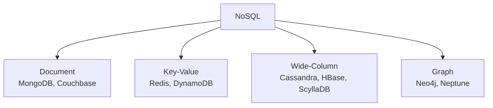
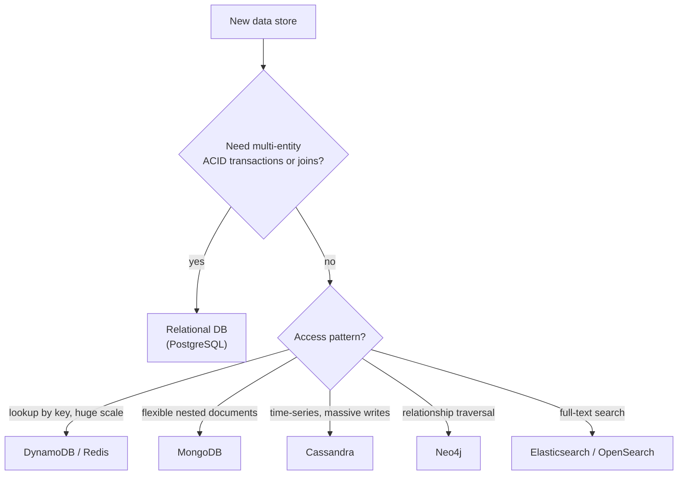
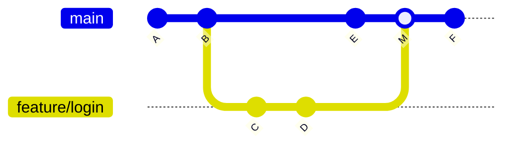

# Day 54 — NoSQL, SQL vs NoSQL & Git Workflows

> **How to use these notes:** the NoSQL half is about **choosing** — interviewers want to hear *why* you'd pick MongoDB, DynamoDB or Cassandra for a given access pattern, not syntax trivia. The Git half is about **working in a team**: branching, history hygiene and code reviews — expect "tell me about your team's workflow". 🚀 marks senior-level details.

**Today's goal:** name the four **NoSQL families** with use cases, model data in **MongoDB** (documents, aggregation, replica sets) and **DynamoDB** (keys, GSI/LSI, capacity, single-table design), make a reasoned **SQL vs NoSQL** decision, and explain **Git Flow vs trunk-based**, **rebase vs merge**, `cherry-pick`/`stash`/`bisect`, and good **code-review** practice.

<!-- topic: d54_t1 -->
## 🗃️ Databases — NoSQL & Tools

<!-- subtopic: d54_t1_s1 -->
### 1. NoSQL categories



| Family | Data model | Strengths | Typical use cases |
|---|---|---|---|
| **Document** | JSON-like documents with nested fields and arrays | Flexible schema, rich queries on fields, data read together is stored together | Product catalogues, user profiles, CMS content |
| **Key-Value** | Opaque value looked up by key | Extremely fast, simple, scales horizontally | Caches, sessions, carts, feature flags, high-scale lookups by id |
| **Wide-Column** | Rows grouped in partitions; columns sorted within a partition | Massive write throughput, multi-datacenter, time-series | IoT, logs, messaging history, activity feeds |
| **Graph** | Nodes and relationships with properties | Traversals over many hops are cheap | Social graphs, recommendations, fraud rings, network topology |

**What most NoSQL systems trade away:** joins, multi-row transactions (some now offer limited ones), and ad-hoc querying — in exchange for horizontal scale, flexible schemas and predictable latency **for the queries you designed for**.

<!-- subtopic: d54_t1_s2 -->
### 2. MongoDB — documents, BSON, aggregation, replica sets

| Concept | SQL equivalent |
|---|---|
| Database | Database |
| **Collection** | Table (no fixed schema) |
| **Document** (BSON) | Row — but nested objects and arrays allowed |
| `_id` | Primary key (ObjectId by default — includes a timestamp) |
| Embedding | A join you do at write time |
| `$lookup` | Left outer join (use sparingly) |

**BSON** = binary JSON with extra types (ObjectId, Date, Decimal128, binary); max document size **16 MB**.

**Modelling — embed or reference?**

```json
{
  "_id": "ord_1001",
  "customerId": "cus_42",
  "status": "PAID",
  "items": [
    { "sku": "BOOK-1", "qty": 2, "price": 499 },
    { "sku": "PEN-3",  "qty": 1, "price": 99 }
  ],
  "shipping": { "city": "Pune", "pin": "411001" },
  "createdAt": { "$date": "2026-11-02T10:15:00Z" }
}
```

| Embed when | Reference when |
|---|---|
| Data is read together (order + its items) | The related data is large or unbounded (a user's millions of events) |
| One-to-few, owned by the parent | Many-to-many, or shared by many parents |
| Updated together | Updated independently and often |

**Aggregation pipeline** — stages transform documents one after another:

```javascript
db.orders.aggregate([
  { $match: { status: "PAID", createdAt: { $gte: ISODate("2026-10-01") } } },   // WHERE (use an index)
  { $unwind: "$items" },                                                       // one doc per item
  { $group: { _id: "$items.sku",
              revenue: { $sum: { $multiply: ["$items.qty", "$items.price"] } },
              units:   { $sum: "$items.qty" } } },                             // GROUP BY
  { $sort: { revenue: -1 } },
  { $limit: 5 }
])
```

**Replica sets** — one **primary** takes writes, **secondaries** replicate the oplog; on primary failure an election picks a new primary (typically within ~10–12 s). Tune durability/consistency with **write concern** (`w: "majority"`) and **read preference / read concern**. **Sharding** spreads collections across shards by a **shard key** — pick a high-cardinality key that matches your queries, or every query becomes scatter-gather.

In Spring: `spring-boot-starter-data-mongodb`, `@Document`, `MongoRepository`, `MongoTemplate` for aggregations.

<!-- subtopic: d54_t1_s3 -->
### 3. DynamoDB — keys, GSI/LSI, capacity, single-table design

| Concept | Meaning |
|---|---|
| **Partition key (PK)** | Hashed to choose the storage partition; every query must specify it (except Scan) |
| **Sort key (SK)** | Orders items within a partition; enables range queries (`begins_with`, `between`) |
| Item size | Max **400 KB** |
| **GSI** (global secondary index) | Different PK/SK, any time, own capacity, **eventually consistent** |
| **LSI** (local secondary index) | Same PK, different SK, created **only at table creation**, supports strongly consistent reads, 10 GB per partition-key limit |
| Consistency | Eventually consistent reads by default; strongly consistent reads optional (not on GSIs) |
| Transactions | `TransactWriteItems` up to 100 items |
| Streams | Change data capture → Lambda (event-driven updates, replication) |

| Capacity mode | Use when |
|---|---|
| **On-demand** | Unpredictable or spiky traffic, new apps — pay per request |
| **Provisioned** (+ auto scaling) | Steady, predictable traffic — cheaper per request; reserved capacity possible |

**Single-table design** — model **access patterns first**, then store several entity types in one table with overloaded keys so one query fetches related items:

| PK | SK | Attributes |
|---|---|---|
| `CUSTOMER#42` | `PROFILE` | name, email |
| `CUSTOMER#42` | `ORDER#2026-11-01#1001` | status, total |
| `CUSTOMER#42` | `ORDER#2026-11-02#1002` | status, total |
| `ORDER#1001` | `ITEM#BOOK-1` | qty, price |

- "Customer with recent orders" → `Query PK = CUSTOMER#42` (one request).
- "Orders in November" → `Query PK = CUSTOMER#42 AND begins_with(SK, 'ORDER#2026-11')`.
- "Orders by status across customers" → a **GSI** with `PK = status`, `SK = createdAt`.

🚀 **Hot partitions:** all traffic on one partition key (e.g. `PK = "2026-11-02"` for every event today) throttles even with plenty of table capacity. Use high-cardinality keys or **write sharding** (append a random suffix 0–9 and query all ten).

<!-- subtopic: d54_t1_s4 -->
### 4. SQL vs NoSQL decision; polyglot persistence

| Question | Leans SQL (PostgreSQL/MySQL) | Leans NoSQL |
|---|---|---|
| Relationships & joins | Many entities, ad-hoc joins, reporting | Few, known access patterns |
| Consistency | Multi-row ACID transactions (money, inventory) | Eventual consistency acceptable, or per-item atomicity enough |
| Schema | Stable, well understood, enforced constraints | Evolving, heterogeneous, nested |
| Query patterns | Unknown / changing ad-hoc queries | Known up front, key-based |
| Scale | Vertical + read replicas covers most apps (very far!) | Massive write throughput, multi-region active-active |
| Team | SQL skills everywhere | Must design around access patterns |



**Polyglot persistence** — each service uses the store that fits its data: orders in PostgreSQL (transactions), product catalogue in MongoDB (flexible attributes), sessions and carts in Redis, search in OpenSearch, analytics in a warehouse. The cost: more systems to operate, and keeping them in sync (outbox/CDC events — Days 27–28).

> **Model answer:** "I default to PostgreSQL — it handles relational data, JSONB for flexible fields, and scales far with replicas and partitioning. I pick NoSQL when the access pattern clearly favours it: DynamoDB for key-based lookups at very high scale with predictable latency, Cassandra for heavy time-series writes, Redis for ephemeral fast data. The deciding questions are transactions, query flexibility and scale."

<!-- subtopic: d54_t1_s5 -->
### 5. Git branching: Git Flow vs trunk-based; rebase vs merge; cherry-pick, stash, bisect

| | **Git Flow** | **Trunk-based development** |
|---|---|---|
| Branches | `main`, `develop`, `feature/*`, `release/*`, `hotfix/*` | `main` + **short-lived** feature branches (hours to 1–2 days) |
| Releases | Scheduled, versioned | Continuous — main is always deployable |
| Unfinished work | Lives on long branches | Hidden behind **feature flags** |
| Merge pain | High (long-lived divergence) | Low (small, frequent merges) |
| Fits | Packaged/mobile software with release trains | Web services with CI/CD (most backend teams today) |



**Merge vs rebase:**

| | `git merge feature` | `git rebase main` (on feature) |
|---|---|---|
| History | Keeps the true history, adds a merge commit | Rewrites feature commits on top of main → linear history |
| Safety | Never rewrites shared history | **Never rebase commits others have pulled** |
| Use | Integrating into `main` (or squash-merge PRs) | Updating your own feature branch; cleaning up with `git rebase -i` before review |

```bash
# Update your feature branch with the latest main, linear history
git fetch origin
git rebase origin/main
# fix conflicts → git add <file> → git rebase --continue
git push --force-with-lease          # safer than --force: refuses if someone else pushed

git stash push -m "wip: half-done refactor"   # park uncommitted work
git switch hotfix/payment-npe
git stash pop                                  # bring it back later

git cherry-pick 3f2a91c              # copy one commit (e.g. a hotfix) onto the current branch

git bisect start
git bisect bad                       # current commit is broken
git bisect good v1.4.0               # this tag worked
# test each commit Git checks out, mark good/bad … Git finds the first bad commit in O(log n) steps
git bisect run ./gradlew test --tests OrderServiceTest   # or automate it
git bisect reset
```

| Command | When you use it |
|---|---|
| `git reflog` | Recover "lost" commits after a bad reset or rebase |
| `git revert <sha>` | Undo a commit on a **shared** branch with a new commit |
| `git reset --soft HEAD~1` | Undo your last local commit but keep the changes staged |
| `git commit --fixup <sha>` + `rebase -i --autosquash` | Tidy review fixes into the right commit |

<!-- subtopic: d54_t1_s6 -->
### 6. Code review best practices — PR size, feedback, conventional commits

**As an author:**

| Practice | Why |
|---|---|
| Small PRs (~200–400 changed lines) | Reviewers find more defects in small diffs; faster turnaround |
| One concern per PR | Refactor separately from behaviour changes |
| A description with **what / why / how to test**, screenshots, linked ticket | Reviewers understand intent before reading code |
| Self-review the diff first, CI green | Respect reviewers' time |
| Tests included | Proves the change and protects it |

**As a reviewer:**

| Practice | Example |
|---|---|
| Review the design first, style last | "Should this live in the service layer instead of the controller?" |
| Ask, don't command | "What happens if `items` is empty here?" instead of "This is wrong." |
| Label severity | `nit:`, `suggestion:`, `blocking:` |
| Explain why | "Using `orElseGet` avoids calling the DB when the value is present." |
| Let tools handle formatting | Spotless/Checkstyle, linters, SonarQube in CI |
| Approve when it's better than before | Perfect is the enemy of merged |

**Conventional Commits** — machine-readable messages that drive changelogs and semantic versioning:

```text
feat(orders): add idempotency key to POST /orders
fix(payment): retry on 503 from gateway with exponential backoff
refactor(user): extract address validation into AddressValidator
docs: describe local Kafka setup in README
feat(api)!: remove deprecated v1 endpoints

BREAKING CHANGE: clients must migrate to /api/v2
```

| Type | Version bump |
|---|---|
| `fix:` | patch (1.4.**1**) |
| `feat:` | minor (1.**5**.0) |
| `!` or `BREAKING CHANGE:` | major (**2**.0.0) |

---

## 📝 Day 54 Revision Cheat Sheet

| Topic | Key points |
|---|---|
| NoSQL families | Document (MongoDB), Key-Value (Redis/DynamoDB), Wide-Column (Cassandra), Graph (Neo4j) |
| MongoDB | Collections of BSON docs (16 MB), embed vs reference, aggregation `$match → $group → $sort`, replica sets, shard keys |
| DynamoDB | PK (+ SK), 400 KB items, GSI (any time, eventual) vs LSI (creation time, same PK), on-demand vs provisioned, single-table, hot partitions |
| SQL vs NoSQL | Transactions/joins/ad-hoc → SQL; known key access at huge scale → NoSQL; polyglot persistence |
| Branching | Git Flow for release trains; trunk-based + feature flags for CI/CD |
| Merge vs rebase | Merge keeps history; rebase linearises your own branch; `--force-with-lease` |
| Tools | stash, cherry-pick, bisect, reflog, revert |
| Reviews | Small PRs, clear description, ask-don't-command, severity labels, Conventional Commits |

<details><summary>Q1. When would you choose MongoDB over PostgreSQL?</summary>

When the data is naturally document-shaped with nested, varying attributes that are read and written together (product catalogues with different attributes per category, content), the schema evolves quickly, and you don't need multi-document joins or complex transactions. PostgreSQL with JSONB covers many of these cases too, so I'd want a clear access-pattern or scale reason.

</details>

<details><summary>Q2. GSI vs LSI in DynamoDB?</summary>

A GSI has its own partition and sort key, can be added any time, has separate capacity and only supports eventually consistent reads. An LSI keeps the table's partition key with a different sort key, must be defined at table creation, shares the table's capacity, supports strongly consistent reads and limits each partition key's data to 10 GB.

</details>

<details><summary>Q3. Merge or rebase?</summary>

Rebase my own unpublished feature branch onto main to keep a clean linear history and resolve conflicts commit by commit; never rebase shared commits others have based work on. Integrate into main with a merge or squash-merge through a pull request, which preserves what was reviewed.

</details>

<details><summary>Q4. How would you find which commit introduced a bug?</summary>

git bisect: mark a known bad commit and a known good one (a release tag); Git checks out the midpoint each step and I mark it good or bad, or automate with git bisect run and a failing test. It finds the first bad commit in about log2(n) steps.

</details>

<details><summary>Q5. What makes a good pull request?</summary>

Small and focused on one change, a clear description of what and why plus how to test it, tests included, CI green, self-reviewed before requesting review, and commits with meaningful messages (Conventional Commits). Reviewers focus on correctness and design and label nits separately.

</details>

### ⚡ Rapid-fire self-test

1. NoSQL family best for relationship traversal? → **Graph databases such as Neo4j**
2. Maximum MongoDB document size? → **16 MB**
3. MongoDB stage equivalent to SQL GROUP BY? → **$group**
4. Maximum DynamoDB item size? → **400 KB**
5. Which DynamoDB index must be created with the table? → **LSI (local secondary index)**
6. DynamoDB capacity mode for unpredictable traffic? → **On-demand**
7. Git workflow with short-lived branches and feature flags? → **Trunk-based development**
8. Safer alternative to git push --force? → **git push --force-with-lease**
9. Git command that binary-searches history for a bug? → **git bisect**
10. Conventional Commit type that bumps the minor version? → **feat**
