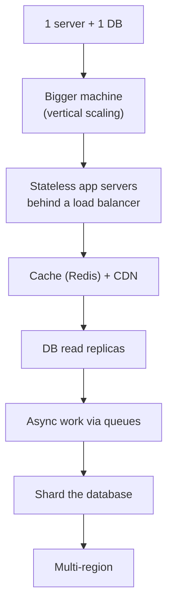
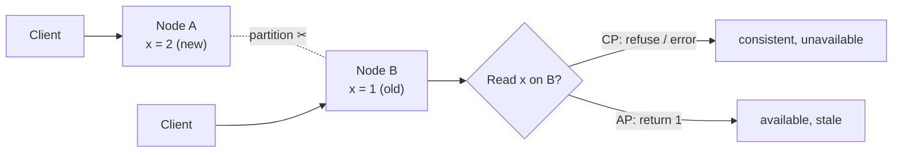
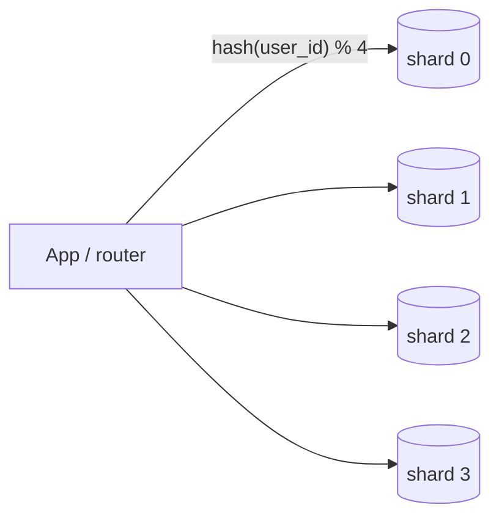
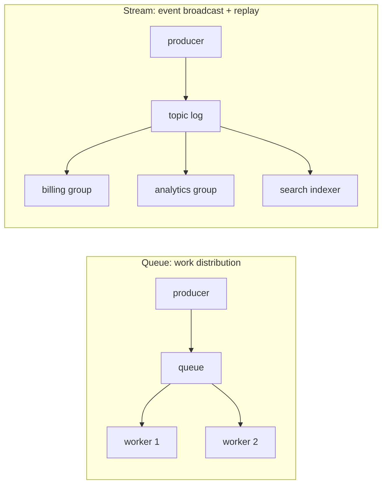
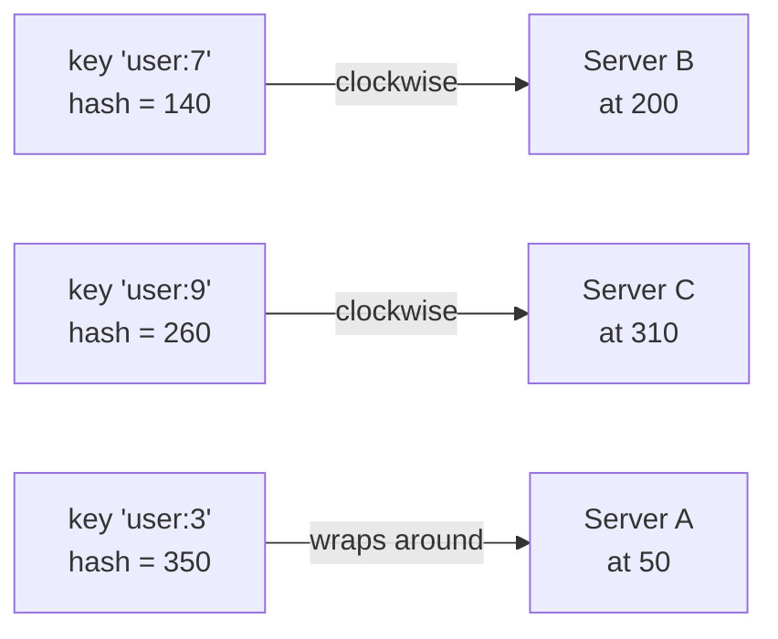
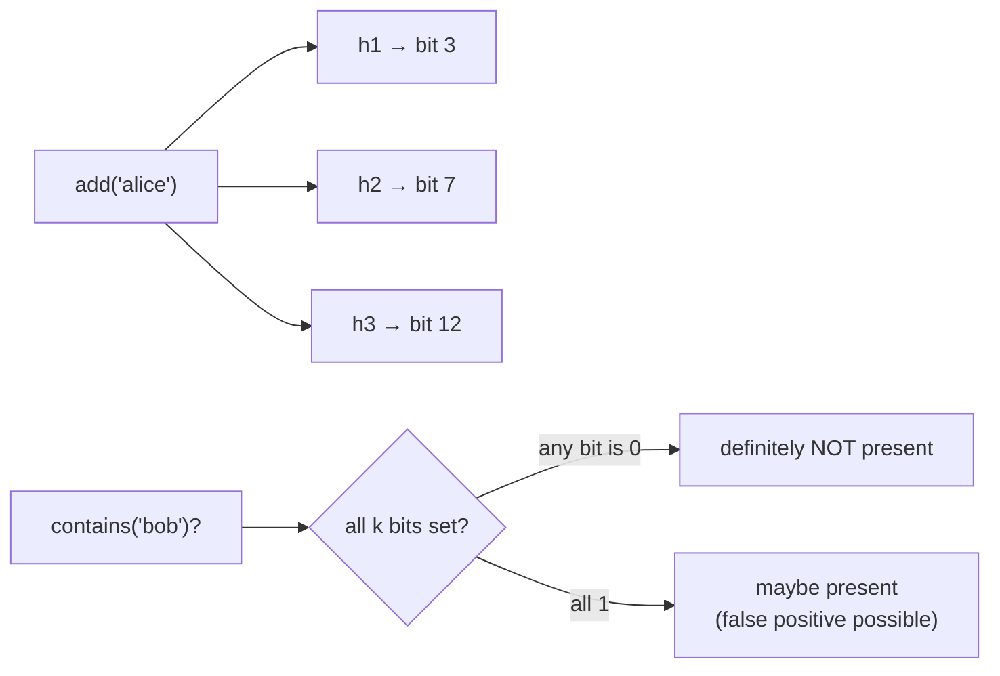

# Day 55 — System Design Fundamentals: Scalability, Caching & Load Balancing

> **How to use these notes:** these nine concepts are the **building blocks** of every high-level design answer (Day 57 and the Day 60 mock). For each, be able to give a one-line definition, **draw** it, and name a **real system** that uses it. Then finish the DP revision with two classic two-string DPs. 🚀 marks senior-level details.

**Today's goal:** explain **CAP/PACELC**, **vertical vs horizontal scaling**, **sharding** strategies, **caching** strategies and invalidation, the four **rate-limiting** algorithms, **load-balancing** algorithms, **queues vs event streams**, **consistent hashing** with virtual nodes, and **Bloom filters**. DSA: classic DPs from memory, **Interleaving String**, **Distinct Subsequences**, and a timed DP round.

**The scaling journey of a typical service:**



<!-- topic: d55_t1 -->
## 🏛️ HLD — System Design Concepts

<!-- subtopic: d55_t1_s1 -->
### 1. CAP theorem and PACELC

**CAP:** when a **network partition** happens, a distributed data store must choose between **Consistency** (every read sees the latest write, or errors) and **Availability** (every request gets a non-error response, possibly stale). Partition tolerance isn't optional in a real network — so the real choice is **CP vs AP during a partition**.



| Choice | Behaviour during a partition | Examples |
|---|---|---|
| **CP** | Rejects some requests to stay consistent | ZooKeeper, etcd, HBase, MongoDB (majority writes/reads), Spanner |
| **AP** | Answers everything, reconciles later | Cassandra, DynamoDB (default eventual reads), CouchDB, DNS |

**PACELC** extends it: if **P**artition → choose **A** or **C**; **E**lse (normal operation) → choose **L**atency or **C**onsistency. Cassandra/DynamoDB are **PA/EL** (favour availability and low latency); Spanner/HBase are **PC/EC**. It's more useful than CAP because partitions are rare, but the latency-vs-consistency trade-off is constant (synchronous replication is slower).

🚀 Many systems are **tunable**: Cassandra with `QUORUM` reads and writes (R + W > N) behaves consistently; with `ONE` it's fast and eventually consistent.

<!-- subtopic: d55_t1_s2 -->
### 2. Database scaling — vertical vs horizontal

| | **Vertical (scale up)** | **Horizontal (scale out)** |
|---|---|---|
| How | Bigger CPU/RAM/faster disks | More machines |
| Pros | No code changes, keeps ACID and joins simple | Near-linear growth, fault tolerance |
| Cons | Hardware ceiling, cost grows steeply, single point of failure | Distribution complexity: consistency, rebalancing, cross-node queries |

**Horizontal options for a relational DB, in the order you usually reach for them:**

| Technique | Scales | Trade-off |
|---|---|---|
| Query/index tuning, connection pooling | Everything | Engineering time — always first |
| **Caching** | Reads | Staleness, invalidation |
| **Read replicas** | Reads | Replication lag — read-your-writes issues |
| **Vertical partitioning** (split tables/services) | Writes per domain | Cross-domain joins move to the app |
| **Sharding** (horizontal partitioning across servers) | Reads **and** writes | Cross-shard queries/transactions, rebalancing, operational complexity |

<!-- subtopic: d55_t1_s3 -->
### 3. Sharding strategies

| Strategy | How a row finds its shard | Pros | Cons |
|---|---|---|---|
| **Range-based** | Key ranges (A–F, G–M…; or by date) | Range queries stay on one shard | **Hot spots** (all new rows hit the latest range) |
| **Hash-based** | `hash(key) % N` | Even distribution | Range queries hit all shards; changing N remaps almost everything (→ consistent hashing) |
| **Directory-based** | Lookup service maps key → shard | Flexible moves, per-tenant placement | Extra lookup hop; the directory must be highly available |
| **Geo / tenant** | By region or customer | Data residency, isolation | Uneven tenant sizes |



**Choosing a shard key:** high cardinality, even distribution, and **present in most queries** (e.g. `user_id` for a user-centric app). A query without the shard key becomes **scatter-gather** across every shard.

**Cross-shard challenges:** joins (denormalise or join in the app), transactions (avoid them; use sagas — Days 27–28), global unique ids (Snowflake-style or UUIDv7 instead of auto-increment), secondary indexes (global index tables), and **resharding** (consistent hashing, or many logical shards mapped onto fewer physical nodes).

<!-- subtopic: d55_t1_s4 -->
### 4. Caching — CDN, cache-aside, write-through, write-behind; invalidation

**Caching layers from the user inwards:**

| Layer | Caches | Example |
|---|---|---|
| Browser | Static files, API responses with `Cache-Control` | `max-age=31536000, immutable` for hashed assets |
| **CDN** | Static assets, images, cacheable API responses at the edge | CloudFront, Cloudflare |
| API gateway / reverse proxy | Whole responses | Nginx, Varnish |
| **Application cache** | Computed objects, DB rows | Redis, Caffeine (in-process) |
| Database | Buffer pool, query plans | PostgreSQL shared buffers |

| Strategy | Read path | Write path | Trade-off |
|---|---|---|---|
| **Cache-aside** | App checks cache → miss → DB → fill | Write DB, **delete** key | Most common; only caches what's used; brief staleness window |
| **Read-through** | Cache loads from DB itself | — | Simpler app code, needs cache-provider support |
| **Write-through** | — | Write cache and DB synchronously | Fresh cache, slower writes, caches unread data |
| **Write-behind** | — | Write cache, flush to DB async | Fast writes, risk of loss |

**Invalidation strategies:**

| Strategy | How |
|---|---|
| TTL | Every key expires (add jitter to avoid avalanches) |
| Explicit delete on write | After the DB commit (`@CacheEvict`) |
| Event-driven | Consume change events (CDC/Kafka) and evict in every service |
| Versioned keys | `product:42:v7` — bump the version, old keys age out |

🚀 **Race condition with cache-aside:** reader misses → reads old row → writer updates DB and deletes key → reader writes the **old** value into the cache. Mitigations: short TTLs, delete again after a small delay ("delayed double delete"), or update the cache from CDC events in commit order.

<!-- subtopic: d55_t1_s5 -->
### 5. Rate limiting — token bucket, leaky bucket, fixed window, sliding window log

| Algorithm | How it works | Bursts | Memory | Notes |
|---|---|---|---|---|
| **Token bucket** | Bucket of capacity B refills at r tokens/s; each request takes a token | Allows bursts up to B | O(1) per key | Most popular (AWS API Gateway, Stripe) |
| **Leaky bucket** | Requests enter a queue that drains at a fixed rate | Smooths output | O(queue) | Good for shaping traffic to a fragile downstream |
| **Fixed window counter** | Count per calendar window (per minute) | **2× burst at window edges** | O(1) | Simplest (`INCR` + `EXPIRE` in Redis) |
| **Sliding window log** | Store each request timestamp; count those in the last window | Exact | O(requests) | Accurate but memory-heavy |
| **Sliding window counter** | Weighted mix of current and previous window counts | Approximate, smooth | O(1) | Great accuracy/cost balance |

```java
// Token bucket (single node, thread-safe)
class TokenBucket {
    private final long capacity;
    private final double refillPerNano;
    private double tokens;
    private long lastRefill = System.nanoTime();

    TokenBucket(long capacity, double refillPerSecond) {
        this.capacity = capacity;
        this.refillPerNano = refillPerSecond / 1_000_000_000.0;
        this.tokens = capacity;
    }

    synchronized boolean tryAcquire() {
        long now = System.nanoTime();
        tokens = Math.min(capacity, tokens + (now - lastRefill) * refillPerNano);   // lazy refill
        lastRefill = now;
        if (tokens >= 1) { tokens -= 1; return true; }
        return false;                                                               // → HTTP 429
    }
}
```

For many servers, keep the state in **Redis** and update it atomically with a Lua script (Day 57 has the distributed version). Return `429 Too Many Requests` with a `Retry-After` header.

<!-- subtopic: d55_t1_s6 -->
### 6. Load balancing algorithms

| Algorithm | How | Good for |
|---|---|---|
| **Round robin** | Next server in turn | Identical servers, similar request costs |
| **Weighted round robin** | More turns for bigger servers | Mixed instance sizes, canary (5 % weight) |
| **Least connections** | Server with the fewest active connections | Long-lived or uneven requests (WebSockets, uploads) |
| **Least response time** | Fastest + fewest connections | Latency-sensitive APIs |
| **IP hash / consistent hashing** | Same client or key → same server | Sticky sessions, cache locality (route user 42 to the node caching user 42) |
| **Random with two choices** | Pick 2 at random, use the less loaded | Simple and surprisingly effective at scale |

| Layer | Sees | Example |
|---|---|---|
| L4 (transport) | IP + port | AWS NLB, HAProxy TCP mode |
| L7 (application) | HTTP path, headers, cookies | AWS ALB, Nginx, Envoy |

**Supporting features:** health checks (remove failing servers), connection draining during deploys, TLS termination. Keep app servers **stateless** (sessions in Redis/JWT) so any server can take any request.

<!-- subtopic: d55_t1_s7 -->
### 7. Message queues vs event streaming — SQS vs Kafka

| | **Message queue** (SQS, RabbitMQ) | **Event stream** (Kafka, Kinesis) |
|---|---|---|
| Model | Work items: each message processed by **one** consumer, then deleted | Append-only log: many consumer groups each read **every** event |
| Replay | No (once acked, gone) | Yes — rewind offsets within retention |
| Ordering | Best effort (FIFO queues per group) | Per partition |
| Scaling consumers | Add workers freely | Up to the number of partitions per group |
| Per-message routing / priority / delay | Strong (RabbitMQ exchanges, SQS delay) | Weak |
| Ops | SQS: zero; RabbitMQ: moderate | Higher (managed: MSK, Confluent Cloud) |



> **Rule of thumb:** "**Do this task**" → queue (send email, resize image, background job). "**This happened**" and several services care, or you need replay/audit → stream (OrderPlaced, PaymentCompleted, CDC events).

<!-- subtopic: d55_t1_s8 -->
### 8. Consistent hashing with virtual nodes

**Problem with `hash(key) % N`:** going from 4 to 5 servers changes the result for ~80 % of keys — a cache cluster would suddenly miss almost everything.

**Consistent hashing:** place servers on a **hash ring** (0 … 2³²−1). A key belongs to the **first server clockwise** from its hash. Adding or removing a server moves only the keys in **one arc** — about K/N keys.



**Virtual nodes:** each physical server gets many positions on the ring (e.g. 100–200 "vnodes"). This evens out the distribution, and when a server leaves, its load spreads across **many** servers instead of dumping onto one neighbour. Weighted vnodes let bigger machines take more keys.

```java
class ConsistentHashRing {
    private final TreeMap<Long, String> ring = new TreeMap<>();
    private final int vnodes;

    ConsistentHashRing(int vnodes) { this.vnodes = vnodes; }

    void addServer(String server) {
        for (int i = 0; i < vnodes; i++) ring.put(hash(server + "#" + i), server);
    }

    void removeServer(String server) {
        for (int i = 0; i < vnodes; i++) ring.remove(hash(server + "#" + i));
    }

    String serverFor(String key) {
        Map.Entry<Long, String> e = ring.ceilingEntry(hash(key));     // first node clockwise
        return (e != null ? e : ring.firstEntry()).getValue();        // wrap around
    }

    private long hash(String s) {                                     // use a well-mixed hash in production
        long h = 1125899906842597L;
        for (char c : s.toCharArray()) h = 31 * h + c;
        return h & 0xffffffffL;
    }
}
```

**Used by:** DynamoDB and Cassandra (partitioning), Akamai/CDNs, load balancers for cache affinity, memcached clients. **Redis Cluster** uses a related idea: **16,384 hash slots** (`CRC16(key) % 16384`) assigned to nodes, moved slot by slot when resharding.

<!-- subtopic: d55_t1_s9 -->
### 9. Bloom filters

A **Bloom filter** answers "is X in the set?" with **"definitely not"** or **"probably yes"** using very little memory: a bit array of m bits and k hash functions.



| Property | Detail |
|---|---|
| False negatives | **Never** |
| False positives | Yes — rate tunable via m and k (≈ 1 % with ~9.6 bits per item and k = 7) |
| Delete | Not supported (use a **counting** Bloom filter) |
| Memory | Tiny compared to storing the items |

**Uses:** avoid disk/DB lookups for keys that don't exist (Cassandra/RocksDB SSTables, HBase), **cache penetration** protection (Day 48), "username already taken?" pre-check, crawler "URL seen?", Medium's "already recommended" articles. In Java: Guava's `BloomFilter.create(Funnels.stringFunnel(UTF_8), 1_000_000, 0.01)`, or RedisBloom.

<!-- topic: d55_t2 -->
## 🧮 DSA — DP Final Revision

<!-- subtopic: d55_t2_s1 -->
### 10. From memory: Coin Change, House Robber, LIS, LCS, Edit Distance, Knapsack

Write each **without looking** (Day 42 has Coin Change, House Robber, LIS and LCS); check the recurrence table afterwards.

| Problem | State | Recurrence | Answer |
|---|---|---|---|
| Coin Change (322) | `dp[x]` min coins for x | `min(dp[x - c] + 1)` | `dp[amount]` or −1 |
| House Robber (198) | `dp[i]` best of first i houses | `max(dp[i-1], dp[i-2] + nums[i])` | `dp[n]` |
| LIS (300) | `dp[i]` LIS ending at i | `max(dp[j] + 1)` for `j < i`, `a[j] < a[i]` | max of dp (or patience sort O(n log n)) |
| LCS (1143) | `dp[i][j]` on prefixes | match → `dp[i-1][j-1] + 1`, else `max(up, left)` | `dp[m][n]` |
| **Edit Distance (72)** | `dp[i][j]` ops to turn `a[0..i)` into `b[0..j)` | match → `dp[i-1][j-1]`, else `1 + min(insert dp[i][j-1], delete dp[i-1][j], replace dp[i-1][j-1])` | `dp[m][n]` |
| 0/1 Knapsack | `dp[c]` best value with capacity c | `max(dp[c], dp[c-w] + v)`, **c descending** | `dp[C]` |

```java
// Edit Distance — the one most people forget the base cases of
public int minDistance(String a, String b) {
    int m = a.length(), n = b.length();
    int[][] dp = new int[m + 1][n + 1];
    for (int i = 0; i <= m; i++) dp[i][0] = i;          // delete everything
    for (int j = 0; j <= n; j++) dp[0][j] = j;          // insert everything
    for (int i = 1; i <= m; i++)
        for (int j = 1; j <= n; j++)
            dp[i][j] = a.charAt(i - 1) == b.charAt(j - 1)
                    ? dp[i - 1][j - 1]
                    : 1 + Math.min(dp[i - 1][j - 1], Math.min(dp[i - 1][j], dp[i][j - 1]));
    return dp[m][n];
}
```

<!-- subtopic: d55_t2_s2 -->
### 11. Interleaving String (LeetCode 97)

**Problem:** is `s3` formed by interleaving `s1` and `s2` while keeping each string's character order? `s1 = "aabcc"`, `s2 = "dbbca"`, `s3 = "aadbbcbcac"` → true.

**State:** `dp[i][j]` = can the first `i` chars of s1 and the first `j` chars of s2 form the first `i + j` chars of s3?

```java
public boolean isInterleave(String s1, String s2, String s3) {
    int m = s1.length(), n = s2.length();
    if (m + n != s3.length()) return false;
    boolean[] dp = new boolean[n + 1];                    // 1-D rolling row over j
    for (int i = 0; i <= m; i++) {
        for (int j = 0; j <= n; j++) {
            if (i == 0 && j == 0) dp[j] = true;
            else {
                char target = s3.charAt(i + j - 1);
                boolean fromS1 = i > 0 && dp[j] && s1.charAt(i - 1) == target;      // dp[j] is still row i-1
                boolean fromS2 = j > 0 && dp[j - 1] && s2.charAt(j - 1) == target;  // dp[j-1] is already row i
                dp[j] = fromS1 || fromS2;
            }
        }
    }
    return dp[n];
}
```

**Complexity:** O(m·n) time, O(n) space. **Common mistake:** a greedy two-pointer "take from whichever matches" fails when both strings match the next character — that branching is exactly why DP is needed.

<!-- subtopic: d55_t2_s3 -->
### 12. Distinct Subsequences (LeetCode 115 — Hard)

**Problem:** count how many distinct subsequences of `s` equal `t`. `s = "rabbbit"`, `t = "rabbit"` → 3 (choose which of the three b's to drop).

**State:** `dp[i][j]` = number of ways the first `i` chars of s can form the first `j` chars of t.

| Case | Transition |
|---|---|
| `s[i-1] == t[j-1]` | `dp[i-1][j-1]` (use this char) + `dp[i-1][j]` (skip it) |
| otherwise | `dp[i-1][j]` (must skip it) |
| Base | `dp[i][0] = 1` (empty t: one way — delete everything); `dp[0][j>0] = 0` |

```java
public int numDistinct(String s, String t) {
    int n = t.length();
    long[] dp = new long[n + 1];                           // dp[j] for the current prefix of s
    dp[0] = 1;
    for (int i = 1; i <= s.length(); i++) {
        for (int j = Math.min(i, n); j >= 1; j--) {        // right-to-left so dp[j-1] is still row i-1
            if (s.charAt(i - 1) == t.charAt(j - 1)) dp[j] += dp[j - 1];
        }
    }
    return (int) dp[n];
}
```

**Complexity:** O(|s|·|t|) time, O(|t|) space. The **right-to-left** inner loop is the same trick as 0/1 knapsack: it reads the previous row's values before overwriting them.

<!-- subtopic: d55_t2_s4 -->
### 13. Timed: 2 medium DP problems in 30 minutes

| Pair (pick one) | State hint (only peek if stuck after 5 min) |
|---|---|
| Word Break (139) + Decode Ways (91) | `dp[i]` = can/ways to build the prefix of length i |
| Unique Paths II (63) + Minimum Path Sum (64) | `dp[r][c]` from top and left |
| Partition Equal Subset Sum (416) + Target Sum (494) | 0/1 knapsack on sum (target = (total + S) / 2 for 494) |
| Longest Palindromic Subsequence (516) + Maximal Square (221) | Interval DP on `[i..j]` / `1 + min(three neighbours)` |

**For every DP, say the 4 steps out loud:** state → recurrence → base cases → iteration order; then mention the space optimisation.

---

## 📝 Day 55 Revision Cheat Sheet

| Concept | One-liner |
|---|---|
| CAP | During a partition choose C or A; PACELC adds latency vs consistency otherwise |
| Scaling | Tune → cache → replicas → split by domain → shard |
| Sharding | Range (hot spots), hash (even, no ranges), directory (flexible); shard key in most queries |
| Caching | CDN → app cache; cache-aside + delete on write; TTL with jitter; watch the stale-fill race |
| Rate limiting | Token bucket (bursts), leaky bucket (smooth), fixed window (edge bursts), sliding log (exact), sliding counter (balanced) |
| Load balancing | Round robin, weighted, least connections, consistent hashing; stateless servers |
| Queue vs stream | Task for one worker vs event for many groups with replay |
| Consistent hashing | Ring + clockwise owner; vnodes even out load; only ~K/N keys move |
| Bloom filter | No false negatives, tunable false positives, no delete |
| DP | Edit distance base cases; interleaving `dp[i][j]`; distinct subsequences right-to-left |

<details><summary>Q1. Explain the CAP theorem with examples.</summary>

In a distributed store, when a network partition separates nodes you must choose consistency (refuse or error rather than return stale data — ZooKeeper, etcd, MongoDB with majority concerns) or availability (keep answering, possibly stale, reconcile later — Cassandra, DynamoDB with eventual reads). PACELC adds that even without partitions you trade latency for consistency.

</details>

<details><summary>Q2. How would you shard a users table?</summary>

Hash-based sharding on user_id, because almost every query includes it and hashing spreads load evenly. Use consistent hashing or many logical shards mapped to fewer physical nodes so adding capacity moves little data. Generate globally unique ids, denormalise to avoid cross-shard joins, and route queries through a shard-aware data access layer.

</details>

<details><summary>Q3. Which rate-limiting algorithm would you choose?</summary>

Token bucket for most APIs — it enforces an average rate while allowing short bursts, needs O(1) state per key, and is easy to implement atomically in Redis. A sliding window counter if edge bursts of a fixed window are a problem; leaky bucket when the downstream needs a perfectly smooth rate.

</details>

<details><summary>Q4. Why use consistent hashing instead of modulo hashing?</summary>

With hash % N, changing the number of nodes remaps almost every key, which empties caches and forces massive data movement. With a hash ring each key goes to the next node clockwise, so adding or removing a node only moves the keys in its arc (about 1/N of them); virtual nodes keep the distribution even.

</details>

<details><summary>Q5. What is a Bloom filter good for?</summary>

Cheaply ruling out lookups for items that are definitely absent — skipping disk reads in LSM-tree databases, protecting a cache from requests for non-existent keys, or checking if a URL was already crawled — using a small bit array and k hashes. It may return false positives but never false negatives, and standard Bloom filters can't delete.

</details>

### ⚡ Rapid-fire self-test

1. Which CAP property can't be traded away in a real distributed system? → **Partition tolerance**
2. Cassandra and DynamoDB in PACELC terms? → **PA/EL — availability during partitions, low latency otherwise**
3. Main weakness of range-based sharding? → **Hot spots on the newest or busiest range**
4. Cache strategy that writes to cache and DB synchronously? → **Write-through**
5. Rate limiter that allows bursts up to its capacity? → **Token bucket**
6. Load-balancing algorithm for long-lived WebSocket connections? → **Least connections**
7. Queue or stream when several services must react to OrderPlaced and replay is needed? → **An event stream such as Kafka**
8. Why add virtual nodes to a hash ring? → **To even out the key distribution and spread load when a node leaves**
9. Can a Bloom filter return a false negative? → **No**
10. Edit Distance transition when characters differ? → **1 + min(insert, delete, replace)**
