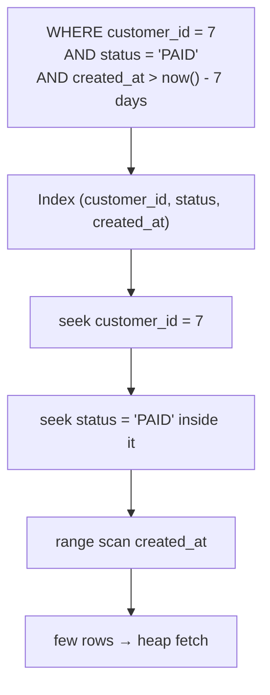
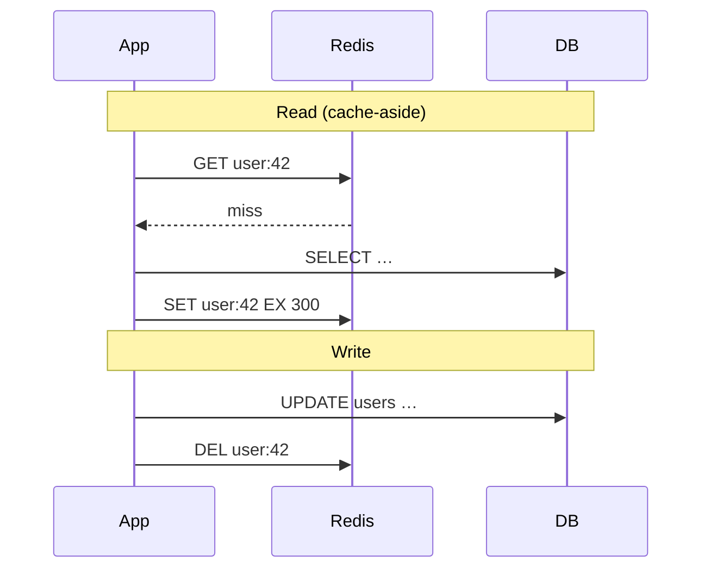
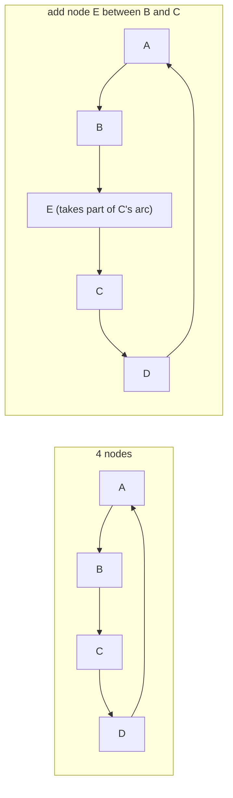

# Day 56 — Phase 7 Review: SQL + System Design Consolidation

> **How to use these notes:** a **closed-book** review. Write the SQL in an empty editor, explain each concept out loud in under 2 minutes with a drawing, and only then compare with the model answers. The DSA half is three classic backtracking/DP Hards plus a timed Hard. 🚀 marks senior-level details.

**Today's goal:** write the three classic window-function queries **without notes**; explain **B-tree indexes**, **composite column order** and **EXPLAIN**; explain **CAP** with real systems, **caching strategies** with Redis and **consistent hashing**; rapid-fire **isolation levels, MVCC and locking**. DSA: **N-Queens II**, **Sudoku Solver**, **Palindrome Partitioning II**, timed Hard.

| Block | Target |
|---|---|
| SQL from memory | All 3 queries correct in 15 min |
| 4 explanations | ≤ 2 min each, with a diagram |
| Rapid-fire | ≥ 12 / 15 |
| DSA | 3 Hards understood + 1 timed |

<!-- topic: d56_t1 -->
## 🔁 SQL & System Design — Review

<!-- subtopic: d56_t1_s1 -->
### 1. Write without notes: 2nd highest salary, running total, LAG comparison

Use the `employees` and `daily_sales` tables from Days 51–52. **Close this page, write all three, then check.**

```sql
-- 1. Second-highest salary in each department (ties included)
WITH ranked AS (
  SELECT dept_id, name, salary,
         DENSE_RANK() OVER (PARTITION BY dept_id ORDER BY salary DESC) AS rnk
  FROM employees
)
SELECT dept_id, name, salary FROM ranked WHERE rnk = 2;

-- 2. Running total of sales by date
SELECT sale_date, amount,
       SUM(amount) OVER (ORDER BY sale_date ROWS BETWEEN UNBOUNDED PRECEDING AND CURRENT ROW) AS running_total
FROM daily_sales;

-- 3. Day-over-day change with LAG
SELECT sale_date, amount,
       amount - LAG(amount) OVER (ORDER BY sale_date) AS change_vs_prev_day
FROM daily_sales;
```

**Self-check list:**

| ✔ | Detail |
|---|---|
| ☐ | Filtered the rank in an **outer** query (not in WHERE of the same level) |
| ☐ | Picked `DENSE_RANK` (ties) and can say when `ROW_NUMBER` is better |
| ☐ | Used an explicit `ROWS` frame for the running total |
| ☐ | Knows the first row's LAG is NULL and how to default it: `LAG(amount, 1, 0)` |
| ☐ | Could add `PARTITION BY` for "per department" / "per customer" variants |

<!-- subtopic: d56_t1_s2 -->
### 2. Explain: B-tree index, composite column order, reading EXPLAIN

> **Model answer (≈ 90 s):** "A B-tree index is a balanced tree whose leaves hold sorted keys with pointers to rows, and the leaves are linked. Finding a key costs O(log n) page reads — three or four levels cover millions of rows — and range scans just walk the leaves. For a composite index like `(customer_id, status, created_at)` the data is sorted by the first column, then the second within it, so a query can use it only for a **leftmost prefix**; I put equality columns first and the range or sort column last. To verify, I run `EXPLAIN ANALYZE` and read the plan inside-out: a Seq Scan with 'Rows Removed by Filter' in the millions tells me an index is missing; an Index Scan or Index Only Scan with matching estimated and actual rows tells me it's fine. Large estimate mismatches mean stale statistics — run ANALYZE."



**Follow-ups to prepare:** "Why not index every column?" (write cost, storage, planner confusion), "Why is my index not used?" (function on column, low selectivity, type mismatch, leading wildcard, stale stats), "What's a covering index?" (`INCLUDE` columns → Index Only Scan).

<!-- subtopic: d56_t1_s3 -->
### 3. Explain: CAP theorem with examples (ZooKeeper CP, Cassandra AP, MongoDB CP)

> **Model answer:** "CAP says that when the network partitions, a distributed store has to give up either consistency or availability. **ZooKeeper** is CP: writes need a quorum, so servers on the minority side of a partition stop serving requests (unless the optional read-only mode is on) — that's why it's used for leader election and config, where correctness matters more than uptime. **Cassandra** is AP: any replica accepts writes, conflicts are resolved by last-write-wins timestamps, and repair/hinted handoff reconcile later — great for always-on writes like messaging history. **MongoDB** with majority write concern is CP: only the primary accepts writes, and if a primary loses the majority it steps down, so that side becomes unavailable for writes until a new primary is elected. Many systems are tunable — Cassandra at QUORUM behaves much more consistently."

| System | Type | Mechanism |
|---|---|---|
| ZooKeeper / etcd | CP | Quorum (ZAB / Raft) — minority can't commit |
| HBase | CP | Single region server owns each region |
| MongoDB (majority) | CP | Single primary per replica set, elections |
| Cassandra | AP (tunable) | Leaderless replicas, consistency level per query |
| DynamoDB | AP by default | Eventually consistent reads; strongly consistent reads optional |
| Couchbase / Riak | AP | Multi-master with conflict resolution |

<!-- subtopic: d56_t1_s4 -->
### 4. Explain: caching strategies (cache-aside, write-through) with Redis

> **Model answer:** "With **cache-aside** the application owns the logic: read Redis first, on a miss read the database and `SET` the value with a TTL; on a write, update the database and then **delete** the key, so the next read reloads it. It only caches what's actually read and survives a Redis outage by falling back to the database. With **write-through** every write updates the cache and the database together, so reads are always fresh but writes are slower and you cache data nobody reads. I default to cache-aside with TTLs plus jitter, protect hot keys from stampedes with a lock or early refresh, and cache 'not found' briefly against penetration."



| Question | Answer |
|---|---|
| Why delete instead of update on write? | Concurrent writes could leave the cache with an older value; deleting is idempotent |
| What do you cache? | Read-heavy, expensive, tolerant of short staleness: product pages, user profiles, config |
| What don't you cache? | Rapidly changing balances/inventory needing strong consistency (or cache with very short TTL) |
| Eviction policy? | Redis `allkeys-lru` / `allkeys-lfu` with `maxmemory` |

<!-- subtopic: d56_t1_s5 -->
### 5. Explain: consistent hashing with virtual nodes

> **Model answer:** "With modulo hashing, adding a fifth cache node remaps around 80 % of keys. Consistent hashing places nodes on a ring of hash values; a key is owned by the first node clockwise from its hash, so adding or removing a node only moves the keys in one arc — roughly 1/N. With only a few physical positions the arcs are uneven, so each node gets many **virtual nodes** scattered around the ring; that balances load, lets bigger machines take more vnodes, and when a node dies its keys spread across many survivors instead of overloading one neighbour. DynamoDB and Cassandra partition data this way; Redis Cluster uses 16,384 hash slots, the same idea in a fixed-size form."



Be ready to sketch the `TreeMap.ceilingEntry` implementation from Day 55.

<!-- subtopic: d56_t1_s6 -->
### 6. Rapid-fire: isolation levels, MVCC, optimistic vs pessimistic locking

| # | Question | Answer |
|---|---|---|
| 1 | Dirty read | Reading another transaction's uncommitted data |
| 2 | Non-repeatable read | Same row read twice, different values (someone committed an update) |
| 3 | Phantom read | Same range query twice, new rows appear |
| 4 | Lowest level preventing dirty reads | Read Committed |
| 5 | PostgreSQL default level | Read Committed |
| 6 | MySQL InnoDB default level | Repeatable Read |
| 7 | What must the app do at Serializable? | Retry transactions aborted with serialization failures |
| 8 | MVCC in one line | Writers create new row versions; readers use a snapshot — no read locks |
| 9 | Why does a long-running transaction hurt PostgreSQL? | VACUUM can't remove dead tuples newer than its snapshot → bloat |
| 10 | Optimistic locking mechanism | Version column checked in `UPDATE … WHERE version = ?` (JPA `@Version`) |
| 11 | Exception on JPA optimistic conflict | `OptimisticLockException` (Spring: `ObjectOptimisticLockingFailureException`) |
| 12 | Pessimistic lock in SQL | `SELECT … FOR UPDATE` |
| 13 | Skip rows locked by others (job queues) | `FOR UPDATE SKIP LOCKED` |
| 14 | Prevent lost update without locks or versions | Atomic `UPDATE … SET stock = stock - 1 WHERE stock > 0` |
| 15 | Deadlock between two transactions | DB detects it and aborts one — lock rows in a consistent order, retry |

<!-- topic: d56_t2 -->
## 🧮 DSA — Final Hard Practice

<!-- subtopic: d56_t2_s1 -->
### 7. N-Queens II (LeetCode 52 — Hard)

**Problem:** count the ways to place n queens on an n×n board so none attack each other.

**Backtracking row by row** — one queen per row; track used columns and both diagonals. On a diagonal `row - col` is constant; on an anti-diagonal `row + col` is constant.

```java
public int totalNQueens(int n) {
    return place(0, n, new boolean[n], new boolean[2 * n], new boolean[2 * n]);
}

private int place(int row, int n, boolean[] cols, boolean[] diag, boolean[] anti) {
    if (row == n) return 1;                                   // all queens placed
    int count = 0;
    for (int c = 0; c < n; c++) {
        int d = row - c + n, a = row + c;                     // +n keeps the index non-negative
        if (cols[c] || diag[d] || anti[a]) continue;
        cols[c] = diag[d] = anti[a] = true;                   // choose
        count += place(row + 1, n, cols, diag, anti);         // explore
        cols[c] = diag[d] = anti[a] = false;                  // un-choose
    }
    return count;
}
```

**Complexity:** O(n!) worst case with heavy pruning; n = 8 → 92 solutions. 🚀 **Bitmask version:** keep `cols`, `diag`, `anti` as ints and get free positions with `~(cols | diag | anti) & ((1 << n) - 1)`, shifting the diagonal masks each row — much faster.

<!-- subtopic: d56_t2_s2 -->
### 8. Sudoku Solver (LeetCode 37 — Hard)

**Backtracking:** find an empty cell, try digits 1–9 that don't conflict in its row, column and 3×3 box, recurse, undo on failure. Precomputed boolean tables make each validity check O(1).

```java
private final boolean[][] row = new boolean[9][10], col = new boolean[9][10], box = new boolean[9][10];

public void solveSudoku(char[][] board) {
    for (int r = 0; r < 9; r++)
        for (int c = 0; c < 9; c++)
            if (board[r][c] != '.') mark(r, c, board[r][c] - '0', true);
    solve(board, 0);
}

private boolean solve(char[][] board, int cell) {
    if (cell == 81) return true;                               // filled every cell
    int r = cell / 9, c = cell % 9;
    if (board[r][c] != '.') return solve(board, cell + 1);
    for (int d = 1; d <= 9; d++) {
        if (row[r][d] || col[c][d] || box[(r / 3) * 3 + c / 3][d]) continue;
        board[r][c] = (char) ('0' + d);
        mark(r, c, d, true);
        if (solve(board, cell + 1)) return true;               // stop at the first solution
        mark(r, c, d, false);
        board[r][c] = '.';
    }
    return false;                                              // dead end → backtrack
}

private void mark(int r, int c, int d, boolean used) {
    row[r][d] = col[c][d] = box[(r / 3) * 3 + c / 3][d] = used;
}
```

**Box index:** `(r / 3) * 3 + c / 3` numbers the boxes 0–8. 🚀 **Speed-up:** always fill the empty cell with the **fewest** candidates next (minimum remaining values heuristic) — prunes the search tree dramatically.

<!-- subtopic: d56_t2_s3 -->
### 9. Palindrome Partitioning II (LeetCode 132 — Hard)

**Problem:** minimum cuts so every part of `s` is a palindrome. `"aab"` → 1 (`"aa" | "b"`).

**Two DPs:**

1. `isPal[i][j]` — is `s[i..j]` a palindrome? `s[i] == s[j] && (j - i < 2 || isPal[i+1][j-1])`.
2. `cuts[j]` — min cuts for `s[0..j]`: 0 if `s[0..j]` is a palindrome, else `min(cuts[i-1] + 1)` over every `i` where `s[i..j]` is a palindrome.

```java
public int minCut(String s) {
    int n = s.length();
    boolean[][] isPal = new boolean[n][n];
    int[] cuts = new int[n];
    for (int j = 0; j < n; j++) {
        int best = j;                                          // worst case: cut before every char
        for (int i = 0; i <= j; i++) {
            if (s.charAt(i) == s.charAt(j) && (j - i < 2 || isPal[i + 1][j - 1])) {
                isPal[i][j] = true;
                best = i == 0 ? 0 : Math.min(best, cuts[i - 1] + 1);
            }
        }
        cuts[j] = best;
    }
    return cuts[n - 1];
}
```

**Complexity:** O(n²) time and space. Iterating `j` outward and `i` from 0 guarantees `isPal[i+1][j-1]` was already computed (it belongs to an earlier `j`). Compare with **Palindrome Partitioning I** (131), which lists all partitions with backtracking.

<!-- subtopic: d56_t2_s4 -->
### 10. Timed: 1 Hard in 40 minutes

Pick one you haven't solved: *Trapping Rain Water (42)*, *Minimum Window Substring (76)*, *Word Ladder (127)*, *Longest Valid Parentheses (32)*, *Burst Balloons (312)*.

| Minute | Checkpoint |
|---|---|
| 5 | Examples written, constraints known |
| 12 | Brute force stated with complexity, optimisation idea named |
| 30 | Code complete |
| 37 | Dry run done, bugs fixed |
| 40 | Complexity + one follow-up discussed |

**Post-mortem (2 lines):** what slowed you down, and which template or insight would have saved the most time. Log it with the 📝 button so it comes back on the Revise page.

---

## 📝 Day 56 Revision Cheat Sheet

| Topic | Must-say points |
|---|---|
| SQL classics | DENSE_RANK in a CTE; SUM OVER with ROWS frame; LAG with default |
| Indexes | B-tree O(log n), leftmost prefix, equality then range, EXPLAIN inside-out, estimates vs actuals |
| CAP | ZooKeeper CP (quorum), Cassandra AP (tunable), MongoDB CP (single primary) |
| Caching | Cache-aside + delete on write + TTL; write-through always fresh; stampede/penetration fixes |
| Consistent hashing | Ring, clockwise owner, ~1/N keys move, vnodes balance |
| Concurrency | RC vs RR vs Serializable; MVCC snapshots; @Version vs FOR UPDATE; SKIP LOCKED |
| N-Queens | Columns + `row − col` + `row + col` sets |
| Sudoku | Row/col/box tables, box = (r/3)*3 + c/3, MRV heuristic |
| Palindrome cuts | isPal table + cuts[j] = min(cuts[i−1] + 1) |

<details><summary>Q1. Why does a composite index on (a, b) not help a query filtering only on b?</summary>

The index is sorted by a first and by b only within each a, so rows with a given b are scattered across the whole index. The database can only seek on a leftmost prefix of the index columns; for b alone it would have to scan everything (some databases do a skip scan when a has few distinct values).

</details>

<details><summary>Q2. Is MongoDB CP or AP?</summary>

With its default majority write concern and reads from the primary, it behaves as CP: each replica set has one primary, and a primary that loses contact with the majority steps down, so the minority side can't accept writes. Reading from secondaries or using weaker write concerns trades that consistency for availability or latency.

</details>

<details><summary>Q3. When would you use SELECT ... FOR UPDATE SKIP LOCKED?</summary>

For a database-backed job queue: several workers each select the next pending jobs with FOR UPDATE SKIP LOCKED, so each worker locks different rows and nobody waits on rows another worker already claimed.

</details>

<details><summary>Q4. How do the diagonals work in N-Queens?</summary>

Cells on the same top-left to bottom-right diagonal share the value row − col, and cells on the same anti-diagonal share row + col. Tracking used columns, used row − col values (offset by n) and used row + col values lets each placement check run in O(1).

</details>

### ⚡ Rapid-fire self-test

1. Ranking function for "second highest including ties"? → **DENSE_RANK()**
2. LAG with a default of 0 for the first row? → **LAG(amount, 1, 0)**
3. Which column goes last in a composite index? → **The range or sort column**
4. CAP classification of ZooKeeper? → **CP**
5. CAP classification of Cassandra by default? → **AP (tunable per query)**
6. On a write with cache-aside, update or delete the cache key? → **Delete it**
7. Fraction of keys moved when adding a node with consistent hashing? → **About 1/N**
8. Lock clause for worker job queues in SQL? → **FOR UPDATE SKIP LOCKED**
9. Sudoku box index for cell (r, c)? → **(r / 3) * 3 + c / 3**
10. N-Queens anti-diagonal key? → **row + col**
