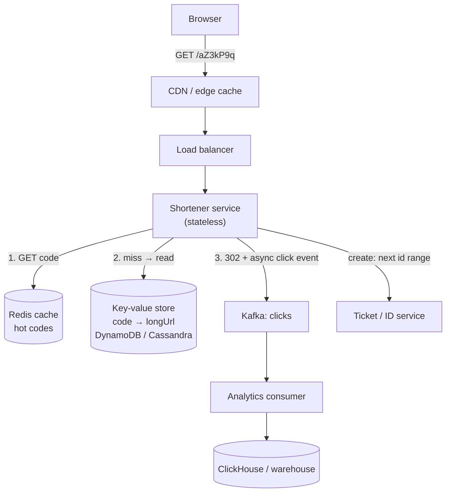
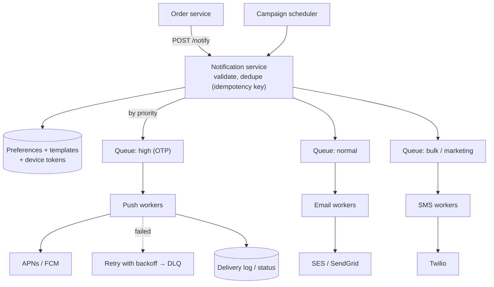
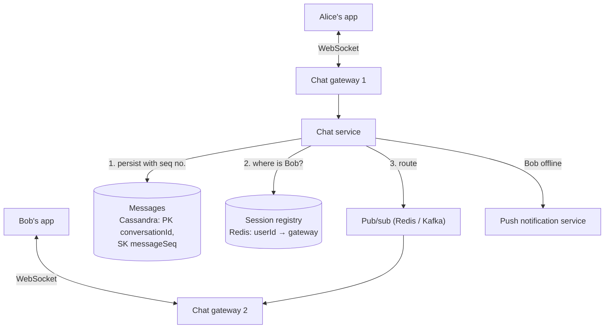
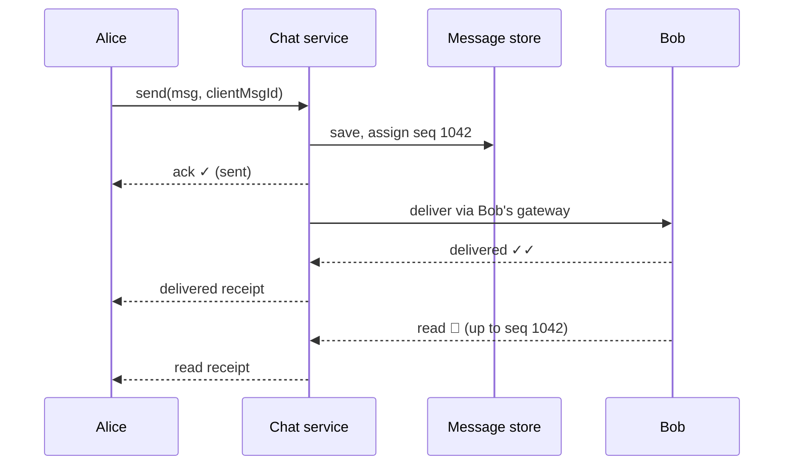
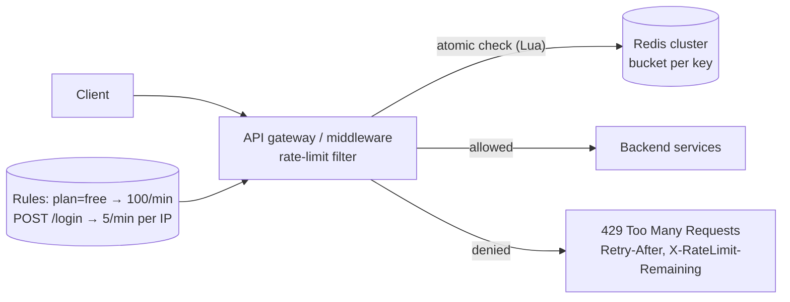
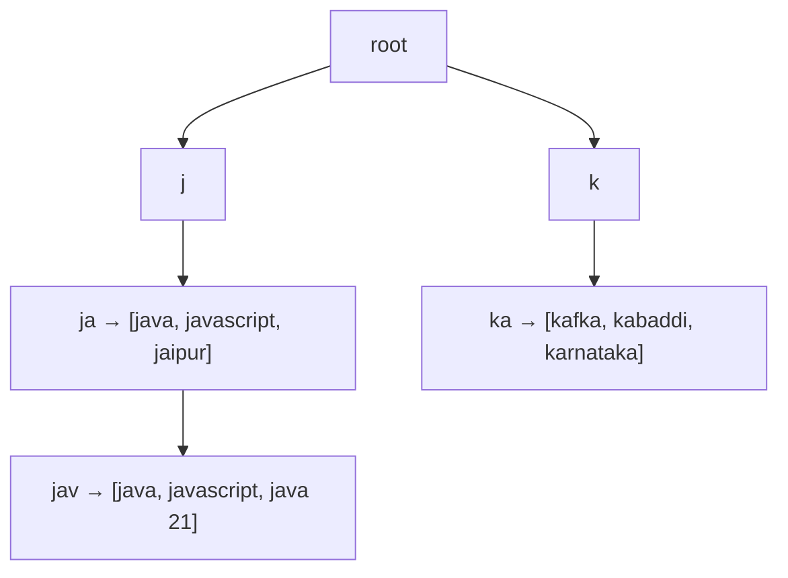
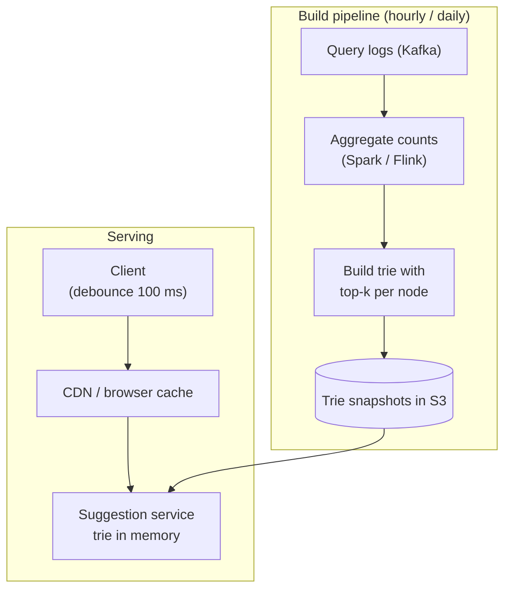
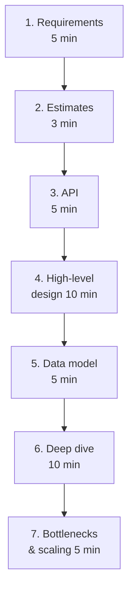

# Day 57 — System Design Practice: URL Shortener, Chat, Notification

> **How to use these notes:** for each problem, set a **35-minute timer**, design it yourself on paper using the framework in section 6, *then* read the reference design. Your design doesn't have to match — what matters is that you cover requirements, estimates, APIs, data model, the core flow and the bottlenecks, and can **defend trade-offs**. 🚀 marks senior-level details.

**Today's goal:** design the five most-asked HLD problems — **URL shortener, notification system, chat, rate limiter, search autocomplete** — using one repeatable **framework**, and draw clean diagrams with **data-flow annotations**.

> Section 6 (the framework) is the method for all the others — read it first if you haven't done an HLD interview before.

<!-- topic: d57_t1 -->
## 🏛️ HLD — Practice Problems (By Interview Frequency)

<!-- subtopic: d57_t1_s1 -->
### 1. Design a URL Shortener (TinyURL / bit.ly)

**Requirements**

| Functional | Non-functional |
|---|---|
| Create a short link for a long URL (optional custom alias, expiry) | Redirects very fast (p99 < 50 ms) and highly available |
| Redirect short → long | Read-heavy: ~100 reads per write |
| Basic click analytics | Short codes unpredictable, links durable |

**Estimates:** 100 M new links/month ≈ 40 writes/s; 100:1 → ~4,000 redirects/s (peaks ×5 = 20 K/s). 5 years × 1.2 B/year = 6 B links × ~500 bytes ≈ **3 TB**. **Code length:** base62 with 7 chars = 62⁷ ≈ **3.5 trillion** codes — plenty.

**API**

```text
POST /api/v1/urls        { "longUrl": "...", "alias": "optional", "expiresAt": "optional" }  → 201 { "shortUrl": "https://sho.rt/aZ3kP9q" }
GET  /{code}             → 302 Location: <longUrl>   (404 if unknown, 410 if expired)
GET  /api/v1/urls/{code}/stats
```

**Generating the code — options:**

| Approach | How | Pros | Cons |
|---|---|---|---|
| Hash + truncate | `base62(md5(longUrl))[0..7]` | Same URL → same code | **Collisions** — check and retry with a salt |
| **Counter + base62** | Unique id (e.g. from a ticket service handing out ranges of 1,000 ids per app server) → base62 | No collisions, short, fast | Sequential codes are guessable → shuffle/encrypt the id (e.g. a Feistel cipher) |
| Pre-generated keys (KGS) | Offline service fills a table of unused random codes; app servers take batches | No runtime collisions | Extra service to run |

```java
static final String ALPHABET = "0123456789abcdefghijklmnopqrstuvwxyzABCDEFGHIJKLMNOPQRSTUVWXYZ";

static String toBase62(long id) {
    StringBuilder sb = new StringBuilder();
    do { sb.append(ALPHABET.charAt((int) (id % 62))); id /= 62; } while (id > 0);
    return sb.reverse().toString();
}
```

**High-level design**



**Key decisions to defend**

| Decision | Choice and reason |
|---|---|
| **301 vs 302** | 301 (permanent) is cached by browsers → fewer hits but **no analytics** and can't change the target. Use **302** (or 307) when you need click tracking or editable links |
| Database | Simple key lookups at huge scale → **DynamoDB/Cassandra** (partition key = code); PostgreSQL also works at this size with caching |
| Cache | Redis/CDN for hot links (Zipf distribution: a few links get most clicks), LRU eviction |
| Analytics | Never block the redirect — publish a click event asynchronously and aggregate later |
| Abuse | Rate-limit creation per user/IP, scan URLs for malware/phishing, expire unused links |

<!-- subtopic: d57_t1_s2 -->
### 2. Design a Notification System

**Requirements:** send notifications via **push (iOS/Android), SMS, email, in-app**; triggered by services (order shipped) or campaigns; respect **user preferences** and quiet hours; **priorities** (OTP now, marketing later); rate limits; delivery tracking; no duplicates.

**Estimates:** 10 M users; 50 M notifications/day ≈ 600/s average, campaign peaks 50×.



| Concern | Design |
|---|---|
| Fan-out | A campaign to 10 M users: a scheduler splits recipients into batches and enqueues them; workers scale horizontally |
| **Push vs pull** | Push to devices via APNs/FCM; the in-app inbox is **pull** (client fetches unread notifications) plus WebSocket for live badges |
| Priorities | Separate queues/topics per priority so a marketing blast never delays OTPs |
| Preferences | Check opt-outs, channel preferences and quiet hours **before** sending (and timezone) |
| Rate limiting | Per user (max N marketing messages/day) and per provider (respect SMS/email provider limits) |
| Reliability | At-least-once queues + **idempotency key** per (event, user, channel) to avoid duplicates; retries with exponential backoff; DLQ |
| Templates | Stored templates with variables and localisation; render in the worker |
| Tracking | Status per message: queued → sent → delivered → opened/clicked (provider webhooks) |

<!-- subtopic: d57_t1_s3 -->
### 3. Design a Chat Application (WhatsApp / Slack)

**Requirements:** 1-to-1 and group chat, online/offline **presence**, **delivery receipts** (sent ✓, delivered ✓✓, read 🔵), message history, works across devices, offline users get messages later. **Non-functional:** low latency (< 200 ms), messages never lost, ordered within a conversation.

**Why WebSockets:** HTTP polling wastes requests and adds latency; long polling is better; **WebSocket** keeps one persistent bidirectional connection per device so the server can push instantly.



**Message flow (Alice → Bob):**



| Problem | Solution |
|---|---|
| **Ordering** | Per-conversation sequence number assigned by the server (or a per-conversation Kafka partition); clients sort by seq, not by device clock |
| **Duplicates** on retry | Client-generated `clientMsgId`; server dedupes |
| **Offline users** | Message is stored; push notification sent; on reconnect the client syncs "everything after my last seq" |
| **Presence** | Heartbeat every ~30 s → Redis key with TTL; publish changes only to friends/contacts who are online (fan-out is expensive in big groups) |
| **Group chat** | Small groups: fan out to each member's gateway; large channels: members pull from the channel log |
| **Storage** | Write-heavy, time-ordered, partitioned by conversation → Cassandra/HBase/ScyllaDB; media in S3 with links in messages |
| **Scaling gateways** | Gateways are stateful (connections) → a session registry maps user → gateway; reconnect with backoff after a gateway dies |

🚀 **End-to-end encryption** (Signal protocol) means the server stores only ciphertext — mention it as a follow-up; it changes search and multi-device sync.

<!-- subtopic: d57_t1_s4 -->
### 4. Design a Rate Limiter

**Requirements:** limit requests **per user, per API key, per IP, per endpoint and globally**; distributed across many API servers; low overhead (< 1–2 ms); configurable rules; return `429` with `Retry-After`; fail **open** if the limiter store is down (usually).



**Token bucket in Redis, atomic with Lua** (one round trip, no race between read and write):

```text
-- KEYS[1] = bucket key, ARGV = capacity, refill_per_sec, now_ms
local b = redis.call('HMGET', KEYS[1], 'tokens', 'ts')
local capacity, rate, now = tonumber(ARGV[1]), tonumber(ARGV[2]), tonumber(ARGV[3])
local tokens = tonumber(b[1]) or capacity
local ts = tonumber(b[2]) or now
tokens = math.min(capacity, tokens + (now - ts) / 1000 * rate)
local allowed = tokens >= 1
if allowed then tokens = tokens - 1 end
redis.call('HSET', KEYS[1], 'tokens', tokens, 'ts', now)
redis.call('PEXPIRE', KEYS[1], math.ceil(capacity / rate * 1000))
return allowed and 1 or 0
```

| Decision | Choice |
|---|---|
| Algorithm | Token bucket (bursts OK) or sliding-window counter (smooth) — Day 55 |
| Where | API gateway / edge for coarse limits; in-service for business limits (e.g. 3 OTPs per hour) |
| Keys | `rl:{userId}:{endpoint}`, `rl:ip:{ip}`; layered rules evaluated together |
| Store | Redis (fast, TTLs, atomic scripts); local in-memory buckets for a first, cheaper layer |
| Failure | Fail open (allow) for normal APIs; fail closed for sensitive ones (login, payments) |
| Distributed accuracy | Slight over-admission is acceptable; for strictness keep each key on one Redis shard |

In Spring: Bucket4j with a Redis backend, or Spring Cloud Gateway's `RequestRateLimiter` filter (Redis token bucket built in). Resilience4j `RateLimiter` limits **outgoing** calls from your service.

<!-- subtopic: d57_t1_s5 -->
### 5. Design Search Autocomplete (typeahead)

**Requirements:** as the user types, return the **top 5–10 suggestions** for the prefix within ~100 ms, ranked by popularity (optionally personalised and fresh); ~10 B queries/day ≈ 100 K+ requests/s at peak (each keystroke is a request).

**Data structure:** a **Trie** where each node stores the **top-k completions** for that prefix, precomputed — a lookup is O(prefix length), no subtree walk at query time.





| Concern | Design |
|---|---|
| Ranking | Count of searches with time decay (recent trends weigh more); filter offensive terms |
| Freshness | Rebuild the trie periodically; a small real-time layer for trending terms |
| Latency | Trie in memory on each server; cache popular prefixes at the CDN/browser; client debouncing |
| Scale | Shard the trie by first character(s) or prefix ranges; replicate shards |
| Personalisation | Merge global suggestions with the user's recent searches client-side or in the service |
| Alternative | Elasticsearch/OpenSearch `completion` suggester or edge n-grams when you don't want to build tries |

<!-- subtopic: d57_t1_s6 -->
### 6. The system design framework



| Step | What to do | Phrases |
|---|---|---|
| 1. Requirements | Functional (3–5 core features), non-functional (scale, latency, availability, consistency), out of scope | "Should I focus on X or also Y?" |
| 2. Estimates | DAU, QPS (avg and peak), storage per year, read/write ratio, bandwidth | "That's read-heavy, so caching matters most" |
| 3. API | REST/gRPC endpoints with key params and responses; pagination; idempotency keys | "POST /orders with an Idempotency-Key header" |
| 4. High-level design | Clients → LB → services → cache/DB/queue; walk one request end to end | "Let me trace a redirect through this" |
| 5. Data model | Entities, keys, SQL vs NoSQL with a reason, indexes, partition key | "Partition by conversationId so a chat's history is one query" |
| 6. Deep dive | The hardest component the interviewer cares about (ID generation, fan-out, ordering) | "Two options here… I'd pick … because …" |
| 7. Bottlenecks | Single points of failure, hot keys, scaling each tier, monitoring, failure modes | "If Redis goes down we fall back to the DB, with a rate limit to protect it" |

**Numbers worth knowing:** 1 day ≈ 86,400 s (≈ 10⁵); 1 M requests/day ≈ 12/s; memory read ~100 ns, SSD random read ~100 µs, same-region round trip ~0.5–1 ms, cross-continent ~100–150 ms; a single PostgreSQL instance handles thousands of simple queries/s; Redis ~100 K ops/s per node.

<!-- subtopic: d57_t1_s7 -->
### 7. Practice: draw clean architecture diagrams with data-flow annotations

**Rules for whiteboard (or Excalidraw) diagrams:**

| Rule | Why |
|---|---|
| Left → right (or top → bottom) = request direction | The reader follows the flow without asking |
| Number the steps on arrows (1, 2, 3…) | Lets you narrate a request precisely |
| Label arrows with **what** flows and **how** (`HTTP`, `gRPC`, `Kafka event OrderPlaced`, `async`) | Shows sync vs async boundaries |
| Distinguish stores visually (cylinders for DBs, queues as pipes) | Data vs compute at a glance |
| Write key numbers next to components (`4K QPS`, `3 TB`, `p99 50 ms`) | Connects estimates to design |
| Draw the read path and write path separately if they differ | Most designs optimise them differently |
| Mark failure domains (AZs/regions) only when discussing availability | Avoids clutter |

**Exercise:** redraw the URL shortener **from memory** with numbered steps for both create and redirect, then explain it in 3 minutes. Repeat with the chat design. Compare with the diagrams above — did you show where the cache sits, which calls are async, and where data is partitioned?

---

## 📝 Day 57 Revision Cheat Sheet

| Design | Core ideas |
|---|---|
| URL shortener | 7-char base62 (3.5 T codes); counter/ID ranges or KGS; 302 for analytics; KV store + Redis/CDN; async click events |
| Notifications | Per-priority queues; preferences/quiet hours; channel workers; idempotency key; retries + DLQ; delivery tracking |
| Chat | WebSockets via gateways; session registry; per-conversation seq numbers; store-then-deliver; receipts; presence with TTL heartbeats |
| Rate limiter | Token bucket in Redis via Lua; layered keys; 429 + Retry-After; fail open vs closed |
| Autocomplete | Trie with top-k per node; offline aggregation from logs; in-memory serving; CDN + debounce; shard by prefix |
| Framework | Requirements → estimates → API → high-level → data model → deep dive → bottlenecks |
| Diagrams | Direction, numbered steps, labelled sync/async arrows, numbers on components |

<details><summary>Q1. How do you generate short codes without collisions?</summary>

Assign each new URL a unique numeric id — for example from an ID service that hands each app server a range of ids — and encode it in base62; 7 characters give about 3.5 trillion codes. To avoid guessable sequential codes, scramble the id with a reversible permutation before encoding. Alternatively a key-generation service pre-creates random unused codes that servers take in batches. Hash-and-truncate needs collision checks.

</details>

<details><summary>Q2. 301 or 302 for the redirect?</summary>

301 is permanent and browsers cache it, reducing load but making analytics and later edits impossible. 302 (or 307) is temporary, so every click reaches our service — use it when click tracking or changing the destination matters.

</details>

<details><summary>Q3. How does a chat app guarantee message order?</summary>

The server assigns a monotonically increasing sequence number per conversation when it persists the message (or routes all messages of a conversation through one partition), and clients order by that sequence rather than by device timestamps. Client message ids make retries idempotent, and on reconnect clients fetch everything after their last seen sequence.

</details>

<details><summary>Q4. How do you keep marketing notifications from delaying OTPs?</summary>

Separate queues or topics per priority with their own worker pools and rate limits, so a bulk campaign can saturate only the bulk queue while high-priority OTP messages are processed immediately.

</details>

<details><summary>Q5. Why precompute top-k suggestions in each trie node?</summary>

So a query only walks the prefix (a few characters) and returns the stored list, instead of traversing the whole subtree and sorting at request time — keeping latency within tens of milliseconds at very high request rates. The cost is a periodic offline rebuild and more memory.

</details>

### ⚡ Rapid-fire self-test

1. How many codes do 7 base62 characters give? → **About 3.5 trillion (62^7)**
2. Redirect status code that keeps click analytics working? → **302 (temporary)**
3. Best store for code → URL lookups at huge scale? → **A key-value store such as DynamoDB or Cassandra, plus a cache**
4. How do notification workers avoid sending duplicates? → **An idempotency key per event, user and channel**
5. Protocol for real-time chat delivery? → **WebSockets**
6. What decides message order in a chat? → **A server-assigned per-conversation sequence number**
7. How is presence usually tracked? → **Heartbeats updating a key with a TTL**
8. Why run the Redis rate-limit check as a Lua script? → **It makes read-and-update atomic in one round trip**
9. Data structure behind autocomplete? → **A trie storing top-k suggestions per node**
10. First step of the system design framework? → **Clarify functional and non-functional requirements**
