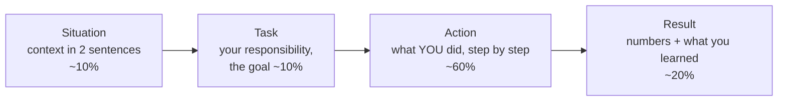
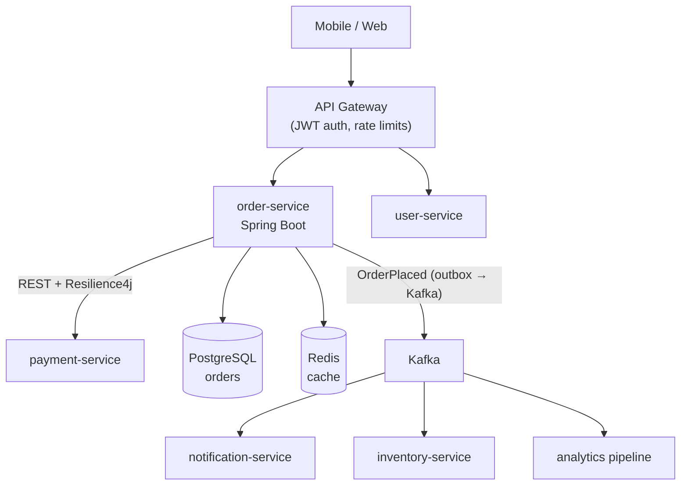
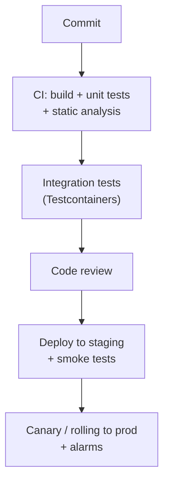

# Day 58 — Behavioral Prep: STAR Method & Project Deep-Dive

> **How to use these notes:** behavioural rounds are where good engineers lose offers by rambling or sounding vague. Today you'll **write your own stories** — the examples below are templates from a typical Java backend role, so replace every detail with **your real projects and numbers**. Say each answer out loud with a timer: **1.5–2 minutes** per story. 🚀 marks senior-level details.

**Today's goal:** a **story bank** of 6–8 STAR stories, a **60-second introduction**, and a **project deep-dive** you can whiteboard — architecture, three design decisions with trade-offs, an outage story, a performance story with before/after metrics, and how you ensure code quality.

**One story can answer many questions** — map them:

| Your story | Covers questions about |
|---|---|
| Reduced API latency 1.2 s → 180 ms | Performance, ownership, using data, technical depth |
| Production incident (Kafka consumer lag) | Pressure, debugging, communication, learning from failure |
| Migrated a service to Spring Boot 3 / Java 21 | Learning fast, initiative, risk management |
| Disagreed with a senior about an API design | Conflict, influence, collaboration |
| Juggled a release and a critical bug | Prioritisation, stakeholder management |
| Mentored a new joiner / improved team process | Leadership, teamwork |

<!-- topic: d58_t1 -->
## 🗣️ Behavioral — STAR Method

<!-- subtopic: d58_t1_s1 -->
### 1. The STAR method

| Part | Do | Avoid |
|---|---|---|
| Situation | Team, system, scale ("payments service, 50 K transactions/day") | Long company history |
| Task | The problem and *your* goal or deadline | Vague "we needed to improve things" |
| **Action** | **"I"** statements, concrete technical steps, why you chose them, how you worked with others | "We did…" for everything; buzzwords without detail |
| Result | Measurable outcome (latency, errors, cost, time saved), business impact, lesson | "It went well" |

**Make it sound senior:** mention **trade-offs** you considered, how you **measured** before and after, how you **communicated** (stakeholders, incident updates), and what you **changed afterwards** (runbook, alert, test) so it can't happen again.

**Practise like this:** write bullet points (not a script), record yourself, check it's under 2 minutes, and that the Action part has at least three concrete steps.

<!-- subtopic: d58_t1_s2 -->
### 2. "Tell me about yourself" — the 60-second pitch

**Structure: present → past → why this role** (≈ 150 words).

> "I'm a backend engineer with about **3 years** of experience building **Java and Spring Boot microservices**. At **[Company]** I work on the **order-management platform**, which handles around **50,000 orders a day**. I own the **order and payment services**, built on Spring Boot, PostgreSQL and **Kafka**, deployed on **AWS ECS** with Terraform.
>
> A couple of things I'm proud of: I **cut the order API's p99 latency from 1.2 seconds to 180 ms** by fixing N+1 queries and adding Redis caching, and I led the move to **event-driven processing with Kafka**, which removed a nightly batch job and made order status updates near real-time.
>
> I'm now looking for a role where I can work on **larger-scale distributed systems** and take more ownership of system design — which is why this team's work on **[their product/scale]** really interests me."

| Do | Don't |
|---|---|
| Lead with your role, experience and stack | Start from school or recite your CV line by line |
| 1–2 achievements with numbers | List every technology you've touched |
| End with why *this* company/role | Talk for 5 minutes |
| Tailor the last line per company | Use the same ending everywhere |

<!-- subtopic: d58_t1_s3 -->
### 3. "Tell me about a time you improved system performance"

> **S:** "Our order-history API, used by the mobile app, had a **p99 of 1.2 s** and timed out during sales, causing a spike in support tickets."
> **T:** "I was asked to bring p99 under 300 ms before the next sale, three weeks away, without a big rewrite."
> **A:** "First I **measured** instead of guessing: I enabled Hibernate SQL logging and looked at traces in our APM, and found each request ran **~40 queries** — a classic **N+1** on order items and addresses. I rewrote the repository method with a **JOIN FETCH / entity graph** and switched the list endpoint to a **DTO projection** that selects only the needed columns. `EXPLAIN ANALYZE` showed a sequential scan on `orders.customer_id`, so I added a **composite index** `(customer_id, created_at DESC)` matching the sort. Finally I cached the first page per customer in **Redis** with a 60-second TTL and evicted it on new orders. I load-tested each change with Gatling against a production-sized copy to confirm the gains."
> **R:** "**p99 dropped from 1.2 s to 180 ms** and DB CPU fell by about **40 %**. The sale went through without timeouts. I added a **query-count assertion** in our integration tests so N+1 regressions fail CI, and shared a short write-up that two other teams used."

**Variants of this question:** "biggest technical achievement", "a time you used data to make a decision", "tell me about scaling something".

<!-- subtopic: d58_t1_s4 -->
### 4. "Describe a challenging technical problem you solved" — a debugging story

> **S:** "Customers occasionally received **duplicate order-confirmation emails** — maybe 0.5 % of orders — and nobody could reproduce it locally."
> **T:** "I picked it up as the owner of the notification consumer and had to find the root cause and fix it without losing any emails."
> **A:** "I correlated logs by order id and saw the same Kafka record processed **twice**, always right after a deployment. That pointed to **consumer group rebalancing**: during rolling restarts, a consumer was processing a slow batch past `max.poll.interval.ms`, got kicked out, and its uncommitted offsets were reprocessed by another instance. I reproduced it in a test environment by adding latency to the email provider call. The fix had three parts: I made the handler **idempotent** with a `processed_events` table keyed by event id inside the same transaction; I reduced `max.poll.records` and moved the slow email call off the poll thread; and I enabled **static membership** so restarts didn't trigger rebalances."
> **R:** "Duplicates went to **zero** over the next month of deployments, and rebalance time during deploys dropped from ~30 s to near zero. I documented the at-least-once + idempotency pattern in our team's Kafka guidelines."

**What interviewers listen for:** a hypothesis-driven process (observe → hypothesise → reproduce → fix → verify), the actual root cause, and prevention.

<!-- subtopic: d58_t1_s5 -->
### 5. "How do you handle conflicting priorities?"

> **S:** "Mid-sprint, product asked me to finish a **checkout feature** for a marketing launch on Friday, while at the same time we found a **payment reconciliation bug** that was misreporting a small number of refunds."
> **T:** "Both were assigned to me, and I couldn't do both well by Friday."
> **A:** "I quantified both: the reconciliation bug affected about **20 refunds a day** and finance was reconciling them manually, so customers weren't losing money; the launch had a fixed marketing date. I wrote this up in a short message to my manager and the product owner with **two options and their risks**, and recommended shipping the feature first while I added a **temporary alert and a daily report** for the affected refunds so finance could handle them. We agreed, I asked a teammate to pair on the bug's investigation, and I fixed it properly the following Monday."
> **R:** "The launch shipped on time, no refund was missed, and the bug fix went out three days later. Since then our team uses a simple **impact vs urgency** check in stand-up when priorities collide."

**Key behaviours:** make the trade-off **explicit with data**, involve the right people **early**, propose a recommendation (don't just escalate), protect against the risk you're deferring.

<!-- subtopic: d58_t1_s6 -->
### 6. "Tell me about a time you learned a new technology quickly"

> **S:** "Our team decided to replace a nightly batch sync with **Kafka**, and none of us had used it in production."
> **T:** "I volunteered to build the first producer and consumer and set the patterns for the team, in about four weeks."
> **A:** "I spent the first week on fundamentals — the Kafka documentation, partitions, consumer groups and delivery semantics — and built a **small prototype** with Docker Compose to break things deliberately: killing consumers, causing rebalances, sending malformed messages. I then wrote the production service with **Spring Kafka**, added a **dead-letter topic** and idempotent handling, and wrote **Testcontainers** integration tests. I asked a platform engineer from another team to review my design, and I ran a one-hour session for my team with the prototype."
> **R:** "We went live in **four weeks**; order status updates went from a **24-hour delay to under 5 seconds**, and the patterns I set up were reused by three more services."

**Show your learning system:** official docs → small prototype → break it on purpose → production with tests → get a review → teach others.

<!-- topic: d58_t2 -->
## 🏗️ Behavioral — Project Deep-Dive

<!-- subtopic: d58_t2_s1 -->
### 7. Document your project architecture

Interviewers often say "**draw the system you work on**". Prepare a diagram you can draw in 3 minutes and explain in 5. Example shape (replace with yours):

**Prepare these facts (write them down):**

| Item | Your answer |
|---|---|
| What the system does, who uses it | |
| Scale: users, requests/s, data size, events/day | |
| Services you **own** vs contribute to | |
| Tech stack per layer (API, data, messaging, infra, CI/CD) | |
| One request traced end to end | |
| How it's deployed and monitored | |
| What you would change if you rebuilt it | |

<!-- subtopic: d58_t2_s2 -->
### 8. Three key design decisions and their trade-offs

Use the format **Decision → Options → Why → Trade-off accepted → Would I change it?**

| Decision | Options considered | Why we chose it | Trade-off we accepted |
|---|---|---|---|
| Kafka for order events instead of synchronous REST calls | REST fan-out, SQS/SNS, Kafka | Several consumers, replay for new services, ordering per order id, decoupled failures | Eventual consistency, operational complexity, idempotent consumers required |
| Transactional outbox instead of publishing directly after commit | Publish after commit, CDC (Debezium), outbox poller | Avoid the dual-write problem (DB committed, event lost) | Extra table + relay; small publish delay |
| PostgreSQL over MongoDB for orders | MongoDB, DynamoDB, PostgreSQL | Transactions across orders/payments, reporting queries, team expertise; JSONB covers flexible fields | Sharding is harder later — read replicas + partitioning first |

> 🚀 **Interviewers love "what would you do differently?"** Good answer: "We added caching before we had proper metrics, and invalidation bugs cost us time. I'd instrument first, and I'd introduce contract tests between services earlier."

<!-- subtopic: d58_t2_s3 -->
### 9. Production outage story — root cause, detection, fix, prevention

**Tell it as a timeline** — it shows calm, structured incident handling.

| Time | What happened |
|---|---|
| 10:02 | **Detection:** alert — order API 5xx rate 12 %, p99 4 s (CloudWatch alarm → PagerDuty) |
| 10:05 | I acknowledged, opened an incident channel, posted the first update to support |
| 10:10 | Dashboards: DB connections at the pool maximum, threads waiting on Hikari |
| 10:15 | **Mitigation:** rolled back the morning's deploy — errors dropped within 3 minutes |
| 10:40 | **Root cause:** a new report endpoint ran an un-indexed query holding connections for 20 s; under load it exhausted the pool, starving checkout |
| Next day | **Fix:** index + pagination, a **separate connection pool / read replica** for reporting, statement timeout 5 s |
| Week after | **Prevention:** blameless post-mortem, load test in CI for new endpoints, alert on pool saturation, bulkhead (Resilience4j) for non-critical paths |

> **Key line:** "I **mitigated first** (rollback) and investigated after — restoring service mattered more than understanding the bug in the moment."

**Impact numbers to include:** duration (~15 minutes degraded), affected requests or users, and revenue impact if known.

<!-- subtopic: d58_t2_s4 -->
### 10. A significant performance optimisation — before/after metrics

Have **one deep story** with numbers ready (section 3 can be it). Interviewers will dig: "How did you measure? What else did you try? What didn't work?"

| Dimension | Before | After | How measured |
|---|---|---|---|
| p99 latency | 1.2 s | 180 ms | APM traces, Gatling load test |
| Queries per request | ~40 | 3 | Hibernate statistics / query-count test |
| DB CPU at peak | 75 % | 45 % | RDS CloudWatch |
| Error rate during sale | 2.1 % | < 0.1 % | ALB 5xx metric |
| Infra cost | — | One fewer read replica (~$400/month) | AWS Cost Explorer |

**Mention what didn't work** ("increasing the connection pool made it worse — more concurrent slow queries"), because it proves you really did the work.

<!-- subtopic: d58_t2_s5 -->
### 11. "How do you ensure code quality?"

> **Model answer:** "At several levels. **Before code:** small, well-defined tickets and a short design note for anything non-trivial. **While coding:** unit tests with JUnit 5 and Mockito for business logic, integration tests with **Testcontainers** for repositories and Kafka, and contract tests between services. **In review:** small PRs, a checklist (error handling, logging, security, tests), and constructive comments. **In CI:** build, tests, coverage gate on changed code, static analysis (SonarQube, SpotBugs), dependency vulnerability scanning, and a container image scan. **After release:** feature flags for risky changes, canary or rolling deploys with automatic rollback on alarms, and dashboards. And after incidents we add the missing test or alert."

| Practice | Tooling |
|---|---|
| Testing pyramid | Many unit, fewer integration, few end-to-end |
| Static analysis | SonarQube, SpotBugs, Checkstyle/Spotless |
| Security | OWASP dependency check / Snyk, secret scanning |
| Release safety | Feature flags, canary, automated rollback |

---

## 📝 Day 58 Revision Cheat Sheet

| Item | Remember |
|---|---|
| STAR | Situation 10 %, Task 10 %, **Action 60 % with "I"**, Result 20 % with numbers + lesson |
| Intro | Present → highlights with numbers → why this role, ≤ 60 s |
| Performance story | Measure → N+1/index/cache → load test → metrics → prevention |
| Debugging story | Observe → hypothesise → reproduce → fix → verify → prevent |
| Priorities | Quantify impact, propose options, align stakeholders, mitigate the deferred risk |
| Learning | Docs → prototype → break it → production → review → teach |
| Project | Architecture drawing, scale numbers, what you own, 3 decisions with trade-offs |
| Outage | Timeline: detect → mitigate first → root cause → fix → prevent; blameless |
| Quality | Tests at each level, reviews, CI gates, safe releases, learn from incidents |

Q1. What is the STAR method?

A structure for behavioural answers: Situation (brief context), Task (your goal or responsibility), Action (the specific steps you personally took and why — most of the answer), Result (measurable outcome and what you learned or changed afterwards).

Q2. How should you structure "Tell me about yourself"?

About 60 seconds: current role, experience and stack; one or two achievements with numbers; then why you're interested in this specific role or company. Don't walk through your CV chronologically.

Q3. What makes an outage story strong?

A clear timeline from detection to resolution, mitigating first (rollback, failover) before root-causing, a specific root cause, a permanent fix, and prevention measures such as new alerts, tests or runbooks, told in a blameless way with impact numbers.

Q4. How do you answer "What would you do differently?" about your project?

Name a real decision, explain what you learned from its consequences, and what you'd do now — it shows judgement and growth. Avoid "nothing" and avoid blaming others.

### ⚡ Rapid-fire self-test

1. Which STAR part should take most of the time? → **Action**
2. Pronoun to use when describing actions? → **"I" — what you personally did**
3. Ideal length of a behavioural story? → **About 1.5–2 minutes**
4. Ideal length of "Tell me about yourself"? → **About 60 seconds**
5. Order of the intro pitch? → **Present, past highlights, why this role**
6. First priority during an outage? → **Mitigate and restore service, then find the root cause**
7. What must every Result include? → **Measurable numbers and what you learned or changed**
8. Format for explaining a design decision? → **Options considered, why chosen, trade-off accepted**
9. Why mention what didn't work in a performance story? → **It proves you did the work and reasoned about it**
10. Tool for realistic integration tests with real dependencies? → **Testcontainers**
