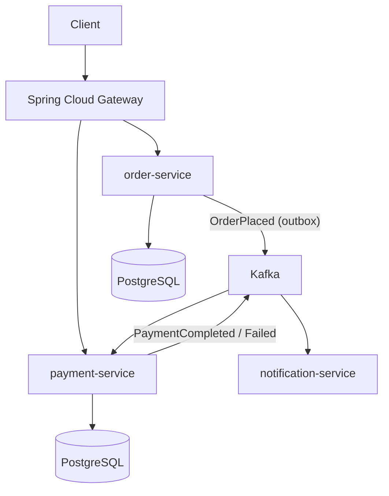

# Day 59 — Resume Polish, LinkedIn & Final Weak Area Review

> **How to use these notes:** today produces **artifacts** — an updated resume, LinkedIn profile and GitHub, a list of questions for interviewers, and a one-page cheat sheet. Work with your resume open in another window and edit as you read. The second half closes your last weak areas before tomorrow's mock. 🚀 marks senior-level details.

**Today's goal:** every resume bullet **quantified**, key technologies tied to **achievements**, LinkedIn and GitHub **consistent** with the resume, sharp **questions to ask**, a **top-20 topics** cheat sheet, and a final sweep of "What I Missed".

<!-- topic: d59_t1 -->
## 📄 Career — Resume & Online Presence

<!-- subtopic: d59_t1_s1 -->
### 1. Quantify every resume bullet

**Formula:** **Action verb + what you built/changed + how (tech) + measurable result (with scale).**

| ❌ Weak | ✅ Strong |
|---|---|
| Worked on order service using Spring Boot | Built the order service in **Spring Boot 3 / Java 21** handling **50 K orders/day**, with idempotent APIs and outbox-based Kafka events |
| Improved API performance | Cut order-history API **p99 from 1.2 s to 180 ms** by removing N+1 queries, adding a composite index and Redis caching, reducing DB CPU by **40 %** |
| Responsible for Kafka integration | Replaced a nightly batch job with **Kafka** event streaming, reducing order-status delay from **24 h to < 5 s** across 4 consuming services |
| Wrote unit tests | Raised service test coverage from **45 % to 82 %** with JUnit 5, Mockito and Testcontainers; production defects dropped **~30 %** quarter over quarter |
| Did deployments on AWS | Migrated 3 services to **AWS ECS Fargate** with **Terraform**, cutting deployment time from **40 to 8 minutes** and infra cost by **18 %** |

**Where numbers come from:** dashboards (latency, error rate, throughput), Cost Explorer, Jira (lead time, bugs), CI (build time, coverage), business metrics (orders, users). If you don't know the exact number, give an **honest approximation** you can explain ("~30 %").

**Resume layout for 2–3 YOE:**

| Section | Notes |
|---|---|
| Header | Name, phone, email, LinkedIn, GitHub, city — no photo, no full address |
| Summary (2 lines, optional) | "Backend engineer, 3 years, Java/Spring Boot microservices, Kafka, AWS" |
| Skills | Grouped: Languages · Frameworks · Data · Messaging · Cloud/DevOps · Testing |
| Experience | 4–6 bullets per role, most impressive first, past tense, numbers |
| Projects | 1–2 if they show something your job doesn't |
| Education, certifications | Short |

**Rules:** one page, a simple single-column layout (ATS-friendly — no tables or images for key text), consistent tense and dates, and keywords from the job description where they're true.

<!-- subtopic: d59_t1_s2 -->
### 2. Add key technologies with specific achievements

Don't just list technologies — **anchor each important one to a result** somewhere in your experience bullets. Recruiters search by keyword; engineers check whether you really used it.

| Technology | Achievement-style mention |
|---|---|
| Kafka | "Designed topic/partition strategy (key = orderId) and DLT handling for 4 consumers; zero message loss across 2 years" |
| Terraform | "Wrote reusable Terraform modules (ECS service, RDS, SQS + DLQ) adopted by 3 teams" |
| Microservices | "Split a monolith's payment module into a service with circuit breakers (Resilience4j) and contract tests" |
| Spring Security | "Implemented JWT auth with refresh-token rotation for 200 K users" |
| Redis | "Introduced cache-aside caching for product data — 70 % cache hit rate, DB reads down 60 %" |
| Docker / Kubernetes | "Containerised 5 services; built CI pipeline producing scanned, versioned images" |

**Skills section example:**

```text
Languages:   Java 21, SQL, Bash
Backend:     Spring Boot 3, Spring Data JPA/Hibernate, Spring Security (JWT/OAuth2), REST, gRPC
Messaging:   Apache Kafka, AWS SQS/SNS
Data:        PostgreSQL, Redis, MongoDB
Cloud/DevOps: AWS (ECS, RDS, S3, Lambda, CloudWatch), Terraform, Docker, GitHub Actions
Testing:     JUnit 5, Mockito, Testcontainers, Gatling
```

Only list what you can **discuss for 5 minutes** — anything on the resume is fair game in the interview.

<!-- subtopic: d59_t1_s3 -->
### 3. Update LinkedIn — mirror the resume

| Section | What to do |
|---|---|
| **Headline** | Not just "Software Engineer at X": "Backend Engineer · Java, Spring Boot, Kafka, AWS · Building scalable microservices" |
| Photo + banner | Professional photo; simple banner |
| **About** | 3 short paragraphs: what you do, 2 achievements with numbers, what you're looking for / interested in |
| Experience | Same bullets as the resume (can be slightly longer), dates consistent |
| **Skills** | Add Java, Spring Boot, Microservices, Apache Kafka, AWS, PostgreSQL, Terraform, System Design — pin the top 3 |
| Featured | GitHub project, a technical blog post, a talk |
| Open to work | Set "Open to work" visible **to recruiters only** if currently employed |
| Recommendations | Ask 1–2 colleagues/managers for a short recommendation |
| Activity | Occasional posts on what you learned (e.g. a Kafka idempotency lesson) increase recruiter reach |

🚀 Recruiters search LinkedIn by **title + skills + location**. Make sure the exact phrases they search ("Java Developer", "Backend Engineer", "Spring Boot") appear in your headline or experience.

<!-- subtopic: d59_t1_s4 -->
### 4. GitHub profile — 2–3 Spring Boot + Kafka projects

**One strong, well-documented project beats ten tutorial clones.** A microservices demo is ideal:



**What makes a repo interview-ready:**

| Item | Detail |
|---|---|
| **README** | Problem statement, architecture diagram, tech stack, how to run in one command, API examples, design decisions |
| One-command start | `docker compose up` brings up services, Kafka, PostgreSQL |
| Real patterns | Saga (choreography), outbox, idempotent consumers, DLT, Resilience4j, JWT |
| Tests | Unit + Testcontainers integration tests, green CI badge (GitHub Actions) |
| Observability | Actuator, Micrometer metrics, tracing with trace ids in logs |
| Clean history | Meaningful commits, no secrets committed, `.gitignore` |
| Profile README | Short intro, pinned repos, tech badges |

**Project ideas:** event-driven e-commerce (order/payment/inventory saga), URL shortener with Redis + rate limiting (Day 57), real-time chat with WebSockets, this 60-day tracker itself.

<!-- subtopic: d59_t1_s5 -->
### 5. Questions to ask interviewers

Always have **3–5 genuine questions** — "no questions" signals low interest. Tailor them to the interviewer's role.

| Topic | Questions |
|---|---|
| Team | "How is the team structured, and who would I work with day to day?" · "What does a typical week look like for an engineer here?" |
| Tech | "What's the stack, and what are the biggest technical challenges right now?" · "How do services communicate — mostly sync or event-driven?" |
| Process | "How do you go from idea to production? How often do you deploy?" · "How are code reviews and design reviews done?" |
| Quality & ops | "What does on-call look like — rotation, frequency, how incidents are handled?" · "How do you measure reliability?" |
| Growth | "What would success look like in the first 6 months?" · "How do engineers grow here — mentoring, promotion process?" |
| For the manager | "What's the biggest problem you'd want the new hire to help solve?" |
| Closing | "Is there anything about my background that makes you hesitant? I'd be happy to clarify." |

**Avoid** asking about salary, leave or perks in technical rounds — keep those for HR or the recruiter.

<!-- subtopic: d59_t1_s6 -->
### 6. Cheat sheet: top 20 most-asked topics across all phases

| # | Topic | One-line answer to have ready | Day |
|---|---|---|---|
| 1 | HashMap internals | Array of buckets, hash spreading, chaining → tree at 8 (table ≥ 64), resize at 0.75 | 12 |
| 2 | equals/hashCode | Equal objects ⇒ equal hashes; override both; immutable keys | 2 |
| 3 | ConcurrentHashMap | CAS + per-bin locks, lock-free reads, no null keys | 13 |
| 4 | Streams & collectors | Lazy pipeline; groupingBy/partitioningBy; map vs flatMap | 6 |
| 5 | Threads & synchronization | synchronized vs volatile vs atomics; deadlock prevention | 8 |
| 6 | Executors & CompletableFuture | Bounded pools, thenCompose/thenCombine, exceptionally | 9 |
| 7 | JVM & GC | Heap generations, G1 regions, OOM diagnosis with heap dumps | 17 |
| 8 | SOLID & design patterns | Strategy, Factory, Builder, Singleton, Observer, Decorator | 10, 32–33 |
| 9 | Spring DI & bean lifecycle | IoC container, constructor injection, @PostConstruct, proxies | 19 |
| 10 | Spring Boot auto-configuration | @Conditional on classpath/beans/properties | 20 |
| 11 | JPA N+1 | JOIN FETCH, entity graphs, batch size, DTO projections | 21 |
| 12 | @Transactional | Proxy-based, self-invocation, rollback rules, propagation | 22 |
| 13 | Spring Security + JWT | Filter chain, token validation, stateless, refresh tokens | 23 |
| 14 | Microservices patterns | Gateway, discovery, saga, outbox, circuit breaker | 27–29 |
| 15 | Kafka guarantees & consumers | acks/ISR, at-least-once + idempotency, lag, rebalancing | 35–38 |
| 16 | SQL joins & window functions | DENSE_RANK per group, running totals, LAG | 51–52 |
| 17 | Indexing & transactions | B-tree, composite order, EXPLAIN, isolation, MVCC | 53 |
| 18 | System design building blocks | CAP, caching, sharding, rate limiting, consistent hashing | 55 |
| 19 | HLD problems | URL shortener, chat, notifications — with the framework | 57 |
| 20 | DSA patterns | Two pointers, window, BFS/DFS, heap, DP, backtracking templates | 42, 48 |

<!-- topic: d59_t2 -->
## 🔁 Review — Final Weak Area Consolidation

<!-- subtopic: d59_t2_s1 -->
### 7. Review all "What I Missed" notes from 58 days

Last full sweep. Open **Backlog & Stats** and the **Revise** page.

| Step | Action |
|---|---|
| 1 | Re-test the **top 5 weak areas** from your Day 50 plan — explain each out loud |
| 2 | For each remaining missed item: explain it in 60 s, or read that day's notes and the Q&A cards |
| 3 | Do today's due flashcards on the Revise page |
| 4 | Anything still shaky → write it on tomorrow's **morning sheet** (one page, read before the mock) |

**Accept that you won't know everything.** In an interview, "I haven't used that in production, but here's how I understand it works…" is a perfectly good answer.

<!-- subtopic: d59_t2_s2 -->
### 8. Practise explaining 5 key concepts aloud

Pick the five you're most likely to be asked (from the top-20 table). For each: **definition → how it works (with a drawing) → a real example → a trade-off or pitfall**, in about **2 minutes**.

| Concept | Skeleton |
|---|---|
| HashMap | Buckets → hash → collisions → treeify → resize → why immutable keys |
| @Transactional | Proxy → begin/commit → rollback rules → self-invocation pitfall → propagation example |
| Kafka delivery | Producer acks/idempotence → consumer commit timing → duplicates → idempotent consumer |
| N+1 | What triggers it → how to spot it (SQL logs) → three fixes → which you'd choose |
| Caching | Cache-aside flow → invalidation → TTL/jitter → stampede → when not to cache |

Record yourself once; listen for filler words, missing examples, and answers that run over 3 minutes.

<!-- subtopic: d59_t2_s3 -->
### 9. Solve 3 random problems from weak categories — no time limit

Today is about **understanding**, not speed:

1. Pick 3 unsolved problems from your two weakest categories (Question Sets → filter unsolved).
2. Spend up to 25 minutes on your own attempt.
3. If stuck, read **only the hint or approach**, then code it yourself.
4. Afterwards write a 3-line note: the pattern, the key insight, and the mistake you'd make next time.
5. Log it with the 📝 button and flag "solve again" if you needed help.

<!-- subtopic: d59_t2_s4 -->
### 10. Elevator pitch for each project on your resume

For **every** project or role on your resume, prepare a 30-second pitch and be ready for 10 minutes of follow-ups.

| Part | Example |
|---|---|
| What & why | "An order-management platform that processes about 50 K orders a day for our e-commerce clients." |
| Your role | "I owned the order and payment services — design, implementation and on-call." |
| Tech | "Spring Boot, PostgreSQL, Kafka with the outbox pattern, Redis, deployed on ECS with Terraform." |
| Highlight | "My biggest contribution was moving status updates from a nightly batch to Kafka events — from 24 hours to under 5 seconds." |

**Likely follow-ups to prepare:** "Why Kafka and not SQS?", "How did you handle failures?", "How did you test it?", "What was the hardest bug?", "What would you change?", "How did you measure the improvement?"

---

## 📝 Day 59 Revision Cheat Sheet

| Item | Remember |
|---|---|
| Resume bullets | Action verb + what + how (tech) + measurable result with scale |
| Technologies | Each key technology tied to an achievement; only list what you can discuss |
| Format | One page, ATS-friendly single column, consistent dates, real keywords |
| LinkedIn | Keyword-rich headline, About with numbers, skills pinned, recruiters-only "open to work" |
| GitHub | 1–2 polished projects: README + diagram, docker compose, tests, CI badge |
| Questions to ask | Team, tech challenges, process, on-call, growth, success in 6 months |
| Top 20 | Collections, concurrency, Spring internals, JPA, Kafka, SQL, system design, DSA patterns |
| Final review | Re-test weak areas, explain 5 concepts aloud, 3 problems for understanding, project pitches |

<details><summary>Q1. What makes a strong resume bullet?</summary>

It starts with an action verb, says what you built or changed, how (the key technologies), and the measurable result with scale — for example cutting p99 latency from 1.2 s to 180 ms for a service handling 50 K orders a day.

</details>

<details><summary>Q2. Why should you prepare questions for the interviewer?</summary>

It shows genuine interest and helps you judge the team: workload, on-call, technical challenges, growth and what success looks like. Ending with "no questions" can come across as disengaged.

</details>

<details><summary>Q3. What makes a GitHub project useful for interviews?</summary>

A clear README with the problem, an architecture diagram, how to run it with one command and the design decisions; realistic patterns (events, retries, idempotency, security); tests and a passing CI pipeline; and clean commits without secrets.

</details>

### ⚡ Rapid-fire self-test

1. Four parts of a strong resume bullet? → **Action verb, what you did, how (tech), measurable result**
2. Ideal resume length for 2–3 years of experience? → **One page**
3. What should a LinkedIn headline contain? → **Your role plus key skills recruiters search for**
4. Who should see "Open to work" if you're employed? → **Recruiters only**
5. Most important file in a portfolio repository? → **The README**
6. How should a demo project start? → **With one command, e.g. docker compose up**
7. Topics to avoid asking about in technical rounds? → **Salary, leave and perks**
8. Length of a project elevator pitch? → **About 30 seconds**
9. Structure for explaining a concept aloud? → **Definition, how it works, real example, trade-off**
10. Good answer when you don't know something in production depth? → **Say so honestly, then explain how you understand it works**
