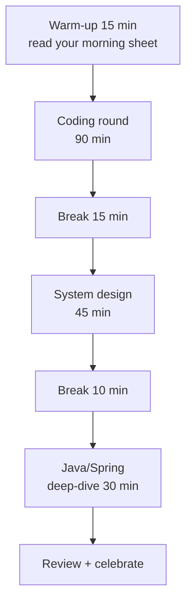
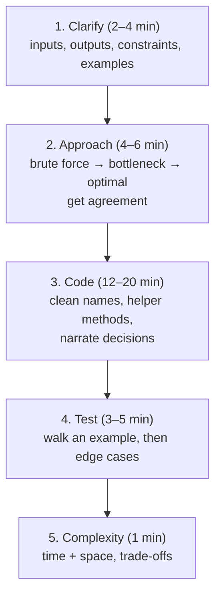
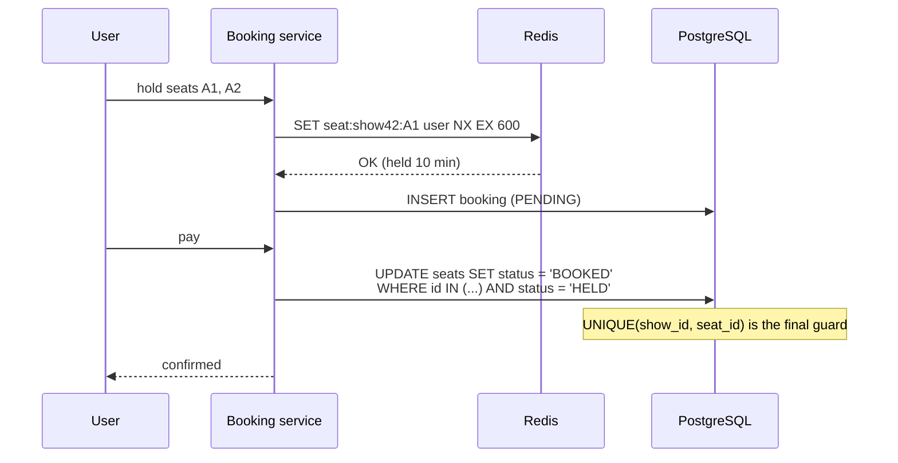
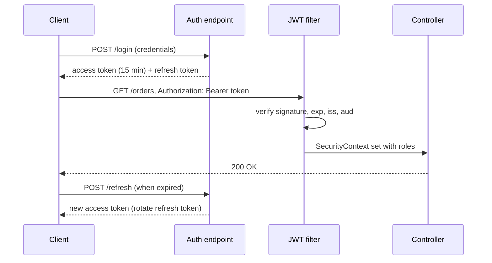
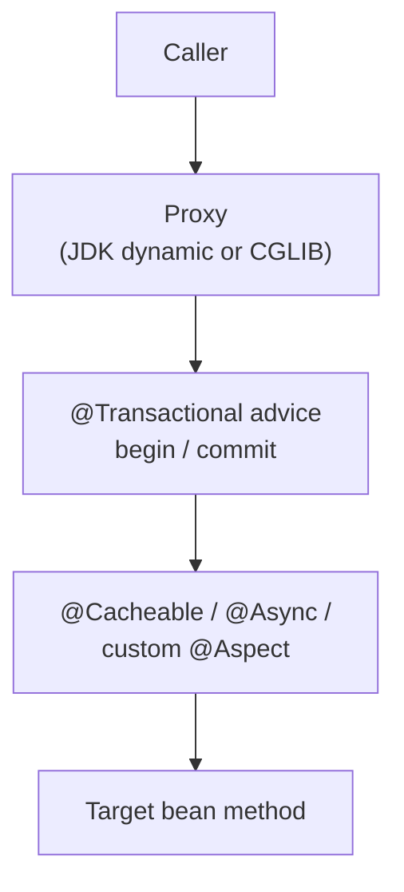

# Day 60 — 🎯 Final Mock Interview Day: You Are Ready!

> **How to use these notes:** today is a **full interview simulation** — three rounds back to back, like a real onsite loop: **coding (90 min)**, **system design (45 min)**, **Java/Spring deep-dive (30 min)**. Use a timer, a plain editor, a whiteboard or Excalidraw, and speak out loud the whole time (record yourself if you can). Read each section's guidance **before** the round and the review checklist **after**. Then close the 60 days properly. 🚀 marks senior-level details.

**Today's schedule:**

<!-- topic: d60_t1 -->
## 💻 Mock — Coding Round (90 min)

<!-- subtopic: d60_t1_s1 -->
### 1. Mock: 2 Medium + 1 Hard in 90 minutes — no hints, think aloud

Choose **unseen** problems (or ask a friend to pick for you):

| Slot | Time | Pick one |
|---|---|---|
| Medium 1 | 25 min | Longest Substring Without Repeating Characters (3) · Number of Islands (200) · Course Schedule II (210) |
| Medium 2 | 25 min | LRU Cache (146) · Top K Frequent Words (692) · Search in Rotated Sorted Array (33) |
| Hard | 40 min | Merge k Sorted Lists (23) · Trapping Rain Water (42) · Word Ladder (127) |

**Rules:** no hints, no running code until you've dry-run it by hand, no looking at old solutions. If you finish early, discuss follow-ups aloud ("what if the input doesn't fit in memory?").

<!-- subtopic: d60_t1_s2 -->
### 2. Practice the flow: clarify → approach → code → test → complexity

| Step | Good signals | Script |
|---|---|---|
| Clarify | Asks about sizes, duplicates, negatives, empty input, return format | "Can the array be empty? Are values bounded? Should I return indices or values?" |
| Approach | States brute force + complexity first, finds the bottleneck, names the pattern | "Brute force is O(n²) pairs. The repeated work is the lookup, so a hash map makes it O(n)." |
| Agreement | Checks before coding | "Does that approach sound good? I'll start coding." |
| Code | Small helpers, meaningful names, handles edge cases explicitly | "I'll pull the neighbour check into a helper so the BFS stays readable." |
| Test | Traces variables line by line | "i = 0, the map is empty, store 2 → 0…" |
| Complexity | Precise, includes recursion stack | "O(n) time, O(n) space for the map." |

<!-- subtopic: d60_t1_s3 -->
### 3. Edge cases and dry runs before submitting

**Edge-case checklist (say the relevant ones out loud):**

| Input type | Cases |
|---|---|
| Arrays / strings | Empty, one element, all equal, already sorted, reverse sorted, very large n |
| Numbers | Zero, negatives, `Integer.MAX_VALUE` overflow (use `long`), duplicates |
| Linked lists | Null head, one node, cycle, even vs odd length |
| Trees | Null root, single node, skewed (deep recursion), duplicate values |
| Graphs / grids | Disconnected parts, cycles, single cell, all walls, start equals end |
| k parameters | k = 0, k = 1, k = n, k > n |

**Dry-run technique:** pick a small but non-trivial example (4–6 elements), write the variables in a table, and update them as you walk each line. Most bugs show up as an off-by-one in a loop bound or a pointer update in the wrong order.

**After the round — score yourself (1–5):** clarification, approach, code quality, testing, communication, time management. Write down the **one habit** to fix before your next real interview.

<!-- topic: d60_t2 -->
## 🏛️ Mock — System Design Round (45 min)

<!-- subtopic: d60_t2_s1 -->
### 4. Pick a random HLD problem and design it end-to-end in 45 minutes

Roll a die (or let a friend choose) — **not** one from Day 57:

| # | Problem | The deep-dive they'll probably push on |
|---|---|---|
| 1 | Design Instagram / news feed | Fan-out on write vs read, celebrity accounts, feed ranking |
| 2 | Design a ride-hailing service (Uber) | Location updates at high frequency, geo-indexing (geohash/quadtree), matching |
| 3 | Design a ticket booking system (BookMyShow) | Seat locking and double booking, payments with timeouts |
| 4 | Design a distributed cache | Consistent hashing, eviction, replication, hot keys |
| 5 | Design a payment system | Idempotency, exactly-once effects, ledger, reconciliation |
| 6 | Design YouTube / video streaming | Upload pipeline, transcoding, CDN, adaptive bitrate |

<!-- subtopic: d60_t2_s2 -->
### 5. Flow: requirements → API → high-level → database → deep dive → scaling

| Minutes | Step | Output on the board |
|---|---|---|
| 0–5 | Requirements | 3–5 functional features, non-functional targets (scale, latency, availability, consistency), out of scope |
| 5–8 | Estimates | DAU, peak QPS, read/write ratio, storage per year |
| 8–13 | API | 3–5 endpoints with key fields, pagination, idempotency keys |
| 13–23 | High-level design | Boxes and arrows for the main flow, walked through once |
| 23–28 | Data model | Tables/collections, keys, SQL vs NoSQL with a reason, partition key |
| 28–38 | Deep dive | The hardest part (the one the interviewer picks), 2 options + choice |
| 38–45 | Bottlenecks & scaling | SPOFs, caching, sharding, async processing, monitoring, failure handling |

**Example — ticket booking deep dive (double booking):**

> **Talking points:** Redis `NX` with a TTL gives a temporary hold that expires if the user abandons; the database **unique constraint** (or `SELECT … FOR UPDATE`) is the source of truth; payment calls use an **idempotency key**; an expiry job releases unpaid holds.

<!-- subtopic: d60_t2_s3 -->
### 6. Clean diagrams, bottlenecks and trade-offs

| Checklist item | ✔ |
|---|---|
| Clients → edge (DNS/CDN/LB) → services → data stores, left to right | ☐ |
| Arrows labelled with protocol and sync/async (`REST`, `gRPC`, `Kafka event`) | ☐ |
| Read path and write path both explained | ☐ |
| Cache placement and invalidation stated | ☐ |
| Partition/shard key named for big tables | ☐ |
| Every single point of failure addressed (replicas, multi-AZ) | ☐ |
| Failure handling: retries + backoff, timeouts, circuit breakers, DLQs, idempotency | ☐ |
| Observability: metrics, logs, traces, alerts | ☐ |
| Trade-offs said out loud ("I chose X over Y because …, at the cost of …") | ☐ |

🚀 **What distinguishes a strong answer:** driving the conversation (you propose the agenda), numbers that influence decisions ("4 K QPS reads — one Redis node is enough"), and naming what you'd do **later** versus now ("start with PostgreSQL + replicas; shard by user_id when we exceed ~5 TB").

<!-- topic: d60_t3 -->
## ☕ Mock — Java/Spring Deep-Dive (30 min)

<!-- subtopic: d60_t3_s1 -->
### 7. Rapid-fire: 20 Java/Spring questions

Answer each in ≤ 45 seconds. Cover the answers first.

| # | Question | Key answer |
|---|---|---|
| 1 | `==` vs `equals()` | Reference vs logical equality |
| 2 | String immutability benefits | Pool sharing, thread safety, security, cached hash |
| 3 | Abstract class vs interface | State/constructors vs multiple inheritance of type, default methods |
| 4 | Checked vs unchecked exceptions | Compiler-enforced handling vs `RuntimeException` |
| 5 | `ArrayList` vs `LinkedList` | O(1) random access vs O(1) insert at known node; ArrayList almost always |
| 6 | Fail-fast iterator | `modCount` check → `ConcurrentModificationException` |
| 7 | `map` vs `flatMap` | One-to-one vs one-to-many then flatten |
| 8 | `Optional` best practice | Return type only; `orElseGet` for expensive defaults; no `get()` without a check |
| 9 | `synchronized` vs `ReentrantLock` | Implicit monitor vs tryLock, timeouts, fairness, conditions |
| 10 | `volatile` | Visibility/ordering, not atomicity |
| 11 | Thread pool sizing | CPU-bound ≈ cores; I/O-bound larger; bounded queues |
| 12 | Virtual threads | Cheap threads for blocking I/O; avoid pinning; don't pool them |
| 13 | IoC / DI | Container creates and wires beans; constructor injection |
| 14 | Bean scopes | singleton (default), prototype, request, session |
| 15 | `@Component` vs `@Bean` | Class-level scanning vs factory method in `@Configuration` |
| 16 | How Spring AOP works | Proxies (JDK dynamic for interfaces, CGLIB subclasses) intercept calls |
| 17 | `@Transactional` default rollback | Unchecked exceptions and errors only |
| 18 | `FetchType.LAZY` vs `EAGER` | Load on access vs immediately; default LAZY for collections |
| 19 | `@SpringBootTest` vs `@WebMvcTest` | Full context vs web slice |
| 20 | Actuator | Health, metrics, info endpoints for operations |

<!-- subtopic: d60_t3_s2 -->
### 8. Explain: HashMap internals, N+1, @Transactional pitfalls, JWT flow

**HashMap (90 s):** "An array of buckets. `hashCode()` is spread with `h ^ (h >>> 16)` and masked with `n − 1` to pick a bucket. Collisions chain in a list; from Java 8 a bucket with 8+ entries becomes a red-black tree once the table has 64+ buckets. When size passes capacity × 0.75 the table doubles and entries split into 'same index' or 'index + old capacity'. Keys must be immutable with consistent equals/hashCode. Not thread-safe — use ConcurrentHashMap."

**N+1 (60 s):** "Loading N entities and then touching a lazy association on each fires N extra queries. I spot it with SQL logging or Hibernate statistics, and fix it with JOIN FETCH or an entity graph for the specific use case, batch fetching as a safety net, or a DTO projection when I only need some columns."

**@Transactional pitfalls (60 s):** "It works through a proxy, so self-invocation, private or final methods aren't intercepted. Checked exceptions don't roll back unless `rollbackFor` is set. Catching an exception inside the method hides it from the proxy. `readOnly = true` helps performance for queries. Watch long transactions holding connections, and remote calls inside transactions."

**JWT flow (60 s):**

<!-- subtopic: d60_t3_s3 -->
### 9. Explain: Kafka delivery guarantees, consumer lag, partition rebalancing

**Delivery guarantees (90 s):** "On the producer side, `acks=all` with `min.insync.replicas=2` and replication factor 3 means an acknowledged write survives a broker failure, and idempotence stops retries from creating duplicates. On the consumer side the guarantee depends on when you commit: before processing is at-most-once, after processing is at-least-once — the usual choice, paired with idempotent handlers. Exactly-once is available for Kafka-to-Kafka pipelines through transactions and `read_committed`; with external systems you get effectively-once via idempotency or the outbox pattern."

**Consumer lag (60 s):** "Lag is log-end offset minus committed offset per partition. I alert on lag and its growth rate. When it grows I check for rebalance storms, a poison pill stuck on one partition, slow downstream calls, or key skew; then I speed up the handler, batch writes, add consumers up to the partition count, or add partitions."

**Rebalancing (60 s):** "When members join or leave, or a consumer exceeds `max.poll.interval.ms`, the group coordinator reassigns partitions. With the old eager protocol everyone stops; the cooperative-sticky assignor moves only the affected partitions, and static membership avoids rebalances during quick restarts. Commit offsets on revocation to limit duplicates."

<!-- subtopic: d60_t3_s4 -->
### 10. Explain: Spring Boot auto-configuration, bean lifecycle, AOP proxies

**Auto-configuration (60 s):** "`@SpringBootApplication` includes `@EnableAutoConfiguration`. Boot reads the list of auto-configuration classes from `META-INF/spring/…AutoConfiguration.imports`, and each one is guarded by conditions — `@ConditionalOnClass`, `@ConditionalOnMissingBean`, `@ConditionalOnProperty`. So adding `spring-boot-starter-data-jpa` brings Hibernate onto the classpath and a DataSource and EntityManagerFactory get configured, but if I define my own DataSource bean, Boot backs off. `--debug` prints the conditions report."

**Bean lifecycle (60 s):** "Instantiate → inject dependencies → Aware callbacks → BeanPostProcessors' before-initialisation → `@PostConstruct` / `afterPropertiesSet` → post-processors' after-initialisation, which is where AOP proxies are created → the bean is ready → on shutdown `@PreDestroy`."

**AOP proxies (60 s):**

"Spring wraps beans that need cross-cutting behaviour in proxies — a JDK dynamic proxy when there's an interface, otherwise a CGLIB subclass (Boot's default). The proxy runs the advice around the call. That's why `@Transactional`, `@Cacheable` and `@Async` don't work on self-invocation or private methods — the call never goes through the proxy."

<!-- topic: d60_t4 -->
## 🎉 Final Checklist

<!-- subtopic: d60_t4_s1 -->
### 11. ✅ Review your overall progress — celebrate the 60-day grind

Open the **Dashboard** and **Backlog & Stats** in this app and look at what you've built over 60 days: subtopics ticked, problems solved, flashcards reviewed, focus hours, your longest streak and the badges you've earned.

| Phase | What you can now do |
|---|---|
| 1 · Core Java | Explain OOP, collections, streams, concurrency and modern Java with code |
| 2 · Collections & JVM | Describe HashMap/CHM internals, GC and JVM tuning |
| 3 · Spring Boot | Build secure, tested, observable REST services with JPA and transactions |
| 4 · Microservices & DevOps | Design resilient services, containerise them, run them on Kubernetes |
| 5 · Kafka & patterns | Build event-driven systems and solve machine-coding problems with design patterns |
| 6 · AWS & Terraform | Deploy and operate services on AWS with infrastructure as code |
| 7 · SQL & system design | Write advanced SQL, tune queries, and design scalable systems |
| 8 · Interview readiness | Tell strong stories, present your projects and handle full interview loops |

Write three sentences in today's "What I Covered" box: what you're proudest of, what got easier, and what you'll keep practising.

<!-- subtopic: d60_t4_s2 -->
### 12. ✅ Resume finalised, LinkedIn updated, GitHub projects pushed

| ✔ | Item |
|---|---|
| ☐ | Resume: one page, every bullet quantified, PDF named `FirstName_LastName_Backend_Engineer.pdf` |
| ☐ | Resume proof-read by someone else; no typos, consistent dates |
| ☐ | LinkedIn headline, About, experience and skills match the resume |
| ☐ | GitHub: pinned project with README, diagram, `docker compose up`, tests and green CI |
| ☐ | Job tracker (spreadsheet): company, role, referral, status, next step, dates |
| ☐ | Referrals requested from people at target companies |

<!-- subtopic: d60_t4_s3 -->
### 13. ✅ Logistics: questions to ask, salary expectations, availability

| Topic | Preparation |
|---|---|
| Questions to ask | 3–5 per round from Day 59, tailored to the company |
| **Salary expectations** | Research ranges (Levels.fyi, Glassdoor, AmbitionBox, peers); know your current CTC breakdown; state a **range** whose bottom is acceptable, and try to let them make the first number ("I'm looking for a competitive offer for the role — what's the budgeted range?") |
| Notice period / availability | Know your exact notice period and whether a buyout is possible |
| Logistics | Interview links tested, quiet room, charged laptop, IDE and an online editor ready, water |
| Day-before | Light revision only: your morning sheet, top-20 table, your project pitches |
| Offers | Get offers in writing; compare total compensation, growth, team and tech; negotiate politely with data |

<!-- subtopic: d60_t4_s4 -->
### 14. ✅ Mental prep: rest, visualise success, trust the work

| Before | During | After |
|---|---|---|
| Sleep 7–8 hours; no all-night cramming | Breathe, slow down, think aloud — silence is the enemy | Note questions you got, while fresh |
| Light exercise or a walk | It's fine to say "let me think for a moment" | Review weak spots, then move on |
| Read your one-page morning sheet | If stuck, state the brute force and build from there | One bad round rarely decides a loop |
| Remind yourself: 60 days of consistent work | Treat the interviewer as a teammate solving a problem with you | Every interview makes the next one easier |

> Interviews are a **skill** that improves with repetition. The first two or three real ones are practice — schedule less-critical companies first if you can.

<!-- subtopic: d60_t4_s5 -->
### 15. 🚀 You have the experience AND the depth — own the interview!

Sixty days ago this was a plan. Now you have **notes for every topic**, **hundreds of problems** behind you, **stories with numbers**, and a **system-design method** you can repeat under pressure. Keep the habit going after the plan ends: a daily problem, a flashcard session on the Revise page, and one deep topic a week.

**Your interview-day mantra:** *Clarify. Think aloud. Start simple. Test it. Explain the trade-offs.*

Good luck — you've earned this. 🎉

---

## 📝 Day 60 Revision Cheat Sheet

| Round | Remember |
|---|---|
| Coding | Clarify → brute force → optimise → agree → code → dry run → edge cases → complexity |
| System design | Requirements → estimates → API → high-level → data → deep dive → bottlenecks; numbers drive decisions |
| Java/Spring | HashMap, N+1, @Transactional proxies, JWT, Kafka guarantees/lag/rebalancing, auto-config, lifecycle, AOP |
| Logistics | Questions ready, salary range researched, notice period known, setup tested |
| Mindset | Rest, think aloud, partial progress counts, every interview is practice |

Q1. What's the best order of steps in a coding interview?

Clarify the problem and constraints with examples, state a brute-force approach and its complexity, find the bottleneck and propose an optimised approach, get the interviewer's agreement, code it cleanly while narrating, dry-run an example and edge cases, then state time and space complexity and possible follow-ups.

Q2. How do you prevent double booking in a ticketing system?

Hold seats temporarily with an atomic Redis SET NX plus a TTL so abandoned holds expire, and make the database the source of truth with a unique constraint on (show, seat) or row locks when confirming. Payment uses an idempotency key, and a background job releases unpaid holds.

Q3. How should you handle salary expectation questions?

Research market ranges for the role and location beforehand, know your current compensation breakdown, give a range whose bottom you'd accept, or ask for the role's budgeted range first. Compare offers on total compensation and growth, and negotiate politely with data.

### ⚡ Rapid-fire self-test

1. Time budget for the Hard in the coding mock? → **40 minutes**
2. What should you state before the optimal approach? → **The brute force and its complexity**
3. What do you do before running or submitting code? → **Dry-run an example and check edge cases**
4. First 5 minutes of a system design round? → **Requirements: functional, non-functional and scope**
5. Final guard against double booking? → **A unique constraint or row lock in the database**
6. Why don't @Transactional and @Cacheable work on self-calls? → **The call bypasses the Spring proxy**
7. Where are AOP proxies created in the bean lifecycle? → **In BeanPostProcessor after-initialisation**
8. Kafka producer settings for no data loss? → **acks=all, idempotence, RF 3 and min.insync.replicas=2**
9. Best response when stuck on a problem? → **State and code the brute force, then optimise**
10. The interview-day mantra? → **Clarify, think aloud, start simple, test it, explain the trade-offs**
