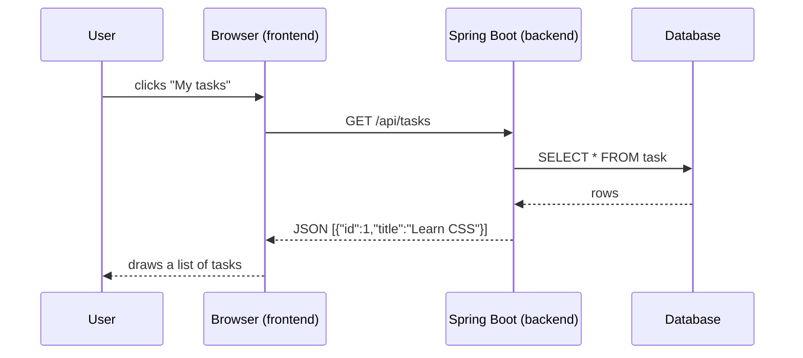
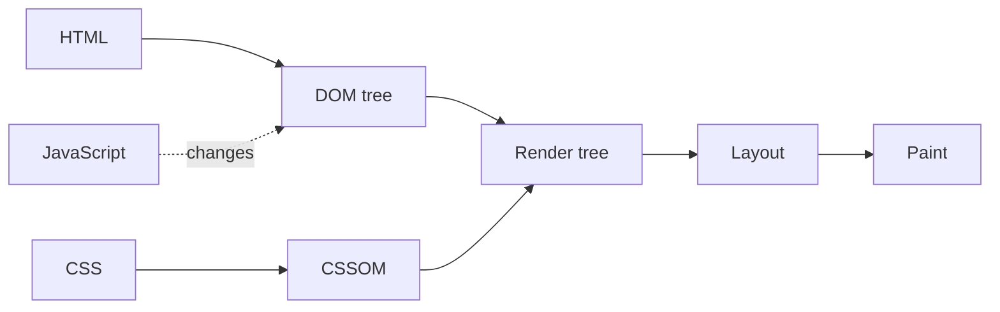

# Frontend 1 — How the Web Works for Frontend

> **Welcome to the frontend side of fullstack.** Your Java code runs on a server. Everything a user actually *sees* (buttons, forms, pages) runs in their browser, and that's the frontend. This module is the map: what the browser does with your files, and the tools you'll use every day.

<!-- subtopic: f1_s1 -->
### Frontend vs backend

A fullstack app has two halves that talk over HTTP:

| | Frontend | Backend |
|---|---|---|
| Runs on | the user's browser (or phone) | your server (Spring Boot) |
| Written in | HTML, CSS, JavaScript / TypeScript, React | Java, Spring, SQL |
| Job | show data, take input, feel fast | store data, apply business rules, security |
| Sends | requests (`GET /api/tasks`) | responses (JSON) |



The backend never draws anything. It sends **data** (usually JSON), and the frontend turns that data into what the user sees. That split is why one Spring Boot API can serve a website, a mobile app and another service at the same time.

<details>
<summary>Where does the code that validates a form actually run: frontend or backend?</summary>

Both. The frontend checks early so the user gets instant feedback, but the backend must check again, because anyone can skip the frontend and send a request directly (with curl or Postman). Frontend validation is for a nice experience; backend validation is for safety.
</details>

<!-- subtopic: f1_s2 -->
### HTML, CSS and JavaScript

Every web page is made of three languages, each with one job:

| Language | Job | Think of it as |
|---|---|---|
| **HTML** | structure and content: headings, text, images, buttons, forms | the skeleton |
| **CSS** | looks: colours, fonts, spacing, layout, animations | the clothes |
| **JavaScript** | behaviour: react to clicks, fetch data, change the page | the muscles |

The same button, built up in three steps:

```html
<button class="buy">Buy now</button>
```

```css
.buy { background: royalblue; color: white; padding: 8px 16px; border-radius: 6px; }
```

```js
document.querySelector(".buy").addEventListener("click", () => alert("Added to cart!"));
```

React (later in this course) doesn't replace these three. It's a JavaScript library that **writes the HTML for you** from data, so you describe *what* the page should look like and React keeps it up to date.

<details>
<summary>Could you build a page with only HTML? Only JavaScript?</summary>

Only HTML: yes, a plain unstyled page (like the earliest websites). Only JavaScript: technically yes, because JavaScript can create every element and style, and that's roughly what React does. But you'd still be producing HTML and CSS in the end; the browser only knows how to show those.
</details>

<!-- subtopic: f1_s3 -->
### What happens when you open a page

You type a URL and press Enter. In order:

1. **DNS** turns the domain (`java60days.vercel.app`) into an IP address.
2. The browser opens a connection (TCP, plus TLS for `https`) and sends `GET /`.
3. The server answers with an **HTML** file.
4. The browser reads the HTML top to bottom and builds the **DOM** (Document Object Model): a tree of objects, one per element.
5. When it finds `<link rel="stylesheet">`, `` or `<script>`, it requests those files too.
6. CSS is parsed into the **CSSOM** (the styling rules).
7. DOM + CSSOM = the **render tree** (only what's visible).
8. **Layout**: work out where every box goes and how big it is.
9. **Paint**: fill in the pixels. Then JavaScript can change the DOM, and parts of steps 7–9 run again.



Why you care as a developer:

- **JavaScript works on the DOM, not on the HTML file.** Changing the DOM changes the page immediately; the file on the server is untouched.
- **A `<script>` in the `<head>` blocks the page** until it downloads and runs, unless you add `defer`. That's why scripts usually go at the end of `<body>` or get `defer` (Module 24 covers this properly).
- **Layout is expensive.** Changing sizes or positions makes the browser redo layout; changing only colour or opacity is cheaper.

#### 🚀 "What happens when you type a URL" in an interview

This is a classic open question. A strong answer walks the layers: DNS lookup (browser cache → OS → resolver), TCP handshake, TLS handshake, HTTP request with headers and cookies, server response with status and caching headers, HTML parsing and the DOM, sub-resources (CSS, JS, images) possibly from cache or a CDN, CSSOM, render tree, layout, paint and compositing, then JavaScript running and the page becoming interactive. Mention one optimisation per stage (DNS prefetch, HTTP/2, caching, `defer`, lazy images) and you'll stand out.

<details>
<summary>What is the DOM?</summary>

The Document Object Model: the browser's in-memory tree of objects built from the HTML. Each element (a `div`, a `p`, a `button`) becomes a node you can read and change from JavaScript. The page you see is drawn from the DOM, not from the original HTML text.
</details>

<!-- subtopic: f1_s4 -->
### Browser DevTools

Every modern browser ships with developer tools. Open them with **F12** (or **Ctrl+Shift+I**, **Cmd+Option+I** on a Mac), or right-click anything → **Inspect**. These four tabs cover most of your day:

| Tab | What you do there |
|---|---|
| **Elements** | see the live DOM, edit HTML and CSS on the fly, see which CSS rule won and why |
| **Console** | read errors and `console.log` output, run JavaScript against the page |
| **Network** | see every request: URL, status, timing, headers, the JSON a call returned |
| **Sources** | read the page's JavaScript, set breakpoints, step through code like in IntelliJ |

Habits worth building from day one:

1. **When something looks wrong, inspect it.** The Elements tab shows the box model and crossed-out CSS rules that lost.
2. **When data doesn't show up, check Network.** Is the request even sent? Is it a 404, a 500, a CORS error? What did the server return?
3. **When nothing happens on click, check Console.** A red error usually says exactly which line broke.
4. **Try the device toolbar** (the phone icon) to see your page at phone sizes.

<details>
<summary>Your page shows "Loading…" forever. Which DevTools tab do you open first?</summary>

Network: find the API request and look at its status and response. If it's red (failed, 404, 500, CORS), the problem is the request or the server. If it succeeded, switch to Console to look for a JavaScript error in the code that handles the response.
</details>

<!-- subtopic: f1_s5 -->
### Set up: VS Code and your first page

You need nothing new to install for HTML, CSS and JavaScript: a browser and an editor are enough.

1. Install **VS Code** (you may already have it from the Java days).
2. Add the **Live Server** extension: it serves your folder and reloads the browser every time you save.
3. Make a folder `hello-web` with a file `index.html`:

```html
<!DOCTYPE html>
<html lang="en">
  <head>
    <meta charset="UTF-8">
    <meta name="viewport" content="width=device-width, initial-scale=1.0">
    <title>Hello web</title>
    <link rel="stylesheet" href="style.css">
  </head>
  <body>
    <h1>Hello, web!</h1>
    <p>This page was written by hand.</p>
    <button id="hi">Say hi</button>
    <script src="app.js"></script>
  </body>
</html>
```

`style.css`:

```css
body { font-family: system-ui, sans-serif; margin: 40px; }
h1 { color: teal; }
```

`app.js`:

```js
document.getElementById("hi").addEventListener("click", () => {
  console.log("Button clicked");
  document.querySelector("p").textContent = "Hi there 👋";
});
```

4. Right-click `index.html` → **Open with Live Server**. Click the button, then open DevTools and find your `console.log` line.

In VS Code, typing `!` and pressing Tab in an empty `.html` file writes the whole skeleton for you (that's the Emmet shortcut).

<details>
<summary>Why not just double-click index.html to open it?</summary>

For a plain page it works, but the browser opens it as a `file://` URL, and many features (`fetch`, ES modules, some APIs) are blocked there for security. A local server like Live Server gives you a real `http://localhost` address, which behaves like a website.
</details>

## 📝 Module 1 Recap

1. What does the frontend do? → **shows data and takes input in the browser; the backend stores data and applies rules**
2. What does a Spring Boot API usually send to the frontend? → **data, usually JSON, not HTML**
3. HTML vs CSS vs JavaScript? → **structure, looks, behaviour**
4. What is the DOM? → **the browser's tree of objects built from the HTML, which JavaScript can change**
5. What do DOM and CSSOM combine into? → **the render tree, which then goes through layout and paint**
6. Why can a script in the head slow a page down? → **it blocks parsing until it downloads and runs, unless it has defer**
7. Data isn't showing: first DevTools tab? → **Network**
8. Why use Live Server instead of opening the file? → **a real http://localhost address; file:// blocks fetch and modules**
