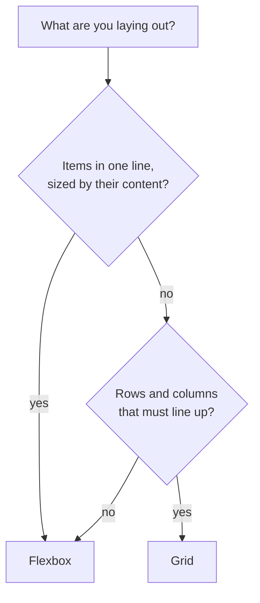

# Frontend 4 — CSS Layout and Responsive Design

> **Two tools do almost all modern layout: Flexbox and Grid.** Learn which one fits which job, add a few media queries, and your pages will look right from a phone to a wide monitor. That's the last of the CSS you need before JavaScript.

<!-- subtopic: f4_s1 -->
### Flexbox

Flexbox lays out children **in one direction**: a row or a column. Put `display: flex` on the **parent**:

```html
<nav class="navbar">
  <a class="logo" href="/">JavaFS</a>
  <div class="links"><a href="/roadmap">Roadmap</a><a href="/sets">Problems</a></div>
  <button>Log in</button>
</nav>
```

```css
.navbar {
  display: flex;
  justify-content: space-between;   /* along the main axis (the row) */
  align-items: center;              /* along the cross axis (vertical here) */
  gap: 16px;                        /* space between items */
  padding: 12px 24px;
}
```

The two axes are the key idea:

| Property (on the parent) | Works along | Common values |
|---|---|---|
| `flex-direction` | sets the main axis | `row` (default), `column` |
| `justify-content` | the main axis | `flex-start`, `center`, `space-between`, `space-around` |
| `align-items` | the cross axis | `stretch` (default), `center`, `flex-start` |
| `flex-wrap` | | `wrap` lets items move onto new lines |
| `gap` | between items | `16px` |

On the **children**:

```css
.search { flex: 1; }          /* take all the leftover space */
.sidebar { flex: 0 0 250px; } /* don't grow, don't shrink, 250px wide */
.push-right { margin-left: auto; }   /* pushes itself (and what follows) to the far end */
```

The famous "centre a thing" answer:

```css
.center-me { display: flex; justify-content: center; align-items: center; min-height: 100vh; }
```

<details>
<summary>flex-direction is column. Which property centres items horizontally now?</summary>

`align-items: center`. With a column, the main axis is vertical, so `justify-content` works up and down and `align-items` works left and right.
</details>

<!-- subtopic: f4_s2 -->
### CSS Grid

Grid lays out children **in two dimensions**: rows and columns at once.

```css
.cards {
  display: grid;
  grid-template-columns: repeat(3, 1fr);   /* three equal columns */
  gap: 20px;
}
```

`fr` means "a fraction of the free space": `1fr 2fr` makes the second column twice as wide as the first.

The single most useful grid line, a responsive card grid with **no media queries**:

```css
.cards {
  display: grid;
  grid-template-columns: repeat(auto-fill, minmax(260px, 1fr));
  gap: 20px;
}
```

It fits as many 260px-or-wider columns as the row has room for, and stretches them to fill it: 4 on a laptop, 2 on a tablet, 1 on a phone.

Placing items and naming areas:

```css
.page {
  display: grid;
  grid-template-columns: 240px 1fr;
  grid-template-rows: auto 1fr auto;
  grid-template-areas:
    "header header"
    "sidebar main"
    "footer footer";
  min-height: 100vh;
}
.page > header { grid-area: header; }
.page > aside  { grid-area: sidebar; }
.page > main   { grid-area: main; }
.page > footer { grid-area: footer; }

.feature { grid-column: span 2; }        /* an item two columns wide */
```

<details>
<summary>What does repeat(auto-fill, minmax(200px, 1fr)) do?</summary>

It creates as many columns as fit, each at least 200px wide and sharing any leftover space equally. The number of columns changes with the screen width automatically.
</details>

<!-- subtopic: f4_s3 -->
### Flexbox or Grid?

| | Flexbox | Grid |
|---|---|---|
| Dimensions | one (a row **or** a column) | two (rows **and** columns) |
| Sizing comes from | the content: items decide their size | the container: you define the tracks |
| Best for | navbars, toolbars, a row of buttons, centring, a card's insides | page layouts, card grids, dashboards, forms with aligned labels |

They work together: a **grid** for the page and the card list, **flexbox** inside each card to line up its icon, title and button.



The "holy grail" layout (header, footer, sidebar, main) is the grid-template-areas example above: one Grid container, no floats and no hacks.

<details>
<summary>You need a row of tags that wraps onto new lines. Flexbox or Grid?</summary>

Flexbox with `flex-wrap: wrap` and a `gap`. Each tag is as wide as its text, and they don't need to line up in columns, which is exactly flexbox's strength.
</details>

<!-- subtopic: f4_s4 -->
### Responsive design

A responsive page adapts to the screen. Three ingredients:

1. **The viewport meta tag** (Module 2), so phones use their real width.
2. **Fluid sizes**: `%`, `fr`, `minmax()`, `max-width` instead of fixed widths.
3. **Media queries**, which apply CSS only when a condition is true.

Write **mobile-first**: the base styles are for small screens, and media queries add changes as the screen gets bigger:

```css
.layout { display: flex; flex-direction: column; gap: 16px; }   /* phone: stacked */

@media (min-width: 768px) {          /* tablet and up */
  .layout { flex-direction: row; }
  .sidebar { flex: 0 0 240px; }
}

@media (min-width: 1200px) {         /* wide screens */
  .container { max-width: 1140px; margin: 0 auto; }
}
```

Common breakpoints are about 640, 768, 1024 and 1280px, but the honest rule is: **add a breakpoint where your design breaks**, not for specific devices.

Images that never overflow their container:

```css
img { max-width: 100%; height: auto; }
```

Other media features worth knowing: `(prefers-color-scheme: dark)` for dark mode, `(prefers-reduced-motion: reduce)` to calm animations, `(hover: hover)` for devices with a mouse. Test everything in the DevTools device toolbar.

<details>
<summary>Why mobile-first, with min-width queries?</summary>

Phones get the simplest CSS with nothing to override, and bigger screens add layout on top. It also makes you design the most constrained screen first, which is where most traffic comes from.
</details>

<!-- subtopic: f4_s5 -->
### CSS variables, transitions and animations

**Custom properties** (CSS variables) keep values in one place and can change at runtime:

```css
:root {
  --brand: #0d9488;
  --radius: 10px;
  --space: 16px;
}
.btn { background: var(--brand); border-radius: var(--radius); padding: calc(var(--space) / 2) var(--space); }

[data-theme="dark"] { --brand: #2dd4bf; }   /* dark mode: just change the variables */
```

This very site switches between light and dark themes that way.

**Transitions** animate a change between two states:

```css
.card { transition: transform 0.2s ease, box-shadow 0.2s ease; }
.card:hover { transform: translateY(-4px); box-shadow: 0 10px 30px rgb(0 0 0 / 15%); }
```

**Keyframe animations** run on their own:

```css
@keyframes spin { to { transform: rotate(360deg); } }
.loader { width: 24px; height: 24px; border: 3px solid #ccc; border-top-color: var(--brand); border-radius: 50%; animation: spin 0.8s linear infinite; }
```

For smooth animations, animate **`transform` and `opacity`** only: the browser can do those without redoing layout. Animating `width`, `top` or `margin` makes the page recalculate layout on every frame.

<details>
<summary>Why prefer transform: translateX() over changing left to move an element?</summary>

`left` changes layout, so the browser re-runs layout and paint every frame, which can stutter. `transform` is handled by the compositor (often on the GPU) without touching layout, so it stays smooth.
</details>

<!-- subtopic: f4_s6 -->
### How teams write CSS today

Plain CSS files get hard to manage in big apps (name clashes, dead styles nobody dares delete). The common answers:

| Approach | Idea | Looks like |
|---|---|---|
| **Tailwind CSS** | small utility classes, composed in the markup | `<button class="px-4 py-2 rounded-lg bg-teal-600 text-white">` |
| **CSS Modules** | normal CSS, but class names are local to one component | `import s from "./Card.module.css"` then `className={s.card}` |
| **Sass/SCSS** | CSS with nesting, mixins and functions, compiled to CSS | `.card { &:hover { … } }` (plain CSS now has nesting too) |
| **CSS-in-JS** | styles written in JavaScript next to the component | styled-components, Emotion |
| **Component libraries** | ready-made accessible components | MUI, Chakra, shadcn/ui, Ant Design |

You don't need all of them. **Tailwind** and **CSS Modules** are the two you'll meet most in React jobs; Module 15 shows both. Whatever the tool, it all ends up as the CSS you learned in Modules 3 and 4, so those fundamentals keep paying off.

<details>
<summary>What problem do CSS Modules solve?</summary>

Global name clashes. Each component's class names are rewritten to unique ones at build time (`card` becomes something like `Card_card__x7f2`), so two components can both have a `.card` class without affecting each other.
</details>

## 📝 Module 4 Recap

1. Flexbox handles how many dimensions? → **one: a row or a column**
2. justify-content vs align-items? → **main axis vs cross axis**
3. How do you centre something both ways? → **display: flex; justify-content: center; align-items: center**
4. What is 1fr? → **one share of the free space in a grid**
5. Responsive grid without media queries? → **repeat(auto-fill, minmax(260px, 1fr))**
6. Flexbox or Grid for a page layout? → **Grid; flexbox for one-line pieces inside it**
7. Mobile-first means? → **base styles for small screens, min-width media queries add to them**
8. What keeps images inside their container? → **max-width: 100%; height: auto**
9. Which properties animate smoothly? → **transform and opacity**
10. Two common ways React teams style components? → **Tailwind utility classes and CSS Modules**
