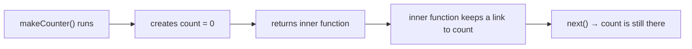

# Frontend 6 — Functions, Scope and Closures

> **Functions are the heart of JavaScript.** They're values you can store and pass around, they remember where they were created, and React components are just functions. Closures in particular come up in almost every frontend interview.

<!-- subtopic: f6_s1 -->
### Three ways to write a function

```js
// 1. Function declaration: hoisted, so it can be called before this line
function add(a, b) {
  return a + b;
}

// 2. Function expression: a function stored in a variable
const multiply = function (a, b) {
  return a * b;
};

// 3. Arrow function: shorter; the usual choice for callbacks
const square = (x) => x * x;                 // one expression: returned automatically
const greet = (name) => {                    // a block body needs return
  const msg = `Hi, ${name}`;
  return msg;
};
const makeUser = (name) => ({ name });       // returning an object: wrap it in ( )
```

Arrow functions are not just shorter. They **don't have their own `this`** (they use the surrounding one, Module 8) and can't be used with `new`. That makes them ideal for callbacks and React components, and wrong for object methods that need `this`.

A function with no `return` (or an empty `return;`) returns `undefined`.

<details>
<summary>Why does const f = () => { name: "x" } return undefined?</summary>

The braces are read as a function body, and `name:` as a label, so nothing is returned. To return an object literal from an arrow function, wrap it in parentheses: `() => ({ name: "x" })`.
</details>

<!-- subtopic: f6_s2 -->
### Parameters: defaults, rest and arguments

JavaScript doesn't check how many arguments you pass. Missing ones are `undefined`, extra ones are ignored:

```js
function hello(name) { return `Hello ${name}`; }
hello();                  // "Hello undefined"
hello("Asha", "extra");   // "Hello Asha"
```

**Default values** fill in missing (`undefined`) arguments:

```js
function paginate(items, page = 1, size = 10) {
  return items.slice((page - 1) * size, page * size);
}
paginate(list);           // page 1, size 10
paginate(list, 3);        // page 3, size 10
```

**Rest parameters** collect the remaining arguments into a real array (like Java's varargs):

```js
function sum(...nums) {
  return nums.reduce((total, n) => total + n, 0);
}
sum(1, 2, 3);             // 6
```

There's no method overloading in JavaScript: a second function with the same name simply replaces the first. Use defaults, rest parameters or an options object instead:

```js
function createUser({ name, role = "user", active = true }) { /* … */ }
createUser({ name: "Asha", role: "admin" });   // named, any order, easy to extend
```

Old code uses the `arguments` object (array-like, not an array, and not available in arrow functions). Prefer rest parameters.

<details>
<summary>How do you write a function that takes any number of arguments?</summary>

With a rest parameter: `function f(...args)`. `args` is a real array, so `args.length`, `args.map` and so on all work.
</details>

<!-- subtopic: f6_s3 -->
### Scope and the scope chain

**Scope** decides where a variable can be seen:

| Scope | Created by | Who uses it |
|---|---|---|
| Global | the top level of a script | everything (avoid putting things here) |
| Function | every function | `var`, `let`, `const` and parameters inside it |
| Block | any `{ }`: `if`, `for`, a bare block | `let` and `const` only (`var` ignores blocks) |

When code uses a variable, JavaScript looks in the current scope, then the enclosing one, and so on outwards until the global scope. That path is the **scope chain**:

```js
const app = "Tracker";            // global

function outer() {
  const user = "Asha";            // outer's scope
  function inner() {
    const day = 5;                // inner's scope
    console.log(app, user, day);  // finds all three by walking outwards
  }
  inner();
  console.log(day);               // ReferenceError: inner scopes aren't visible from outside
}
```

Scope is decided by **where the code is written**, not where it's called from. That's called **lexical scope**, and it's what makes closures work.

Inner variables can **shadow** outer ones with the same name; the closest one wins.

<details>
<summary>A variable is declared with let inside a for loop's body. Can code after the loop read it?</summary>

No. `let` is block-scoped, and the loop body is a block, so the variable only exists inside it. (A `var` would leak out to the enclosing function.)
</details>

<!-- subtopic: f6_s4 -->
### Hoisting and the temporal dead zone

Before running code, JavaScript scans each scope and sets up its declarations. That's **hoisting**, and it behaves differently for each kind:

| Declaration | Hoisted? | Before its line you get |
|---|---|---|
| `function f() {}` | fully, with its body | a working function |
| `var x` | yes, set to `undefined` | `undefined` |
| `let x` / `const x` | yes, but **not initialised** | ReferenceError |
| `class C {}` | like `let` | ReferenceError |
| `const f = () => {}` | like `const` | ReferenceError |

```js
sayHi();                  // works: declarations are hoisted with their body
function sayHi() { console.log("hi"); }

console.log(a);           // undefined: var is hoisted, the assignment isn't
var a = 1;

console.log(b);           // ReferenceError: Cannot access 'b' before initialization
let b = 2;
```

The time between the start of the scope and the `let`/`const` line is the **temporal dead zone (TDZ)**: the variable exists but can't be touched. That's a good thing: an early mistake becomes a clear error instead of a silent `undefined`.

<details>
<summary>Why does calling a function expression before its line fail, when a declaration works?</summary>

A function declaration is hoisted with its body. A function expression is just a value assigned to a variable: with `const` or `let` the variable is in the TDZ (ReferenceError), and with `var` it's `undefined` (TypeError: not a function).
</details>

<!-- subtopic: f6_s5 -->
### Closures

A **closure** is a function together with the variables from the scope where it was created. The function keeps access to them even after that outer function has returned:

```js
function makeCounter() {
  let count = 0;                  // lives on after makeCounter returns
  return function () {
    count++;
    return count;
  };
}

const next = makeCounter();
next();   // 1
next();   // 2
const other = makeCounter();
other();  // 1: each call to makeCounter makes a fresh count
```



Where you'll meet closures:

- **Private state**: `count` can't be read or changed from outside, only through `next`. Before classes had `#private` fields, this was how JavaScript hid data.
- **Callbacks and event handlers** that use variables from around them:

```js
function setupButton(button, message) {
  button.addEventListener("click", () => alert(message));   // remembers message
}
```

- **Function factories**: `const double = multiplier(2)`.
- **React hooks**: every render's event handlers close over that render's state, which explains the famous "stale state" bug (Module 17).
- **debounce, throttle and memoize** (Module 12) all keep their timers and caches in a closure.

#### 🚀 Closures in memory

A closure keeps its outer variables alive, so they can't be garbage-collected while the function is reachable. Long-lived closures (a listener that's never removed, a cache that grows forever) are a common source of memory leaks in single-page apps. The fix is to remove listeners and clear timers when they're no longer needed (React's effect cleanup does exactly this).

<details>
<summary>Explain a closure in one sentence, then give a real use.</summary>

A closure is a function that remembers the variables from where it was defined, even after that scope has finished. Real uses: private state (a counter or a cached value), event handlers that use surrounding variables, and utilities like debounce that keep a timer between calls.
</details>

<!-- subtopic: f6_s6 -->
### Higher-order functions and callbacks

Functions are **first-class values**: you can store them in variables, put them in arrays, pass them as arguments and return them from other functions. A function that takes or returns a function is a **higher-order function**:

```js
// Takes a function
function repeat(n, action) {
  for (let i = 0; i < n; i++) action(i);
}
repeat(3, (i) => console.log(`round ${i}`));

// Returns a function
const multiplier = (factor) => (x) => x * factor;
const double = multiplier(2);
double(21);               // 42
```

A function passed in to be called later is a **callback**. You already use them all the time:

```js
[3, 1, 2].sort((a, b) => a - b);                     // compare callback
button.addEventListener("click", handleClick);       // event callback (no parentheses: pass, don't call)
setTimeout(() => console.log("1 second later"), 1000);
```

Compared with Java: this is what Java's lambdas and functional interfaces (`Function`, `Predicate`) give you, but in JavaScript it's built in and needs no interface.

<details>
<summary>What's the difference between addEventListener("click", handle) and addEventListener("click", handle())?</summary>

The first passes the function, to be called on each click. The second calls `handle` immediately and passes its *return value* (usually `undefined`), so nothing happens on click.
</details>

## 📝 Module 6 Recap

1. Function declaration vs arrow function? → **declarations are hoisted and have their own this; arrows are shorter and use the outer this**
2. Returning an object from an arrow function? → **wrap it in parentheses: () => ({ a: 1 })**
3. What do rest parameters give you? → **the remaining arguments as a real array**
4. Does JavaScript have method overloading? → **no; use defaults, rest parameters or an options object**
5. What is lexical scope? → **scope decided by where code is written, not where it's called**
6. What does var ignore? → **block scope**
7. let used before its line? → **ReferenceError: the temporal dead zone**
8. What is a closure? → **a function plus the variables of the scope it was created in**
9. A real use of closures? → **private state, event handlers, debounce, React hooks**
10. What is a higher-order function? → **one that takes or returns a function**
