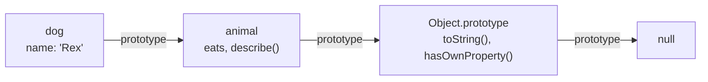

# Frontend 8 — this, Prototypes and Classes

> **JavaScript's objects work differently from Java's under the hood.** `this` depends on *how* a function is called, and inheritance is done with prototypes, with `class` as friendlier syntax on top. Modern React code uses little of this directly, but interviewers love it, and it explains many confusing bugs.

<!-- subtopic: f8_s1 -->
### How this is decided

In Java, `this` is always the current object. In JavaScript, a regular function's `this` is decided **at the moment it's called**, by how it's called. Check these rules in order:

| How it's called | this is | Example |
|---|---|---|
| with `new` | the brand-new object | `new User("Asha")` |
| with `call` / `apply` / `bind` | whatever you pass | `greet.call(user)` |
| as a method: `obj.fn()` | the object before the dot | `user.greet()` |
| as a plain call: `fn()` | `undefined` in strict mode / modules (the global object in old sloppy scripts) | `const g = user.greet; g()` |
| **arrow function** | the `this` of the code around it (it has none of its own) | `() => this.name` |

```js
const user = {
  name: "Asha",
  greet() { return `Hi, ${this.name}`; },
};

user.greet();                 // "Hi, Asha": called as a method
const g = user.greet;
g();                          // TypeError (strict mode): this is undefined; the method "lost" its object
```

That "lost `this`" happens whenever you pass a method as a callback:

```js
setTimeout(user.greet, 100);                   // this is lost
setTimeout(() => user.greet(), 100);           // ✅ called as a method
setTimeout(user.greet.bind(user), 100);        // ✅ this fixed with bind
```

Arrow functions take `this` from where they're written, which is exactly what you want inside methods:

```js
const timer = {
  seconds: 0,
  start() {
    setInterval(() => { this.seconds++; }, 1000);   // arrow: this is still timer ✅
    // setInterval(function () { this.seconds++; }, 1000);  // regular function: this is lost ❌
  },
};
```

But don't use an arrow function *as* an object method: it would take `this` from outside the object.

<details>
<summary>Why does button.addEventListener("click", obj.handle) break when handle uses this?</summary>

`obj.handle` is passed as a plain function, so when the browser calls it, `this` isn't `obj` (for DOM listeners it's the element). Pass `() => obj.handle()` or `obj.handle.bind(obj)` instead.
</details>

<!-- subtopic: f8_s2 -->
### call, apply and bind

All three set `this` explicitly:

```js
function introduce(greeting, punctuation) {
  return `${greeting}, I'm ${this.name}${punctuation}`;
}
const asha = { name: "Asha" };

introduce.call(asha, "Hello", "!");      // call: arguments one by one   → "Hello, I'm Asha!"
introduce.apply(asha, ["Hey", "."]);     // apply: arguments as an array → "Hey, I'm Asha."
const bound = introduce.bind(asha, "Hi");// bind: returns a NEW function with this (and "Hi") fixed
bound("?");                              // "Hi, I'm Asha?"
```

| | Runs now? | Arguments |
|---|---|---|
| `call` | yes | listed: `f.call(obj, a, b)` |
| `apply` | yes | an array: `f.apply(obj, [a, b])` |
| `bind` | no, returns a new function | fixed up front, more can be added later |

A memory trick: **A**pply takes an **A**rray. `bind` also does *partial application*: pre-filling the first arguments, as `"Hi"` above. Writing your own `bind` is a classic interview task (Module 12).

<details>
<summary>What's the difference between call and bind?</summary>

`call` runs the function immediately with the given `this`. `bind` doesn't run anything: it returns a new function whose `this` (and optionally its first arguments) are fixed, to be called later.
</details>

<!-- subtopic: f8_s3 -->
### Prototypes and the prototype chain

Every JavaScript object has a hidden link to another object, its **prototype**. When you read a property the object doesn't have, JavaScript looks in the prototype, then the prototype's prototype, and so on. That's the **prototype chain**, and it's how JavaScript does inheritance.

```js
const animal = {
  eats: true,
  describe() { return `${this.name} eats: ${this.eats}`; },
};
const dog = Object.create(animal);   // dog's prototype is animal
dog.name = "Rex";

dog.name          // "Rex": dog's own property
dog.eats          // true: found on the prototype
dog.describe()    // "Rex eats: true": method from the prototype, this = dog
Object.getPrototypeOf(dog) === animal   // true
```



Built-ins work the same way: `[1, 2].map` comes from `Array.prototype`, and `"hi".toUpperCase` from `String.prototype`. That's why you can add methods there (a "polyfill"), and also why you shouldn't change built-in prototypes in app code.

`obj.hasOwnProperty("name")` (or `Object.hasOwn(obj, "name")`) checks whether a property is the object's *own*, not inherited.

#### 🚀 Constructor functions and the prototype property

Before `class` (2015), objects were made with constructor functions:

```js
function User(name) { this.name = name; }
User.prototype.greet = function () { return `Hi, ${this.name}`; };
const u = new User("Asha");
```

`new` creates an empty object, links its prototype to `User.prototype`, runs `User` with `this` = the new object, and returns it. Methods live once on the prototype instead of being copied into every object, which saves memory. A `class` compiles down to exactly this.

<details>
<summary>What is the prototype chain?</summary>

The chain of linked prototype objects JavaScript follows when a property isn't found on an object itself. Lookup goes object → its prototype → that prototype's prototype, ending at `Object.prototype` and then `null`. It's how objects inherit methods.
</details>

<!-- subtopic: f8_s4 -->
### Classes

`class` gives JavaScript the syntax Java developers know, built on prototypes:

```js
class Account {
  static bankName = "JS Bank";       // belongs to the class
  balance = 0;                       // a field, set on every instance

  constructor(owner) {
    this.owner = owner;
  }

  deposit(amount) {                  // goes on Account.prototype
    if (amount <= 0) throw new Error("Amount must be positive");
    this.balance += amount;
    return this;                     // allows chaining
  }

  static compare(a, b) { return a.balance - b.balance; }
}

class SavingsAccount extends Account {
  constructor(owner, rate) {
    super(owner);                    // must call super before using this
    this.rate = rate;
  }

  addInterest() {
    return this.deposit(this.balance * this.rate);
  }

  toString() { return `${this.owner}: ${this.balance}`; }   // override
}

const s = new SavingsAccount("Asha", 0.05).deposit(1000);
s.addInterest();
s instanceof Account;                // true
Account.bankName;                    // "JS Bank"
```

Differences from Java to keep in mind:

- **One constructor only** (no overloading); use default parameters instead.
- **No `implements` or interfaces**: JavaScript is duck-typed (TypeScript adds interfaces).
- **Methods aren't bound**: `const d = s.deposit; d(5)` loses `this`.
- **Classes aren't hoisted** like functions are (TDZ applies).

In modern React, you'll rarely write classes: components are functions. You'll still see class components in older codebases, and classes are handy for services and plain data models.

<details>
<summary>What happens if a subclass constructor uses this before calling super()?</summary>

It throws a ReferenceError. In a derived class, the object is created by the parent's constructor, so `this` doesn't exist until `super(...)` has run.
</details>

<!-- subtopic: f8_s5 -->
### Getters, setters and private fields

```js
class Temperature {
  #celsius = 0;                          // private field: only code inside the class can see it

  get fahrenheit() {                     // read like a property: t.fahrenheit
    return this.#celsius * 9 / 5 + 32;
  }

  set celsius(value) {                   // assign like a property: t.celsius = 25
    if (value < -273.15) throw new RangeError("Below absolute zero");
    this.#celsius = value;
  }

  #log(msg) { console.log(msg); }        // private method
}

const t = new Temperature();
t.celsius = 25;
t.fahrenheit;                            // 77
t.#celsius;                              // SyntaxError: private field
```

Compared with Java:

| Java | JavaScript |
|---|---|
| `private int celsius;` | `#celsius` (truly private, enforced by the language) |
| `getCelsius()` / `setCelsius()` | `get celsius()` / `set celsius(v)`, used like a field |
| `public` by default? No, package-private | everything is public unless it starts with `#` |
| `protected` | doesn't exist (a leading `_name` is just a "please don't touch" convention) |

Before `#` existed, privacy came from closures (Module 6), and you'll still see the `_underscore` convention in older code.

<details>
<summary>How do you make a class field truly private in JavaScript?</summary>

Prefix it with `#` (`#balance`). Code outside the class body can't read or write it at all; it's a syntax error. An `_underscore` prefix is only a naming convention.
</details>

## 📝 Module 8 Recap

1. What decides this in a regular function? → **how it's called: new, call/apply/bind, obj.method(), or a plain call**
2. this in a plain call in strict mode? → **undefined**
3. this in an arrow function? → **the this of the surrounding code; arrows have none of their own**
4. call vs apply vs bind? → **call: args listed, runs now; apply: args array, runs now; bind: returns a new function**
5. What is the prototype chain? → **the linked objects searched when a property isn't on the object itself**
6. Where do array methods like map come from? → **Array.prototype**
7. What are JavaScript classes built on? → **prototypes: class is syntax over constructor functions**
8. Rule for super in a subclass constructor? → **call super() before using this**
9. How do you make a field private? → **prefix it with #**
10. Why can passing obj.method as a callback break? → **it's called as a plain function, so this is lost**
