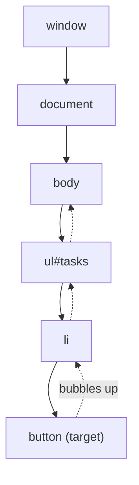

# Frontend 9 — The DOM and Events

> **This is where JavaScript meets the page.** You'll find elements, change them, create new ones and react to clicks and typing, with no framework. React does all of this for you later, and knowing what it does underneath makes React much easier to understand.

<!-- subtopic: f9_s1 -->
### Finding elements in the DOM

The DOM (Module 1) is a tree of element objects, and `document` is its root.

```html
<ul id="tasks">
  <li class="task done">Learn HTML</li>
  <li class="task">Learn JS</li>
</ul>
<input name="title" type="text">
```

```js
document.getElementById("tasks");              // one element by id
document.querySelector(".task");               // the FIRST match of any CSS selector
document.querySelector("input[name='title']");
document.querySelectorAll(".task");            // ALL matches: a NodeList
document.querySelectorAll("#tasks > li.done");
```

`querySelector` and `querySelectorAll` take any CSS selector (Module 3), so they cover almost everything. They also work on an element, to search only inside it: `list.querySelectorAll("li")`.

A `NodeList` isn't a real array. It has `forEach` and `length`; for `map` or `filter`, convert it:

```js
const titles = [...document.querySelectorAll(".task")].map(li => li.textContent);
```

Walking the tree from an element:

```js
const li = document.querySelector(".task");
li.parentElement;              // the ul
li.children;                   // its child elements
li.nextElementSibling;         // the next li
li.closest("ul");              // the nearest ancestor (or itself) matching a selector: very handy
```

If a selector matches nothing, `querySelector` returns `null`, and calling a method on it throws, the classic "Cannot read properties of null". A common cause is a script that runs before the HTML below it exists; fix it with `defer` or by putting the script at the end of `body`.

<details>
<summary>querySelector vs querySelectorAll?</summary>

`querySelector` returns the first matching element (or null). `querySelectorAll` returns a static NodeList of every match (possibly empty).
</details>

<!-- subtopic: f9_s2 -->
### Changing the page

```js
const title = document.querySelector("h1");

title.textContent = "My Tasks";                 // plain text: safe
title.innerHTML = "My <em>Tasks</em>";          // parses HTML: dangerous with user input
title.classList.add("highlight");
title.classList.remove("hidden");
title.classList.toggle("dark");                 // add if missing, remove if present
title.classList.contains("dark");               // true or false
title.setAttribute("data-day", "5");
title.dataset.day;                              // "5": reads data-* attributes
title.style.color = "teal";                     // inline style (camelCase: backgroundColor)

const input = document.querySelector("input");
input.value;                                    // what the user typed
input.disabled = true;
```

**`textContent` vs `innerHTML`** matters for security. If you put user-typed text into `innerHTML`, a value like an image tag with an `onerror` script runs that script in your page. That's an **XSS** attack (Module 25). Use `textContent` for text; use `innerHTML` only with HTML you wrote yourself.

**Prefer toggling classes over setting styles.** Keep the looks in CSS:

```css
.hidden { display: none; }
.task.done { text-decoration: line-through; opacity: 0.6; }
```

```js
li.classList.toggle("done");    // JavaScript only says *what state* it's in
```

<details>
<summary>Why is el.innerHTML = userComment dangerous?</summary>

`innerHTML` parses the string as HTML, so if the comment contains markup with a script (for example an image with an onerror handler), it runs in your page with access to the user's data. That's cross-site scripting. Use `textContent`, which treats the value as plain text.
</details>

<!-- subtopic: f9_s3 -->
### Creating, adding and removing elements

```js
const list = document.querySelector("#tasks");

function addTask(title) {
  const li = document.createElement("li");
  li.className = "task";
  li.textContent = title;                       // safe even if title has HTML in it

  const del = document.createElement("button");
  del.textContent = "✕";
  del.addEventListener("click", () => li.remove());

  li.append(del);
  list.append(li);                              // add at the end (prepend: at the start)
}

addTask("Learn the DOM");
list.firstElementChild.remove();                // remove an element
```

Other useful ones: `el.before(x)`, `el.after(x)`, `el.replaceWith(x)`, `list.replaceChildren()` (empty it).

**Performance:** every change to the live DOM can make the browser redo layout. Adding 1,000 items one by one is slow; build them first and add them once:

```js
const fragment = document.createDocumentFragment();
for (const t of tasks) {
  const li = document.createElement("li");
  li.textContent = t.title;
  fragment.append(li);
}
list.append(fragment);                          // one insertion
```

This "keep the real DOM in sync with my data" job gets messy fast in a real app: you have to remember every element to update when the data changes. **That's the problem React solves**: you describe the UI for the current data, and React works out the minimal DOM changes (Module 22).

<details>
<summary>Why build many elements in a DocumentFragment before adding them?</summary>

A fragment isn't part of the page, so adding to it doesn't trigger layout. Appending the fragment once puts all its children in the DOM in a single change, instead of one reflow per item.
</details>

<!-- subtopic: f9_s4 -->
### Events

```js
const button = document.querySelector("#save");

function handleClick(event) {
  console.log(event.type);           // "click"
  console.log(event.target);         // the element that was actually clicked
}

button.addEventListener("click", handleClick);
button.removeEventListener("click", handleClick);   // needs the same function reference
button.addEventListener("click", handleClick, { once: true });   // runs once, then removes itself
```

Events you'll use most:

| Event | Fires when |
|---|---|
| `click` | an element is clicked (also Enter/Space on buttons) |
| `input` | the value of an input changes, on every keystroke |
| `change` | a value is committed (checkbox ticked, select changed, input loses focus) |
| `submit` | a form is submitted (on the form, not the button) |
| `keydown` | a key is pressed: `event.key` is `"Enter"`, `"Escape"`, `"a"`… |
| `focus` / `blur` | an element gains / loses focus |
| `DOMContentLoaded` | the HTML is parsed and the DOM is ready |
| `scroll`, `resize` | the page scrolls / the window resizes (fire very often: debounce them, Module 12) |

**`preventDefault()`** stops the browser's built-in behaviour:

```js
form.addEventListener("submit", (e) => {
  e.preventDefault();               // don't reload the page
  const title = form.elements.title.value.trim();
  if (title) addTask(title);
});

link.addEventListener("click", (e) => e.preventDefault());   // don't follow the link
```

Avoid the old `onclick="…"` HTML attribute: it mixes JavaScript into HTML and allows only one handler.

<details>
<summary>A form submit handler runs, then the page reloads and your changes vanish. What's missing?</summary>

`event.preventDefault()`. Submitting a form makes the browser send it and load a new page by default; calling preventDefault in the submit handler stops that so your JavaScript can handle it.
</details>

<!-- subtopic: f9_s5 -->
### Bubbling, capturing and event delegation

When you click a button inside a list inside the body, the event travels in three phases:

1. **Capturing**: from `window` down to the target.
2. **Target**: at the clicked element.
3. **Bubbling**: back up from the target to `window`.



Listeners run in the **bubbling** phase by default (pass `{ capture: true }` for capturing). So a click on the button also triggers click listeners on the `li`, the `ul` and the `body`.

```js
event.target          // where the event started (the button)
event.currentTarget   // the element whose listener is running now
event.stopPropagation();   // stop it bubbling further (use sparingly)
```

**Event delegation** uses bubbling: put **one** listener on a parent instead of one per child:

```js
document.querySelector("#tasks").addEventListener("click", (e) => {
  const button = e.target.closest("button.delete");
  if (!button) return;                       // the click wasn't on a delete button
  button.closest("li").remove();
});
```

Why it's better:

- **One listener** instead of hundreds: less memory.
- **Works for items added later**, with no need to attach listeners to every new item.

React itself uses delegation: it attaches one listener per event type at the root and dispatches to your components.

<details>
<summary>What is event delegation, and why use it?</summary>

Handling events for many children with a single listener on their common parent, using `event.target` (often with `closest`) to find which child was hit. It relies on bubbling, uses fewer listeners, and automatically covers children added later.
</details>

<!-- subtopic: f9_s6 -->
### Forms in JavaScript, and saving data in the browser

Reading a whole form at once:

```js
form.addEventListener("submit", (e) => {
  e.preventDefault();
  const data = Object.fromEntries(new FormData(form));   // { title: "…", priority: "high" }
  if (!form.checkValidity()) return form.reportValidity();   // show the browser's messages
  save(data);
  form.reset();
});
```

**Web Storage** keeps small amounts of data in the browser, as strings:

| | localStorage | sessionStorage |
|---|---|---|
| Lasts | until cleared (survives restarts) | until the tab is closed |
| Shared | across all tabs of the same site | one tab only |
| Size | about 5 MB per site | about 5 MB |

```js
const tasks = [{ id: 1, title: "Learn the DOM" }];
localStorage.setItem("tasks", JSON.stringify(tasks));        // objects must be stringified
const saved = JSON.parse(localStorage.getItem("tasks") ?? "[]");
localStorage.removeItem("tasks");
```

This very tracker stores your progress in `localStorage`, which is why it survives page reloads but not clearing site data.

Rules: it's synchronous (keep it small), strings only, and **any script on the page can read it**, so never store passwords there. Where to keep login tokens is a real debate (Module 25).

<details>
<summary>localStorage vs sessionStorage?</summary>

Both store strings per site in the browser. localStorage persists until cleared and is shared between tabs; sessionStorage is per tab and disappears when the tab closes.
</details>

## 📝 Module 9 Recap

1. Most flexible way to find an element? → **querySelector / querySelectorAll with any CSS selector**
2. Is a NodeList an array? → **no; spread it into an array to use map or filter**
3. textContent vs innerHTML? → **textContent sets plain text (safe); innerHTML parses HTML (XSS risk with user input)**
4. Better than setting styles from JS? → **toggling CSS classes with classList**
5. How do you add many elements efficiently? → **build them in a DocumentFragment and append once**
6. What does preventDefault do? → **stops the browser's default action, like a form reload or following a link**
7. input vs change event? → **input on every change; change when the value is committed**
8. event.target vs event.currentTarget? → **where the event started vs the element whose listener is running**
9. Default listener phase? → **bubbling**
10. What is event delegation? → **one listener on a parent handling events from its children through bubbling**
11. How do you store an object in localStorage? → **JSON.stringify to save, JSON.parse to read**
