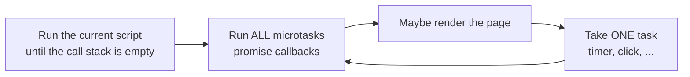
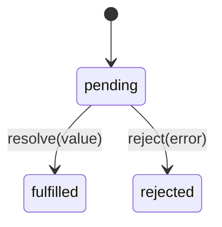

# Frontend 10 — Asynchronous JavaScript

> **JavaScript runs on one thread, yet a page can fetch data, run timers and respond to clicks all at once.** The event loop is how. Then promises and `async/await` let you write "wait for the server" code that reads top to bottom. This is the most important module for calling your Spring Boot API.

<!-- subtopic: f10_s1 -->
### Why async: one thread, never blocking

The browser runs your JavaScript, handles clicks and repaints the page on **one main thread**. If your code takes 3 seconds, the page freezes for 3 seconds: no scrolling, no clicks, no animations.

So slow things (network requests, timers, file reads) don't block. You **start** them and give a function to run **when they finish**:

```js
console.log("1. ask the server");
fetch("/api/tasks").then(() => console.log("3. data arrived"));
console.log("2. carry on immediately");
// prints 1, 2, 3
```

The browser does the waiting itself (its network and timer code runs outside your JavaScript thread), then queues your callback to run later.

Compared with Java: in Spring you'd usually block a thread while waiting for the database, and the server has many threads. In the browser there's only one, so blocking is never an option. Java's `CompletableFuture` is the closest cousin of JavaScript promises.

<details>
<summary>Why can't the browser just wait for a fetch to finish, like a blocking call in Java?</summary>

There's one main thread for your code, rendering and input. Blocking it while waiting for the network would freeze the whole page. Instead the request runs in the background and your code continues; a callback runs when the response arrives.
</details>

<!-- subtopic: f10_s2 -->
### The event loop

Four parts:

1. **Call stack**: the functions running right now (one at a time).
2. **Web APIs**: the browser's own background work: timers, network, DOM events.
3. **Task queue** (macrotasks): callbacks from `setTimeout`, `setInterval`, events, and network I/O.
4. **Microtask queue**: promise callbacks (`.then`, the code after `await`) and `queueMicrotask`.

The loop:



**Microtasks always run before the next task.** That's the rule behind every "what's the output" question:

```js
console.log("A");
setTimeout(() => console.log("B"), 0);         // task queue
Promise.resolve().then(() => console.log("C")); // microtask queue
console.log("D");
// A, D, C, B
```

- `A` and `D` run first: they're synchronous.
- Then the microtask `C` runs.
- Then the task `B`, even though its delay was 0.

`setTimeout(fn, 0)` means "as soon as possible after the current work and all microtasks", not "now". And a loop that keeps adding microtasks can starve rendering, freezing the page just like a long loop.

<details>
<summary>setTimeout(…, 0) and Promise.resolve().then(…): which callback runs first?</summary>

The promise callback. It's a microtask, and all microtasks run as soon as the call stack is empty, before the event loop takes the next task (the timer callback).
</details>

<!-- subtopic: f10_s3 -->
### Callbacks and callback hell

The original async style passes a function to call when the work is done:

```js
setTimeout(() => console.log("done"), 1000);
```

When each step depends on the previous one, callbacks nest deeper and deeper, the "pyramid of doom":

```js
getUser(id, (err, user) => {
  if (err) return showError(err);
  getTasks(user.id, (err, tasks) => {
    if (err) return showError(err);
    getComments(tasks[0].id, (err, comments) => {
      if (err) return showError(err);
      render(user, tasks, comments);           // three levels deep, errors handled three times
    });
  });
});
```

Problems: hard to read, errors must be handled at every level, hard to run steps in parallel or cancel them. Promises fix all of this.

<details>
<summary>What is callback hell?</summary>

Deeply nested callbacks, where each async step is written inside the previous step's callback. The code drifts right, error handling is repeated at every level, and the flow is hard to follow. Promises and async/await flatten it.
</details>

<!-- subtopic: f10_s4 -->
### Promises

A **promise** is an object for a value that will arrive later. It's in one of three states:



Once fulfilled or rejected it's **settled** and never changes again.

```js
fetch("/api/tasks")                         // returns a promise
  .then(response => response.json())        // returns another promise
  .then(tasks => render(tasks))
  .catch(error => showError(error))         // one catch for any failure above
  .finally(() => hideSpinner());            // runs either way
```

Each `.then` returns a **new promise**, so they chain flat instead of nesting. If a `.then` callback returns a promise, the chain waits for it.

Making your own promise (mostly to wrap old callback APIs):

```js
function wait(ms) {
  return new Promise(resolve => setTimeout(resolve, ms));
}
wait(500).then(() => console.log("half a second later"));

const ready = new Promise((resolve, reject) => {
  if (Math.random() > 0.5) resolve("ok");
  else reject(new Error("unlucky"));
});
```

An error thrown inside a `.then` callback rejects that promise and skips to the next `.catch`. A rejection with no `catch` anywhere shows "Uncaught (in promise)" in the console.

<details>
<summary>What are the three states of a promise?</summary>

Pending (not finished), fulfilled (finished with a value) and rejected (failed with a reason). Fulfilled and rejected are "settled", and a settled promise never changes state.
</details>

<!-- subtopic: f10_s5 -->
### async and await

`async/await` is syntax over promises that reads like normal top-to-bottom code:

```js
async function loadDashboard(userId) {
  try {
    const user = await getUser(userId);         // pauses this function, not the page
    const tasks = await getTasks(user.id);
    return { user, tasks };                     // an async function always returns a promise
  } catch (error) {
    console.error("Couldn't load the dashboard", error);
    throw error;                                // let the caller decide what to show
  } finally {
    hideSpinner();
  }
}
```

- `async` before a function makes it return a promise.
- `await` pauses **that function** until the promise settles, then gives its value (or throws its error). Other code keeps running in the meantime.
- Errors are caught with ordinary `try/catch`.

**Don't await things one by one when they don't depend on each other:**

```js
// Slow: about 2 seconds if each takes 1 second
const user = await getUser(id);
const settings = await getSettings(id);

// Fast: about 1 second, both requests run at the same time
const [user2, settings2] = await Promise.all([getUser(id), getSettings(id)]);
```

Also, `await` inside `forEach` doesn't wait (forEach ignores the returned promises). Use `for…of` for one-by-one, or `Promise.all` with `map` for in parallel.

<details>
<summary>Does await block the whole page?</summary>

No. It pauses only the async function it's in; that function's remaining code continues as a microtask when the promise settles. The main thread is free to handle clicks and rendering meanwhile.
</details>

<!-- subtopic: f10_s6 -->
### fetch: calling a REST API

`fetch` is the browser's built-in HTTP client. Calling the Spring Boot endpoints from the backend days:

```js
const API = "http://localhost:8080/api";

async function getTasks() {
  const res = await fetch(`${API}/tasks`);
  if (!res.ok) throw new Error(`Failed to load tasks: ${res.status}`);   // fetch doesn't throw on 404/500!
  return res.json();
}

async function createTask(title) {
  const res = await fetch(`${API}/tasks`, {
    method: "POST",
    headers: { "Content-Type": "application/json", Authorization: `Bearer ${token}` },
    body: JSON.stringify({ title }),
  });
  if (!res.ok) {
    const problem = await res.json().catch(() => ({}));   // Spring's error body, if any
    throw new Error(problem.message ?? `HTTP ${res.status}`);
  }
  return res.json();                                       // 201 Created with the new task
}
```

The big gotcha: **`fetch` only rejects on network failure** (server down, CORS blocked, no internet). A 404 or 500 is a *successful* fetch with `res.ok === false`, so always check `res.ok` (`status` 200–299).

Useful parts of the response: `res.status`, `res.ok`, `res.headers.get("Content-Type")`, and the body readers `res.json()`, `res.text()`, `res.blob()` (each can be read only once).

**Cancelling** a request (the user typed again, or left the page) uses `AbortController`:

```js
const controller = new AbortController();
fetch(`${API}/search?q=java`, { signal: controller.signal })
  .catch(err => { if (err.name !== "AbortError") throw err; });
controller.abort();                                // the fetch rejects with an AbortError
```

React apps use this in effect cleanups (Module 17). Many teams use **axios** instead of fetch: it throws on 4xx/5xx and parses JSON automatically (Module 20).

<details>
<summary>The server returns 500 but your catch block never runs. Why?</summary>

`fetch` only rejects for network errors. An HTTP error status still resolves the promise, with `response.ok` false. Check `if (!res.ok) throw new Error(...)` yourself.
</details>

<!-- subtopic: f10_s7 -->
### Promise.all, allSettled, race and any

Four ways to wait for several promises:

| Method | Resolves when | Rejects when | Use it for |
|---|---|---|---|
| `Promise.all` | **all** succeed: an array of values, in order | **any** fails (fail fast) | loading several things the page needs |
| `Promise.allSettled` | all finish, success or not | never | a dashboard where each widget can fail alone |
| `Promise.race` | the **first** to settle (success or failure) | the first to settle fails | a timeout |
| `Promise.any` | the **first success** | all fail (AggregateError) | the fastest of several mirrors |

```js
const [user, tasks] = await Promise.all([getUser(id), getTasks(id)]);

const results = await Promise.allSettled([loadNews(), loadWeather(), loadStocks()]);
results.forEach(r => {
  if (r.status === "fulfilled") show(r.value);
  else showWidgetError(r.reason);
});

// A timeout: whichever settles first wins
const timeout = (ms) => new Promise((_, reject) => setTimeout(() => reject(new Error("Timed out")), ms));
const data = await Promise.race([fetch("/api/slow"), timeout(5000)]);
```

Writing `Promise.all` yourself is a common interview question (Module 12).

<details>
<summary>One of three requests in Promise.all fails. What happens to the other two results?</summary>

`Promise.all` rejects immediately with that error, and the other results are discarded (the requests themselves still finish in the background). Use `Promise.allSettled` if you want every result regardless of failures.
</details>

## 📝 Module 10 Recap

1. Why is JavaScript async? → **one main thread runs code and rendering, so slow work must not block it**
2. Microtasks vs tasks? → **promise callbacks are microtasks and all run before the next task like setTimeout**
3. Output of log A, setTimeout B, promise C, log D? → **A, D, C, B**
4. Promise states? → **pending, fulfilled, rejected**
5. What does .then return? → **a new promise, which is why chains stay flat**
6. What does an async function return? → **always a promise**
7. How do you handle errors with await? → **try/catch**
8. Two independent requests: how do you wait? → **Promise.all so they run in parallel**
9. Does fetch reject on a 404? → **no; check response.ok**
10. How do you cancel a fetch? → **AbortController and its signal**
11. all vs allSettled? → **all fails fast on any rejection; allSettled waits for every result**
