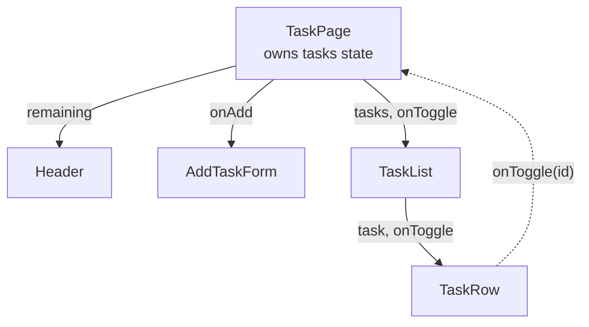

# Frontend 16 — State and Events

> **State is what makes a component interactive:** data that changes over time, like a counter, a form's text or a list of tasks. Change it the right way and React re-renders for you. Most beginner React bugs come from changing it the wrong way, so this module is all about the right way.

<!-- subtopic: f16_s1 -->
### useState

```tsx
import { useState } from "react";

function Counter() {
  const [count, setCount] = useState(0);     // [current value, setter], with 0 as the starting value
  return (
    <button onClick={() => setCount(count + 1)}>
      Clicked {count} times
    </button>
  );
}
```

Why not a normal variable?

```tsx
function BrokenCounter() {
  let count = 0;
  return <button onClick={() => { count++; }}>Clicked {count} times</button>;   // always shows 0
}
```

Two problems: changing `count` doesn't tell React to re-render, and even if it did, `let count = 0` would run again and reset it. `useState` fixes both: React **stores the value between renders** and **re-renders** when you call the setter.

**Props vs state:**

| | Props | State |
|---|---|---|
| Comes from | the parent | the component itself |
| Can the component change it? | no | yes, with its setter |
| When it changes | the parent re-rendered with new props | you called `setX` |

Each component instance has its own state: two `<Counter />` elements count independently.

State updates are **not immediate**. Calling `setCount` schedules a re-render; inside the current render, `count` keeps its old value:

```tsx
function handle() {
  setCount(count + 1);
  console.log(count);     // still the old value: this render's snapshot
}
```

<details>
<summary>Why doesn't changing a regular let variable update the screen in React?</summary>

React only re-renders when state or props change through React. A plain variable change is invisible to it, and the variable is re-created with its initial value on every render anyway. State lives outside the function, so it survives re-renders, and its setter triggers one.
</details>

<!-- subtopic: f16_s2 -->
### Handling events

```tsx
function SearchBox() {
  const [query, setQuery] = useState("");

  function handleSubmit(e: React.FormEvent<HTMLFormElement>) {
    e.preventDefault();                       // same as in plain DOM code (Module 9)
    console.log("search for", query);
  }

  return (
    <form onSubmit={handleSubmit}>
      <input value={query} onChange={e => setQuery(e.target.value)} />
      <button type="submit">Search</button>
      <button type="button" onClick={() => setQuery("")}>Clear</button>
    </form>
  );
}
```

- Event props are camelCase: `onClick`, `onChange`, `onSubmit`, `onKeyDown`, `onBlur`.
- **Pass a function, don't call it**: `onClick={handleClick}` or `onClick={() => remove(task.id)}`, never `onClick={handleClick()}` (that runs it during render).
- In React, `onChange` on an input fires **on every keystroke** (like the DOM's `input` event).
- Name handlers `handleX` inside a component, and props that take handlers `onX` (`onDelete`, `onToggle`).

Passing handlers down lets children report back to their parent:

```tsx
function TaskRow({ task, onToggle }: { task: Task; onToggle: (id: number) => void }) {
  return (
    <label>
      <input type="checkbox" checked={task.done} onChange={() => onToggle(task.id)} />
      {task.title}
    </label>
  );
}
```

<details>
<summary>onClick={deleteTask(id)} deletes every task as soon as the page loads. Why?</summary>

The parentheses call `deleteTask` during rendering, for every row, and pass its return value as the handler. Wrap it in a function so it runs on click: `onClick={() => deleteTask(id)}`.
</details>

<!-- subtopic: f16_s3 -->
### Updating objects and arrays without mutating

React decides whether to re-render by comparing the **old and new reference** (`Object.is`). If you change an object or array **in place**, it's still the same reference, so React may skip the update and your screen goes stale. **Always replace, never mutate** (Module 7):

```tsx
const [tasks, setTasks] = useState<Task[]>([]);

// ❌ mutating: same array, React may not re-render
tasks.push(newTask); setTasks(tasks);

// ✅ new arrays
setTasks([...tasks, newTask]);                                              // add
setTasks(tasks.filter(t => t.id !== id));                                    // remove
setTasks(tasks.map(t => (t.id === id ? { ...t, done: !t.done } : t)));     // update one
setTasks([...tasks].sort((a, b) => a.title.localeCompare(b.title)));        // sort a copy
```

Objects the same way:

```tsx
const [form, setForm] = useState({ title: "", priority: "medium", tags: [] as string[] });

setForm({ ...form, title: "New title" });                       // change one field
setForm({ ...form, tags: [...form.tags, "urgent"] });           // nested: copy every level you change
```

**Functional updates**: when the new state depends on the old, pass a function. React gives it the latest value:

```tsx
function addThree() {
  setCount(count + 1);
  setCount(count + 1);
  setCount(count + 1);         // count + 1 three times with the SAME old count → only +1
}

function addThreeRight() {
  setCount(c => c + 1);
  setCount(c => c + 1);
  setCount(c => c + 1);        // each gets the previous result → +3
}
```

Use the function form whenever the update reads the previous state, especially in timers and async code, where `count` may be stale. For deeply nested state, the **Immer** library (built into Redux Toolkit) lets you write "mutating" code that produces copies.

<details>
<summary>Why does setCount(count + 1) three times in a row only add 1?</summary>

All three read `count` from the same render, so each schedules "set to old + 1". The function form `setCount(c => c + 1)` receives the latest queued value each time, so three calls add 3.
</details>

<!-- subtopic: f16_s4 -->
### Lifting state up and one-way data flow

When two components need the same data, move the state to their **closest common parent** and pass it down as props, along with functions to change it:

```tsx
function TaskPage() {
  const [tasks, setTasks] = useState<Task[]>(initialTasks);
  const remaining = tasks.filter(t => !t.done).length;

  const toggle = (id: number) =>
    setTasks(ts => ts.map(t => (t.id === id ? { ...t, done: !t.done } : t)));
  const add = (title: string) =>
    setTasks(ts => [...ts, { id: Date.now(), title, done: false }]);

  return (
    <>
      <Header remaining={remaining} />
      <AddTaskForm onAdd={add} />
      <TaskList tasks={tasks} onToggle={toggle} />
    </>
  );
}
```



This is **one-way data flow**: data flows **down** as props; changes flow **up** as function calls; only the owner updates the state. It makes bugs easy to trace: to find why something changed, look at whoever owns the state.

When the common parent is far up the tree and props must pass through many layers that don't use them ("prop drilling"), that's the cue for context (Module 18) or a store (Module 19).

<details>
<summary>Two sibling components need to show and edit the same list. Where should the list's state live?</summary>

In their closest common parent. It passes the list down to both as props, along with callback functions that update the state.
</details>

<!-- subtopic: f16_s5 -->
### Forms: controlled vs uncontrolled inputs

A **controlled** input's value comes from state, and every change goes through React:

```tsx
function AddTaskForm({ onAdd }: { onAdd: (title: string) => void }) {
  const [title, setTitle] = useState("");
  const [priority, setPriority] = useState("medium");
  const [urgent, setUrgent] = useState(false);

  function handleSubmit(e: React.FormEvent) {
    e.preventDefault();
    if (!title.trim()) return;
    onAdd(title.trim());
    setTitle("");                                     // clearing is just setting state
  }

  return (
    <form onSubmit={handleSubmit}>
      <input value={title} onChange={e => setTitle(e.target.value)} placeholder="New task" />
      <select value={priority} onChange={e => setPriority(e.target.value)}>
        <option value="low">Low</option>
        <option value="medium">Medium</option>
        <option value="high">High</option>
      </select>
      <label>
        <input type="checkbox" checked={urgent} onChange={e => setUrgent(e.target.checked)} /> Urgent
      </label>
      <button disabled={!title.trim()}>Add</button>
    </form>
  );
}
```

An **uncontrolled** input keeps its own value in the DOM, and you read it when you need it, with a ref or `FormData`:

```tsx
function QuickAdd({ onAdd }: { onAdd: (title: string) => void }) {
  function handleSubmit(e: React.FormEvent<HTMLFormElement>) {
    e.preventDefault();
    const data = new FormData(e.currentTarget);
    onAdd(String(data.get("title")));
    e.currentTarget.reset();
  }
  return (
    <form onSubmit={handleSubmit}>
      <input name="title" defaultValue="" />
      <button>Add</button>
    </form>
  );
}
```

| | Controlled | Uncontrolled |
|---|---|---|
| Value lives in | React state | the DOM |
| Instant validation, formatting, disabling a button | easy | harder |
| Code | more | less |
| Typical use | most interactive forms | simple forms, file inputs, React Hook Form (Module 20) |

A warning you'll meet: "A component is changing an uncontrolled input to be controlled": you passed `value={undefined}` first and a string later. Always start with a defined value, like `useState("")`.

<details>
<summary>What makes an input "controlled"?</summary>

Its value is set from React state (`value={title}`) and every change goes through an `onChange` that updates that state. React is the single source of truth for what the input shows.
</details>

<!-- subtopic: f16_s6 -->
### Derived state: compute it, don't store it

If a value can be **calculated** from props or existing state, don't put it in state. Compute it during rendering:

```tsx
// ❌ duplicated state: easy to forget to update one of them
const [tasks, setTasks] = useState<Task[]>([]);
const [doneCount, setDoneCount] = useState(0);

// ✅ derived: always correct
const [tasks, setTasks] = useState<Task[]>([]);
const [filter, setFilter] = useState<"all" | "open" | "done">("all");

const doneCount = tasks.filter(t => t.done).length;
const visible = tasks.filter(t =>
  filter === "all" ? true : filter === "done" ? t.done : !t.done
);
```

Ask of every piece of state: **"could I compute this from something I already have?"** If yes, compute it. Examples that should almost never be state: counts and totals, filtered or sorted lists, a full name built from first and last names, "is the form valid?".

Keep state **minimal**: store the selected id (`selectedId`), not a copy of the selected object (which goes stale when the list updates).

If a computation is genuinely expensive (thousands of items), wrap it in `useMemo` (Module 18), but start with plain calculation; it's usually fast enough.

<details>
<summary>You keep tasks and filteredTasks both in state. What can go wrong?</summary>

They can disagree: when a task is added or toggled, you must remember to update both, and forgetting one leaves the screen wrong. Keep only `tasks` (and the filter) in state and compute `filteredTasks` during rendering.
</details>

## 📝 Module 16 Recap

1. What does useState return? → **the current value and a setter function**
2. Why not a plain variable? → **it's reset on every render and changing it doesn't re-render**
3. Is a state update immediate? → **no; it schedules a re-render, the current render keeps the old value**
4. onClick={handle} vs onClick={handle()}? → **pass the function; calling it runs during render**
5. How do you add to an array in state? → **setItems([...items, item]), never push**
6. When do you use setX(prev => …)? → **when the new value depends on the previous one**
7. What is lifting state up? → **moving shared state to the closest common parent and passing it down**
8. One-way data flow means? → **data goes down as props, changes go up as callbacks**
9. Controlled input? → **its value comes from state and changes go through onChange**
10. What is derived state? → **values computed from existing state or props during render, not stored**
