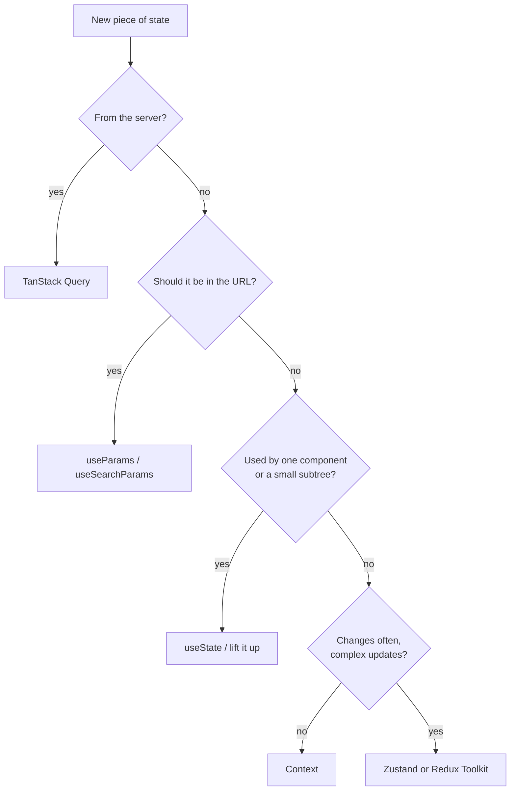

# Frontend 19 — Routing and State Management

> **Real apps have many pages and data that many components share.** React Router gives your single-page app real URLs; state-management tools decide where shared data lives. The most useful idea here: most "global state" is actually **server data**, and a tool like TanStack Query handles it better than any store.

<!-- subtopic: f19_s1 -->
### React Router: routes, links, params and layouts

React Router maps URLs to components, without reloading the page:

```bash
npm install react-router
```

```tsx
import { BrowserRouter, Routes, Route, Link, NavLink, Outlet, useParams } from "react-router";

export default function App() {
  return (
    <BrowserRouter>
      <Routes>
        <Route element={<Layout />}>                       {/* a layout around every page */}
          <Route index element={<Home />} />               {/* "/" */}
          <Route path="tasks" element={<TaskList />} />    {/* "/tasks" */}
          <Route path="tasks/:id" element={<TaskDetail />} />   {/* "/tasks/42" */}
          <Route path="*" element={<NotFound />} />        {/* anything else */}
        </Route>
      </Routes>
    </BrowserRouter>
  );
}

function Layout() {
  return (
    <>
      <nav>
        <NavLink to="/">Home</NavLink>                     {/* NavLink adds an "active" class */}
        <NavLink to="/tasks">Tasks</NavLink>
      </nav>
      <main><Outlet /></main>                              {/* the matched child page renders here */}
    </>
  );
}

function TaskDetail() {
  const { id } = useParams();                              // "42": params are always strings
  return <h1>Task {id}</h1>;
}
```

- **`Link` / `NavLink`** instead of `a href`: they change the URL without a full page reload.
- **`:id`** in a path is a URL parameter, read with `useParams`.
- **Nested routes + `Outlet`** share a layout (navbar, sidebar) across pages.
- **Query strings** (`/tasks?status=done&page=2`) are read and written with `useSearchParams`.

React Router v7 also offers "data mode" (`createBrowserRouter` with `loader` functions that fetch before rendering) and a full framework mode (formerly Remix). The component style above is the place to start.

**Deploying an SPA:** the server must return `index.html` for every path (so `/tasks/42` doesn't 404 on refresh). Vercel and Netlify have a rewrite setting for it; Spring Boot needs a forwarding controller if it serves the frontend.

<details>
<summary>Why use Link instead of an a href for links inside the app?</summary>

An `a href` makes the browser load a whole new page from the server, losing all React state. `Link` updates the URL with the History API and lets React Router render the new route instantly, in the same page.
</details>

<!-- subtopic: f19_s2 -->
### Navigating in code, protected routes and 404s

**Navigate after an action** (saving, logging in) with `useNavigate`:

```tsx
import { useNavigate } from "react-router";

function NewTaskPage() {
  const navigate = useNavigate();
  async function handleSave(task: NewTask) {
    const saved = await createTask(task);
    navigate(`/tasks/${saved.id}`);              // go to the new task
    // navigate(-1) goes back; navigate("/login", { replace: true }) replaces the history entry
  }
  /* … */
}
```

**Protected routes** send logged-out users to the login page:

```tsx
import { Navigate, Outlet, useLocation } from "react-router";

function RequireAuth() {
  const { user } = useAuth();                    // from your auth context (Module 20)
  const location = useLocation();
  if (!user) return <Navigate to="/login" replace state={{ from: location }} />;
  return <Outlet />;
}

<Route element={<RequireAuth />}>
  <Route path="tasks" element={<TaskList />} />
  <Route path="settings" element={<Settings />} />
</Route>
```

After logging in, send the user back where they were going: `navigate(location.state?.from?.pathname ?? "/")`.

Remember: hiding a page in the frontend is **convenience, not security**. Anyone can call your API directly, so Spring Security must protect every endpoint (as on the Spring Security days).

**404 pages**: a `path="*"` route catches unknown URLs. For a valid URL whose item doesn't exist (`/tasks/9999`), show a "not found" message in the page itself when the API returns 404.

<details>
<summary>Is a protected route enough to keep data private?</summary>

No. It only hides pages in the UI. The data is protected only if the backend checks authentication and authorisation on every request, because anyone can call the API without your frontend.
</details>

<!-- subtopic: f19_s3 -->
### Where should state live?

Before reaching for a library, sort your state into kinds. Each has a natural home:

| Kind of state | Example | Where it lives |
|---|---|---|
| **Local UI** | is this dropdown open, input text | `useState` in the component |
| **Shared UI** | the selected task shown in two panels | lifted to the common parent |
| **App-wide, rarely changing** | logged-in user, theme, language | context |
| **URL** | current page, filters, search, tab | the URL (`useParams`, `useSearchParams`) |
| **Server data** | tasks, users, anything from your API | a server-state cache: TanStack Query |
| **Complex client-only global** | a shopping cart, a multi-step editor, drag-and-drop board | a store: Redux Toolkit or Zustand |

Two big lessons:

- **Put filters, tabs and pagination in the URL.** Users can bookmark, share and refresh, and the back button works.
- **Server data isn't really "your" state.** It's a cache of what's on the server, with its own problems: loading, errors, staleness, refetching, deduplication. A store makes you solve all of those by hand; TanStack Query solves them for you.

Many apps that once needed Redux need only TanStack Query plus a little context.



<details>
<summary>Where should the current search filter and page number of a task list live, and why?</summary>

In the URL query string (`?status=done&page=2`). Then refreshing keeps them, users can bookmark or share the exact view, and the back button moves between filter states.
</details>

<!-- subtopic: f19_s4 -->
### Redux Toolkit

Redux keeps app state in one **store**. Components **dispatch actions**, **reducers** compute the new state (Module 18), and components **select** what they need. **Redux Toolkit (RTK)** is the official, modern way to write it, with far less boilerplate than old Redux:

```bash
npm install @reduxjs/toolkit react-redux
```

```tsx
// cartSlice.ts
import { createSlice, type PayloadAction } from "@reduxjs/toolkit";

type CartItem = { id: number; name: string; qty: number };

const cartSlice = createSlice({
  name: "cart",
  initialState: [] as CartItem[],
  reducers: {
    added(state, action: PayloadAction<{ id: number; name: string }>) {
      const item = state.find(i => i.id === action.payload.id);
      if (item) item.qty++;                     // looks like mutation: Immer turns it into a safe copy
      else state.push({ ...action.payload, qty: 1 });
    },
    removed(state, action: PayloadAction<number>) {
      return state.filter(i => i.id !== action.payload);
    },
  },
});
export const { added, removed } = cartSlice.actions;
export default cartSlice.reducer;

// store.ts
import { configureStore } from "@reduxjs/toolkit";
import cart from "./cartSlice";
export const store = configureStore({ reducer: { cart } });
export type RootState = ReturnType<typeof store.getState>;

// main.tsx: <Provider store={store}><App /></Provider>   (Provider from react-redux)

// CartButton.tsx
import { useDispatch, useSelector } from "react-redux";
function CartCount() {
  const count = useSelector((s: RootState) => s.cart.reduce((n, i) => n + i.qty, 0));
  return <span>🛒 {count}</span>;            // re-renders only when this number changes
}
```

Why teams pick Redux: predictable updates, great DevTools (time-travel through every action), and a standard structure for large teams. **RTK Query** adds server-data fetching and caching, similar to TanStack Query.

<details>
<summary>In a createSlice reducer you write state.push(item). Isn't that mutating state?</summary>

It looks like it, but Redux Toolkit runs reducers through Immer, which records the "mutations" on a draft and produces a new, immutable state. Outside createSlice/Immer, you must still never mutate.
</details>

<!-- subtopic: f19_s5 -->
### Zustand

Zustand is a much smaller global store: a hook you create, with no providers, actions or slices:

```bash
npm install zustand
```

```tsx
import { create } from "zustand";

type CartItem = { id: number; name: string; qty: number };
type CartState = {
  items: CartItem[];
  add: (item: { id: number; name: string }) => void;
  remove: (id: number) => void;
};

export const useCart = create<CartState>()(set => ({
  items: [],
  add: item => set(state => {
    const found = state.items.find(i => i.id === item.id);
    return {
      items: found
        ? state.items.map(i => (i.id === item.id ? { ...i, qty: i.qty + 1 } : i))
        : [...state.items, { ...item, qty: 1 }],
    };
  }),
  remove: id => set(state => ({ items: state.items.filter(i => i.id !== id) })),
}));

function CartCount() {
  const count = useCart(s => s.items.length);    // select a slice: re-renders only when it changes
  return <span>🛒 {count}</span>;
}

function AddButton({ product }: { product: { id: number; name: string } }) {
  const add = useCart(s => s.add);
  return <button onClick={() => add(product)}>Add to cart</button>;
}
```

| | Context | Zustand | Redux Toolkit |
|---|---|---|---|
| Setup | built in | tiny | more structure |
| Re-renders | every consumer | only components whose selected slice changed | same as Zustand |
| DevTools, middleware | no | optional | excellent |
| Good for | rarely changing values (theme, user) | most client-side global state | large apps and teams wanting strict conventions |

<details>
<summary>Why can Zustand avoid the re-render problem that context has?</summary>

Components subscribe with a selector (`useCart(s => s.items.length)`) and re-render only when that selected value changes. With context, every consumer re-renders whenever the provided value changes.
</details>

<!-- subtopic: f19_s6 -->
### Server state with TanStack Query

TanStack Query (formerly React Query) fetches, **caches**, deduplicates, retries and refreshes server data. It replaces most hand-written `useEffect` fetching (Module 17):

```bash
npm install @tanstack/react-query
```

```tsx
import { QueryClient, QueryClientProvider, useQuery, useMutation, useQueryClient } from "@tanstack/react-query";

const queryClient = new QueryClient();
// main.tsx: <QueryClientProvider client={queryClient}><App /></QueryClientProvider>

function TaskList() {
  const { data: tasks, isPending, error } = useQuery({
    queryKey: ["tasks"],                                  // the cache key
    queryFn: () => api.get<Task[]>("/tasks"),             // any function returning a promise
  });

  if (isPending) return <p>Loading…</p>;
  if (error) return <p role="alert">{error.message}</p>;
  return <ul>{tasks.map(t => <TaskRow key={t.id} task={t} />)}</ul>;
}

function AddTask() {
  const queryClient = useQueryClient();
  const mutation = useMutation({
    mutationFn: (title: string) => api.post<Task>("/tasks", { title }),
    onSuccess: () => queryClient.invalidateQueries({ queryKey: ["tasks"] }),   // refetch the list
  });
  return (
    <button disabled={mutation.isPending} onClick={() => mutation.mutate("New task")}>
      {mutation.isPending ? "Saving…" : "Add task"}
    </button>
  );
}

function TaskDetail({ id }: { id: number }) {
  const { data } = useQuery({ queryKey: ["tasks", id], queryFn: () => api.get<Task>(`/tasks/${id}`) });
  /* … */
}
```

What you get for free:

- **Caching**: two components asking for `["tasks"]` share one request and one cached result.
- **Stale-while-revalidate**: cached data shows instantly, and fresh data is fetched in the background (on window focus, reconnect, or after `staleTime`).
- **Retries**, **request deduplication**, **pagination and infinite queries**, **optimistic updates**, DevTools.
- **No race conditions**: results are keyed by `queryKey`.

The **query key** is everything the data depends on: `["tasks", { status, page }]`. Change the key and it fetches (and caches) that version.

<details>
<summary>After creating a task with a mutation, how does the task list update?</summary>

In the mutation's onSuccess, call `queryClient.invalidateQueries({ queryKey: ["tasks"] })`. That marks the cached list as stale and refetches it for every component showing it. (Or update the cache directly with `setQueryData` for an instant, optimistic feel.)
</details>

## 📝 Module 19 Recap

1. How do you read /tasks/:id's id? → **useParams() (always a string)**
2. Link vs a href? → **Link changes the route without reloading the page**
3. What renders a nested route's page inside a layout? → **&lt;Outlet /&gt;**
4. How do you navigate after saving? → **useNavigate()**
5. Does a protected route secure your data? → **no; the backend must check every request**
6. Where should filters and pagination live? → **in the URL**
7. Best home for server data? → **a server-state cache like TanStack Query**
8. Why can Redux Toolkit reducers "mutate"? → **Immer turns those changes into new immutable state**
9. Zustand's advantage over context? → **selector subscriptions: only affected components re-render**
10. What is a query key? → **the cache key, containing everything the data depends on**
11. How do you refresh a list after a mutation? → **invalidateQueries with its key**
