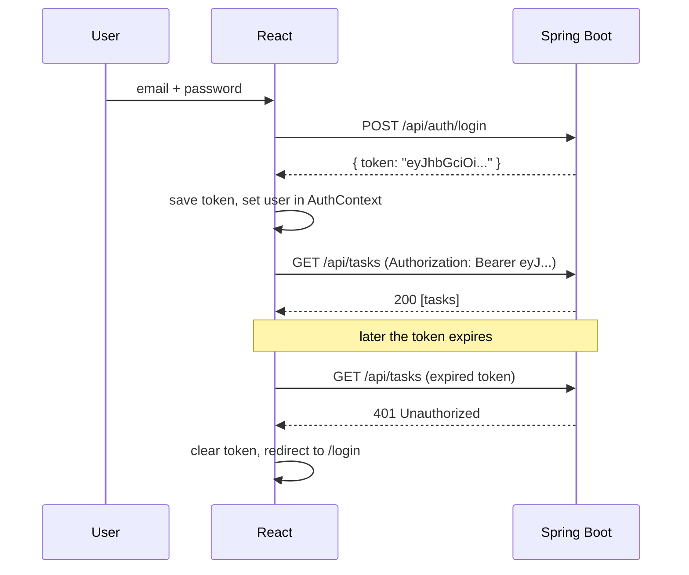

# Frontend 20 — React with a Spring Boot API

> **This is where the "fullstack" comes together.** You'll connect a React app to the Spring Boot API you built (the Task Manager from the project days): structure the project, call the API, get past CORS, log in with JWT, validate forms, and deploy both halves.

<!-- subtopic: f20_s1 -->
### Project structure for a real React app

Group code **by feature**, not by file type, once an app grows past a few screens:

```text
task-ui/
├─ src/
│  ├─ main.tsx                  providers: Router, QueryClient, Auth
│  ├─ App.tsx                   routes
│  ├─ api/
│  │  ├─ client.ts              one configured HTTP client (base URL, token, errors)
│  │  └─ types.ts               types matching your Spring DTOs
│  ├─ features/
│  │  ├─ auth/                  LoginPage.tsx, AuthContext.tsx, useAuth.ts
│  │  └─ tasks/                 TaskListPage.tsx, TaskForm.tsx, TaskRow.tsx, tasksApi.ts, useTasks.ts
│  ├─ components/               shared UI: Button, Modal, Spinner, Layout
│  ├─ hooks/                    shared hooks: useDebounce, useLocalStorage
│  └─ lib/                      helpers: formatDate, cn
├─ .env.development             VITE_API_URL=http://localhost:8080/api
└─ vite.config.ts
```

Guidelines:

- **One component per file**, named like the component (`TaskRow.tsx`).
- **Keep API calls out of components**: `tasksApi.ts` exports `getTasks`, `createTask`; components call hooks (`useTasks`) that use them. Changing an endpoint touches one file.
- **Mirror your Spring DTOs as TypeScript types** in one place:

```ts
// api/types.ts: match TaskResponse / CreateTaskRequest on the backend
export type Task = { id: number; title: string; description: string | null; done: boolean; dueDate: string | null };
export type CreateTask = { title: string; description?: string; dueDate?: string };
export type ApiError = { status: number; message: string; errors?: Record<string, string> };
```

(Tools like `openapi-typescript` can generate these from Springdoc's OpenAPI spec, so the two sides never drift.)

<details>
<summary>Why put API calls in their own module instead of calling fetch inside components?</summary>

One place knows the URLs, headers, token and error handling. Components stay about the UI, endpoints change in one file, and you can mock the module in tests.
</details>

<!-- subtopic: f20_s2 -->
### Calling your Spring Boot API with fetch or axios

A small client wraps the common parts: base URL, JSON, the token and errors:

```ts
// api/client.ts
const BASE = import.meta.env.VITE_API_URL;

export class HttpError extends Error {
  constructor(public status: number, message: string, public body?: unknown) { super(message); }
}

async function request<T>(path: string, options: RequestInit = {}): Promise<T> {
  const token = localStorage.getItem("token");
  const res = await fetch(`${BASE}${path}`, {
    ...options,
    headers: {
      "Content-Type": "application/json",
      ...(token ? { Authorization: `Bearer ${token}` } : {}),
      ...options.headers,
    },
  });
  if (res.status === 204) return undefined as T;                      // DELETE: no body
  const body = await res.json().catch(() => null);
  if (!res.ok) throw new HttpError(res.status, body?.message ?? `HTTP ${res.status}`, body);
  return body as T;
}

export const api = {
  get: <T>(path: string) => request<T>(path),
  post: <T>(path: string, data: unknown) => request<T>(path, { method: "POST", body: JSON.stringify(data) }),
  put: <T>(path: string, data: unknown) => request<T>(path, { method: "PUT", body: JSON.stringify(data) }),
  delete: (path: string) => request<void>(path, { method: "DELETE" }),
};
```

```ts
// features/tasks/tasksApi.ts
export const getTasks = () => api.get<Task[]>("/tasks");
export const createTask = (t: CreateTask) => api.post<Task>("/tasks", t);
export const deleteTask = (id: number) => api.delete(`/tasks/${id}`);
```

**axios** is a popular alternative that already throws on 4xx/5xx, parses JSON, and has **interceptors** (code that runs on every request or response):

```ts
import axios from "axios";
export const http = axios.create({ baseURL: import.meta.env.VITE_API_URL });
http.interceptors.request.use(config => {
  const token = localStorage.getItem("token");
  if (token) config.headers.Authorization = `Bearer ${token}`;
  return config;
});
const { data } = await http.get<Task[]>("/tasks");
```

Either way, combine it with TanStack Query (Module 19) for caching and loading states.

<details>
<summary>Your Spring controller returns 400 with validation errors. Where should the frontend read them?</summary>

From the response body: the client should parse the JSON body even when `res.ok` is false (Spring's `@ControllerAdvice` error format, or ProblemDetail) and put it on the thrown error, so the form can show each field's message.
</details>

<!-- subtopic: f20_s3 -->
### CORS: the dev proxy and Spring's CORS config

Your React dev server runs on `http://localhost:5173` and Spring on `http://localhost:8080`. Different port = different **origin**, so the browser blocks the response unless the server allows it:

```text
Access to fetch at 'http://localhost:8080/api/tasks' from origin 'http://localhost:5173'
has been blocked by CORS policy: No 'Access-Control-Allow-Origin' header is present.
```

CORS is enforced by the **browser** (Postman and curl don't care), and it's fixed on the **server**, or avoided with a proxy.

**Option 1: Vite's dev proxy** (development). The browser only talks to Vite, which forwards `/api` to Spring, so it's same-origin:

```ts
// vite.config.ts
export default defineConfig({
  plugins: [react()],
  server: {
    proxy: { "/api": "http://localhost:8080" },
  },
});
// then call fetch("/api/tasks") with a relative URL
```

**Option 2: allow the origin in Spring** (needed when frontend and backend are on different domains in production):

```java
@Configuration
public class CorsConfig {
    @Bean
    CorsConfigurationSource corsConfigurationSource(@Value("${app.frontend-url}") String frontendUrl) {
        CorsConfiguration config = new CorsConfiguration();
        config.setAllowedOrigins(List.of(frontendUrl));          // e.g. https://tasks.vercel.app, never "*" with credentials
        config.setAllowedMethods(List.of("GET", "POST", "PUT", "PATCH", "DELETE", "OPTIONS"));
        config.setAllowedHeaders(List.of("Authorization", "Content-Type"));
        config.setAllowCredentials(true);                        // only if you send cookies
        UrlBasedCorsConfigurationSource source = new UrlBasedCorsConfigurationSource();
        source.registerCorsConfiguration("/api/**", config);
        return source;
    }
}
// and in the SecurityFilterChain: http.cors(Customizer.withDefaults())
```

With Spring Security, CORS must be enabled **in the security chain** too, or the preflight `OPTIONS` request is rejected with 401/403 before your config is reached. `@CrossOrigin` on a controller works for simple cases without Spring Security. Module 25 explains preflight requests in depth.

<details>
<summary>The API works in Postman but the browser shows a CORS error. Why?</summary>

CORS is a browser rule: the browser refuses to give a page the response from another origin unless the server sends Access-Control-Allow-Origin for that page's origin. Postman isn't a browser, so it ignores CORS. Fix it on the server (or use a same-origin proxy).
</details>

<!-- subtopic: f20_s4 -->
### Login with JWT

The flow with the JWT-based Spring Security setup from the backend days:



An auth context holds the user and login/logout:

```tsx
type User = { email: string; roles: string[] };
type AuthCtx = { user: User | null; login: (email: string, password: string) => Promise<void>; logout: () => void };
const AuthContext = createContext<AuthCtx | null>(null);

export function AuthProvider({ children }: { children: React.ReactNode }) {
  const [user, setUser] = useState<User | null>(() => userFromToken(localStorage.getItem("token")));

  async function login(email: string, password: string) {
    const { token } = await api.post<{ token: string }>("/auth/login", { email, password });
    localStorage.setItem("token", token);
    setUser(userFromToken(token));
  }

  function logout() {
    localStorage.removeItem("token");
    setUser(null);
  }

  return <AuthContext.Provider value={{ user, login, logout }}>{children}</AuthContext.Provider>;
}

// Read the user from the token's payload (the middle part). This only DISPLAYS info;
// the server verifies the signature on every request.
function userFromToken(token: string | null): User | null {
  if (!token) return null;
  try {
    const payload = JSON.parse(atob(token.split(".")[1].replace(/-/g, "+").replace(/_/g, "/")));
    if (payload.exp * 1000 < Date.now()) return null;          // already expired
    return { email: payload.sub, roles: payload.roles ?? [] };
  } catch {
    return null;
  }
}
```

Handle expiry in one place: when any request returns **401**, clear the token and send the user to `/login` (an axios response interceptor, or a check in the `request` function above).

Points that come up in interviews:

- **The token is not encrypted**: anyone can read its payload. Never put secrets in it. The signature only proves it wasn't changed.
- **Where to store it** (localStorage vs an HttpOnly cookie) is a real trade-off between XSS and CSRF risks (Module 25).
- **Short-lived access tokens + refresh tokens** limit the damage of a stolen token: when the access token expires, the app silently calls `/auth/refresh` to get a new one.
- **Hide UI by role** (`user.roles.includes("ADMIN")`), but enforce it on the server.

<details>
<summary>Can the frontend trust the roles it decodes from a JWT?</summary>

Only for display (showing or hiding buttons). Decoding doesn't verify anything, and a user could edit what their browser shows. The backend verifies the token's signature and checks roles on every request; that's the real security.
</details>

<!-- subtopic: f20_s5 -->
### Forms with validation: React Hook Form and Zod

For more than a couple of fields, **React Hook Form** handles form state, validation and submit with few re-renders, and **Zod** describes the rules once, as a schema that also produces the TypeScript type:

```bash
npm install react-hook-form zod @hookform/resolvers
```

```tsx
import { useForm } from "react-hook-form";
import { zodResolver } from "@hookform/resolvers/zod";
import { z } from "zod";

const taskSchema = z.object({
  title: z.string().trim().min(3, "At least 3 characters").max(100),
  description: z.string().max(500).optional(),
  dueDate: z.string().optional(),
});
type TaskForm = z.infer<typeof taskSchema>;            // the type comes from the schema

function TaskFormPage() {
  const { register, handleSubmit, setError, formState: { errors, isSubmitting } } = useForm<TaskForm>({
    resolver: zodResolver(taskSchema),
  });

  async function onSubmit(values: TaskForm) {
    try {
      await createTask(values);
    } catch (e) {
      if (e instanceof HttpError && e.status === 400) {
        const fieldErrors = (e.body as ApiError)?.errors ?? {};          // server-side @Valid errors
        for (const [field, message] of Object.entries(fieldErrors)) {
          setError(field as keyof TaskForm, { message });
        }
      } else {
        setError("root", { message: "Couldn't save. Please try again." });
      }
    }
  }

  return (
    <form onSubmit={handleSubmit(onSubmit)} noValidate>
      <label htmlFor="title">Title</label>
      <input id="title" {...register("title")} aria-invalid={!!errors.title} />
      {errors.title && <p role="alert">{errors.title.message}</p>}

      <label htmlFor="due">Due date</label>
      <input id="due" type="date" {...register("dueDate")} />

      {errors.root && <p role="alert">{errors.root.message}</p>}
      <button disabled={isSubmitting}>{isSubmitting ? "Saving…" : "Save"}</button>
    </form>
  );
}
```

The same rule lives in three places on purpose: **Zod** for instant feedback, Spring's **`@Valid` + Bean Validation** as the real gate, and **server errors mapped back to fields** so the user sees them where they belong. Zod is also handy for validating API responses at runtime (TypeScript can't, Module 13).

<details>
<summary>Why show server validation errors next to fields if the frontend already validates?</summary>

Some rules can only be checked on the server (an email already registered, a date conflicting with existing data), and the frontend rules may drift from the backend's. Mapping the server's field errors back to the form keeps the experience right in both cases.
</details>

<!-- subtopic: f20_s6 -->
### Build and deploy

```bash
npm run build      # type-check + bundle into dist/
```

Two common setups:

**1. Separate deployments** (most common):

| Part | Where | Config |
|---|---|---|
| React (`dist/`) | Vercel, Netlify, S3 + CloudFront | `VITE_API_URL=https://api.mytasks.com/api` at build time; a rewrite so every path serves `index.html` |
| Spring Boot | Render, Railway, AWS ECS/EC2, a Docker host | CORS allows `https://mytasks.com`; database and JWT secret as environment variables |

On Vercel, a `vercel.json` next to `package.json` sends every route to the SPA:

```json
{ "rewrites": [{ "source": "/(.*)", "destination": "/index.html" }] }
```

**2. One deployment**: copy `dist/` into Spring Boot's `src/main/resources/static/` (or let the Maven build do it with `frontend-maven-plugin`). The same origin serves the app and the API, so there's no CORS at all; add a controller that forwards unknown non-API paths to `index.html`.

A checklist before going live:

- `VITE_API_URL` points at the production API, and **no secrets** are in the frontend (Module 11).
- CORS allows the real frontend origin only.
- HTTPS everywhere (Vercel and Netlify do it automatically).
- The SPA rewrite works: refresh on `/tasks/42` doesn't 404.
- Error and loading states look right on a slow connection (DevTools → Network → Slow 4G).

<details>
<summary>After deploying, refreshing the page at /tasks/42 gives a 404 from the host. Why, and how do you fix it?</summary>

The host looks for a file at /tasks/42, but only index.html exists; routing happens in the browser. Add a rewrite (Vercel/Netlify) or a forwarding controller (Spring) that serves index.html for every non-file, non-API path.
</details>

## 📝 Module 20 Recap

1. How should a growing React app be organised? → **by feature, with API calls in their own modules**
2. Why mirror Spring DTOs as TypeScript types? → **one shared contract, checked by the compiler**
3. What do axios interceptors do? → **run code on every request or response, like adding the token or handling 401**
4. Who enforces CORS? → **the browser; the server fixes it by allowing the origin**
5. Two ways around CORS in development? → **Vite's dev proxy, or allowing the origin in Spring**
6. Where must CORS be enabled when using Spring Security? → **in the security filter chain too, so preflight isn't rejected**
7. Is a JWT encrypted? → **no, only signed; anyone can read the payload**
8. What should happen on a 401? → **clear the token and redirect to login**
9. What does Zod give a form? → **one schema for validation rules and the TypeScript type**
10. Why does refreshing a deep link 404 on a static host? → **the host needs a rewrite to index.html**
