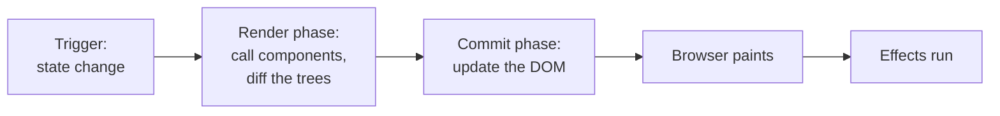

# Frontend 21 — React Performance

> **React is fast by default, and most apps never need tuning.** When one does, it's almost always the same few causes: components re-rendering for no reason, huge lists, or too much JavaScript loaded up front. This module shows how rendering works, how to find the slow part, and the fix for each cause.

<!-- subtopic: f21_s1 -->
### How React renders, and what triggers a re-render

An update goes through two phases:

1. **Render phase**: React calls your components to get the new JSX (a tree of plain objects), and compares it with the previous one. Nothing on screen changes yet, and this phase can be paused or thrown away.
2. **Commit phase**: React applies the **minimal** set of DOM changes, then runs layout effects, and the browser paints. Then `useEffect`s run.



A component re-renders when:

- **its own state changes** (`setX` with a new value);
- **its parent re-renders** (by default, all children re-render too, whatever their props);
- **a context it reads changes**.

Note what's **not** on the list: "its props changed". Children re-render because their parent did, even with identical props. That's usually fine: a re-render is just calling a function, and if the JSX is the same, React touches no DOM at all.

"Re-render" ≠ "slow". It's only a problem when a component is **expensive** to render, or renders **very often** (on every keystroke, every scroll event).

<details>
<summary>A parent's state changes. Do its children re-render even if their props are the same?</summary>

Yes, by default. When a component renders, React renders all of its children too. Only if a child is wrapped in React.memo (and its props are the same references) does React skip it.
</details>

<!-- subtopic: f21_s2 -->
### React.memo, useMemo and useCallback: avoiding wasted renders

**`React.memo`** wraps a component so it skips re-rendering when its props are shallowly equal (every prop `Object.is` the same):

```tsx
const TaskRow = memo(function TaskRow({ task, onToggle }: { task: Task; onToggle: (id: number) => void }) {
  console.log("render", task.id);
  return <li onClick={() => onToggle(task.id)}>{task.title}</li>;
});
```

The catch: **new objects and functions are created on every parent render**, so they're never "the same" and memo is useless:

```tsx
function TaskList({ tasks }: { tasks: Task[] }) {
  const [filter, setFilter] = useState("");
  const toggle = (id: number) => { /* … */ };              // ❌ new function each render: every TaskRow re-renders
  return tasks.map(t => <TaskRow key={t.id} task={t} onToggle={toggle} />);
}
```

Stabilise the props with `useCallback` (functions) and `useMemo` (objects, arrays, computed values):

```tsx
const toggle = useCallback((id: number) => {
  setTasks(ts => ts.map(t => (t.id === id ? { ...t, done: !t.done } : t)));   // functional update: no deps needed
}, []);
const style = useMemo(() => ({ color: theme.primary }), [theme.primary]);
```

Now typing in the filter re-renders `TaskList`, but each memoised `TaskRow` with unchanged `task` and `toggle` is skipped.

Often a **simpler fix** beats memoisation:

- **Move state down**: if only the search box uses `filter`, put that state *in* the search box, so typing re-renders only it.
- **Pass children**: `<Layout><ExpensiveTree /></Layout>`; when Layout's own state changes, `children` is the same element, so the expensive tree isn't re-rendered.

The React Compiler (Module 22) automates much of this.

<details>
<summary>You wrapped a child in React.memo but it still re-renders every time. What's the likely cause?</summary>

A prop is a new object, array or function on every parent render (an inline `() => …` handler or `{ … }` style), so the shallow comparison always fails. Stabilise it with useCallback/useMemo, or restructure so the prop doesn't change.
</details>

<!-- subtopic: f21_s3 -->
### Keys and component identity

React keeps a component's state as long as the **same component type** stays in the **same position** in the tree (with the same **key**). Change any of those and the old component is destroyed, with its state, and a new one is created.

```tsx
{isEditing ? <input defaultValue={title} /> : <span>{title}</span>}   // switching types: input state is reset
```

```tsx
function Page({ showBanner }: { showBanner: boolean }) {
  return (
    <div>
      {showBanner && <Banner />}
      <Counter />            {/* keeps its state: {showBanner && …} holds a slot even when false */}
    </div>
  );
}
```

**Keys can reset a component on purpose.** A profile editor should start fresh for each user:

```tsx
<EditProfile key={userId} userId={userId} />   // a new userId = a brand-new EditProfile with fresh state
```

That's cleaner than an effect that resets every field when `userId` changes (Module 17).

And the **performance** side of keys in lists (Module 15): stable keys let React **move** existing DOM nodes when items are reordered. Index keys or random keys make it rewrite or rebuild every item, which is slow and loses state.

A common bug: **defining a component inside another component**:

```tsx
function Parent() {
  function Child() { return <input />; }     // ❌ a NEW component type on every render
  return <Child />;                           // so it's unmounted and remounted: the input loses focus and text
}
```

Always define components at the top level of a module.

<details>
<summary>How can a key reset a component's state, and when is that useful?</summary>

When a component's key changes, React treats it as a different component: it unmounts the old one and mounts a new one with fresh state. Useful when the same form or view should start over for a different item, like `<Editor key={docId} />`.
</details>

<!-- subtopic: f21_s4 -->
### Code splitting with lazy and Suspense

By default, the whole app is one JavaScript bundle, downloaded before anything shows. **Code splitting** loads parts only when needed, usually per route:

```tsx
import { lazy, Suspense } from "react";

const Dashboard = lazy(() => import("./features/dashboard/Dashboard"));   // a separate chunk
const Settings = lazy(() => import("./features/settings/Settings"));

function App() {
  return (
    <Suspense fallback={<Spinner />}>               {/* shown while a chunk downloads */}
      <Routes>
        <Route path="/" element={<Dashboard />} />
        <Route path="/settings" element={<Settings />} />
      </Routes>
    </Suspense>
  );
}
```

`lazy` needs a **default export**. Vite creates a separate file for each dynamic `import()` automatically.

What to split:

- **Routes**: the biggest, easiest win.
- **Heavy, rarely used components**: a chart library, a rich-text editor, a PDF viewer, an admin panel.
- **Big libraries used in one place**: `const { jsPDF } = await import("jspdf")` inside the click handler that needs it.

Check your bundle with `npx vite-bundle-visualizer` (or the build output sizes), and preload a chunk the user will probably need next (on hover over the link) so the spinner rarely appears.

<details>
<summary>What does React.lazy need from the module it imports, and what must wrap a lazy component?</summary>

The module must have a default export (the component). A `<Suspense fallback={…}>` must wrap it somewhere above, to show the fallback while the code downloads.
</details>

<!-- subtopic: f21_s5 -->
### Long lists: virtualization

Rendering 10,000 rows means 10,000+ DOM nodes: slow to render, slow to scroll, heavy on memory. **Virtualization** (windowing) renders only the rows in view, plus a few extra, and swaps them as you scroll:

```text
┌──────────────── viewport ────────────────┐
│ row 41                                   │  ← only rows 38–60 exist in the DOM
│ row 42                                   │
│ …                                        │
│ row 55                                   │
└──────────────────────────────────────────┘
  rows 0–37 and 61–9,999: just empty space (a tall spacer)
```

```tsx
import { useVirtualizer } from "@tanstack/react-virtual";

function BigList({ items }: { items: Task[] }) {
  const parentRef = useRef<HTMLDivElement>(null);
  const virtualizer = useVirtualizer({
    count: items.length,
    getScrollElement: () => parentRef.current,
    estimateSize: () => 40,          // row height in px
    overscan: 8,
  });

  return (
    <div ref={parentRef} style={{ height: 500, overflow: "auto" }}>
      <div style={{ height: virtualizer.getTotalSize(), position: "relative" }}>
        {virtualizer.getVirtualItems().map(row => (
          <div key={row.key}
               style={{ position: "absolute", top: 0, width: "100%", height: row.size, transform: `translateY(${row.start}px)` }}>
            {items[row.index].title}
          </div>
        ))}
      </div>
    </div>
  );
}
```

Libraries: **TanStack Virtual**, **react-window**, **react-virtuoso** (handles variable heights easily).

Alternatives: **pagination** or **infinite scroll** with "load more" (Module 26), which also save server work. Virtualize when users genuinely need to scroll through thousands of items already loaded.

<details>
<summary>What is list virtualization?</summary>

Rendering only the items currently visible in a scroll container (plus a small buffer) and positioning them inside a spacer as tall as the full list. The DOM stays small no matter how many items there are, so rendering and scrolling stay fast.
</details>

<!-- subtopic: f21_s6 -->
### Finding slow components with the Profiler

**Measure before optimising.** Guessing usually optimises the wrong thing.

1. Install the **React Developer Tools** browser extension.
2. **Profiler** tab → ⏺ record → do the slow interaction (type in the search box) → stop.
3. The **flame graph** shows every component that rendered, how long it took, and (with "Record why each component rendered" on in settings) **why**: state changed, props changed, parent rendered, hooks changed.
4. In **Components** settings, turn on "Highlight updates when components render" to see re-renders flash on screen.

Look for: a component taking many milliseconds, or many components re-rendering on every keystroke when they don't need to.

Then apply the matching fix:

| Problem | Fix |
|---|---|
| state too high, re-rendering a big tree | move state down, or pass children |
| memoised child re-renders anyway | stabilise props with useCallback/useMemo |
| one expensive calculation | useMemo |
| thousands of rows | virtualization or pagination |
| slow first load | code splitting, smaller dependencies |
| typing feels laggy because of slow results | useDeferredValue / useTransition (Module 18) |
| a context changes and everything re-renders | split the context, or use a store with selectors |

Also check the browser's **Performance** tab for long tasks (over 50 ms) and Lighthouse for load performance (Module 24). Always test performance with a **production build** (`npm run build && npm run preview`): development mode is much slower and runs StrictMode's double renders.

<details>
<summary>Why profile with a production build?</summary>

Development builds include extra checks, warnings and StrictMode double rendering, so they're much slower and can point you at problems real users never have. Measure what users actually run.
</details>

## 📝 Module 21 Recap

1. The two phases of an update? → **render (call components, diff) and commit (update the DOM)**
2. Three things that cause a re-render? → **own state change, parent re-render, context change**
3. Is a re-render always slow? → **no; unchanged output means no DOM work**
4. What does React.memo do? → **skips re-rendering when props are shallowly equal**
5. Why might memo fail? → **new object or function props every render**
6. Two fixes simpler than memo? → **move state down; pass expensive parts as children**
7. How do you reset a component's state? → **change its key**
8. Why not define a component inside another? → **it's a new type each render, so it remounts and loses state**
9. What does lazy + Suspense do? → **loads a component's code on demand, showing a fallback meanwhile**
10. What is virtualization? → **rendering only the visible rows of a long list**
11. First step before optimising? → **measure with the React Profiler on a production build**
