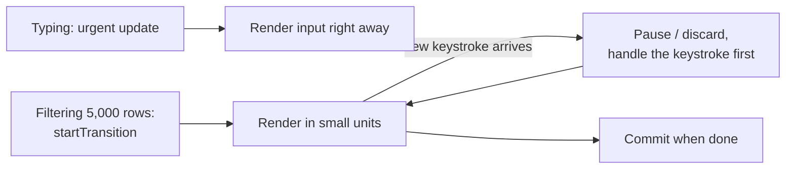

# Frontend 22 — React Internals and Modern React

> **Senior frontend interviews ask how React works, not just how to use it.** This module covers the virtual DOM and reconciliation, Fiber and concurrent rendering, Suspense and error boundaries, the rendering strategies (CSR, SSR, SSG), Next.js and Server Components, and what React 19 adds.

<!-- subtopic: f22_s1 -->
### The virtual DOM and reconciliation

JSX produces **React elements**: lightweight JavaScript objects describing what should be on screen, like `{ type: "li", props: { className: "task", children: "Learn React" } }`. The tree of these is often called the **virtual DOM**.

On each update, React builds a new element tree and compares it with the previous one. That diff is **reconciliation**, and the result is the minimal list of real DOM operations.

A perfect tree diff costs O(n³), far too slow. React uses **two heuristics** that make it O(n):

1. **Different element types produce different trees.** If a `div` becomes a `section`, or `TaskList` becomes `TaskGrid`, React doesn't compare their insides: it destroys the old subtree (and its state) and builds the new one.
2. **Keys identify children across renders.** In a list, React matches old and new children by `key`, so it can move, insert and delete items efficiently instead of comparing by position.

```text
Before: <ul> <li key="a">A</li> <li key="b">B</li> </ul>
After:  <ul> <li key="c">C</li> <li key="a">A</li> <li key="b">B</li> </ul>

With keys:    insert "c" at the start; a and b are reused   → 1 DOM insertion
With indexes: item 0 "A"→"C", item 1 "B"→"A", add item 2 "B" → 2 text changes + 1 insertion
```

Same type and same key → React keeps the DOM node and component state, and only updates the props/attributes that changed.

A common misconception: **the virtual DOM isn't "faster than the DOM"**. Hand-written DOM updates can be faster. Its value is that you write simple declarative code ("here's the UI for this state") and get updates that are fast enough, automatically.

<details>
<summary>What two assumptions make React's diffing algorithm O(n)?</summary>

Elements of different types produce entirely different trees (so React replaces instead of comparing), and keys tell React which children are the same across renders (so lists are matched by identity rather than position).
</details>

<!-- subtopic: f22_s2 -->
### Fiber, batching and concurrent rendering

**Fiber** (React 16) is React's internal engine. Each component instance has a **fiber**: a node holding its type, props, state, hooks list, effects and links to its parent, child and sibling. Because rendering walks this linked structure in small units, React can **pause, resume, prioritise or abandon** rendering work instead of doing it all in one go.

That enables **concurrent rendering** (React 18): urgent updates (typing, clicking) can interrupt a non-urgent render (filtering a big list, switching a heavy tab). You opt in with `useTransition` and `useDeferredValue` (Module 18). The render phase can be interrupted; the commit phase is always done in one go, so users never see a half-updated screen.



This is also why React requires components to be **pure**: a render may run, be thrown away and run again.

**Automatic batching** (React 18): several state updates in the same event, timeout or promise callback produce **one** re-render:

```tsx
async function save() {
  const task = await createTask(form);
  setTasks(ts => [...ts, task]);
  setForm(empty);
  setSaving(false);           // three updates → one re-render (before React 18: three, in async code)
}
```

`flushSync` forces an immediate update in the rare case you need the DOM updated before the next line (for example, to scroll to a just-added item).

<details>
<summary>What is Fiber, and what does it make possible?</summary>

Fiber is React's internal reconciliation engine, where each component is a unit of work in a linked tree. Because work is split into units, React can pause, prioritise and resume rendering, which is what makes concurrent features like transitions possible.
</details>

<!-- subtopic: f22_s3 -->
### Suspense and error boundaries

**Suspense** shows a fallback while something inside isn't ready yet: lazily loaded code (Module 21), or data in frameworks and libraries that support it (Next.js, TanStack Query's `useSuspenseQuery`, React 19's `use`):

```tsx
<Suspense fallback={<TaskListSkeleton />}>
  <TaskList />                       {/* "suspends" until its data is ready */}
</Suspense>
```

You declare loading states by **where you put the boundaries**, instead of `if (loading)` in every component. Nested boundaries let the page appear piece by piece.

**Error boundaries** catch errors thrown while **rendering** a subtree, and show a fallback instead of a blank white page (by default, an uncaught render error unmounts the whole app):

```tsx
import { ErrorBoundary } from "react-error-boundary";   // the usual small library

<ErrorBoundary fallback={<p>Something went wrong in the task list.</p>}>
  <TaskList />
</ErrorBoundary>
```

Error boundaries are still written as **class components** (`componentDidCatch` / `getDerivedStateFromError`) under the hood; there's no hook equivalent, so most people use `react-error-boundary`.

What they **don't** catch: errors in event handlers, in async code (`setTimeout`, promise callbacks), or in the boundary itself. Handle those with `try/catch`, and report everything to a monitoring tool (Sentry) in production.

Put boundaries around **independent sections** (a widget, a route) so one failure doesn't take down the page.

<details>
<summary>Does an error boundary catch an error thrown in an onClick handler?</summary>

No. Error boundaries only catch errors during rendering, lifecycle methods and constructors in their subtree. Errors in event handlers and async code need try/catch (and can then set state to show an error).
</details>

<!-- subtopic: f22_s4 -->
### CSR, SSR, SSG and hydration

Where and when is the HTML produced?

| Strategy | HTML is built | First paint | SEO | Good for |
|---|---|---|---|---|
| **CSR** (client-side rendering) | in the browser, by JavaScript | after JS downloads and runs | weaker | dashboards, apps behind login (a Vite React app) |
| **SSR** (server-side rendering) | on the server, **per request** | fast, with real content | strong | personalised or frequently changing public pages |
| **SSG** (static generation) | at **build time** | fastest (static files on a CDN) | strong | blogs, docs, marketing pages |
| **ISR** (incremental static regeneration) | at build time, rebuilt in the background every N seconds | fast | strong | product catalogues, news |

With SSR and SSG, the browser first receives ready-made HTML, then downloads the JavaScript, and React **hydrates** it: attaches event handlers and state to the existing HTML instead of rebuilding it. Until hydration finishes, the page is visible but not interactive.

**Hydration mismatch** errors happen when the server's HTML differs from what the client renders on its first pass. Typical causes: `Date.now()`, `Math.random()`, `window` or `localStorage` read during render. Move browser-only logic into `useEffect`.

**Streaming SSR** sends HTML in chunks as Suspense boundaries resolve, so slow data doesn't hold up the whole page.

<details>
<summary>What is hydration?</summary>

When a page is server-rendered, the browser receives finished HTML. Hydration is React running on the client, matching its component tree to that existing HTML and attaching event listeners and state, so the static page becomes interactive without being re-created.
</details>

<!-- subtopic: f22_s5 -->
### Next.js and React Server Components

**Next.js** is the most popular React framework: routing by folders, SSR/SSG/ISR, API routes, image and font optimisation, and production defaults. Its **App Router** is built on **React Server Components (RSC)**.

**Server Components** run only on the server. They can read the database or call internal APIs directly, and their code is **never sent to the browser**:

```tsx
// app/tasks/page.tsx: a Server Component (the default in the App Router)
export default async function TasksPage() {
  const tasks = await fetch("https://api.internal/tasks", { cache: "no-store" }).then(r => r.json());
  return (
    <main>
      <h1>Tasks</h1>
      <TaskFilter />                                   {/* an interactive Client Component */}
      <ul>{tasks.map((t: Task) => <li key={t.id}>{t.title}</li>)}</ul>
    </main>
  );
}
```

```tsx
// app/tasks/TaskFilter.tsx
"use client";                                           // marks a Client Component: can use state, effects, events
import { useState } from "react";
export function TaskFilter() {
  const [q, setQ] = useState("");
  return <input value={q} onChange={e => setQ(e.target.value)} placeholder="Filter" />;
}
```

| Server Components | Client Components (`"use client"`) |
|---|---|
| async, fetch data directly, use secrets | useState, useEffect, event handlers, browser APIs |
| zero JavaScript sent for them | their code ships to the browser |
| can render Client Components | can't import Server Components (but can receive them as children) |

The idea: keep most of the tree on the server, and only the interactive leaves on the client. Smaller bundles, faster loads.

Should you use Next.js with a Spring Boot backend? For an app behind a login (like the Task Manager), a **Vite SPA** calling Spring is simpler and very common. Choose Next.js when you need SEO, fast first loads for public pages, or want server rendering. Other frameworks in the space: React Router's framework mode (Remix) and Astro.

<details>
<summary>What's the difference between a Server Component and a Client Component?</summary>

A Server Component runs only on the server: it can fetch data and use secrets directly, and its code isn't sent to the browser, but it can't use state, effects or event handlers. A Client Component ("use client") is shipped to the browser and can be interactive.
</details>

<!-- subtopic: f22_s6 -->
### What's new in React 19

**Actions**: pass an async function to a form's `action`. React handles the pending state, errors and form reset:

```tsx
import { useActionState } from "react";

function AddTaskForm() {
  const [error, submitAction, isPending] = useActionState(
    async (_prev: string | null, formData: FormData) => {
      try {
        await createTask({ title: String(formData.get("title")) });
        return null;
      } catch {
        return "Couldn't add the task";
      }
    },
    null
  );
  return (
    <form action={submitAction}>
      <input name="title" />
      <button disabled={isPending}>{isPending ? "Adding…" : "Add"}</button>
      {error && <p role="alert">{error}</p>}
    </form>
  );
}
```

**`useOptimistic`**: show the expected result immediately while the request runs, and roll back automatically if it fails:

```tsx
const [optimisticTasks, addOptimistic] = useOptimistic(tasks, (current, title: string) =>
  [...current, { id: -1, title, done: false }]);
```

**`use`**: read a promise (with Suspense) or a context; unlike other hooks, it can be called inside conditions.

Smaller changes: `ref` is a normal prop (no more `forwardRef`), `<Context>` can be used directly as a provider, and `<title>` / `<meta>` tags inside components are hoisted into the document head.

**The React Compiler** (stable in 2025) analyses your components at build time and **adds memoisation automatically**, the work you'd do by hand with `useMemo`, `useCallback` and `React.memo` (Module 21). It relies on components following the rules (pure rendering, rules of hooks), one more reason to follow them.

In interviews, knowing these exist and what problem each solves matters more than memorising APIs: Actions simplify form submission state, `useOptimistic` gives instant feedback, and the Compiler removes most manual memoisation.

<details>
<summary>What does the React Compiler do?</summary>

At build time it analyses components and hooks and inserts memoisation automatically, so values, functions and JSX that didn't change aren't recomputed and children don't re-render needlessly, without hand-written useMemo, useCallback or React.memo. It assumes your code follows React's rules.
</details>

## 📝 Module 22 Recap

1. What is reconciliation? → **comparing the new element tree with the old to find minimal DOM changes**
2. The two diffing heuristics? → **different types build new trees; keys match list items**
3. Is the virtual DOM faster than direct DOM updates? → **not inherently; it makes declarative updates fast enough**
4. What is Fiber? → **React's engine of interruptible units of work, enabling concurrent rendering**
5. What is automatic batching? → **several state updates in one event or callback cause a single re-render**
6. What does an error boundary not catch? → **errors in event handlers and async code**
7. CSR vs SSR vs SSG? → **built in the browser vs on the server per request vs at build time**
8. What causes hydration mismatches? → **server and client rendering different output, e.g. dates, random values, window**
9. Server Component vs Client Component? → **server: data and no JS shipped; client: state, effects, events**
10. What does useOptimistic do? → **shows the expected result immediately and rolls back on failure**
11. What does the React Compiler automate? → **memoisation**
