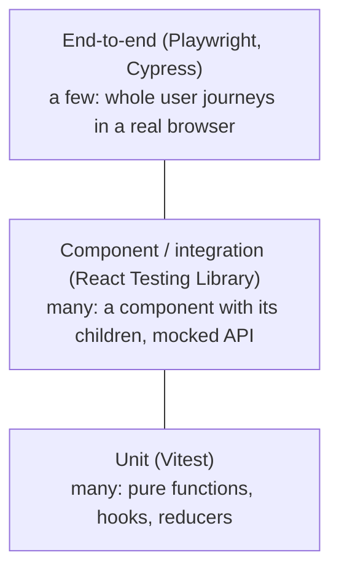

# Frontend 23 — Testing Frontend Code

> **You tested Spring Boot with JUnit, Mockito and Testcontainers. Frontend testing has the same ideas with different tools:** Vitest instead of JUnit, React Testing Library for components, MSW instead of mocking your HTTP client, and Playwright for the full browser. The guiding rule: test what the user sees and does, not how the code is written.

<!-- subtopic: f23_s1 -->
### The testing pyramid for frontend



| Level | Tests | Speed | Confidence |
|---|---|---|---|
| **Unit** | a function, a reducer, a formatter, a custom hook | milliseconds | narrow |
| **Component** | a component as the user uses it: render, click, type, check the screen | fast | good |
| **End-to-end** | the real app in a real browser, often against a real backend | seconds each | highest |

Many frontend teams use the "testing trophy" variation: **most tests at the component/integration level**, because that's where you get the most confidence per test. Plus **static checks** at the base, TypeScript and ESLint, which catch a whole class of bugs for free.

What to test first: critical user flows (log in, create a task, checkout), tricky logic (date maths, permissions, reducers), and anything that broke before (write the test that would have caught it).

<details>
<summary>Why do many frontend teams favour component/integration tests over unit tests?</summary>

They test components the way users use them, with their children and real interactions, so they catch far more real bugs per test, and they don't break when you refactor internals. Pure logic still gets unit tests, and a few end-to-end tests cover the critical journeys.
</details>

<!-- subtopic: f23_s2 -->
### Vitest for plain functions

**Vitest** is Vite's test runner, with a Jest-compatible API (so Jest examples work too):

```bash
npm install -D vitest
# package.json → "scripts": { "test": "vitest" }
npm test            # watch mode: re-runs affected tests on save
npx vitest run      # run once (CI)
```

```ts
// src/lib/tasks.ts
export function progress(tasks: { done: boolean }[]): number {
  if (tasks.length === 0) return 0;
  return Math.round((tasks.filter(t => t.done).length / tasks.length) * 100);
}
```

```ts
// src/lib/tasks.test.ts
import { describe, it, expect } from "vitest";
import { progress } from "./tasks";

describe("progress", () => {
  it("is 0 for no tasks", () => {
    expect(progress([])).toBe(0);
  });

  it("rounds to a whole percentage", () => {
    expect(progress([{ done: true }, { done: false }, { done: false }])).toBe(33);
  });

  it.each([
    [[{ done: true }], 100],
    [[{ done: false }], 0],
  ])("progress(%j) = %i", (tasks, expected) => {
    expect(progress(tasks)).toBe(expected);
  });
});
```

The same mental model as JUnit 5: `describe` ≈ a test class, `it`/`test` ≈ `@Test`, `expect(x).toBe(y)` ≈ `assertEquals(y, x)`, `it.each` ≈ `@ParameterizedTest`, `beforeEach` ≈ `@BeforeEach`.

Useful matchers: `toBe` (===), `toEqual` (deep equality for objects and arrays), `toContain`, `toThrow`, `toHaveBeenCalledWith`, `resolves`/`rejects` for promises. Mocks: `vi.fn()` (a spy function), `vi.mock("./api")` (replace a module), `vi.useFakeTimers()` (control `setTimeout`, perfect for testing debounce).

<details>
<summary>toBe vs toEqual?</summary>

`toBe` checks identity with `Object.is` (like ===): right for primitives. `toEqual` compares contents recursively: right for objects and arrays, which are different references even when equal.
</details>

<!-- subtopic: f23_s3 -->
### React Testing Library

**React Testing Library (RTL)** renders a component into a simulated DOM (jsdom) and lets you find things **the way a user would**: by role, label and text.

```bash
npm install -D @testing-library/react @testing-library/user-event @testing-library/jest-dom jsdom
# vitest config: test: { environment: "jsdom", setupFiles: "./src/setupTests.ts" }
# setupTests.ts: import "@testing-library/jest-dom/vitest";
```

```tsx
// AddTaskForm.test.tsx
import { render, screen } from "@testing-library/react";
import userEvent from "@testing-library/user-event";
import { vi, it, expect } from "vitest";
import { AddTaskForm } from "./AddTaskForm";

it("adds a task and clears the input", async () => {
  const user = userEvent.setup();
  const onAdd = vi.fn();
  render(<AddTaskForm onAdd={onAdd} />);

  const input = screen.getByRole("textbox", { name: /new task/i });
  await user.type(input, "Write tests");
  await user.click(screen.getByRole("button", { name: /add/i }));

  expect(onAdd).toHaveBeenCalledWith("Write tests");
  expect(input).toHaveValue("");
});

it("disables Add while the input is empty", () => {
  render(<AddTaskForm onAdd={vi.fn()} />);
  expect(screen.getByRole("button", { name: /add/i })).toBeDisabled();
});
```

Query priority (most to least preferred):

1. **`getByRole`** with a name: `getByRole("button", { name: "Save" })`. It's what assistive technology sees, so it also tests accessibility.
2. `getByLabelText`, `getByPlaceholderText`, `getByText`.
3. `getByTestId` (a `data-testid` attribute): last resort.

| Prefix | When nothing matches | Use for |
|---|---|---|
| `getBy…` | throws | things that must be there now |
| `queryBy…` | returns null | asserting something is **not** there |
| `findBy…` | waits (async), then throws | things that appear after loading |

Test **behaviour**, not implementation: don't check state variables or which hook was called. If you can refactor a component without changing what the user sees, its tests shouldn't break.

<details>
<summary>Why prefer getByRole over getByTestId?</summary>

getByRole finds elements the way users and screen readers do (a button named "Save"), so tests don't depend on implementation details and they fail if accessibility breaks. A test id is invisible to users and couples the test to markup.
</details>

<!-- subtopic: f23_s4 -->
### Mocking API calls with MSW

**Mock Service Worker (MSW)** intercepts requests at the **network level**, so your components and API client run their real code, only the "server" is fake. It's like WireMock for the frontend.

```bash
npm install -D msw
```

```ts
// src/test/server.ts
import { http, HttpResponse } from "msw";
import { setupServer } from "msw/node";

export const handlers = [
  http.get("*/api/tasks", () =>
    HttpResponse.json([{ id: 1, title: "Learn MSW", done: false }])),
  http.post("*/api/tasks", async ({ request }) => {
    const body = (await request.json()) as { title: string };
    return HttpResponse.json({ id: 2, title: body.title, done: false }, { status: 201 });
  }),
];
export const server = setupServer(...handlers);

// setupTests.ts
beforeAll(() => server.listen());
afterEach(() => server.resetHandlers());
afterAll(() => server.close());
```

```tsx
it("shows tasks from the API", async () => {
  render(<TaskList />, { wrapper: Providers });          // QueryClientProvider etc.
  expect(await screen.findByText("Learn MSW")).toBeInTheDocument();
});

it("shows an error when the API fails", async () => {
  server.use(http.get("*/api/tasks", () => new HttpResponse(null, { status: 500 })));   // override for one test
  render(<TaskList />, { wrapper: Providers });
  expect(await screen.findByRole("alert")).toHaveTextContent(/couldn't load/i);
});
```

The same handlers can run **in the browser during development** (`msw/browser`), so you can build the UI before the Spring endpoint exists, or demo error states on demand.

<details>
<summary>Why mock at the network level with MSW instead of mocking fetch or your API module?</summary>

Your real API client, error handling and data hooks run in the test, so the test exercises the code users actually run. The tests don't care whether you use fetch, axios or TanStack Query, so changing those doesn't break them.
</details>

<!-- subtopic: f23_s5 -->
### End-to-end tests with Playwright or Cypress

E2E tests drive a **real browser** through your **real app**:

```bash
npm init playwright@latest
npx playwright test           # headless, across Chromium, Firefox and WebKit
npx playwright test --ui      # watch it run, step by step
npx playwright codegen http://localhost:5173   # records your clicks into a test
```

```ts
// e2e/tasks.spec.ts
import { test, expect } from "@playwright/test";

test("a user can log in and add a task", async ({ page }) => {
  await page.goto("/login");
  await page.getByLabel("Email").fill("asha@example.com");
  await page.getByLabel("Password").fill("correct-horse");
  await page.getByRole("button", { name: "Log in" }).click();

  await expect(page).toHaveURL(/\/tasks/);
  await page.getByRole("textbox", { name: "New task" }).fill("Ship it");
  await page.getByRole("button", { name: "Add" }).click();
  await expect(page.getByText("Ship it")).toBeVisible();
});
```

Playwright **auto-waits** for elements to be ready, and its locators look like RTL's queries. **Cypress** is the other popular choice: a great interactive runner, its own command style.

E2E tests are slow and can be flaky, so keep them for the **critical journeys** (sign up, log in, the core create/edit flow, checkout) and run them in CI against a test environment, often with a seeded database or with Spring started in Testcontainers.

| | Component tests (RTL) | E2E (Playwright) |
|---|---|---|
| Runs in | jsdom (simulated) | a real browser |
| Backend | mocked (MSW) | real or a test instance |
| Speed | ms per test | seconds per test |
| Catches | component logic and UI states | integration: routing, auth, real API, CSS that hides a button |

<details>
<summary>What can an end-to-end test catch that component tests with MSW can't?</summary>

Problems between the real pieces: wrong API URLs or CORS settings, a mismatch between the frontend's expectations and the real backend response, routing and auth redirects, and real-browser issues like CSS making a button unclickable.
</details>

## 📝 Module 23 Recap

1. The three levels of frontend tests? → **unit, component/integration, end-to-end**
2. Where do many teams put most tests? → **component/integration tests**
3. Vitest's equivalents of @Test and assertEquals? → **it/test and expect(x).toBe(y)**
4. toBe vs toEqual? → **identity vs deep equality**
5. Preferred RTL query? → **getByRole with an accessible name**
6. getBy vs queryBy vs findBy? → **throws / returns null / waits asynchronously**
7. Test behaviour or implementation? → **behaviour: what the user sees and does**
8. What does MSW mock? → **the network, so real client code runs against a fake server**
9. What is Playwright for? → **end-to-end tests in real browsers**
10. Which flows deserve E2E tests? → **the critical journeys: login, core create/edit, checkout**
