# Frontend 24 — Web Performance and Accessibility

> **A fast page that everyone can use is part of the job, not an extra.** Google ranks pages partly on speed, slow pages lose users, and accessibility is a legal requirement in many countries. This module covers how speed is measured, the fixes that matter most, and accessibility beyond the basics in Module 2.

<!-- subtopic: f24_s1 -->
### Core Web Vitals and Lighthouse

Google's **Core Web Vitals** measure what users feel:

| Metric | Measures | Good | Typical causes when bad |
|---|---|---|---|
| **LCP**, Largest Contentful Paint | when the main content (hero image, headline) appears | ≤ 2.5 s | slow server, big images, render-blocking CSS/JS, client-side-only rendering |
| **INP**, Interaction to Next Paint | how quickly the page responds to clicks and typing | ≤ 200 ms | long JavaScript tasks blocking the main thread, heavy re-renders |
| **CLS**, Cumulative Layout Shift | how much content jumps around while loading | ≤ 0.1 | images without width/height, ads or banners inserted above content, late-loading fonts |

(INP replaced the older FID metric in 2024.) Other numbers you'll see: **TTFB** (time to first byte from the server) and **FCP** (first contentful paint).

How to measure:

- **Lighthouse** (DevTools → Lighthouse tab): a lab test scoring Performance, Accessibility, Best Practices and SEO, with specific suggestions. Run it on a **production build**, in an incognito window, with mobile throttling.
- **PageSpeed Insights**: Lighthouse plus **real-user data** from Chrome users (the field data Google actually ranks on).
- **The Performance tab**: a timeline of everything the main thread did, with long tasks marked in red.
- In code: the `web-vitals` library reports real users' metrics to your analytics.

<details>
<summary>Users say the page "jumps" while it loads. Which metric is that, and the usual fixes?</summary>

CLS (Cumulative Layout Shift). Give images and videos width and height (or aspect-ratio), reserve space for ads, banners and late content, and load fonts so text doesn't reflow badly (font-display and matching fallbacks).
</details>

<!-- subtopic: f24_s2 -->
### Loading faster

The biggest wins, roughly in order of impact:

**1. Images** (often most of a page's bytes):

```html
                         <!-- the LCP image: load it first -->

   <!-- below the fold: load later -->
```

Modern formats (WebP, AVIF), the right size for the screen (`srcset`), `loading="lazy"` for off-screen images, and never lazy-load the main hero image.

**2. Less JavaScript**: code splitting by route (Module 21), checking the bundle for huge dependencies (a date library pulling in every locale), importing only what you use, deferring third-party scripts (chat widgets, analytics).

**3. Caching**: build tools give files content hashes (`index-a1b2c3.js`), so they can be cached "forever":

```text
Cache-Control: public, max-age=31536000, immutable     ← hashed JS/CSS/images
Cache-Control: no-cache                                 ← index.html: always check for a new version
```

**4. A CDN**: serve static files from servers near the user (Vercel, Netlify and CloudFront do this). Plus compression (Brotli/gzip) and HTTP/2 or HTTP/3.

**5. Fewer round trips**: `<link rel="preconnect" href="https://api.mytasks.com">` to open the API connection early; `<link rel="preload">` for a critical font.

**6. API data**: show cached data instantly (TanStack Query), fetch in parallel (`Promise.all`), paginate instead of loading everything, and render a skeleton instead of a blank page.

<details>
<summary>Should the main hero image use loading="lazy"?</summary>

No. It's usually the LCP element, so lazy-loading it delays the most important paint. Load it eagerly, ideally with fetchpriority="high"; lazy-load only images below the fold.
</details>

<!-- subtopic: f24_s3 -->
### The critical rendering path: render-blocking CSS and JS

The browser can't paint until it has the HTML, **all the CSS** for the page, and has run any **blocking scripts** (Module 1). Those resources are on the **critical rendering path**.

How scripts load:

| Tag | Downloads | Runs | Order kept? |
|---|---|---|---|
| `<script src>` | blocks HTML parsing | immediately | yes |
| `<script defer src>` | in parallel | after HTML is parsed, before DOMContentLoaded | yes |
| `<script async src>` | in parallel | as soon as it's downloaded (pauses parsing then) | no |
| `<script type="module">` | in parallel | deferred by default | yes |



```mermaid
gantt
    dateFormat X
    axisFormat %s
    section plain script
    parse HTML      :a1, 0, 3
    download + run  :crit, a2, 3, 6
    parse rest      :a3, 6, 9
    section defer
    parse HTML      :b1, 0, 6
    download        :b2, 1, 4
    run             :b3, 6, 7
    section async
    parse HTML      :c1, 0, 4
    download        :c2, 1, 4
    run (pauses parsing) :crit, c3, 4, 5
    parse rest      :c4, 5, 7
```

Rules of thumb:

- **App scripts: `defer`** (or modules, which Vite produces). They keep their order and never block parsing.
- **Independent third-party scripts** (analytics): `async`.
- **CSS is render-blocking by design** (otherwise you'd see unstyled content flash). Keep it small, inline the critical CSS for the first screen if needed, and split the rest.
- **Fonts**: `font-display: swap` shows fallback text immediately instead of invisible text.

<details>
<summary>defer vs async?</summary>

Both download without blocking parsing. defer scripts run in order after the HTML is parsed; async scripts run as soon as each one finishes downloading, in any order, pausing parsing when they do. Use defer for your app code, async for independent scripts like analytics.
</details>

<!-- subtopic: f24_s4 -->
### Accessibility in practice

The standard is **WCAG** (Web Content Accessibility Guidelines); most companies aim for level **AA**. What it means day to day:

**Keyboard**: every action must work without a mouse.

- Use real `button`, `a`, `input` elements: they're focusable and work with Enter/Space.
- Never remove the focus outline without replacing it: `:focus-visible { outline: 3px solid #2563eb; }`.
- Tab order follows the DOM order, so keep the DOM in a logical order (don't reorder visually with CSS).
- A "Skip to main content" link at the top helps keyboard users bypass the navigation.

**Focus management** in single-page apps:

- When a **modal** opens, move focus into it, **trap** Tab inside it, close it on Escape, and return focus to the button that opened it (the native `dialog` element with `showModal()` does most of this).
- After a route change, move focus to the new page's heading so screen-reader users know something changed.

**Visual**:

- **Contrast**: at least 4.5:1 for normal text, 3:1 for large text (DevTools shows the ratio when you inspect a colour).
- Don't rely on colour alone: an error says "Error" and has an icon, not just red text.
- Text can be zoomed to 200% without breaking the layout (use `rem`, Module 3).
- Respect `prefers-reduced-motion` for big animations.

**Screen readers** (NVDA on Windows, VoiceOver on Mac/iPhone, TalkBack on Android) read the **accessibility tree**: roles, names and states built from your HTML. Try VoiceOver or NVDA on your own app for ten minutes; it's eye-opening.

**Tools**: Lighthouse's accessibility score, the axe DevTools extension, `eslint-plugin-jsx-a11y`, and RTL's role-based queries (Module 23), which fail when elements aren't accessible.

<details>
<summary>What four things should happen when a modal dialog opens and closes, for keyboard users?</summary>

Focus moves into the dialog when it opens, Tab stays trapped inside it, Escape closes it, and when it closes focus returns to the element that opened it. The native dialog element with showModal() handles most of this.
</details>

<!-- subtopic: f24_s5 -->
### ARIA: when you need it

**ARIA** attributes add roles, names and states to the accessibility tree when HTML alone can't express them.

**The first rule of ARIA: don't use ARIA if a native element does the job.** A `button` already has `role="button"`, focus, and keyboard handling; `div role="button"` has only the role.

When you do need it:

```html
<!-- Name an icon-only button -->
<button aria-label="Delete task">🗑️</button>

<!-- Describe extra help text -->
<input id="pw" type="password" aria-describedby="pw-help">
<p id="pw-help">At least 8 characters.</p>

<!-- State of a disclosure / menu button -->
<button aria-expanded="false" aria-controls="filters">Filters</button>
<div id="filters" hidden>…</div>

<!-- Announce changes that happen without focus moving (toasts, async results) -->
<div aria-live="polite">3 results found</div>
<p role="alert">Couldn't save the task.</p>          <!-- assertive: announced immediately -->

<!-- Mark invalid fields -->
<input aria-invalid="true" aria-describedby="title-error">

<!-- Hide decoration from screen readers -->
<span aria-hidden="true">★</span>
```

| Need | Use |
|---|---|
| an accessible name for an icon button | `aria-label` (or visible text) |
| link a field to help or error text | `aria-describedby` |
| open/closed state | `aria-expanded` |
| current page in navigation | `aria-current="page"` |
| live updates | `aria-live="polite"`, or `role="alert"` for urgent ones |
| hide decorative content | `aria-hidden="true"` |

Complex widgets (tabs, comboboxes, menus, trees) need specific roles and keyboard behaviour; follow the **WAI-ARIA Authoring Practices** patterns, or use a library that implements them (Radix UI, React Aria, Headless UI) rather than building from scratch.

Bad ARIA is worse than none: `aria-hidden="true"` on a focusable element, or `role="button"` without keyboard support, makes things harder for screen-reader users.

<details>
<summary>An async search shows "5 results" but screen-reader users never hear it. How do you fix that?</summary>

Put the result count in an aria-live="polite" region (present in the DOM before the text changes). Screen readers announce changes to live regions even though focus didn't move.
</details>

## 📝 Module 24 Recap

1. The three Core Web Vitals? → **LCP (loading), INP (responsiveness), CLS (visual stability)**
2. Good LCP? → **2.5 seconds or less**
3. How do you prevent layout shift from images? → **set width and height (or aspect-ratio)**
4. Lazy-load the hero image? → **no; lazy-load only images below the fold**
5. How should hashed JS files be cached? → **for a year, immutable; index.html with no-cache**
6. defer vs async? → **defer runs in order after parsing; async runs whenever it's downloaded**
7. Is CSS render-blocking? → **yes, by design; keep critical CSS small**
8. Minimum contrast for normal text (AA)? → **4.5:1**
9. First rule of ARIA? → **use a native HTML element if one does the job**
10. How do you announce async updates? → **an aria-live region or role="alert"**
